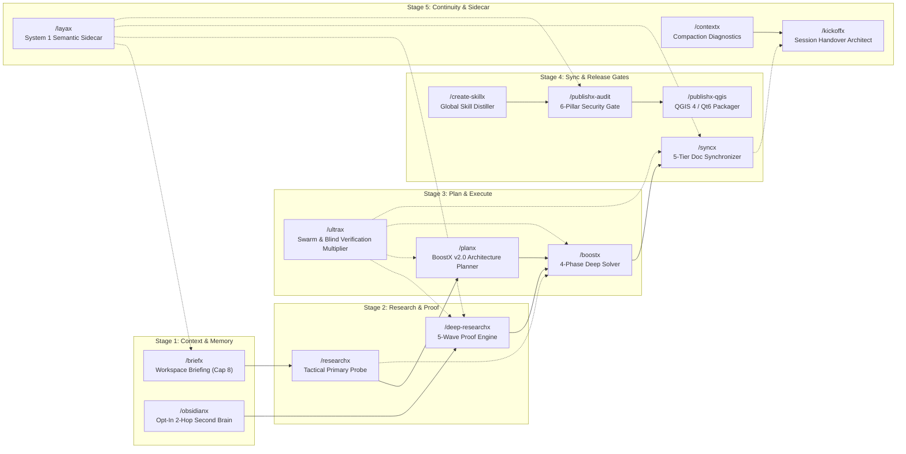
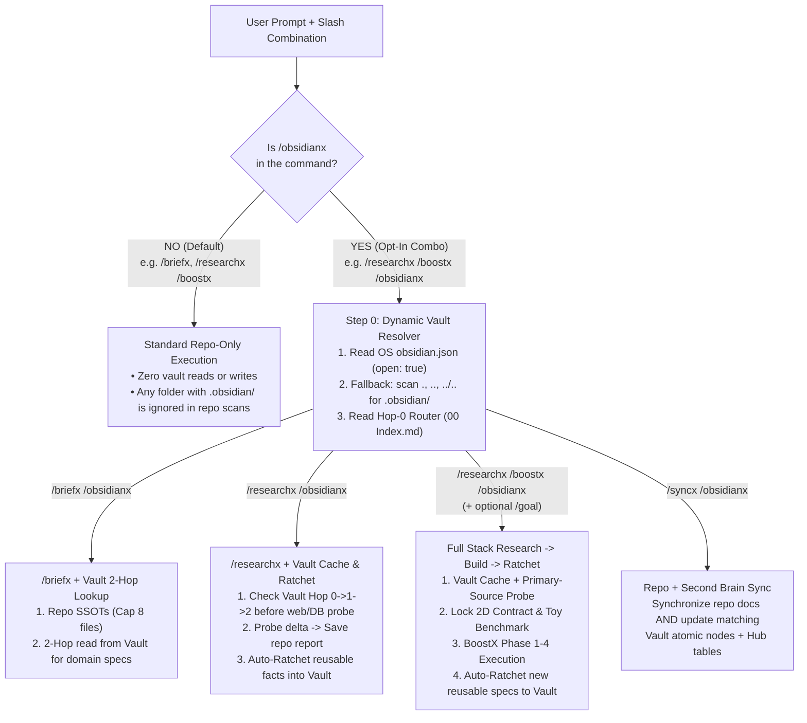
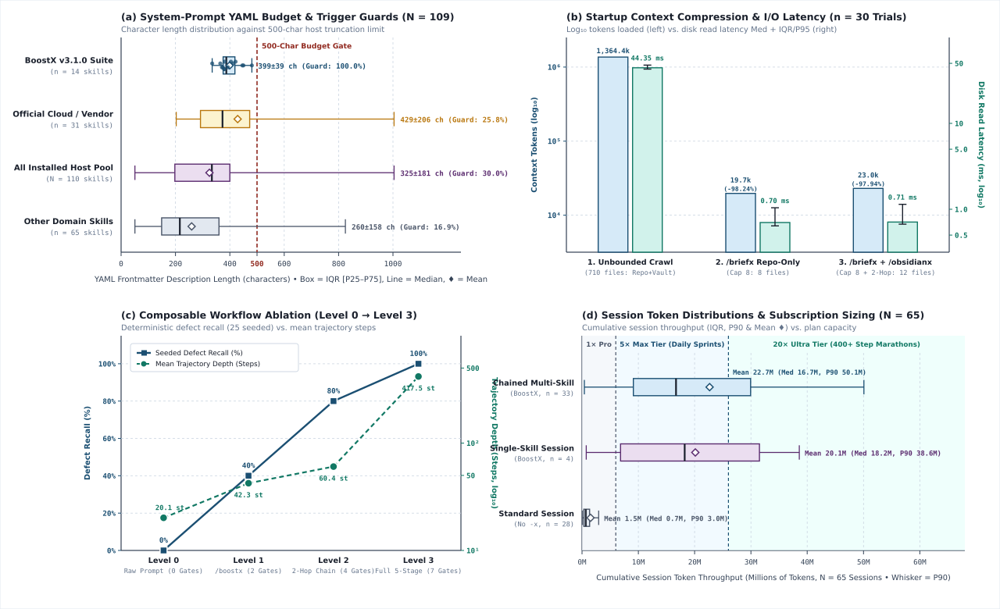

# BoostX: Composable Agent Skills Ecosystem

[](LICENSE)
[](https://github.com/iscvlab/boostx/releases/tag/v3.1.0)
[](#-the-14-skill-suite)
[](#-universal-installation)
[](#-portable-by-design)
[](#-bundled-zero-dependency-cli-engines)

> **A unified, composable `-x` skill ecosystem and verification harness for AI coding agents.**  
> Fourteen portable `SKILL.md` protocols and seven zero-dependency Python CLI engines that run identically across **Claude Code, Grok, Google Gemini / Antigravity, Cursor, and Codex** on **Windows, macOS, and Linux**.

Sister toolkit: **[mcp-bridges](https://github.com/iscvlab/mcp-bridges)** (Model Context Protocol automation bridges for QGIS, Rhino 3D, Grasshopper, Adobe Illustrator, and Figma).

---

## 1. Master Ecosystem Architecture

BoostX organizes software engineering, scientific research, spatial/physics simulation, and documentation governance into **five deterministic lifecycle stages** plus **cross-stage System 1 semantic & multi-agent swarm multipliers** across **14 composable `-x` skills**:

<p align="center">
  
</p>

<details>
<summary><b>View Mermaid Architecture Source</b></summary>



</details>

---

## 2. Composable Slash-Command Grammar & Opt-In Second Brain

Every skill in BoostX is designed to work either **standalone** or **chained left-to-right** in a single prompt:

```text
[Stage 1: Context]  →  [Stage 2: Research]  →  [Stage 3: Plan / Execute]  →  [Stage 4: Sync]  +  [Modifiers / Sidecars]
     /briefx        →      /researchx       →     /planx  or  /boostx     →      /syncx       +  /obsidianx /layax /ultrax /goal
```

### Strict Opt-In Second Brain Isolation (`/obsidianx`)

By default, all skills operate in **100% Repo-Only Mode** and ignore any directory containing an `.obsidian/` subfolder. The 2-Hop Obsidian Second Brain and Knowledge Ratchet activate **only** when `/obsidianx` is explicitly included in the command chain:

<p align="center">
  
</p>

<details>
<summary><b>View Mermaid Routing Source</b></summary>



</details>

### High-Leverage Command Combinations

| Command Chain | Execution Pipeline | Best Used When |
|:---|:---|:---|
| `/briefx <task>` | Load up to 8 authoritative repo docs (`Pass A` skeleton → `Pass B` deep read) → execute `<task>` | Starting a feature or fix inside an unfamiliar or multi-doc repository |
| `/briefx /obsidianx <task>` | Load repo SSOTs (cap 8) + 2-Hop lookup in active Obsidian vault → execute `<task>` | Pulling cross-project architectural rules or domain constants into the current task |
| `/researchx /boostx <task>` | Primary-source SDK/DB/AST probe → lock 2D Goal Contract → Red-Green-Verify build | Implementing a technical feature or solver that depends on exact API/physics specs |
| `/researchx /boostx /obsidianx` | Vault 2-Hop cache check → probe missing delta → BoostX 4-phase build → Auto-Ratchet new specs into Vault | Compounding reusable engineering or scientific knowledge while shipping production code |
| `/deep-researchx /boostx /goal` | 5-wave multi-agent harvest + `verify_evidence.py` audit → full-stack implementation until 100% milestone completion | Long-running, multi-milestone research-to-production engineering sprints |
| `/boostx /ultrax <task>` | Dynamic `N × K` topology sizer (`Best-of-3` Tournament or `N+2` Partitioned Batch with Pre-Locked Shared Seam Header) + `Maker ≠ Checker` Blind Adversarial Critic & Red-Team Breaker | High-stakes algorithms, multi-module sprints, or parallel UI/diagram candidate tournaments on `5×`/`20×` tiers |
| `/planx <task>` | 2D Plan Contract → Ponytail × Deep Module Vector A/B/C → `implementation_plan.md` with Inline Grilling Matrix & Red → Green table → halt for approval | Stress-testing architectural decisions and edge cases before writing a single line of code |
| `/syncx /layax` | Fast System 1 `noul` semantic contradiction triage + `audit_workspace_docs.py` + 5-tier inner-to-outer doc sync | Catching semantic contradictions across markdown/HTML docs alongside deterministic regex/link audits |
| `/syncx /obsidianx` | 5-tier inner-to-outer repo doc sync + update matching atomic notes and Hub tables in the Obsidian vault | Keeping both repository documentation and long-term knowledge graphs 100% synchronized |
| `/publishx-audit` → `/publishx-qgis` | Run 6-pillar security/AST/Flake8/skill audit (`audit_engine.py`), then build Qt6-verified single-root QGIS zip | Releasing open-source packages to GitHub, `plugins.qgis.org`, or Food4Rhino |
| `/contextx` → `/kickoffx` | Diagnose transcript compaction health (`check_context.py`) → run pre-handover `/syncx` → generate task-smart fresh session prompt | Transitioning cleanly to a fresh chat window before context degradation or timeouts occur |

---

## 3. The 14-Skill Suite

```text
boostx/skills/
├── /boostx           2D Task × Project goal synthesis, Physics Triad & 4-phase red-green solver
├── /briefx           4-tier authority hierarchy, two-pass structural reading & invariant loading
├── /contextx         transcript compaction diagnostics, cross-platform token telemetry & drift scorecard
├── /create-skillx    author, distill & globalize portable SKILL.md files with ≤ 350-char budget guard
├── /deep-researchx   5-wave multi-agent deep research, blind adversarial audit & 100%-proof engine
├── /kickoffx         end-of-session sync check, task-smart command selector & handover prompt
├── /layax            System 1 fast semantic decision, section shortlisting & conflict triage sidecar
├── /obsidianx        opt-in 2-hop Obsidian Second Brain router, cross-domain bridges & auto-ratchet
├── /planx            BoostX v2.0 architecture planner with Vector A/B/C & inline grilling matrix
├── /publishx-audit   6-pillar secret, Python AST, Flake8, platform & skill globalization audit gate
├── /publishx-qgis    QGIS 4 / Qt6 scoped enum AST checker & deterministic single-root zip packager
├── /researchx        tactical primary-source research, local SDK/DB/binary probe & architecture study
├── /syncx            5-tier cross-document sync, SHA-256 mirror auditor & zero-stale ledger
└── /ultrax           dynamic topology-matched multi-agent swarm & Maker ≠ Checker blind verification multiplier
```

### Stage 1: Context, Triage & Memory

| Skill | Command (Legacy Aliases) | Core Architecture & Protocol | Failure Modes Prevented |
|:---|:---|:---|:---|
| **BriefX** | `/briefx` (`/brief`) | Discovers related markdown in the active repository via a **4-tier authority hierarchy** (hard-capped at 8 files), applies **Two-Pass reading** (`Pass A` structural skeleton/cardinality scan before `Pass B` targeted section reading), verifies frozen/deferred boundaries, and executes `/briefx <task>` in the same turn. | Answering from stale LLM memory, keyword-grep tunneling without knowing total section counts, or modifying frozen modules. |
| **ObsidianX** | `/obsidianx` (`/obsidian-vault`) | **Dynamic Vault Resolver** reads OS `obsidian.json` (`open: true`) or parent directories with zero hardcoded paths. Enforces the **2-Hop Navigation Rule** (`00 Index.md` → `Hub - <Domain>.md` → Atomic Note), requires **Cross-Domain Bridges** (`## Cross-Domain Connections`), and runs a **4-Check Graph Verification** (`0` broken wikilinks, `0` orphans, `100%` frontmatter, `0` duplicate concepts). | Dumping 50+ markdown notes into context, hardcoded vault paths breaking across PCs, or polluting vaults with transient repo tasks. |
| **Layax** | `/layax` (`/laya`) | **System 1 Semantic Decision & Triage Sidecar** (`scripts/laya_triage.py`) powered by `convaiinnovations/laya` (~7–33 ms single-pass inference). Provides fence-safe heading chunking (`≤ 1,200` chars / `#L<start>-L<end>`), auto-routed English/multilingual checkpoints (`laya.is_english`), categorical routing (`choice`), ordinal rubric evaluation (`score`), and calibrated contradiction testing (`noul`) with 100% graceful fallback to native tools when `laya` is not installed. | Silent 512-token truncation, burning thousands of LLM tokens on large-corpus section shortlisting, or missing subtle semantic contradictions between docs. |

### Stage 2: Research & Proof

| Skill | Command (Legacy Aliases) | Core Architecture & Protocol | Failure Modes Prevented |
|:---|:---|:---|:---|
| **ResearchX** | `/researchx` | Tactical primary-source counterpart to `/boostx`. Routes across **3 execution tiers** (inline probe `≤ 2` sources, single isolated scout, or parallel multi-angle swarm) and enforces a **4-tier primary-source authority ladder**: (1) local pinned manifests/SQLite/AST probes first, (2) version-matched official docs, (3) upstream source/tests, (4) peer-reviewed standards. | Secondary-blog guesswork, researching the wrong SDK version, or read-only subagent write deadlocks. |
| **Deep-ResearchX** | `/deep-researchx` (`/deep-research`) | Universal **5-Wave Multi-Agent Deep Research Engine**: (1) 2D `Intent × Domain` contract synthesis, (2) parallel Harvester scouts with mandatory deep-link scraping, (3) **Blind Adversarial Auditor** + deterministic `scripts/verify_evidence.py` CLI gate with **Wave 3.5 Prune & Replace Loop**, (4) `[VERIFIED FACT]` vs `[RECOMMENDED SYNTHESIS]` binding, and (5) `/boostx` handoff. | Search-snippet hallucinations, conflating construction completion vs policy dates, bare root-domain lazy URLs, and fabricated citations. |

### Stage 3: Planning & Deep Execution

| Skill | Command (Legacy Aliases) | Core Architecture & Protocol | Failure Modes Prevented |
|:---|:---|:---|:---|
| **PlanX** | `/planx` (`/plan`) | **BoostX v2.0 Architectural Planner**. Locks a **2D Plan Contract (`Scope × Risk`)**, runs blast-radius & invariant discovery, evaluates **Ponytail × Deep Module Vectors A/B/C** (`Vector A (Recommended): Zero-New-File / Stdlib Seam`), embeds an **Inline Grilling Decision Matrix** (`DEC-01..N`) and **Red → Green Verification Matrix** inside `implementation_plan.md` with zero chat Q&A spam, and halts for user approval. | Jumping straight into code on underspecified requirements, noisy chat Q&A walls, or over-engineered multi-file abstractions. |
| **BoostX** | `/boostx` | Flagship **4-Phase Engineering & Simulation Solver**: (1) **2D `Task × Project` Goal Contract** & **Tri-Track Signal Gate** (Track A bug repro, Track B greenfield probe, Track C **Simulation Physics Triad**: SI unit bridge, CFL stability cap, zero-load identity check), (2) **Ponytail × Deep Module Ladder** (`YAGNI → Reuse → Stdlib → Deep Seam → Shortest Diff`), (3) **Universal Parity** (Dual-OS + OneDrive + IDE/CLI), (4) **3-Tier Verification** (Before proof, After/Mutation proof, Bloat & Anti-Hardcode sweep). | Speculative blind fixes, shallow pass-through wrapper bloat, numerical `NaN`/`Inf` blowups in CAD/CFD solvers, and machine-bound paths. |
| **UltraX** | `/ultrax` (`/ultra`) | **Dynamic Topology-Matched Multi-Agent Swarm & Blind Verification Multiplier**. Normalizes any multi-skill combo into the **Canonical Stage DAG** (`RETRIEVE → RESEARCH → PLAN → BUILD → AUDIT/SYNC → RATCHET → VERIFY`), routes through the **Dynamic `N × K` Topology Sizer** (`Archetype 1: 3+2 Best-of-3 Tournament`, `Archetype 2: N+2 Partitioned Batch` with `≤ 3` items/agent cap & **Pre-Locked Shared Seam Header**, `Archetype 3: Multi-Wave DAG`), enforces **Build-Lock Serialization**, **`Maker ≠ Checker` Zero-Trust Critic + Red-Team Breaker**, and **`≤ 150-Word` Caveman Receipt** returns. | Fixed-count subagent waste on trivial tasks, multi-agent file-write race conditions, cross-partition interface drift, and self-grading confirmation bias. |

### Stage 4: Synchronization & Release Gates

| Skill | Command (Legacy Aliases) | Core Architecture & Protocol | Failure Modes Prevented |
|:---|:---|:---|:---|
| **SyncX** | `/syncx` (`/update-doc`, `/doc-sync`, `/audit-docs`) | Exhaustive multi-file synchronizer with bundled `scripts/audit_workspace_docs.py`. Applies a **4-Level Conflict Arbitration Hierarchy** (`Level 1: Code/Data Receipts > Level 2: Canonical SSOT > Level 3: Session User Lock > Level 4: Drafts`), verifies relative links, Zero-LaTeX compliance, SHA-256 mirror parity, and `--deprecated` sweeps across **Tiers 1-5**, and outputs a verified **Synchronization Ledger**. | Touching 1-2 surface files while leaving stale numbers elsewhere, propagating unverified metrics, or breaking HTML slide/card counters. |
| **Create-SkillX** | `/create-skillx` (`/create-skill`) | **4-Step Cognitive Distillation Protocol** for authoring agent skills: (1) Universal Globalization into `~/.gemini/config/skills/<name>/`, (2) **Context Budget Guard** (`≤ 350 chars` YAML description with explicit `Use when...` and `Do NOT use for...` triggers so host IDEs never drop sibling skills), (3) progressive disclosure into `references/` and `scripts/`, and (4) mandatory `--platform skill` audit. | Workspace-siloed skills invisible to other projects, bloated frontmatter descriptions that overflow system prompts, and unverified helper scripts. |
| **PublishX-Audit** | `/publishx-audit` (`/publish-audit`) | **6-Pillar Pre-Flight Release Gate** (`scripts/audit_engine.py`) supporting `generic`, `github`, `qgis`, `food4rhino`, and `skill` profiles. Scans 16 high-entropy secret patterns, hardcoded user paths (`C:\Users\...`, `/Users/...`), Python AST security risks (`eval`, `shell=True`, `pickle`), Flake8 compliance, and platform-specific package invariants. | Leaked API keys, developer username leaks in committed files, shell injection vulnerabilities, and broken skill frontmatter. |
| **PublishX-QGIS** | `/publishx-qgis` (`/publish-qgis`) | **5-Gate Deterministic QGIS Release Packager** (`scripts/package_qgis.py` + `scripts/check_qt6.py`). Enforces `metadata.txt` INI `%` escaping, `classFactory(iface)` verification, **Qt6 / QGIS 4 scoped enum AST checks** (earning the official *QGIS 4 Ready* badge), pure runtime file filtering, SemVer bumping, and fixed-epoch `(2026, 1, 1)` single-root ZIP creation. | `plugins.qgis.org` server `InterpolationSyntaxError`, Qt5 unscoped enum crashes in QGIS 4, and top-level ZIP folder mismatches. |

### Stage 5: Session Continuity

| Skill | Command (Legacy Aliases) | Core Architecture & Protocol | Failure Modes Prevented |
|:---|:---|:---|:---|
| **ContextX** | `/contextx` (`/context`) | Runs `scripts/check_context.py` against the active IDE conversation transcript (`transcript.jsonl`) and SQLite step logs (`conversations/*.db`), filtering out isolated subagent logs, reporting **Session & Cross-Platform Token Telemetry** (`--tokens`, `--days N`, `--all-time` across Antigravity 2.0, IDE, and CLI), and evaluating a **2D Health Rubric (`Compaction Round × Active Window Pressure %`)** across strict `CHECKPOINT` boundaries (`🟢 HEALTHY`, `🟡 NOMINAL`, `🟠 CAUTION`, `🔴 CRITICAL`). | Continuing complex edits after multi-pass compactions, subagent transcript hijacking, or invisible cross-platform token usage. |
| **KickoffX** | `/kickoffx` (`/kickoff`) | End-of-session handover protocol. Runs a pre-handover `/syncx` verification check, presents a structured **Next-Step Options Table** (`Option A Recommended`, `Option B`, `Option C`), applies the **Task-Smart Recommended Command Selector** (auto-routing `/layax` only for large-corpus/audit tasks), and generates a **self-contained copy-pasteable Kickoff Prompt**. | Starting a fresh conversation with vague context, losing mid-session decisions, or leaving unsynchronized documentation behind. |

---

## 4. Deep-Dive Engineering Pillars

### 4.1 2D Goal Contract & Simulation Physics Triad (`/boostx`)

Before touching code on non-trivial tasks, `/boostx` locks a **2D Goal Contract** crossing **6 Task Archetypes** (`DEBUG/RCA`, `BUILD/FEATURE`, `SIMULATE/SOLVER`, `REFACTOR/SIMPLIFY`, `OPTIMIZE/SCALE`, `AUDIT/PLAN/SHIP`) with **5 Project Verification Harnesses** (`CAD/Rhino/GH`, `GIS/QGIS`, `Web UI/Figma`, `Data/GCP/ML`, `Agent Skills/CLI`).

For numerical, spatial, and multi-physics solvers (`SIMULATE / SOLVER`), `/boostx` enforces the **Physics Triad**:
1. **Dimensional & Unit Bridge**: Explicit conversion between CAD model units (`mm`, `cm`, `m`, `ft`) and SI solver equations (`m`, `s`, `kg`, `K`, `W/m²`), plus explicit CRS alignment (`EPSG:4326` ↔ metric UTM).
2. **Stability, Bounds & Conservation**: Explicit Courant-Friedrichs-Lewy (CFL) / timestep caps (`dt ≤ C_max · dx / |v|`), physical clamping (`albedo ∈ [0, 1]`, `SVF ∈ [0, 1]`), and zero-`NaN`/`Inf` output assertions.
3. **Zero-Load Identity & 1D Analytical Toy Benchmark**: Verifies zero-input equilibrium and benchmarks the solver on a 3-node or 10×10 analytical grid before scaling to full 3D site meshes.

### 4.2 5-Wave Adversarial Fact Auditing (`/deep-researchx`)

Standard LLM web research frequently hallucinates metrics from search snippets or cites bare homepage domains. `/deep-researchx` separates **harvesting** from **verification**:
- **Wave 1 (2D Contract)**: Locks domain axes, minimum record quotas, and disambiguation rules (e.g., separating construction completion year from policy adoption year).
- **Wave 2 (Harvester Swarm)**: Parallel scouts scrape full page bodies and deep links.
- **Wave 3 & 3.5 (Blind Adversarial Audit + Prune & Replace)**: An independent auditor runs `scripts/verify_evidence.py` to reject `[TBD]` placeholders, root-domain URLs, and schema violations, triggering replacement harvesting until the quota is 100% verified.
- **Wave 4 (100%-Proof Synthesis)**: Every claim is explicitly tagged as `[VERIFIED FACT]` (backed by a primary receipt) or `[RECOMMENDED SYNTHESIS]` (engineering inference).

### 4.3 Public Claim Vocabulary (`/syncx` & `/publishx-audit`)

Both `/syncx` and `/publishx-audit` enforce five canonical status terms across all public READMEs and portfolios:
- **LIVE**: Publicly installable, downloadable, or accessible via URL right now.
- **REGISTERED**: Registered on an official portal; public version or review pending.
- **PREPARED**: Built and verified locally; public release package ready next.
- **IN PIPELINE**: Scheduled next in the active engineering roadmap.
- **DRAFT**: Internal working specification.

### 4.4 Empirical Benchmark & Token Economics ([`benchmarks/BENCHMARK_REPORT.md`](benchmarks/BENCHMARK_REPORT.md))

Reproducible multi-trial measurements (`3` warm-ups + `20–30` timed iterations via [`benchmarks/run_boostx_benchmark.py`](benchmarks/run_boostx_benchmark.py)) across `110` installed skills, `778` repository/vault markdown files (`583`-node Obsidian Second Brain), `25` seeded red-team defects, and `80` real IDE sessions (`623` prompt turns):

| Benchmark Dimension | Unstructured / Prompt-Only Baseline | `BoostX v3.1.0` Composable Suite | Empirical Delta & Receipt |
|:---|:---|:---|:---|
| **1. System-Prompt Discovery Guard** | `74.2%` `≤ 500`-char pass • `25.8%` dual triggers *(Official Cloud/Vendor cohort, `N=31`)* | **`399.4 ± 39.2` chars** (`100%` `≤ 500`-char pass • `100%` `Use when` + `Do NOT use` guards across all `14` skills) | **`0%` Sibling Skill Truncation** |
| **2. Briefing & Vault Context Compression** | `778` files (`1,364,405` tokens in Median `44.35 ms`) | **`/briefx` (`Cap 8`) + `/obsidianx` (`2-Hop = 4` files) = `22,982` tokens** in **`0.71 ms`** | **`-98.32%` Context Noise (`59.4×` Compression)** |
| **3. System 1 `/layax` Section Triage** | Full-corpus read (`86,092` tokens across `21` specs / `429` chunks) | **Top-5 `#L<start>-L<end>` sections (`1,344` tokens) in Median `10.81 ms`** (`39,686` chunks/sec) | **`-98.44%` Pass-B Reading Tokens** |
| **4. 25-Defect Red-Team Catch Rate** | `0 / 25` (`0.0%` deterministic pre-LLM enforcement) | **`25 / 25` (`100.0%` Recall • `100.0%` Precision • `0` False Positives)** in **Median `6.94 ms`** | **7 Stdlib CLI Gates (`3,403` LOC)** |
| **5. Real Turn & Session Token Depth** | `20.1` steps/turn (`11.7k` new input • `7.2k` output • `1.01M` total/turn) | **`60.4` steps/turn (`3.00×`)** • **`70.3k` new input (`6.03×`)** • **`24.8k` output (`3.43×`)** • **`22.67M` tok/session (`14.93×`)** | **Recommended: `5×` Max (Sprints) / `20×` Ultra (Swarms & Marathons)** |

> **Transparency on Token Consumption**: BoostX reduces low-value file-scanning noise by **`98.32%`**, then deliberately invests that freed context capacity into **`3.00×` more verification steps** and **`6.03×` more primary-source & CLI telemetry inputs** per chained turn. While single-skill runs work comfortably on `1×` Pro plans, daily chained workflows (`/briefx /researchx /boostx /syncx /obsidianx`) are best paired with **`5×` High-Throughput tiers** (Claude Max `5×`, Gemini `5×`), and `400+`-step autonomous `/goal` marathons or `/ultrax` / `/deep-researchx` multi-agent swarms are engineered for **`20×` Ultra tiers** (Gemini Ultra `20×`, Claude Max `20×`).

<p align="center">
  
</p>

| Academic Evaluation Figure | Empirical Scope & Statistical Protocol |
|:---|:---|
| [`docs/assets/boostx-benchmark-summary.svg`](docs/assets/boostx-benchmark-summary.svg) | **Composite Summary (Panels a–d)** — System-prompt character distributions (`N=110`), log-scale context compression (`n=30`), composable workflow ablation (`Level 0 → Level 3`), and session token throughput (`N=80`). |
| [`docs/assets/fig1_discovery_distribution.svg`](docs/assets/fig1_discovery_distribution.svg) | **Figure 1 (Experiment 1)** — YAML frontmatter character boxplots (`Min / IQR / Max / Median / Mean ♦`) and `≤ 500`-char budget pass vs. explicit dual trigger guard compliance (`100.0%` vs. `25.8%` vendor baseline). |
| [`docs/assets/fig2_compression_latency.svg`](docs/assets/fig2_compression_latency.svg) | **Figure 2 (Experiments 2 & 3)** — Log₁₀ context token volume & disk read latency (`0.71 ms`, `-98.32%` noise) alongside `/layax` System 1 section shortlisting (`-98.44%` tokens, Median `10.81 ms` across `n=30` trials). |
| [`docs/assets/fig3_ablation_redteam.svg`](docs/assets/fig3_ablation_redteam.svg) | **Figure 3 (Experiments 4 & 5)** — `25`-defect red-team injection recall (`25/25 = 100.0%`, `0` false positives, Median `6.94 ms`) and progressive workflow ablation across `0 → 7` deterministic CLI gates. |
| [`docs/assets/fig4_token_distributions.svg`](docs/assets/fig4_token_distributions.svg) | **Figure 4 (Experiment 6)** — Per-turn token component quantiles (`N=623` turns on log₁₀ scale) and cumulative session throughput (`N=80` sessions) mapped to `1×` Pro, `5×` Max, and `20×` Ultra subscription tiers. |

---

## 5. Bundled Zero-Dependency CLI Engines

All seven bundled Python CLI scripts run on **Python 3.8+ standard library** (`ast`, `re`, `json`, `zipfile`, `urllib`, `configparser`, `hashlib`, `pathlib`, with optional `laya` neural acceleration in `laya_triage.py`) with UTF-8 stream guards (`sys.stdout.reconfigure(encoding='utf-8')`) and zero bytecode pollution (`sys.dont_write_bytecode = True`):

```bash
# 1. Pre-flight security, secret, AST, Flake8 & platform audit (/publishx-audit)
python skills/publishx-audit/scripts/audit_engine.py <target_dir> --platform github
python skills/publishx-audit/scripts/audit_engine.py skills/<skill_name> --platform skill

# 2. Repo-agnostic workspace documentation, link, SHA-256 mirror & stale-term auditor (/syncx)
python skills/syncx/scripts/audit_workspace_docs.py <workspace_dir> --deprecated old_term

# 3. Deep-research evidence, deep-link URL & JSON schema verifier (/deep-researchx)
python skills/deep-researchx/scripts/verify_evidence.py <report.md> <dataset.json> --min-items 10 --check-http

# 4. Qt6 / QGIS 4 forward-compatibility AST scanner (/publishx-qgis)
python skills/publishx-qgis/scripts/check_qt6.py <plugin_dir>

# 5. Deterministic single-root QGIS plugin release packager (/publishx-qgis)
python skills/publishx-qgis/scripts/package_qgis.py <plugin_dir> --bump patch

# 6. IDE conversation transcript compaction, context health & cross-platform token telemetry (/contextx)
python skills/contextx/scripts/check_context.py
python skills/contextx/scripts/check_context.py --days 30
python skills/contextx/scripts/check_context.py --all-time

# 7. System 1 heading-aware chunker, section shortlister & contradiction triage (/layax)
python skills/layax/scripts/laya_triage.py <target_dir_or_file> --mode shortlist --query "<topic>"
```

---

## 6. Universal Installation

Clone this repository, then place or link the `skills/*` folders into **your host's skill root**. Because every `SKILL.md` uses standard YAML frontmatter (`name` + `description`), the exact same files work across all hosts without modification:

| Host / Agent Platform | Global Skill Root | Workspace Skill Root |
|:---|:---|:---|
| **Claude Code** | `~/.claude/skills` | `<repo>/.claude/skills` |
| **Grok** | `$GROK_HOME/skills` or `~/.grok/skills` | `<repo>/.grok/skills` |
| **Gemini / Antigravity** | `~/.gemini/config/skills` | `<repo>/.agents/skills` |
| **Cursor / Codex / Windsurf** | `~/.agents/skills` | `<repo>/.agents/skills` |

### Option A: Automated Multi-Host Installer (Recommended)

**Windows (PowerShell):**
```powershell
git clone https://github.com/iscvlab/boostx.git
cd boostx
.\scripts\install.ps1 -All
```

**macOS / Linux (Bash / Zsh):**
```bash
git clone https://github.com/iscvlab/boostx.git
cd boostx
chmod +x scripts/install.sh
./scripts/install.sh --all
```

### Option B: Direct Copy into a Specific Host Root

```bash
git clone https://github.com/iscvlab/boostx.git

# Claude Code
mkdir -p ~/.claude/skills && cp -r boostx/skills/* ~/.claude/skills/

# Grok
mkdir -p ~/.grok/skills && cp -r boostx/skills/* ~/.grok/skills/

# Google Gemini / Antigravity
mkdir -p ~/.gemini/config/skills && cp -r boostx/skills/* ~/.gemini/config/skills/

# Project-local (.agents/skills)
mkdir -p .agents/skills && cp -r boostx/skills/* .agents/skills/
```

To pin the `v3.1.0` release tag:
```bash
git clone --branch v3.1.0 https://github.com/iscvlab/boostx.git
```

---

## 7. Repository Layout

```text
boostx/
├── README.md
├── CHANGELOG.md
├── LICENSE
├── .flake8
├── benchmarks/
│   ├── run_boostx_benchmark.py
│   ├── generate_figures.py
│   ├── BENCHMARK_REPORT.md
│   └── BENCHMARK_RESULTS.json
├── docs/
│   └── assets/
│       ├── boostx-master-ecosystem.svg
│       ├── boostx-composable-routing.svg
│       ├── boostx-benchmark-summary.svg
│       ├── fig1_discovery_distribution.svg
│       ├── fig2_compression_latency.svg
│       ├── fig3_ablation_redteam.svg
│       └── fig4_token_distributions.svg
├── scripts/
│   ├── install.ps1
│   └── install.sh
└── skills/
    ├── boostx/
    │   └── SKILL.md
    ├── briefx/
    │   └── SKILL.md
    ├── contextx/
    │   ├── SKILL.md
    │   └── scripts/check_context.py
    ├── create-skillx/
    │   └── SKILL.md
    ├── deep-researchx/
    │   ├── SKILL.md
    │   └── scripts/verify_evidence.py
    ├── kickoffx/
    │   └── SKILL.md
    ├── layax/
    │   ├── SKILL.md
    │   └── scripts/laya_triage.py
    ├── obsidianx/
    │   └── SKILL.md
    ├── planx/
    │   └── SKILL.md
    ├── publishx-audit/
    │   ├── SKILL.md
    │   └── scripts/audit_engine.py
    ├── publishx-qgis/
    │   ├── SKILL.md
    │   └── scripts/
    │       ├── check_qt6.py
    │       └── package_qgis.py
    ├── researchx/
    │   └── SKILL.md
    ├── syncx/
    │   ├── LICENSE
    │   ├── SKILL.md
    │   └── scripts/
    │       ├── README.md
    │       └── audit_workspace_docs.py
    └── ultrax/
        └── SKILL.md
```

---

## 8. Related Toolkits & Author

- **[mcp-bridges](https://github.com/iscvlab/mcp-bridges)**: Model Context Protocol (MCP) automation bridges for **QGIS, Rhino 3D, Grasshopper, Adobe Illustrator, and Figma**.
- **[qgis-axonometric-transformer](https://plugins.qgis.org/plugins/axonometric_transformer/)**: Official QGIS plugin (Plugin ID: `6219`) for 1-click isometric, dimetric, and oblique axonometric map diagrams.

**Napat Phasundhiae**  
*Computational Design Technologist | Spatial Analytics • Urban & Environmental Simulation • Workflow Automation*

- GitHub: [@napattan](https://github.com/napattan) · [ISCV | Isocurve Research Lab (@iscvlab)](https://github.com/iscvlab)
- LinkedIn: [linkedin.com/in/napatphas](https://www.linkedin.com/in/napatphas/)

## License

Released under the [MIT License](LICENSE).
