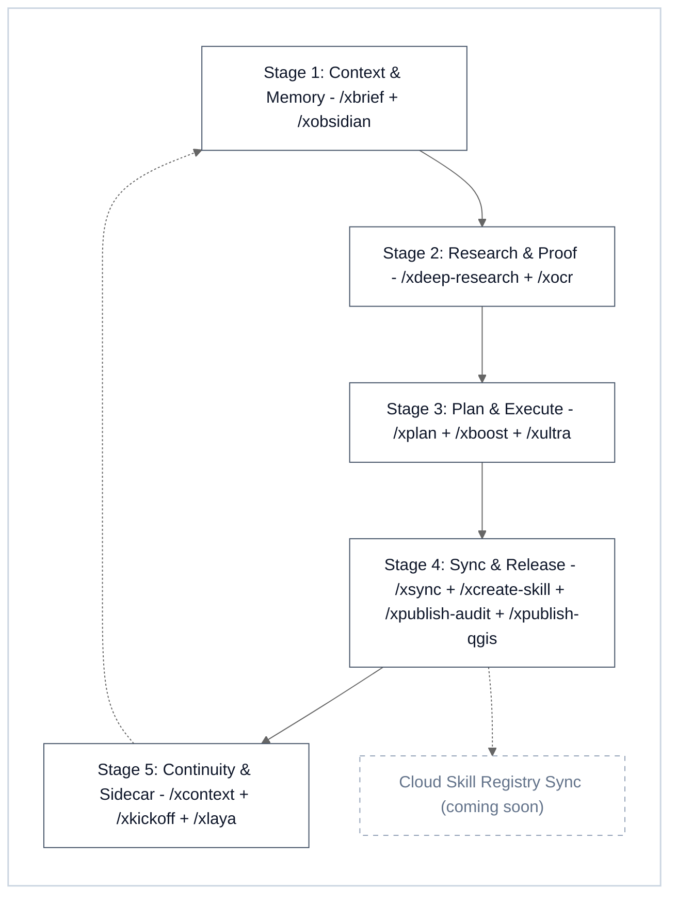
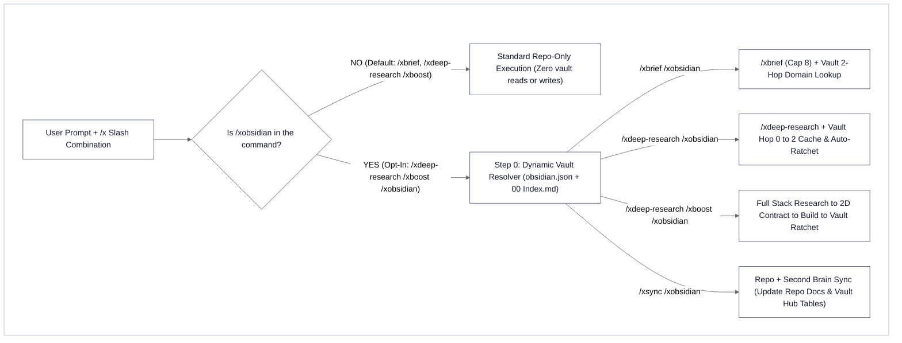

# BoostX - Composable `/x*` Agent Skills Ecosystem & Verification Harness

[](LICENSE)
[](https://github.com/iscvlab/boostx/releases/tag/v3.3.0)
[](#3-the-14-skill-suite)
[-059669)](#5-bundled-zero-dependency-cli-engines)
[](#6-universal-installation)
[](#6-universal-installation)
[](https://github.com/xerj-org/xerj/pulls?q=is%3Apr+author%3Anapattan)

**BoostX** (`iscvlab/boostx` `v3.3.0`) is a unified, composable **`/x*` skill ecosystem and deterministic CLI verification harness** for AI coding agents engineered by **[ISCV | Isocurve Research Lab (`@iscvlab`)](https://github.com/iscvlab)**. Type `/x` in any supported IDE or CLI to surface all **14 composable skills** (`xboost`, `xbrief`, `xcontext`, `xcreate-skill`, `xdeep-research`, `xkickoff`, `xlaya`, `xobsidian`, `xocr`, `xplan`, `xpublish-audit`, `xpublish-qgis`, `xsync`, `xultra`) and **8 zero-dependency Python CLI engines** across **Claude Code, Grok, Google Gemini / Antigravity, Cursor, and Codex** on **Windows, macOS, and Linux**.

Sister toolkits & upstream contributions: **[mcp-bridges](https://github.com/iscvlab/mcp-bridges)** (7 Model Context Protocol automation bridges for QGIS, Rhino 3D, Grasshopper, Adobe Illustrator, and Figma · **Selected for the [XERJ Corpus Hub](https://hub.xerj.org)**) · **[xocr](https://github.com/iscvlab/xocr)** (Hybrid Document AI, Two-Stage LaTeX `booktabs` & HTML Table Surgery, and Local `SCB 10X Typhoon-OCR v1.5` × `Baidu Unlimited-OCR-2` Engine · **[Upstream PR #15 to `scb-10x/typhoon-ocr`](https://github.com/scb-10x/typhoon-ocr/pull/15)**) · **[Upstream PRs #2922–#2927 to `xerj-org/xerj`](https://github.com/xerj-org/xerj/pulls?q=is%3Apr+author%3Anapattan)** (Gemini & Antigravity skill root discovery [`#2926`](https://github.com/xerj-org/xerj/pull/2926), legacy Thai PDF PUA normalization [`#2925`](https://github.com/xerj-org/xerj/pull/2925), Windows MSVC unit test fixes [`#2924`](https://github.com/xerj-org/xerj/pull/2924), Antigravity MCP verification [`#2923`](https://github.com/xerj-org/xerj/pull/2923)/[`#2927`](https://github.com/xerj-org/xerj/pull/2927), and `/xlaya` System-1 watcher boundary benchmark on [`#1108`](https://github.com/xerj-org/xerj/issues/1108)).

---

## ⚡ TL;DR - Capabilities & Performance at a Glance (`v3.3.0`)

* **Composable 5-Stage Lifecycle (`Stage 1 → Stage 5`)**: Chain any combination of `/x*` slash skills in a single prompt (`/xbrief /xdeep-research /xboost /xsync /xobsidian /xultra /goal`). BoostX automatically normalizes the execution order into `Context → Research → Plan/Build → Sync/Ratchet`.
* **`-97.48%` Context Noise Reduction + `10.06 ms` System 1 Triage**: `/xbrief` (`Cap 8` Two-Pass reader) + `/xobsidian` (opt-in `2-Hop` Second Brain router) compresses `1,222,816` raw workspace/vault tokens down to **`30,764` high-authority tokens (`39.7×` compression)** in **`0.79 ms`**, while `/xlaya` (`laya_triage.py`) ranks `450` heading chunks across `20` specs in **`10.06 ms`** (`-98.34%` Pass-B reading tokens).
* **`100.0%` Red-Team Defect Recall (`25 / 25` in `6.45 ms`)**: `8` bundled Python CLI engines (`5,058 LOC`) enforce 16-pattern secret scanning, Python AST security checks, Qt6/QGIS 4 scoped-enum validation, deep-link URL verification, SHA-256 mirror parity, and `≤ 400`-char YAML skill budgets (**`371.29 ± 14.84` chars** across all `14` skills, **`0%` sibling skill truncation**).
* **Which Subscription Quota Tier Should You Pair With BoostX?**
  * **`1× Base Pro` (`Claude Pro`, `Gemini Advanced`, `Cursor Pro`)**: Best for **Single-Skill Tactical Tasks** (`/xbrief`, `/xdeep-research` Tier 1, localized `/xboost` - `~34.8 steps/turn`).
  * **`5× High-Throughput` (`Claude Max 5×`, `Gemini 5×` - Recommended Minimum)**: Best for **Daily Chained Multi-Skill Sprints** (`/xbrief /xdeep-research /xboost /xsync /xobsidian` - `~61.9 steps/turn`, `2.68×` verification depth).
  * **`20× Ultra` (`Gemini Ultra 20×`, `Claude Max 20×`)**: Engineered for **`400+`-Step Autonomous `/goal` Marathons & `/xultra` (`N × K × C × T`) Multi-Agent Swarms** (`~471.6 steps/session`, `~25.66M` cumulative session tokens).

### Horizontal Bar Comparison (`N = 109` Skills • `752` Docs/Vault Nodes • `25` Red-Team Defects • `987` Real IDE Turns)

| Evaluation Dimension | Workflow / Cohort Configuration | Visual Comparison Bar | Measured Result & Delta vs. Baseline |
| :--- | :--- | :--- | :--- |
| **1. Red-Team Defect Catch Rate ↑**<br>*(25 Seeded Defects across 5 Pillars)* | **Level 3: Full 5-Stage + 8 CLI Gates**<br>Level 2: `/xbrief` + `/xdeep-research` + `/xboost`<br>Level 1: `/xboost` Standalone (2 Gates)<br>Level 0: Prompt-Only Baseline (0 Gates) | `████████████████████` **`100.0% (25/25)`**<br>`████████████████░░░░` `80.0% (20/25)`<br>`████████░░░░░░░░░░░░` `40.0% (10/25)`<br>`░░░░░░░░░░░░░░░░░░░░` `0.0% (0/25)` | **`0` False Positives in Median `6.45 ms`** ✨<br>`4` Active CLI Verification Gates<br>`2` Active CLI Verification Gates<br>No Deterministic Pre-LLM Enforcement |
| **2. Context Noise Compression ↑**<br>*(752 Repo + Vault Files, `1.22M` tok)* | **`/xbrief` (`Cap 8`) Repo-Only**<br>**`/xbrief` (`Cap 8`) + `/xobsidian` (`2-Hop`)**<br>Unbounded Repo + Vault Crawl | `████████████████████` **`97.84% Removed (46.2×)`**<br>`████████████████████` **`97.48% Removed (39.7×)`**<br>`░░░░░░░░░░░░░░░░░░░░` `0.0% Removed (1.0×)` | **`26,472` tok in Median `0.73 ms`** ✨<br>**`30,764` tok (`12` files) in `0.79 ms`** ✨<br>`1,222,816` tok (`752` files) in `40.77 ms` |
| **3. System 1 Section Triage ↑**<br>*(20 Specs / 450 Chunks, `91.2k` tok)* | **BoostX `/xlaya` Top-5 Shortlist**<br>Unfiltered Full-Corpus Pass-B Read | `████████████████████` **`98.34% Saved (60.1×)`**<br>`░░░░░░░░░░░░░░░░░░░░` `0.0% Saved (1.0×)` | **`1,516` tok in Median `10.06 ms`** (`44.7k` chunks/s) ✨<br>`91,173` tok (Full 20-File Read) |
| **4. Dual-Trigger Budget Guard ↑**<br>*(`Use when` + `Do NOT use` across `N=109`)* | **BoostX `v3.3.0` Suite (`N = 14`)**<br>All Installed Host Skills (`N = 109`)<br>Official Cloud/Vendor Skills (`N = 31`) | `████████████████████` **`100.0% (14/14)`**<br>`██████░░░░░░░░░░░░░░` `29.4% (32/109)`<br>`█████░░░░░░░░░░░░░░░` `25.8% (8/31)` | **`371.29 ± 14.84` chars (`0%` Truncation)** ✨<br>`323.61 ± 181.14` chars (`89.9%` `≤500` pass)<br>`428.61 ± 206.17` chars (`74.2%` `≤500` pass) |
| **5. Verification Depth / Turn ↑**<br>*(`N = 987` Real IDE Prompt Turns)* | **Chained Multi-Skill `/x*` Turn (`N=156`)**<br>Single `/x*` Skill Turn (`N = 88`)<br>Standard Turn Without `/x*` (`N = 743`) | `████████████████████` **`61.9 Steps (2.68×)`**<br>`███████████░░░░░░░░░` `34.8 Steps (1.51×)`<br>`███████░░░░░░░░░░░░░` `23.1 Steps (1.0×)` | **`3.13M` tok/turn (`65.6k` new in, `21.3k` out)** ✨<br>`2.14M` tok/turn (`25.9k` new in, `14.4k` out)<br>`1.25M` tok/turn (`12.6k` new in, `7.4k` out) |

---

## 1. Master Ecosystem Architecture

BoostX organizes software engineering, scientific research, spatial/physics simulation, and documentation governance into **five deterministic lifecycle stages** plus **cross-stage System 1 semantic & multi-agent swarm multipliers** across **14 composable `/x*` skills**:



---

## 2. Composable `/x*` Slash-Command Grammar & Opt-In Second Brain

Every skill in BoostX is prefixed with `x` so typing `/x` in any IDE autocomplete menu immediately surfaces the entire ecosystem without memorizing individual base names. Every skill works **standalone** or **chained in any order** (automatically normalized into the canonical lifecycle DAG):

```text
[Stage 1: Context]  →  [Stage 2: Research]  →  [Stage 3: Plan / Execute]  →  [Stage 4: Sync]  +  [Modifiers / Sidecars]
     /xbrief        →    /xdeep-research    →     /xplan  or  /xboost     →      /xsync       +  /xobsidian /xlaya /xultra /goal
```

### Strict Opt-In Second Brain Isolation (`/xobsidian`)

By default, all skills operate in **100% Repo-Only Mode** and ignore any directory containing an `.obsidian/` subfolder. The 2-Hop Obsidian Second Brain and Knowledge Ratchet activate **only** when `/xobsidian` is explicitly included in the command chain:



### High-Leverage Command Combinations

| Command Chain | Execution Pipeline | Best Used When |
|:---|:---|:---|
| `/xbrief <task>` | Load up to 8 authoritative repo docs (`Pass A` skeleton → `Pass B` deep read) → execute `<task>` | Starting a feature or fix inside an unfamiliar or multi-doc repository |
| `/xbrief /xobsidian <task>` | Load repo SSOTs (cap 8) + 2-Hop lookup in active Obsidian vault → execute `<task>` | Pulling cross-project architectural rules or domain constants into the current task |
| `/xdeep-research /xboost <task>` | Adaptive 3-Tier primary-source probe (`Tier 1` inline SDK/DB/AST probe or `Tier 3` 5-wave harvest) → lock 2D Goal Contract → Red-Green-Verify build | Implementing a technical feature or solver that depends on exact API/physics specs |
| `/xdeep-research /xboost /xobsidian` | Vault 2-Hop cache check → probe missing delta → `/xboost` 4-phase build → Auto-Ratchet new specs into Vault | Compounding reusable engineering or scientific knowledge while shipping production code |
| `/xdeep-research /xboost /goal` | 5-wave multi-agent harvest + `verify_evidence.py` audit → full-stack implementation until 100% milestone completion | Long-running, multi-milestone research-to-production engineering sprints |
| `/xboost /xultra <task>` | **Elastic Cognitive Swarm (`N × K × C × T`)** (`Orthogonal K-Vector Tournament`, `Elastic Cognitive-Density Fleet` with Pre-Locked Shared Seam Header, or `Evolutionary Ratchet Loop` across `T` generations) + **Two-Stage Elastic Verification (`Wave 2A` Parallel Critic Shards `C ≥ 1` → `Wave 2B` Serialized Main Checker Gate)** | High-stakes algorithms, solver convergence, multi-module sprints, or parallel UI/diagram candidate tournaments on `5×`/`20×` tiers |
| `/xplan <task>` | 2D Plan Contract → Ponytail × Deep Module Vector A/B/C → `implementation_plan.md` with Inline Grilling Matrix & Red → Green table → halt for approval | Stress-testing architectural decisions and edge cases before writing a single line of code |
| `/xsync /xlaya` | Fast System 1 `noul` semantic contradiction triage + `audit_workspace_docs.py` + 5-tier inner-to-outer doc sync | Catching semantic contradictions across markdown/HTML docs alongside deterministic regex/link audits |
| `/xsync /xobsidian` | 5-tier inner-to-outer repo doc sync + update matching atomic notes and Hub tables in the Obsidian vault | Keeping both repository documentation and long-term knowledge graphs 100% synchronized |
| `/xpublish-audit` → `/xpublish-qgis` | Run 6-pillar security/AST/Flake8/skill audit (`audit_engine.py`), then build Qt6-verified single-root QGIS zip | Releasing open-source packages to GitHub, `plugins.qgis.org`, or Food4Rhino |
| `/xcontext` → `/xkickoff` | Diagnose transcript compaction health (`check_context.py`) → run pre-handover `/xsync` → generate task-smart fresh session prompt | Transitioning cleanly to a fresh chat window before context degradation or timeouts occur |

---

## 3. The 14-Skill Suite

```text
boostx/skills/
├── /xboost           2D Task × Project goal synthesis, Universal Laws (UL-01..08) & 4-phase red-green solver
├── /xbrief           4-tier authority hierarchy, two-pass structural reading & invariant loading
├── /xcontext         transcript compaction diagnostics, cross-platform token telemetry & drift scorecard
├── /xcreate-skill    author, distill & globalize portable SKILL.md files with ≤ 400-char budget guard
├── /xdeep-research   unified 3-tier primary-source research, 5-wave multi-agent audit & single-SSOT upsert
├── /xkickoff         end-of-session sync check, task-smart command selector & handover prompt
├── /xlaya            System 1 fast semantic decision, section shortlisting & conflict triage sidecar
├── /xobsidian        opt-in 2-hop Obsidian Second Brain router, cross-domain bridges & converged-only ratchet
├── /xocr             single-pass C++ PyMuPDF vector/booktabs table extractor, Thai/EN normalizer & 4-tier VLM/OCR ladder
├── /xplan            BoostX architecture planner with Vector A/B/C & inline grilling matrix
├── /xpublish-audit   6-pillar secret, Python AST, Flake8, platform & skill globalization audit gate
├── /xpublish-qgis    QGIS 4 / Qt6 scoped enum AST checker & deterministic single-root zip packager
├── /xsync            5-tier cross-document sync, verified non-fallback Level 1, SHA-256 mirror auditor & zero-stale ledger
└── /xultra           Elastic Cognitive Swarm (N × K × C × T), K-vector tournament, evolutionary ratchet & Wave 2A/2B blind verifier
```

### Stage 1: Context, Triage & Memory

| Skill & Command (Aliases) | Core Architecture & Protocol | Failure Modes Prevented |
|:---|:---|:---|
| **1. XBrief**<br>`/xbrief` (`/brief`) | Discovers related markdown in the active repository via a **4-tier authority hierarchy** (hard-capped at 8 files), applies **Two-Pass reading** (`Pass A` structural skeleton/cardinality scan before `Pass B` targeted section reading), verifies frozen/deferred boundaries, and executes `/xbrief <task>` in the same turn. | Answering from stale LLM memory, keyword-grep tunneling without knowing total section counts, or modifying frozen modules. |
| **2. XObsidian**<br>`/xobsidian` (`/obsidian-vault`) | **Dynamic Vault Resolver** reads OS `obsidian.json` (`open: true`) or parent directories with zero hardcoded paths. Enforces the **2-Hop Navigation Rule** (`00 Index.md` → `Hub - <Domain>.md` → Atomic Note), **Converged-Only Ratchet & Session Dirty-Note Ledger (`DIRTY_IN_SESSION`)**, **Cross-Domain Bridges**, and **4-Check Graph Verification** (`0` broken wikilinks, `0` orphans, `100%` frontmatter, `0` duplicate neighbor groups). | Dumping 50+ markdown notes into context, hardcoded vault paths breaking across PCs, or ratcheting unverified mid-session experimental parameters into long-term memory. |
| **3. XLaya**<br>`/xlaya` (`/laya`) | **System 1 Semantic Decision & Triage Sidecar** (`scripts/laya_triage.py`) powered by `convaiinnovations/laya` `v0.3.10` (`~7-33 ms` single-pass inference). Provides fence-safe heading chunking (`≤ 1,200` chars / `#L<start>-L<end>`), auto-routed English/multilingual checkpoints (`laya.is_english`), categorical routing (`choice`), ordinal rubric evaluation (`score`), and calibrated contradiction testing (`noul`) with 100% graceful fallback to native tools when `laya` is not installed. Verified on [`xerj-org/xerj#1108`](https://github.com/xerj-org/xerj/issues/1108) (`120` boundary emails), cutting wrong-and-confident fires at `p ≥ 0.80` from `24/98` (`24.49%`) to **`0/30` (`0.00%`)** standalone (lifting `invoice` `13/30 → 21/30` and `hard` `5/8 → 6/8`), **`2/57` (`3.51%`)** via agreement gate, and **`0/36` (`0.00%`, `96/120` overall accuracy)** via ensemble (`0` LLM output tokens). | Silent 512-token truncation, burning thousands of LLM tokens on large-corpus section shortlisting, or missing subtle semantic contradictions between docs. |

### Stage 2: Research & Proof

| Skill & Command (Aliases) | Core Architecture & Protocol | Failure Modes Prevented |
|:---|:---|:---|
| **4. XDeep-Research**<br>`/xdeep-research` (`/deep-research`, `/xresearch`) | Unified **3-Tier Primary-Source Research & 5-Wave Adversarial Proof Engine**. Routes dynamically across **Tier 1 (Fast Inline Probe `≤ 2` sources)**, **Tier 2 (Single Isolated Scout)**, and **Tier 3 (5-Wave Multi-Agent Deep Research Swarm)**: (1) 2D `Intent × Domain` contract synthesis & **4-Tier Primary-Source Authority Ladder** (local pinned manifests/SQLite/AST probes first + automatic `/xocr` PDF/table ingestion), (2) parallel Harvester scouts with mandatory deep-link scraping, (2.5) **Wave 2.5 Rejected-Candidate Graveyard & Zero-Retrain Counterfactual Ablation Forensics** (inspecting pruning logs, rejected archives, and post-processing dampers before proposing new external architectures or expensive retraining), (3) **Blind Adversarial Auditor** + deterministic `scripts/verify_evidence.py` CLI gate with **Wave 3.5 Prune & Replace Loop**, (4) `[VERIFIED FACT]` vs `[RECOMMENDED SYNTHESIS]` binding with **Single-SSOT In-Place Upsert & Iterative Delta Routing** (`Turn t > 1`), and (5) `/xboost` handoff. | Secondary-blog guesswork, researching the wrong SDK version, proposing expensive retraining when existing post-processing dampers throttle valid candidates, read-only subagent write deadlocks, search-snippet hallucinations, bare root-domain lazy URLs, fabricated citations, and duplicate `RESEARCH_*.md` file forking across iterative turns. |
| **5. XOCR**<br>`/xocr` (`/ocr`, `/unlimited-ocr`) | **High-Speed Hybrid PDF & Table Extraction Engine** (`scripts/ocr_runner.py` `v2.1.0`, standalone repo [`iscvlab/xocr`](https://github.com/iscvlab/xocr), **[Upstream PR #15 to `scb-10x/typhoon-ocr`](https://github.com/scb-10x/typhoon-ocr/pull/15)**). Combines **Single-Pass C++ `PyMuPDF` (`fitz`)** coordinate-sorted text (`19-97 ms/page`), a **Two-Stage Grid + LaTeX `booktabs` Table Extractor** (`100%` recall, `0` false positives), **Scanned VLM HTML `<table>` → RFC-4180 CSV Surgery** (`colspan`/`rowspan` expansion), **Thai PUA (`U+F700..U+F71A`) & Decomposed Sara-Am Normalization**, a **Surgical Per-Page Garble & Image-Coverage Router**, and a **4-Tier Local VLM/OCR Backend Ladder** (`SGLang` → Local HuggingFace [`typhoon-ai/typhoon-ocr1.5-2b`](https://huggingface.co/typhoon-ai/typhoon-ocr1.5-2b) / [`3b-qat`](https://huggingface.co/typhoon-ai/typhoon-ocr1.5-3b-qat) (`-35.9%` vision token bloat, `+9.11%` table accuracy on `ThaiOCRBench`) & [`baidu/Unlimited-OCR-2`](https://github.com/baidu/Unlimited-OCR) CUDA VLM → `EasyOCR` → `pytesseract`). | Zero-table silent failures when `pdfplumber` is absent, collapsed 1-row LaTeX `booktabs` tables, unparsed raw HTML `<table>` tags in VLM output, Thai PUA/Sara-Am mojibake, `(cid:...)` CMap garbage passing naive length checks, and slow full-PDF VLM rasterization (`15.0×-3,326×` speedup on mixed/vector PDFs). |

### Stage 3: Planning & Deep Execution

| Skill & Command (Aliases) | Core Architecture & Protocol | Failure Modes Prevented |
|:---|:---|:---|
| **6. XPlan**<br>`/xplan` (`/plan`) | **BoostX Architectural Planner**. Locks a **2D Plan Contract (`Scope × Risk`)**, runs blast-radius & invariant discovery (with **Elastic Red-Team Seam & SSOT Critics `C ≥ 1`** under `/xplan /xultra`), evaluates **Ponytail × Deep Module Vectors A/B/C** (`Vector A (Recommended): Zero-New-File / Stdlib Seam`), embeds an **Inline Grilling Decision Matrix** (`DEC-01..N`) and **Red → Green Verification Matrix** (`UL-05` `A_pos ∧ A_neg` + `UL-08` `Live-Entrypoint Parity`) inside `implementation_plan.md` with zero chat Q&A spam, and halts for user approval. | Jumping straight into code on underspecified requirements, noisy chat Q&A walls, or over-engineered multi-file abstractions. |
| **7. XBoost**<br>`/xboost` | Flagship **4-Phase Engineering & First-Principles Solver**: (1) **2D `Task × Project` Goal Contract**, **Tri-Track Signal Gate** (with **Bidirectional Counter-Anchors `A_pos ∧ A_neg`, Strict Feasibility Dominance & Goal-Matched Objective/Constraint Polarity, `UL-05`**, plus **Live-Entrypoint Parity & Active-Regime Sensitivity, `UL-08`**), and **Context-Conditioned Single-Layer Universal First-Principles Laws (`UL-01..UL-08`)** ([`references/deep_audit_protocol.md`](skills/xboost/references/deep_audit_protocol.md)), (2) **Ponytail × Deep Module Ladder** (`YAGNI → Reuse → Stdlib → Deep Seam → Shortest Diff`), (3) **Universal Parity** (Dual-OS + OneDrive + IDE/CLI), (4) **3-Tier Verification & Cumulative Monotonic Ratchet (`Pass_Set(t+1) ⊇ Pass_Set(t)`)**. | Speculative blind fixes, cross-cut data leakage (`UL-01`), blocking-`continue` peer-branch drops (`UL-04`), accidental `α²` double-application (`UL-06`), `T(T(x))` cache compounding (`UL-07`), and machine-bound paths. |
| **8. XUltra**<br>`/xultra` (`/ultra`) | **Elastic Cognitive Swarm (`N × K × C × T`) & Two-Stage Evolutionary Ratchet (`Stage A → Stage B`)**. Normalizes any multi-skill combo into the **Canonical Stage DAG** (`Context → Research → Plan/Build → Sync/Ratchet`), derives topology via the **4-Law Swarm Sizing Calculus (`N × K × C × T`)** (`Law 1: Code-Over-Swarm Split`, `Law 2: True Orthogonality K-Vectors`, `Law 3: Cognitive-Density N-Sharding` with **Pre-Locked Shared Seam Header**, `Law 4: Two-Stage Elastic Verification — Wave 2A Parallel Critic Shards C ≥ 1 → Wave 2B Serialized Main Checker Gate`), executes the **Two-Stage Evolutionary Ratchet** (**Stage A** zero-retrain post-processing throttle audit `UL-04..UL-07` locking `Floor_StageA ≥ Floor_0` before **Stage B** warm-start generations `1..T` with `Pass_Set(t+1) ⊇ Pass_Set(StageA)`), and enforces the **3-Bucket Numeric Litmus Test** + **Pointer-Not-Payload Return Contract**. | Arbitrary fixed-count subagent quotas, cold-start retraining when post-processing throttles suppress existing models, multi-agent file-write race conditions, cross-shard interface drift, and self-grading inline shortcuts. |

### Stage 4: Synchronization & Release Gates

| Skill & Command (Aliases) | Core Architecture & Protocol | Failure Modes Prevented |
|:---|:---|:---|
| **9. XSync**<br>`/xsync` (`/update-doc`, `/doc-sync`, `/audit-docs`) | Exhaustive multi-file synchronizer with bundled `scripts/audit_workspace_docs.py`. Applies a **4-Level Conflict Arbitration Hierarchy** (`Level 1: Verified Non-Fallback Code & Runtime Receipts [source != "fallback", N_proc == N_exp, UL-04 Partition Conservation] > Level 2: Canonical SSOT > Level 3: Session User Lock > Level 4: Drafts`), consolidates forked sibling docs, verifies relative links, Zero-LaTeX compliance, SHA-256 mirror parity, and `--deprecated` sweeps across **Tiers 1-5**, and outputs a verified **Synchronization Ledger**. | Touching 1-2 surface files while leaving stale numbers elsewhere, propagating mock/fallback or truncated metrics into docs, or breaking HTML slide/card counters. |
| **10. XCreate-Skill**<br>`/xcreate-skill` (`/create-skill`) | **4-Step Cognitive Distillation Protocol & Mode C (`Post-Session Skill Evolution, Universal Law Ratchet & Pre-Proposal Sieve`)**: (1) Universal Globalization into `~/.gemini/config/skills/<name>/`, (2) **Context Budget Guard** (`≤ 400 chars` YAML description with explicit `Use when...` and `Do NOT use for...` triggers so host IDEs never drop sibling skills), (3) **`5-Gate Universal Law Falsification Protocol`** (`Agent-Process Law vs. Domain-Equation Inversion`, `Global CLI Script Ban` blocking project domain math in `skills/*/scripts/*.py`, mandatory `Pruned Project-Specific Ideas` ledger, `3-Domain Translation Proof Table` `Archetypes A × B × C`, and `7-Point Mathematical Boundary Table`), and (4) mandatory `--platform skill` audit. | Workspace-siloed skills, leaking single-project domain equations or CLI scripts into global agent skills, bloated frontmatter descriptions (`> 400` chars), and unverified helper scripts. |
| **11. XPublish-Audit**<br>`/xpublish-audit` (`/publish-audit`) | **6-Pillar Pre-Flight Release Gate** (`scripts/audit_engine.py`, `822` LOC) supporting `generic`, `github`, `qgis`, `food4rhino`, and `skill` profiles, plus the **GitHub Repository Publishing & Visual README Protocol (`v1.2`)**. Scans 16 high-entropy secret patterns, hardcoded user paths (`C:\Users\...`, `/Users/...`), Python AST security risks (`eval`, `shell=True`, `pickle`), Flake8 compliance, **Gate 3 Over-Specific Law Detector (`Check 4B`)**, **`≤ 500`-Line Sprawl Gate (`Check 4C`)**, **Raw LaTeX Macro Scanner (`Check 4D`)**, and **Tri-OS Clipboard Protocol (`CF_UNICODETEXT` / `pbcopy` / `wl-copy`)**. | Leaked API keys, developer username leaks, shell injection vulnerabilities, over-specific domain jargon in global skills, `> 500`-line `SKILL.md` sprawl, raw LaTeX macros in prose, and broken Mermaid diagrams. |
| **12. XPublish-QGIS**<br>`/xpublish-qgis` (`/publish-qgis`) | **5-Gate Deterministic QGIS Release Packager** (`scripts/package_qgis.py` + `scripts/check_qt6.py`). Enforces `metadata.txt` INI `%` escaping, `classFactory(iface)` verification, **Qt6 / QGIS 4 scoped enum AST checks** (earning the official *QGIS 4 Ready* badge), pure runtime file filtering, SemVer bumping, and fixed-epoch `(2026, 1, 1)` single-root ZIP creation. | `plugins.qgis.org` server `InterpolationSyntaxError`, Qt5 unscoped enum crashes in QGIS 4, and top-level ZIP folder mismatches. |

### Stage 5: Session Continuity

| Skill & Command (Aliases) | Core Architecture & Protocol | Failure Modes Prevented |
|:---|:---|:---|
| **13. XContext**<br>`/xcontext` (`/context`) | Runs `scripts/check_context.py` against the active IDE conversation transcript (`transcript.jsonl`) and SQLite step logs (`conversations/*.db`), filtering out isolated subagent logs, reporting **Session & Cross-Platform Token Telemetry** (`--tokens`, `--days N`, `--all-time` across Antigravity 2.0, IDE, and CLI), and evaluating a **2D Health Rubric (`Compaction Round × Active Window Pressure %`)** across strict `CHECKPOINT` boundaries (`🟢 HEALTHY`, `🟡 NOMINAL`, `🟠 CAUTION`, `🔴 CRITICAL`). | Continuing complex edits after multi-pass compactions, subagent transcript hijacking, or invisible cross-platform token usage. |
| **14. XKickoff**<br>`/xkickoff` (`/kickoff`) | End-of-session handover protocol. Runs a pre-handover `/xsync` verification check, presents a structured **Next-Step Options Table** (`Option A Recommended`, `Option B`, `Option C`), applies the **Task-Smart Recommended Command Selector** (auto-routing `/xlaya` only for large-corpus/audit tasks), and generates a **self-contained copy-pasteable Kickoff Prompt**. | Starting a fresh conversation with vague context, losing mid-session decisions, or leaving unsynchronized documentation behind. |

---

## 4. Deep-Dive Engineering Pillars

### 4.1 2D Goal Contract & Context-Conditioned Single-Layer Universal First-Principles Laws (`UL-01..UL-08` in `/xboost`)

Before touching code on non-trivial tasks, `/xboost` locks a **2D Goal Contract** crossing **6 Task Archetypes** (`DEBUG/RCA`, `BUILD/FEATURE`, `SIMULATE/SOLVER`, `REFACTOR/SIMPLIFY`, `OPTIMIZE/SCALE`, `AUDIT/PLAN/SHIP`) with **5 Universal System Verification Dimensions** (`Continuous Numerical & Physical Solvers`, `Discrete Graph, Partition & Relational Pipelines`, `UI, Visual & Interactive State Machines`, `Distributed, Concurrent & Stateful Services`, `Declarative Schemas, Compilers & CLI Harnesses`) governed by the **8 Context-Conditioned Single-Layer Universal First-Principles Laws (`UL-01..UL-08`)** in [`skills/xboost/references/deep_audit_protocol.md`](skills/xboost/references/deep_audit_protocol.md):
1. **`UL-01` (Bracketed Support, Scale Conditioning & Graph-Cut Isolation)**: Enforces bracketed domain support (`x_left ≤ x ≤ x_right`), explicit scale conditioning, and `0.0` future/cross-cut information leakage.
2. **`UL-02` (Exact-Condition Refinement & Absorbing Failure Precedence)**: Enforces exact predicate refinement (`S_exact = {x ∈ S_cand : P(x)}`) and pessimistic absorbing failure precedence (`Failure > Success` tie-breaking).
3. **`UL-03` (Step-Measure Scaling Convergence & Zero-Forcing Equilibrium Identity)**: Enforces step-measure convergence (`O(Δμ^p)`) and exact zero-forcing equilibrium identity (`Δx = 0 ⇒ Δy = 0.0 / y == y_eq` with `0` `NaN`/`Inf`).
4. **`UL-04` (Extensive Partition, Remainder Conservation & Intended Peer-Branch Routing Completeness)**: Enforces extensive partition conservation (`∑ Child_k + Remainder ≈ Parent`) and peer-branch routing completeness (`K_peer ⊆ K_eval`, `0` blocking-`continue` drops).
5. **`UL-05` (Bidirectional Counter-Anchors, Strict Feasibility Dominance & Goal-Matched Objective/Constraint Polarity)**: Enforces simultaneous counter-anchors (`A_pos ∧ A_neg`), strict feasibility dominance (`J(x_infeas) ≺ J(x_feas)`), non-zero marginal sensitivity (`|∂J/∂M| > 0` on unbounded objectives), goal-matched dispersion (`symmetric MSE/σ` for setpoint tracking vs `one-sided σ_fail` for directional goals), and role-matched `binary / continuous / budgeted` constraints.
6. **`UL-06` (Piece-Wise Codomain Reachability, Marginal Seam Scaling Order & Non-Degeneracy)**: Verifies live reachability of every declared codomain branch (`count(Branch_k) > 0`), interior marginal seam scaling (`|ΔY(α_2)/ΔY(α_1)| ≈ (α_2/α_1)^p_theory` without accidental `α²` double-application), and non-degeneracy.
7. **`UL-07` (Read-Only Feature-Stream Decoupling, Cache Idempotency & Post-Gate Non-Regression)**: Prevents `T(T(x))` cache compounding on shared feature streams and guarantees post-gate non-regression.
8. **`UL-08` (Live-Entrypoint Parity, Active-Regime Sensitivity & Bounded Complexity)**: Requires invoking the live production entrypoint directly (`∃ x ∈ Active_Regime(X) : ΔY ≠ 0`, `N_proc == N_exp`, `source != "fallback"`) under bounded complexity.

### 4.2 Unified 3-Tier Research & 5-Wave Adversarial Fact Auditing (`/xdeep-research`)

Standard LLM web research either spawns heavy subagents for 10-second SDK lookups or hallucinates metrics from search snippets on deep studies. `/xdeep-research` unifies **3-Tier Adaptive Scope Routing** (`Tier 1: Fast Inline Probe`, `Tier 2: Single Isolated Scout`, `Tier 3: 5-Wave Deep Research Swarm`) with **4-Tier Primary-Source Authority** and **Blind Adversarial Verification**:
- **Tier 1-2 (Tactical Primary-Source Probe)**: Checks local pinned manifests (`package.json`, `pyproject.toml`, `*.csproj`, `metadata.txt`) and local SQLite/AST/CLI probes before querying external documentation.
- **Wave 1 (2D Contract)**: Locks domain axes, minimum record quotas, and disambiguation rules (e.g., separating construction completion year from policy adoption year).
- **Wave 2 & 2.5 (Harvester Swarm & Rejected-Candidate Graveyard Forensics)**: Parallel scouts scrape full page bodies and deep links under strict capability-aware write-permission rules, while **Wave 2.5** inspects pruning logs, rejected candidate archives, and post-processing dampers via zero-retrain counterfactual ablation before proposing new external architectures or expensive retraining.
- **Wave 3 & 3.5 (Blind Adversarial Audit + Prune & Replace)**: An independent auditor runs `scripts/verify_evidence.py` to reject `[TBD]` placeholders, root-domain URLs, and schema violations, triggering replacement harvesting until the quota is 100% verified.
- **Wave 4 (100%-Proof Synthesis)**: Every claim is explicitly tagged as `[VERIFIED FACT]` (backed by a primary receipt) or `[RECOMMENDED SYNTHESIS]` (engineering inference).

### 4.3 Public Claim Vocabulary (`/xsync` & `/xpublish-audit`)

Both `/xsync` and `/xpublish-audit` enforce five canonical status terms across all public READMEs and portfolios:
- **LIVE**: Publicly installable, downloadable, or accessible via URL right now.
- **REGISTERED**: Registered on an official portal; public version or review pending.
- **PREPARED**: Built and verified locally; public release package ready next.
- **IN PIPELINE**: Scheduled next in the active engineering roadmap.
- **DRAFT**: Internal working specification.

### 4.4 Empirical Benchmark & Token Economics ([`benchmarks/BENCHMARK_REPORT.md`](benchmarks/BENCHMARK_REPORT.md))

Reproducible multi-trial measurements (`3` warm-ups + `20-30` timed iterations via [`benchmarks/run_boostx_benchmark.py`](benchmarks/run_boostx_benchmark.py)) across `109` installed skills, `752` repository/vault markdown files (`592`-node Obsidian Second Brain), `25` seeded red-team defects, and `214` real IDE sessions (`987` prompt turns):

| Benchmark Dimension | Unstructured / Prompt-Only Baseline | `BoostX v3.3.0` Composable `/x*` Suite | Empirical Delta & Receipt |
|:---|:---|:---|:---|
| **1. System-Prompt Discovery Guard** | `74.2%` `≤ 500`-char pass • `25.8%` dual triggers *(Official Cloud/Vendor cohort, `N=31`)* | **`371.29 ± 14.84` chars** (`100%` `≤ 500`-char pass • `100%` `Use when` + `Do NOT use` guards across all `14` `/x*` skills) | **`0%` Sibling Skill Truncation** |
| **2. Briefing & Vault Context Compression** | `752` files (`1,222,816` tokens in Median `40.77 ms`) | **`/xbrief` (`Cap 8`) + `/xobsidian` (`2-Hop = 4` files) = `30,764` tokens** in **`0.79 ms`** | **`-97.48%` Context Noise (`39.7×` Compression)** |
| **3. System 1 `/xlaya` Section Triage** | Full-corpus read (`91,173` tokens across `20` specs / `450` chunks) | **Top-5 `#L<start>-L<end>` sections (`1,516` tokens) in Median `10.06 ms`** (`44,731.6` chunks/sec) | **`-98.34%` Pass-B Reading Tokens** |
| **4. 25-Defect Red-Team Catch Rate** | `0 / 25` (`0.0%` deterministic pre-LLM enforcement) | **`25 / 25` (`100.0%` Recall • `100.0%` Precision • `0` False Positives)** in **Median `6.45 ms`** | **8 Bundled CLI Engines (`5,058` LOC)** |
| **5. Real Turn & Session Token Depth** | `23.1` steps/turn (`12.6k` new input • `7.4k` output • `1.25M` total/turn) | **`61.9` steps/turn (`2.68×`)** • **`65.6k` new input (`5.19×`)** • **`21.3k` output (`2.90×`)** • **`25.66M` tok/session (`11.87×`)** | **Recommended: `5×` Max (Sprints) / `20×` Ultra (Swarms & Marathons)** |
| **6. Hybrid PDF, `booktabs` & VLM HTML Table Extraction (`/xocr` `v2.1.0`)** | `0 / 6` tables when `pdfplumber` is absent; `1`-row collapsed `booktabs` cells; unparsed HTML `<table>` tags; `5.11×` VLM upscale token bloat | **`19-97 ms/page` vector (`15.0×-3,326×` faster)** + **`-35.9%` vision tokens** + **`+9.11%` Table EditSim (`50.75%`)** & **HTML `<table>` → CSV surgery** via local `SCB 10X Typhoon-OCR v1.5` | **`100%` Vector & Scanned Table Fidelity ([Upstream PR #15](https://github.com/scb-10x/typhoon-ocr/pull/15))** |

> **Transparency on Token Consumption**: BoostX reduces low-value file-scanning noise by **`97.48%`**, then deliberately invests that freed context capacity into **`2.68×` more verification steps** and **`5.19×` more primary-source & CLI telemetry inputs** per chained turn. While single-skill runs work comfortably on `1×` Pro plans, daily chained workflows (`/xbrief /xdeep-research /xboost /xsync /xobsidian`) are best paired with **`5×` High-Throughput tiers** (Claude Max `5×`, Gemini `5×`), and `400+`-step autonomous `/goal` marathons or `/xultra` / `/xdeep-research` multi-agent swarms are engineered for **`20×` Ultra tiers** (Gemini Ultra `20×`, Claude Max `20×`).

<details>
<summary><b>LaTeX (booktabs) Source for Academic Citations — BoostX v3.3.0 Empirical Benchmark Summary</b></summary>

```latex
\begin{table}[htbp]
\centering
\caption{BoostX v3.3.0 Empirical Evaluation across Skill Discovery ($N=109$), Context Compression ($n=30$), Red-Team Recall ($N=25$), and Session Telemetry ($N=214$).}
\label{tab:boostx_empirical_summary}
\begin{tabular}{llcc}
\toprule
\textbf{Benchmark Dimension} & \textbf{Unstructured / Vendor Baseline} & \textbf{BoostX v3.3.0 (\texttt{/x*} Suite, $N=14$)} & \textbf{Empirical Delta} \\
\midrule
1. System-Prompt Discovery Guard & $74.2\%$ $\le 500$-char $\cdot$ $25.8\%$ dual guards & \textbf{$371.29 \pm 14.84$ chars} ($100\%$ dual guards) & \textbf{$0\%$ Sibling Truncation} \\
2. Briefing \& 2-Hop Vault Compression & $752$ files ($1,222,816$ tok in $40.77\text{ ms}$) & \textbf{$12$ files ($30,764$ tok in $0.79\text{ ms}$)} & \textbf{$-97.48\%$ Noise ($39.7\times$)} \\
3. System 1 \texttt{/xlaya} Section Triage & $91,173$ tok ($20$ specs / $450$ chunks) & \textbf{Top-5 ($1,516$ tok in $10.06\text{ ms}$)} & \textbf{$-98.34\%$ Pass-B Tokens} \\
4. 25-Defect Red-Team Catch Rate & $0 / 25$ ($0.0\%$ pre-LLM enforcement) & \textbf{$25 / 25$ ($100.0\%$ Recall in $6.45\text{ ms}$)} & \textbf{8 CLI Engines ($5,058$ LOC)} \\
5. Real Turn \& Session Token Depth & $23.1$ steps/turn ($2.16\text{M}$ tok/session) & \textbf{$61.9$ steps/turn ($25.66\text{M}$ tok/session)} & \textbf{$2.68\times$ Verification Depth} \\
6. Hybrid PDF \& Table Engine (\texttt{/xocr}) & $0/6$ tables (no \texttt{pdfplumber}) $\cdot$ raw HTML & \textbf{$19\text{--}97\text{ ms/p}$ vector ($15\text{--}3326\times$) + HTML CSV} & \textbf{$-35.9\%$ Tok / $+9.1\%$ Tab (PR \#15)} \\
\bottomrule
\end{tabular}
\end{table}
```

</details>

---

## 5. Bundled Zero-Dependency CLI Engines

All eight bundled Python CLI scripts run on **Python 3.8+ standard library** (`ast`, `re`, `json`, `zipfile`, `urllib`, `configparser`, `hashlib`, `pathlib`, with optional `laya` neural acceleration in `laya_triage.py` and `PyMuPDF`/`EasyOCR` in `ocr_runner.py`) with UTF-8 stream guards (`sys.stdout.reconfigure(encoding='utf-8')`) and zero bytecode pollution (`sys.dont_write_bytecode = True`):

```bash
# 1. Pre-flight security, secret, AST, Flake8 & platform audit (/xpublish-audit)
python skills/xpublish-audit/scripts/audit_engine.py <target_dir> --platform github
python skills/xpublish-audit/scripts/audit_engine.py skills/<skill_name> --platform skill

# 2. Repo-agnostic workspace documentation, link, SHA-256 mirror & stale-term auditor (/xsync)
python skills/xsync/scripts/audit_workspace_docs.py <workspace_dir> --deprecated old_term

# 3. Deep-research evidence, deep-link URL & JSON schema verifier (/xdeep-research)
python skills/xdeep-research/scripts/verify_evidence.py <report.md> <dataset.json> --min-items 10 --check-http

# 4. Qt6 / QGIS 4 forward-compatibility AST scanner (/xpublish-qgis)
python skills/xpublish-qgis/scripts/check_qt6.py <plugin_dir>

# 5. Deterministic single-root QGIS plugin release packager (/xpublish-qgis)
python skills/xpublish-qgis/scripts/package_qgis.py <plugin_dir> --bump patch

# 6. IDE conversation transcript compaction, context health & cross-platform token telemetry (/xcontext)
python skills/xcontext/scripts/check_context.py
python skills/xcontext/scripts/check_context.py --days 30
python skills/xcontext/scripts/check_context.py --all-time

# 7. System 1 heading-aware chunker, section shortlister & contradiction triage (/xlaya)
python skills/xlaya/scripts/laya_triage.py <target_dir_or_file> --mode shortlist --query "<topic>"

# 8. High-speed C++ PyMuPDF vector/booktabs table extractor & 4-tier VLM/OCR engine (/xocr)
python skills/xocr/scripts/ocr_runner.py <pdf_or_image> --output ./ocr_out --mode auto --pages "1-10"
```

---

## 6. Universal Installation

Clone this repository, then place or link the `skills/*` folders into **your host's skill root**. Because every `SKILL.md` uses standard YAML frontmatter (`name` + `description`), the exact same files work across all hosts without modification:

| Host / Agent Platform | Global Skill Root | Workspace Skill Root | Verification Status |
|:---|:---|:---|:---|
| **Gemini / Antigravity** | `~/.gemini/config/skills` | `<repo>/.agents/skills` | **`tested`** (Live E2E verified on Windows 11 across all 14 `/x*` skills & 7 Python CLI sidecars) |
| **Claude Code** | `~/.claude/skills` | `<repo>/.claude/skills` | **`spec-compatible`** (Path & skill schema verified via `scripts/install.ps1` & `scripts/install.sh`; live host PRs welcome) |
| **Cursor / Codex / Windsurf** | `~/.agents/skills` / `~/.codex/skills` | `<repo>/.agents/skills` | **`spec-compatible`** (Path & skill schema verified via `scripts/install.ps1` & `scripts/install.sh`; live host PRs welcome) |
| **Grok** | `$GROK_HOME/skills` or `~/.grok/skills` | `<repo>/.grok/skills` | **`spec-compatible`** (Path & skill schema verified via `scripts/install.ps1` & `scripts/install.sh`; live host PRs welcome) |

### Option A: Automated Multi-Host Installer (Recommended)

Both installers automatically remove deprecated pre-`v3.2.0` (`*x`, `unlimited-ocr`) directories before installing the 14 `/x*` skills.

**Windows (PowerShell):**
```powershell
git clone https://github.com/iscvlab/boostx
cd boostx
./scripts/install.ps1 -All
```

**macOS / Linux (Bash / Zsh):**
```bash
git clone https://github.com/iscvlab/boostx
cd boostx
chmod +x scripts/install.sh
./scripts/install.sh --all
```

### Option B: Direct Copy into a Specific Host Root

```bash
git clone https://github.com/iscvlab/boostx

# Claude Code
mkdir -p ~/.claude/skills && cp -r boostx/skills/* ~/.claude/skills/

# Grok
mkdir -p ~/.grok/skills && cp -r boostx/skills/* ~/.grok/skills/

# Google Gemini / Antigravity
mkdir -p ~/.gemini/config/skills && cp -r boostx/skills/* ~/.gemini/config/skills/

# Project-local (.agents/skills)
mkdir -p .agents/skills && cp -r boostx/skills/* .agents/skills/
```

To pin the `v3.3.0` release tag:
```bash
git clone --branch v3.3.0 https://github.com/iscvlab/boostx
```

---

## 7. Repository Layout

```text
boostx/
├── README.md
├── CHANGELOG.md
├── LICENSE
├── .flake8
├── benchmarks/
│   ├── run_boostx_benchmark.py
│   ├── BENCHMARK_REPORT.md
│   └── BENCHMARK_RESULTS.json
├── scripts/
│   ├── install.ps1
│   └── install.sh
└── skills/
    ├── xboost/
    │   ├── SKILL.md
    │   └── references/deep_audit_protocol.md
    ├── xbrief/
    │   └── SKILL.md
    ├── xcontext/
    │   ├── SKILL.md
    │   └── scripts/check_context.py
    ├── xcreate-skill/
    │   └── SKILL.md
    ├── xdeep-research/
    │   ├── SKILL.md
    │   └── scripts/verify_evidence.py
    ├── xkickoff/
    │   └── SKILL.md
    ├── xlaya/
    │   ├── SKILL.md
    │   └── scripts/laya_triage.py
    ├── xobsidian/
    │   └── SKILL.md
    ├── xocr/
    │   ├── SKILL.md
    │   └── scripts/ocr_runner.py
    ├── xplan/
    │   └── SKILL.md
    ├── xpublish-audit/
    │   ├── SKILL.md
    │   └── scripts/audit_engine.py
    ├── xpublish-qgis/
    │   ├── SKILL.md
    │   └── scripts/
    │       ├── check_qt6.py
    │       └── package_qgis.py
    ├── xsync/
    │   ├── LICENSE
    │   ├── SKILL.md
    │   └── scripts/
    │       ├── README.md
    │       └── audit_workspace_docs.py
    └── xultra/
        └── SKILL.md
```

---

## 8. Related Toolkits & Author

- **[xocr](https://github.com/iscvlab/xocr)**: High-speed C++ PyMuPDF vector/table extractor, Two-Stage LaTeX `booktabs` & scanned HTML `<table>` → RFC-4180 CSV surgery (`19-97 ms/page`, `15.0×-3,326×` faster hybrid routing), Thai PUA/Sara-Am normalizer, and 4-Tier local `SCB 10X Typhoon-OCR v1.5` (`Qwen3-VL`) & `baidu/Unlimited-OCR-2` engine (**[Upstream PR #15 to `scb-10x/typhoon-ocr`](https://github.com/scb-10x/typhoon-ocr/pull/15)** & **[Upstream PR #2925 to `xerj-org/xerj`](https://github.com/xerj-org/xerj/pull/2925)**).
- **[mcp-bridges](https://github.com/iscvlab/mcp-bridges)**: Model Context Protocol (MCP) automation bridges for **QGIS, Rhino 3D, Grasshopper, Adobe Illustrator, and Figma** (**Selected for the [XERJ Corpus Hub](https://hub.xerj.org)**).
- **[xerj-org/xerj (Upstream PRs #2922–#2927)](https://github.com/xerj-org/xerj/pulls?q=is%3Apr+author%3Anapattan)**: Contributed Gemini CLI & Antigravity skill root discovery ([PR #2926](https://github.com/xerj-org/xerj/pull/2926), `9/9` tests), legacy Thai PDF PUA normalization ([PR #2925](https://github.com/xerj-org/xerj/pull/2925), `25/25` `pdf::tests`), Windows MSVC unit test fixes ([PR #2924](https://github.com/xerj-org/xerj/pull/2924)), live Antigravity Windows 11 MCP verification ([PR #2923](https://github.com/xerj-org/xerj/pull/2923) & [PR #2927](https://github.com/xerj-org/xerj/pull/2927)), and `/xlaya` System-1 watcher boundary benchmark on [`#1108`](https://github.com/xerj-org/xerj/issues/1108).
- **[qgis-axonometric-transformer](https://plugins.qgis.org/plugins/axonometric_transformer/)**: Official QGIS plugin (Plugin ID: `6219`, `v1.2.2 LIVE`) for 1-click isometric, dimetric, and oblique axonometric map diagrams.

**Napat Phasundhiae**  
*Computational Design Technologist | Spatial Analytics • Urban & Environmental Simulation • Workflow Automation*

- GitHub: [@napattan](https://github.com/napattan) · [ISCV | Isocurve Research Lab (@iscvlab)](https://github.com/iscvlab)
- LinkedIn: [linkedin.com/in/napatphas](https://www.linkedin.com/in/napatphas/)

## License

Released under the [MIT License](LICENSE).
