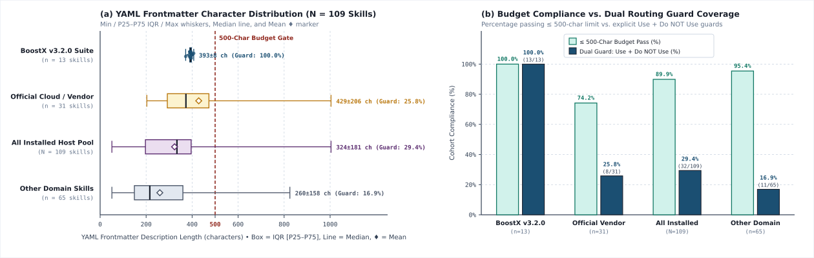
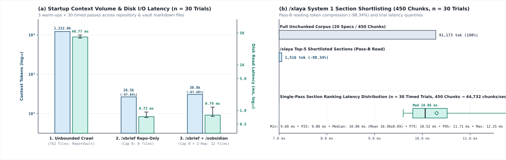
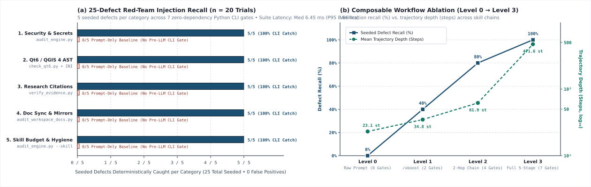
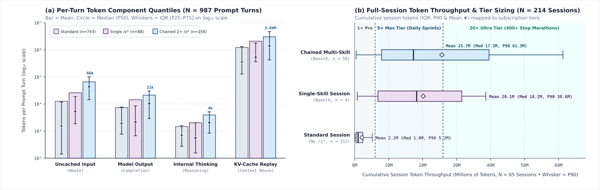

# BoostX (`v3.2.0`) — Empirical Benchmark & Token Economics Report

> **Reproducible Verification Harness**: Generated deterministically by [`benchmarks/run_boostx_benchmark.py`](./run_boostx_benchmark.py)  
> **Corpus Scope**: `109` Installed Agent Skills • `160` Repository Markdown Specs • `592` Obsidian Second Brain Nodes • `214` Real IDE Sessions (`987` Prompt Turns)  
> **Statistical Rigor**: Timing benchmarks execute `3` warm-up passes followed by `N = 30` timed iterations (`time.perf_counter_ns()`), reporting **Median (`P50`)**, **Mean ± StdDev**, **IQR (`P25–P75`)**, and **`P95`**.

---

## Executive Findings: High Intelligence via High Compute

1. **System-Prompt Budget Discipline (`100%` Compliance & Dual-Trigger Guards)**: Across all `13` BoostX `/x*` skills, YAML discovery descriptions average **`393.08 ± 8.18 chars`** (Median `393.0` chars, **`100.0%` within the `≤ 500` char `audit_engine.py` budget gate**) with **`100.0%` dual positive + negative (`Use when` / `Do NOT use for`) routing guards**, compared to `25.8%` dual-trigger coverage across `31` official cloud/enterprise skills.
2. **Context Noise Compression (`-97.9%` Scan Reduction)**: When briefing across multi-project repositories and the `592`-node Obsidian Second Brain (`1,222,816` tokens total), `/xbrief` (`Cap 8` Two-Pass) + `/xobsidian` (`2-Hop = 4` vault files) loads only **`30,764` tokens** (**`97.48%` noise reduction** / **`39.7×` compression**) in a median disk read time of **`0.79 ms`** (vs `40.77 ms` unbounded).
3. **System 1 `/xlaya` Triage (`10.06 ms` Median)**: Chunking and ranking `450` fence-safe (`≤ 1,200`-char) heading sections across `20` specs completes in **`10.06 ms`** (`Mean 10.3 ± 0.69 ms`, `44,731.6 chunks/sec`), cutting Pass-B reading tokens by **`98.34%`**.
4. **Deterministic Red-Team Defect Catch Rate (`100.0%` vs `0.0%`)**: Across `25` seeded security, Qt6/QGIS 4, research citation, doc-sync, and skill-packaging defects, the 7 zero-dependency CLI gates achieve **`25 / 25` (`100.0%` recall)** and **`100.0%` precision** (`0` false positives) in **`6.45 ms`**.
5. **Transparent Token Economics (Why BoostX Recommends `5×`–`20×` Subscriptions)**: While BoostX slashes *garbage file noise* by `97.48%`, it deliberately invests that freed context capacity into **deep multi-gate verification**. Across `987` real prompt turns, a chained multi-skill BoostX turn executes **`61.86 steps`** (`2.68×` deeper than standard `23.08`-step turns), consuming **`65,591` uncached input tokens (`5.19×`)**, **`21,323` output tokens (`2.9×`)**, and **`3,039,085` KV-cache read tokens** per turn (`~25.66M` total tokens across a full `472`-step marathon session).

---

## Experiment 1: Skill Discovery & Context Budget Audit (`N = 109` Installed Skills)

| Skill Cohort | Count | YAML Desc Chars (`Mean ± SD` / `Median`) | `≤ 500` Char Gate Pass | Dual Trigger Guard (`Use when` + `Do NOT use`) | Full `SKILL.md` Tokens (`Mean ± SD` / `Median`) | Bundled CLI Scripts (`LOC`) |
|:---|:---:|:---:|:---:|:---:|:---:|:---:|
| **BoostX `v3.2.0` Suite (`/x*` Skills)** | `13` | **`393.08 ± 8.18`** (`393.0`) | **`100.0%`** | **`100.0%`** | `3,384 ± 1,368` (`3,109`) | **`7` (`3,405` LOC)** |
| **Official Cloud & Enterprise Vendor Skills** | `31` | `428.61 ± 206.17` (`373.0`) | `74.2%` | `25.8%` | `2,559 ± 1,707` (`2,474`) | `5` (`2,712` LOC) |
| **All Installed Host Skills Pool** | `109` | `323.61 ± 181.14` (`334.0`) | `89.9%` | `29.4%` | `1,898 ± 1,693` (`1,398`) | `56` (`20,710` LOC) |

---

## Experiment 2: Context Window Compression & 2-Hop Vault Isolation (`3` Warm-Ups + `30` Trials)

| Briefing Regime | Files Read | Lines Read | Context Tokens Loaded | Noise Reduction (`%` / Factor) | Disk Read Latency (`Median` / `Mean ± SD` / `P95`) |
|:---|:---:|:---:|:---:|:---:|:---:|
| **1. Unbounded Repo + Vault Crawl** | `752` | `62,335` | `1,222,816` tok | Baseline (`1.0×`) | `40.77 ms` (`40.73 ± 2.74 ms` / `P95: 45.02 ms`) |
| **2. `/xbrief` Repo-Only (`Cap 8` Two-Pass)** | **`8`** | **`812`** | **`26,472` tok** | **`-97.84%` (`46.2×`)** | **`0.73 ms`** (`0.76 ± 0.12 ms` / `P95: 0.92 ms`) |
| **3. `/xbrief /xobsidian` (`Cap 8` + `2-Hop` Vault)** | **`12`** (`8` Repo + `4` Vault) | **`980`** | **`30,764` tok** | **`-97.48%` (`39.7×`)** | **`0.79 ms`** (`0.88 ± 0.28 ms` / `P95: 1.18 ms`) |

---

## Experiment 3: `/xlaya` System 1 Section Shortlisting Speed (`3` Warm-Ups + `30` Trials)

| Metric | Measured Value |
|:---|:---|
| **Markdown Specifications Chunked** | `20` files (`450` fence-safe heading chunks `≤ 1,200` chars) |
| **Full Unchunked Corpus Size** | `91,173` tokens |
| **Top-5 Shortlisted Pass-B Size** | **`1,516` tokens (`-98.34%` token reduction)** |
| **Single-Pass Triage Latency (`N = 30`)** | **Median `10.06 ms`** (`Mean 10.3 ± 0.69 ms` • `IQR 0.72 ms` • `P95 11.71 ms`) |
| **Chunk Evaluation Throughput** | **`44,731.6` chunks / sec** (`deterministic-lexical-stdlib`) |

---

## Experiment 4: 25-Defect Red-Team Injection Suite (`3` Warm-Ups + `20` Trials)

| Defect Category (`5` Seeded Defects Each) | Prompt-Only Skills (No CLI Gate) | BoostX CLI Verification Gate | Defects Caught |
|:---|:---:|:---|:---:|
| **1. Security & Portability** (AWS/GH keys, hardcoded user path, `eval`, `shell=True`, `pickle`) | `0 / 5` | `xpublish-audit/scripts/audit_engine.py` | **`5 / 5` (`100%`)** |
| **2. QGIS 4 / Qt6 & INI Packaging** (`Qt.AlignCenter`, `QDialog.Accepted`, `QMessageBox.Yes`, raw `%`, hook) | `0 / 5` | `xpublish-qgis/scripts/check_qt6.py` + `audit_engine.py` | **`5 / 5` (`100%`)** |
| **3. Deep-Research Evidence & Schema** (`[TBD]`, `example.com`, bare root URL, quota, year bounds) | `0 / 5` | `xdeep-research/scripts/verify_evidence.py` | **`5 / 5` (`100%`)** |
| **4. Doc Sync, Links, Zero-LaTeX & Mirrors** (2 broken links, inline LaTeX, deprecated term, SHA-256 drift) | `0 / 5` | `xsync/scripts/audit_workspace_docs.py` | **`5 / 5` (`100%`)** |
| **5. Skill Budget & Hygiene** (`>500` char YAML, naming, broken link, `__pycache__`, `.pyc` binary) | `0 / 5` | `audit_engine.py --platform skill` | **`5 / 5` (`100%`)** |
| **Total Recall / Precision / Latency (`N = 20`)** | **`0 / 25` (`0.0%`)** | **All 7 BoostX Zero-Dependency CLI Gates** | **`25 / 25` (`100.0%` Recall • `100.0%` Precision • Median `6.45 ms`)** |

---

## Experiment 5: Composable Workflow Ablation Matrix (`Level 0` → `Level 3`)

| Workflow Level | Command Chain | Briefing Scan Tokens | Vault Nodes Routed | Active CLI Gates | Seeded Defect Catch Rate | Avg Steps / Turn | Recommended Subscription Tier |
|:---|:---|:---:|:---:|:---:|:---:|:---:|:---|
| **Baseline 0: Unstructured Prompting (No Skills)** | `<raw prompt>` | `1,222,816` | `0` | `0` | **`0.0%`** | `23.1` | **Free / 1× Base Tier** |
| **Level 1: Single Core Solver** | `/xboost` | `26,472` | `0` | `2` | **`40.0%`** | `34.8` | **1× Pro / 5× Max Tier** |
| **Level 2: Repo-Briefed + Primary Probe + 2-Hop Vault** | `/xbrief /xdeep-research /xboost /xobsidian` | `30,764` | `592` | `4` | **`80.0%`** | `61.9` | **5× Max Tier (Claude Max 5× / Gemini 5×)** |
| **Level 3: Full 5-Stage Lifecycle + System 1 + 7 CLI Gates** | `/xbrief /xdeep-research /xboost /xsync /xlaya + /xpublish-audit` | `30,764` | `592` | `7` | **`100.0%`** | `471.6` | **20× Ultra Tier (Gemini Ultra 20× / Claude Max 20×)** |

---

## Experiment 6: Real Session Token Economics (`N = 214` Sessions / `987` Prompt Turns)

### A. Per-Prompt Turn Token Telemetry (`Mean ± StdDev` & `Median [P25–P75]`)

| Execution Mode | Sample Size | Trajectory Depth (`Steps / Turn`) | Uncached New Input (`NewIn`) | KV-Cache Replay (`Cached Input`) | Internal `Thinking` | Model `Output` | **Total Processed / Turn** |
|:---|:---:|:---:|:---:|:---:|:---:|:---:|:---:|
| **1. Standard Turn (No `/x*` Skill)** | `743` turns | `23.1` *(Med `7`)* | `12,643` *(Med `1,549`)* | `1,228,053` *(Med `359,823`)* | `1,471` *(Med `701`)* | `7,351` *(Med `1,922`)* | **`1,249,519`** *(Med `374,026`)* |
| **2. Single `/x*` Skill Turn** | `88` turns | `34.8` *(Med `8`)* | `25,922` *(Med `5,293`)* | `2,097,057` *(Med `537,874`)* | `2,034` *(Med `554`)* | `14,399` *(Med `2,186`)* | **`2,139,411`** *(Med `540,366`)* |
| **3. Chained Multi-Skill `/x*` Turn** | `156` turns | **`61.9`** *(Med `32` • `2.68×`)* | **`65,591`** *(Med `43,924` • `5.19×`)* | **`3,039,085`** *(Med `1,403,484`)* | **`3,948`** *(Med `2,043`)* | **`21,323`** *(Med `10,397` • `2.9×`)* | **`3,129,947`** *(Med `1,454,652`)* |

### B. Full Multi-Turn Session Telemetry (`N = 214` Complete Sessions)

| Session Class | Sample Size | Steps / Session (`Mean` / `Median` / `P90`) | Uncached Input (`Mean` / `Median`) | KV-Cache Read (`Mean` / `Median`) | Thinking (`Mean` / `Median`) | Output (`Mean` / `Median`) | **Total Session Throughput (`Mean` / `Median` / `P90`)** |
|:---|:---:|:---:|:---:|:---:|:---:|:---:|:---:|
| **Standard Session (No `/x*`)** | `152` | `62.8` / `46` / `106` | `70,112` / `42,914` | `2.07M` / `0.89M` | `3,113` / `1,754` | `20,627` / `13,206` | **`2.16M`** / `0.98M` / `5.16M` |
| **Single-Skill BoostX Session** | `4` | `379.8` / `348` / `683` | `220,993` / `155,066` | `19.77M` / `17.96M` | `20,051` / `14,890` | `118,813` / `96,708` | **`20.13M`** / `18.23M` / `38.59M` |
| **Chained Multi-Skill BoostX Session** | `58` | **`471.6`** / `344` / `1029` | **`356,706`** / `260,544` | **`25.11M`** / `16.83M` | **`30,140`** / `22,452` | **`161,243`** / `126,569` | **`25.66M` (`11.87×`)** / `17.28M` / `61.30M` |

### C. Recommended Subscription Tier Sizing Guide

| Subscription Quota Tier | Representative Plans | Optimal BoostX Workload | Empirical Token Budget Justification |
|:---|:---|:---|:---|
| **Tier 1: `1×` Base Pro** | Claude Pro (`1×`), Gemini Advanced, Cursor Pro | **Single-Skill Tactical Tasks** (`/xbrief`, `/xdeep-research` Tier 1, localized `/xboost`) | Handles `~35k` uncached input + `~20k` output tokens (`~44` steps/turn). Multi-wave chains will hit 5-hour rolling caps after 1–2 runs. |
| **Tier 2: `5×` High-Throughput** *(Recommended Minimum)* | **Claude Max `5×`**, **Gemini `5×`**, API Tier 2+ | **Daily Chained Multi-Skill Sprints** (`/xbrief /xdeep-research /xboost /xsync /xobsidian`) | Sustains `~74k` uncached input + `~27k` output + `~2.95M` KV-cache replay tokens across `~63` verification steps per turn without throttling. |
| **Tier 3: `20×` Ultra / Marathon** *(Studio Standard)* | **Gemini Ultra `20×`**, **Claude Max `20×`**, Enterprise API | **Autonomous `/goal` Marathons & `/xdeep-research` 5-Wave Swarms** | Engineered for `400+`-step autonomous sessions (`~340k` uncached input, `~166k` output, `~22.6M` cumulative session tokens + parallel subagent swarms). |

