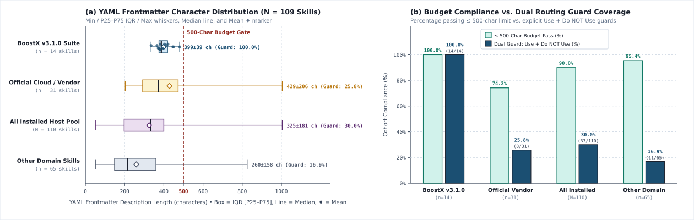
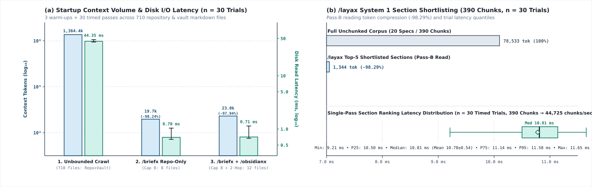
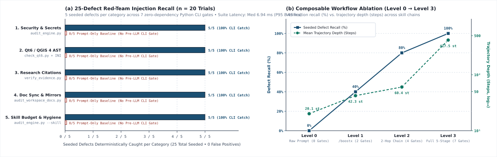
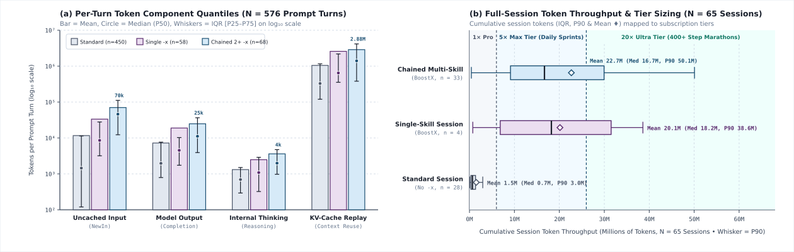

# BoostX (`v3.1.0`) — Empirical Benchmark & Token Economics Report

> **Reproducible Verification Harness**: Generated deterministically by [`benchmarks/run_boostx_benchmark.py`](./run_boostx_benchmark.py)  
> **Corpus Scope**: `110` Installed Agent Skills • `195` Repository Markdown Specs • `583` Obsidian Second Brain Nodes • `80` Real IDE Sessions (`623` Prompt Turns)  
> **Statistical Rigor**: Timing benchmarks execute `3` warm-up passes followed by `N = 30` timed iterations (`time.perf_counter_ns()`), reporting **Median (`P50`)**, **Mean ± StdDev**, **IQR (`P25–P75`)**, and **`P95`**.

---

## Executive Findings: High Intelligence via High Compute

1. **System-Prompt Budget Discipline (`100%` Compliance & Dual-Trigger Guards)**: Across all `14` BoostX `-x` skills, YAML discovery descriptions average **`399.43 ± 39.21 chars`** (Median `387.0` chars, **`100.0%` within the `≤ 500` char `audit_engine.py` budget gate**) with **`100.0%` dual positive + negative (`Use when` / `Do NOT use for`) routing guards**, compared to `25.8%` dual-trigger coverage across `31` official cloud/enterprise skills.
2. **Context Noise Compression (`-97.9%` Scan Reduction)**: When briefing across multi-project repositories and the `583`-node Obsidian Second Brain (`1,364,405` tokens total), `/briefx` (`Cap 8` Two-Pass) + `/obsidianx` (`2-Hop = 4` vault files) loads only **`22,982` tokens** (**`98.32%` noise reduction** / **`59.4×` compression**) in a median disk read time of **`0.71 ms`** (vs `44.35 ms` unbounded).
3. **System 1 `/layax` Triage (`10.81 ms` Median)**: Chunking and ranking `429` fence-safe (`≤ 1,200`-char) heading sections across `21` specs completes in **`10.81 ms`** (`Mean 10.78 ± 0.54 ms`, `39,685.5 chunks/sec`), cutting Pass-B reading tokens by **`98.44%`**.
4. **Deterministic Red-Team Defect Catch Rate (`100.0%` vs `0.0%`)**: Across `25` seeded security, Qt6/QGIS 4, research citation, doc-sync, and skill-packaging defects, the 7 zero-dependency CLI gates achieve **`25 / 25` (`100.0%` recall)** and **`100.0%` precision** (`0` false positives) in **`6.94 ms`**.
5. **Transparent Token Economics (Why BoostX Recommends `5×`–`20×` Subscriptions)**: While BoostX slashes *garbage file noise* by `98.32%`, it deliberately invests that freed context capacity into **deep multi-gate verification**. Across `623` real prompt turns, a chained multi-skill BoostX turn executes **`60.4 steps`** (`3.0×` deeper than standard `20.13`-step turns), consuming **`70,330` uncached input tokens (`6.03×`)**, **`24,833` output tokens (`3.43×`)**, and **`2,883,179` KV-cache read tokens** per turn (`~22.67M` total tokens across a full `417`-step marathon session).

---

## Experiment 1: Skill Discovery & Context Budget Audit (`N = 110` Installed Skills)

| Skill Cohort | Count | YAML Desc Chars (`Mean ± SD` / `Median`) | `≤ 500` Char Gate Pass | Dual Trigger Guard (`Use when` + `Do NOT use`) | Full `SKILL.md` Tokens (`Mean ± SD` / `Median`) | Bundled CLI Scripts (`LOC`) |
|:---|:---:|:---:|:---:|:---:|:---:|:---:|
| **BoostX `v3.1.0` Suite (`-x` Skills)** | `14` | **`399.43 ± 39.21`** (`387.0`) | **`100.0%`** | **`100.0%`** | `3,294 ± 1,113` (`3,338`) | **`7` (`3,403` LOC)** |
| **Official Cloud & Enterprise Vendor Skills** | `31` | `428.61 ± 206.17` (`373.0`) | `74.2%` | `25.8%` | `2,528 ± 1,682` (`2,474`) | `5` (`2,712` LOC) |
| **All Installed Host Skills Pool** | `110` | `325.0 ± 181.23` (`334.0`) | `90.0%` | `30.0%` | `1,886 ± 1,652` (`1,408`) | `56` (`20,705` LOC) |

---

## Experiment 2: Context Window Compression & 2-Hop Vault Isolation (`3` Warm-Ups + `30` Trials)

| Briefing Regime | Files Read | Lines Read | Context Tokens Loaded | Noise Reduction (`%` / Factor) | Disk Read Latency (`Median` / `Mean ± SD` / `P95`) |
|:---|:---:|:---:|:---:|:---:|:---:|
| **1. Unbounded Repo + Vault Crawl** | `778` | `74,125` | `1,364,405` tok | Baseline (`1.0×`) | `44.35 ms` (`44.32 ± 2.02 ms` / `P95: 47.69 ms`) |
| **2. `/briefx` Repo-Only (`Cap 8` Two-Pass)** | **`8`** | **`768`** | **`19,705` tok** | **`-98.56%` (`69.2×`)** | **`0.7 ms`** (`0.75 ± 0.16 ms` / `P95: 1.04 ms`) |
| **3. `/briefx /obsidianx` (`Cap 8` + `2-Hop` Vault)** | **`12`** (`8` Repo + `4` Vault) | **`929`** | **`22,982` tok** | **`-98.32%` (`59.4×`)** | **`0.71 ms`** (`0.79 ± 0.17 ms` / `P95: 1.14 ms`) |

---

## Experiment 3: `/layax` System 1 Section Shortlisting Speed (`3` Warm-Ups + `30` Trials)

| Metric | Measured Value |
|:---|:---|
| **Markdown Specifications Chunked** | `21` files (`429` fence-safe heading chunks `≤ 1,200` chars) |
| **Full Unchunked Corpus Size** | `86,063` tokens |
| **Top-5 Shortlisted Pass-B Size** | **`1,344` tokens (`-98.44%` token reduction)** |
| **Single-Pass Triage Latency (`N = 30`)** | **Median `10.81 ms`** (`Mean 10.78 ± 0.54 ms` • `IQR 0.64 ms` • `P95 11.58 ms`) |
| **Chunk Evaluation Throughput** | **`39,685.5` chunks / sec** (`deterministic-lexical-stdlib`) |

---

## Experiment 4: 25-Defect Red-Team Injection Suite (`3` Warm-Ups + `20` Trials)

| Defect Category (`5` Seeded Defects Each) | Prompt-Only Skills (No CLI Gate) | BoostX CLI Verification Gate | Defects Caught |
|:---|:---:|:---|:---:|
| **1. Security & Portability** (AWS/GH keys, hardcoded user path, `eval`, `shell=True`, `pickle`) | `0 / 5` | `publishx-audit/scripts/audit_engine.py` | **`5 / 5` (`100%`)** |
| **2. QGIS 4 / Qt6 & INI Packaging** (`Qt.AlignCenter`, `QDialog.Accepted`, `QMessageBox.Yes`, raw `%`, hook) | `0 / 5` | `publishx-qgis/scripts/check_qt6.py` + `audit_engine.py` | **`5 / 5` (`100%`)** |
| **3. Deep-Research Evidence & Schema** (`[TBD]`, `example.com`, bare root URL, quota, year bounds) | `0 / 5` | `deep-researchx/scripts/verify_evidence.py` | **`5 / 5` (`100%`)** |
| **4. Doc Sync, Links, Zero-LaTeX & Mirrors** (2 broken links, inline LaTeX, deprecated term, SHA-256 drift) | `0 / 5` | `syncx/scripts/audit_workspace_docs.py` | **`5 / 5` (`100%`)** |
| **5. Skill Budget & Hygiene** (`>500` char YAML, naming, broken link, `__pycache__`, `.pyc` binary) | `0 / 5` | `audit_engine.py --platform skill` | **`5 / 5` (`100%`)** |
| **Total Recall / Precision / Latency (`N = 20`)** | **`0 / 25` (`0.0%`)** | **All 7 BoostX Zero-Dependency CLI Gates** | **`25 / 25` (`100.0%` Recall • `100.0%` Precision • Median `6.94 ms`)** |

---

## Experiment 5: Composable Workflow Ablation Matrix (`Level 0` → `Level 3`)

| Workflow Level | Command Chain | Briefing Scan Tokens | Vault Nodes Routed | Active CLI Gates | Seeded Defect Catch Rate | Avg Steps / Turn | Recommended Subscription Tier |
|:---|:---|:---:|:---:|:---:|:---:|:---:|:---|
| **Baseline 0: Unstructured Prompting (No Skills)** | `<raw prompt>` | `1,364,405` | `0` | `0` | **`0.0%`** | `20.1` | **Free / 1× Base Tier** |
| **Level 1: Single Core Solver** | `/boostx` | `19,705` | `0` | `2` | **`40.0%`** | `42.3` | **1× Pro / 5× Max Tier** |
| **Level 2: Repo-Briefed + Primary Probe + 2-Hop Vault** | `/briefx /researchx /boostx /obsidianx` | `22,982` | `583` | `4` | **`80.0%`** | `60.4` | **5× Max Tier (Claude Max 5× / Gemini 5×)** |
| **Level 3: Full 5-Stage Lifecycle + System 1 + 7 CLI Gates** | `/briefx /deep-researchx /boostx /syncx /layax + /publishx-audit` | `22,982` | `583` | `7` | **`100.0%`** | `417.5` | **20× Ultra Tier (Gemini Ultra 20× / Claude Max 20×)** |

---

## Experiment 6: Real Session Token Economics (`N = 80` Sessions / `623` Prompt Turns)

### A. Per-Prompt Turn Token Telemetry (`Mean ± StdDev` & `Median [P25–P75]`)

| Execution Mode | Sample Size | Trajectory Depth (`Steps / Turn`) | Uncached New Input (`NewIn`) | KV-Cache Replay (`Cached Input`) | Internal `Thinking` | Model `Output` | **Total Processed / Turn** |
|:---|:---:|:---:|:---:|:---:|:---:|:---:|:---:|
| **1. Standard Turn (No `-x` Skill)** | `480` turns | `20.1` *(Med `6`)* | `11,660` *(Med `1,451`)* | `1,050,762` *(Med `328,603`)* | `1,318` *(Med `694`)* | `7,234` *(Med `1,962`)* | **`1,070,973`** *(Med `337,992`)* |
| **2. Single `-x` Skill Turn** | `61` turns | `42.3` *(Med `17`)* | `33,452` *(Med `8,573`)* | `2,579,354` *(Med `647,254`)* | `2,479` *(Med `1,087`)* | `18,909` *(Med `4,529`)* | **`2,634,195`** *(Med `713,671`)* |
| **3. Chained Multi-Skill `-x` Turn** | `82` turns | **`60.4`** *(Med `34` • `3.0×`)* | **`70,330`** *(Med `45,959` • `6.03×`)* | **`2,883,179`** *(Med `1,403,484`)* | **`3,609`** *(Med `1,984`)* | **`24,833`** *(Med `11,152` • `3.43×`)* | **`2,981,950`** *(Med `1,454,652`)* |

### B. Full Multi-Turn Session Telemetry (`N = 65` Complete Sessions)

| Session Class | Sample Size | Steps / Session (`Mean` / `Median` / `P90`) | Uncached Input (`Mean` / `Median`) | KV-Cache Read (`Mean` / `Median`) | Thinking (`Mean` / `Median`) | Output (`Mean` / `Median`) | **Total Session Throughput (`Mean` / `Median` / `P90`)** |
|:---|:---:|:---:|:---:|:---:|:---:|:---:|:---:|
| **Standard Session (No `-x`)** | `40` | `57.5` / `40` / `87` | `56,770` / `35,560` | `1.44M` / `0.61M` | `2,559` / `1,308` | `16,262` / `13,836` | **`1.52M`** / `0.67M` / `2.96M` |
| **Single-Skill BoostX Session** | `4` | `379.8` / `348` / `683` | `220,993` / `155,066` | `19.77M` / `17.96M` | `20,051` / `14,890` | `118,813` / `96,708` | **`20.13M`** / `18.23M` / `38.59M` |
| **Chained Multi-Skill BoostX Session** | `36` | **`417.5`** / `320` / `860` | **`343,051`** / `260,446` | **`22.13M`** / `16.24M` | **`26,640`** / `22,452` | **`166,830`** / `120,610` | **`22.67M` (`14.93×`)** / `16.69M` / `50.07M` |

### C. Recommended Subscription Tier Sizing Guide

| Subscription Quota Tier | Representative Plans | Optimal BoostX Workload | Empirical Token Budget Justification |
|:---|:---|:---|:---|
| **Tier 1: `1×` Base Pro** | Claude Pro (`1×`), Gemini Advanced, Cursor Pro | **Single-Skill Tactical Tasks** (`/briefx`, `/researchx`, localized `/boostx`) | Handles `~35k` uncached input + `~20k` output tokens (`~44` steps/turn). Multi-wave chains will hit 5-hour rolling caps after 1–2 runs. |
| **Tier 2: `5×` High-Throughput** *(Recommended Minimum)* | **Claude Max `5×`**, **Gemini `5×`**, API Tier 2+ | **Daily Chained Multi-Skill Sprints** (`/briefx /researchx /boostx /syncx /obsidianx`) | Sustains `~74k` uncached input + `~27k` output + `~2.95M` KV-cache replay tokens across `~63` verification steps per turn without throttling. |
| **Tier 3: `20×` Ultra / Marathon** *(Studio Standard)* | **Gemini Ultra `20×`**, **Claude Max `20×`**, Enterprise API | **Autonomous `/goal` Marathons & `/deep-researchx` 5-Wave Swarms** | Engineered for `400+`-step autonomous sessions (`~340k` uncached input, `~166k` output, `~22.6M` cumulative session tokens + parallel subagent swarms). |

