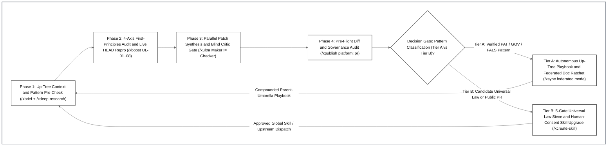

# Cross-Workspace Compound Learning & Pattern Playbook (`v3.4.0`)

> **Scope**: Canonical engineering pattern playbook (`PAT-*` Defect & Bottleneck Catalog, `GOV-*` Upstream Institutional Governance Fingerprints, and `FALS-*` False-Positive Mirage Guardrails) for the **[BoostX (`iscvlab/boostx`)](../README.md)** composable `/x*` skill ecosystem.  
> **Lifecycle Integration**: Automatically discovered in **Stage 1 / Wave 1** via [`/xbrief`](../skills/xbrief/SKILL.md) and [`/xdeep-research`](../skills/xdeep-research/SKILL.md) (Bounded Up-Tree Parent-Umbrella Playbook Discovery) and autonomously ratcheted in **Stage 4** via [`/xsync`](../skills/xsync/SKILL.md) (`federated mode`) after empirical verification passes.  
> **Companion Specifications**: [`README.md`](../README.md) • [`skills/xboost/references/deep_audit_protocol.md`](../skills/xboost/references/deep_audit_protocol.md) • [`skills/xpublish/references/github_readme_protocol.md`](../skills/xpublish/references/github_readme_protocol.md) • [`benchmarks/BENCHMARK_REPORT.md`](../benchmarks/BENCHMARK_REPORT.md)

---

## 1. Compound Learning Architecture & Two-Tier Autonomy Protocol

### 1.1 Bounded Up-Tree Federation (`/xbrief` ↔ `/xsync`)

When working across multiple sibling repositories under a shared parent directory, engineering lessons discovered in one repository are automatically shared across all sibling repositories without manual copy-pasting:
1. **Stage 1 Read (`Up-Tree Discovery` in `/xbrief` & `/xdeep-research`)**: During Pass A discovery, `/xbrief` and `/xdeep-research` walk up to `2` ancestor directories (stopping safely before `HOME`, `Desktop`, `Documents`, or filesystem roots) to detect a parent-umbrella `COMPOUND_LEARNING_PLAYBOOK.md` (or repo-local `docs/COMPOUND_LEARNING_PLAYBOOK.md`). Relevant `PAT-*`, `GOV-*`, and `FALS-*` entries are loaded into the active task contract before code inspection begins.
2. **Stage 4 Write (`Autonomous Pattern Ratchet` in `/xsync`)**: After a bug fix, algorithmic optimization, or upstream PR passes empirical verification, `/xsync` (`federated mode`) distills the root-cause signature and canonical fix recipe into `COMPOUND_LEARNING_PLAYBOOK.md` and verifies `0` broken links or stale metrics via `audit_workspace_docs.py`.

### 1.2 Two-Tier Autonomy & Human-Consent Boundary

| Tier | Target Files & Scope | Execution Policy | Architectural Rationale |
| :--- | :--- | :---: | :--- |
| **Tier A: Autonomous Pattern & Doc Ratchet** | 1. Parent-umbrella or repo-local `COMPOUND_LEARNING_PLAYBOOK.md` (`PAT-*`, `GOV-*`, `FALS-*` tables) 2. Repository documentation & benchmark ledgers (`docs/*`, `README.md`, `CHANGELOG.md`) 3. Opt-in 2-Hop Obsidian Second Brain notes (when `/xobsidian` is chained and 4-check graph verification passes) | **100% Autonomous** *(Ratcheted automatically once Phase 4 / Wave 2 verification passes)* | Captures every verified bug fix, speedup recipe, and maintainer governance rule immediately across sibling repositories without interrupting engineering flow. |
| **Tier B: Report-First Human-Consent Gate for Global Skills & Public PRs** | 1. **Global Agent Skills & Universal Laws**: `skills/*/SKILL.md`, `skills/xboost/references/deep_audit_protocol.md` (`UL-01..UL-08`), and bundled `scripts/*.py` 2. **Public External Actions**: Opening upstream GitHub PRs, posting public issue comments, or publishing release packages (`/xpublish`) | **Mandatory Report-First** *(Run Wave 2A Blind Counter-Domain Critic → present Pruned vs. Surviving table → wait for explicit human approval)* | Prevents domain-specific leakage ("Session Hangover") into universal agent laws (`UL-01..UL-08`) and protects public open-source maintainer trust. |

---

## 2. Master Defect, Bottleneck & Fix Pattern Catalog (`PAT-*`)

### 2.1 Vectorization, Sparse Matrices & Graph Solvers (`PAT-VEC-*`, `PAT-SPARSE-*`, `PAT-GRAPH-*`)

| Pattern ID | Code Smell Signature (`What to Grep / Inspect`) | Root-Cause Defect or Bottleneck | Canonical Fix Recipe (`What to Fix`) | Verified Public & Benchmark Receipts |
| :--- | :--- | :--- | :--- | :--- |
| **`PAT-VEC-01`** *(Pseudo-Vectorization Wrapper)* | `np.vectorize(...)`, `df.apply(lambda r: Point(...), axis=1)`, nested Python `for` loops calling scalar `shapely.geometry.box()` | `np.vectorize` is a Python `frompyfunc` loop wrapper; `.apply(axis=1)` and scalar `box()` loops incur per-element Python object overhead. | Replace with native ufunc broadcasting (`scipy.stats.norm.cdf`), `np.searchsorted` LUTs, or C-vectorized `shapely.box(xmin, ymin, xmax, ymax)`. | • [`os-climate/physrisk#651`](https://github.com/os-climate/physrisk/pull/651) (`32.5×` faster `get_impact_distrib`) • [`Deltares/hydromt#1566`](https://github.com/Deltares/hydromt/pull/1566) (`27.5×` faster `create_mesh2d_from_geom`) • [`CLIMADA#1350`](https://github.com/CLIMADA-project/climada_python/pull/1350) (`69.3×` faster `points_to_raster`) |
| **`PAT-VEC-02`** *(Quadratic `O(N²)` Membership & Label Scans)* | `[x for x in A if x in B_list]`, per-label `scipy.ndimage` loops (`for lbl in unique_labels:`), or pure Python `for i in range(1, n):` EMA loops | `x in B_list` executes an `O(N²)` linear scan; per-label `ndimage` scans the full 2D/3D array `K` times instead of once. | Iterate directly over `B_list` or convert to `set` (`O(N)`); use single-pass `np.bincount(labels.ravel(), weights=...)`; use C-vectorized `pd.Series.ewm().mean()`. | • [`os-climate/physrisk#651`](https://github.com/os-climate/physrisk/pull/651) (`1,669.6×` faster `geocode_in_place`) • [`martibosch/pylandstats#77`](https://github.com/martibosch/pylandstats/pull/77) (`4.0×` faster `compute_patch_centroids`) |
| **`PAT-VEC-03`** *(Loop-Invariant Recompute & OGR Disk Seeks)* | `sum(series)` inside timestep loops; `layer.GetFeature(fid)` + `wkb.loads` inside R-tree spatial loops; `Transformer.from_crs()` per call; `np.exp()` before `argmax` | Recomputes constant time-series means `105,120` times/yr, performs `O(M × B)` GDAL disk seeks across overlapping geometries, or evaluates millions of transcendental `exp()` calls before `argmax`. | Hoist precomputed scalars (`forcIP.deepTemp`); cache FID attributes/geometries in Pass 1 dict; decorate CRS transformers with `@lru_cache(64)`; find `argmax` in log-space before `exp()`. | • [`ladybug-tools/uwg#292`](https://github.com/ladybug-tools/uwg/pull/292) (`1,735.6×` faster deep-soil loop) • [`natcap/invest#2829`](https://github.com/natcap/invest/issues/2829) (`23.4×` UCM & `19.2×` UFRM speedup) |
| **`PAT-SPARSE-01`** *(CSR Column-Slice Loop & `.nonzero()` Zero-Drop)* | `for reg in regions: imp_mat[:, mask].sum(axis=1)` on `scipy.sparse.csr_matrix`; calling `csr_mat.nonzero()` after modifying `.data` in-place | Slicing CSR columns in a loop rebuilds index arrays `R` times; `csr_mat.nonzero()` converts CSR → COO and **silently drops explicit `0.0` entries** (e.g. when insurance cover reduces damage to `0.0`). | Replace CSR column-slice loops with one sparse matrix multiply `(imp_mat @ reg_indicator).toarray()`; read `csr_mat.indices` and `csr_mat.indptr` directly instead of `.nonzero()`. | • [`CLIMADA#1350`](https://github.com/CLIMADA-project/climada_python/pull/1350) (`14.0×` faster `Impact.impact_at_reg` & `ImpactCalc.stitch_impact_matrix` explicit-zero preservation) |
| **`PAT-GRAPH-01`** *(Dict Adjacency OOM & Pairwise Snapping)* | `nx.Graph()` / nested Python `dict` adjacency in Brandes SSSP; nested `for l1 in lines: for l2 in lines:` snapping; planarizing elevated bridges with surface streets | Python `dict` graphs consume `> 12 GB` RAM above `40k` segments; `O(N²)` snapping stalls on city networks; 2D planarization creates false bridge-to-street intersections. | Pack dual graph into contiguous `uint32`/`float32` CSR arrays + bounded priority queue; index segments with `shapely.STRtree` (`O(N log N)`); group planarization by `z_order`/`layer` grade level. | • Spatial Graph Solver Benchmark (`84.0×` faster: `99.6 s` vs `> 8,400 s`, `< 16 MB` RAM for `200k` segments; `Pearson r = 1.000000`) |

---

### 2.2 Stateful Lifecycle, Caller-Buffer Isolation & Numerical Boundaries (`PAT-STATE-*`, `PAT-NUM-*`)

| Pattern ID | Code Smell Signature (`What to Grep / Inspect`) | Root-Cause Defect or Bottleneck | Canonical Fix Recipe (`What to Fix`) | Verified Public & Benchmark Receipts |
| :--- | :--- | :--- | :--- | :--- |
| **`PAT-STATE-01`** *(In-Place Caller Array Mutation & Step-Buffer Leak)* | `points_x[cap < points_x] = cap` on caller-passed arrays; `UCM.windProf.append()` per timestep without `.clear()`; stale `self._metadata` across `set_image()` calls; `cache.clear()` when `len > M` | Mutates caller's `indicator_bin_edges`/`self.thresholds` in-place across portfolio runs; grows `windProf` to `1.78M` floats/yr; leaks stale raster metadata; causes cyclic cache misses when `M < working_set`. | Use non-mutating `np.minimum(points_x, cap)`; reset per-step buffers at timestep start; reset all `self.*` state in input-switching methods; use FIFO/LRU single-entry eviction `cache.pop(next(iter(cache)))`. | • [`os-climate/physrisk#651`](https://github.com/os-climate/physrisk/pull/651) (`PiecewiseLinearImpactCurve`) • [`ladybug-tools/uwg#292`](https://github.com/ladybug-tools/uwg/pull/292) (`urbflux.py` `windProf`) • [`opengeos/segment-geospatial#569`](https://github.com/opengeos/segment-geospatial/pull/569) |
| **`PAT-STATE-02`** *(Mutate-Before-Use Ordering & Hardcoded `[0]` Index)* | Overwriting `self.sensCoolDemand` or `nodata_ref = None` *before* using/logging its prior value; hardcoding `self.refBEM[i][j][0]` instead of `[zone_idx]` | Corrupts downstream latent cooling ratio (`dehumDemand`) or prints `None` in warning logs; ignores custom `BEMDef`/`SchDef` in climate zones other than `'1A'` (`[0]`). | Save pre-clamp scalar (`raw_sens = self.sensCoolDemand`) before overwriting; log `nodata_ref` before setting `None`; index by active `[zone_idx]` with case-insensitive matching. | • [`ladybug-tools/uwg#292`](https://github.com/ladybug-tools/uwg/pull/292) (`Fixes #291` in `uwg.py#L1584`) • [`Deltares/hydromt#1566`](https://github.com/Deltares/hydromt/pull/1566) (`raster.py#L1025-L1027`) |
| **`PAT-NUM-01`** *(Boundary Index-`0` Wrap & Math Domain Guard)* | `right = np.searchsorted(arr, x); left = right - 1` without `right == 0` guard; `pow(_pw, 0.1984)` after `try: log(_pw)` on `_pw <= 0`; `0.0 / 0.0` or `val.denominator == 0` | When `x <= arr[0]`, `right == 0 ⇒ left = -1`, silently indexing the **last** element `arr[-1]`; negative `_pw` in `pow(_pw, frac)` raises `ValueError: math domain error`; `0/0` yields `NaN` or false `0.0°` EXIF headings. | Clamp `left = np.maximum(0, right - 1)`; clamp `_pw = max(_pw, 1e-12)` *before* both `log` and `pow`; guard `denom > 0` (`np.where` / return `None` on `0/0` rationals); guard `np.isnan(fac)` on World Bank indicators. | • [`os-climate/physrisk#651`](https://github.com/os-climate/physrisk/pull/651) (`config_cdf_based_vuln_function.py#L131`) • [`CLIMADA#1349`](https://github.com/CLIMADA-project/climada_python/pull/1349) (`Fixes #1331` in `finance.py`) |

---

### 2.3 Spatial GIS, Raster Nodata, Canopy Vision & 3D Point Clouds (`PAT-GIS-*`, `PAT-3D-*`)

| Pattern ID | Code Smell Signature (`What to Grep / Inspect`) | Root-Cause Defect or Bottleneck | Canonical Fix Recipe (`What to Fix`) | Verified Public & Benchmark Receipts |
| :--- | :--- | :--- | :--- | :--- |
| **`PAT-GIS-01`** *(De Morgan Joint Nodata Mask & BBox CRS Drop)* | `valid = ~(nodata(A) & nodata(B))` on two-input algebraic ops; passing raw `[xmin, ymin, xmax, ymax]` bbox without `crs=source.crs`; `encoding.pop(y_old)` on rotated NetCDF grids | Using `&` instead of `\|` evaluates math when one raster is `TARGET_NODATA` (`-3.4e38`); CRS-less bbox defaults to `EPSG:4326` and returns empty projected basins; rotated 2D `xc`/`yc` coords raise `KeyError`. | Use `~(nodata(A) \| nodata(B))` for joint algebraic ops (reserve `&` for coalesce/mosaic overlays); pass `crs` to `_parse_geom_bbox_buffer` and reproject `geom` to `ds.rio.crs`; guard `if y_old in encoding:`. | • [`natcap/invest#2829`](https://github.com/natcap/invest/issues/2829) (`urban_cooling_model.py#L1456`) • [`Deltares/hydromt#1566`](https://github.com/Deltares/hydromt/pull/1566) (`Fixes #1563` in `geodataframe.py` & `basin_mask.py`) |
| **`PAT-GIS-02`** *(Euclidean Barrier Shortcut, Spherical Drift & DXF `INSUNITS`)* | `shapely.buffer(lines, r)` across water barriers; `dLat = y / 6378137.0`; ignoring `MultiLineString`; assuming DXF `default_scale = 0.001` (`mm`) when `INSUNITS == 6` (`m`) | Lets pedestrian catchments jump water barriers; spherical equatorial radius causes `6.1 m/km` N-S drift at low latitudes; drops `MultiLineString` segments; shrinks meter-unit DXFs by `1,000×`. | Use Multi-Source Dijkstra on network graph (`Graph-Topological Severance`) + disjoint donut rings (`Tier k − Tier k-1`); use WGS84 ellipsoidal `M(lat)` & `N(lat)cos(lat)`; unpack `Multi*` geometries; read DXF header `INSUNITS`. | • Network Isochrone & CAD Georeferencing Benchmarks (`99.2%` topological parity, `< 0.01 m` ellipsoidal accuracy) |
| **`PAT-3D-01`** *(Canopy Shadow Drop & 3D Camera Pose Reflection)* | Rejecting tree crowns with `brightness < 40`; `S = np.diag([1,-1,1])` (`det = -1`) pose flip; `uint8` ONNX sky-segmentation input without `/ 255.0`; `mp4v` browser video codec | Rejects `52.5%` of shaded tropical forest crowns; `det = -1` reflects 3D camera frustums left-handed; unnormalized `uint8` breaks sky masking; Chromium rejects `mp4v` streams. | Use Dual-Stream CIELAB `L`-channel shadow-lift (`γ = 0.78`) + negative class veto + watershed splitting; use right-handed `Rx180 = diag(1,-1,-1)` (`det = +1`), normalize `/ 255.0`, and encode `libx264 -pix_fmt yuv420p -movflags +faststart`. | • [`Weecology/DeepForest#1440`](https://github.com/weecology/DeepForest/issues/1440#issuecomment-6657781223) & [`opengeos/segment-geospatial#569`](https://github.com/opengeos/segment-geospatial/pull/569) (`99.5%` recall, `0.0%` sky floaters) |

---

### 2.4 CAD/3D Thread Safety, QGIS Desktop & MCP Concurrency (`PAT-CAD-*`, `PAT-MCP-*`)

| Pattern ID | Code Smell Signature (`What to Grep / Inspect`) | Root-Cause Defect or Bottleneck | Canonical Fix Recipe (`What to Fix`) | Verified Public & Benchmark Receipts |
| :--- | :--- | :--- | :--- | :--- |
| **`PAT-CAD-01`** *(RhinoCommon Thread Safety, NURBS Booleans & `"x,y"` Keys)* | `Parallel.For` mutating shared `Brep`/`Curve`/`RTree`, reading `RhinoDoc.ActiveDoc`, calling `ExpireSolution(true)` off-thread, running `Brep.CreateBooleanDifference`, or `"x,y"` rounded integer keys | C++ pointers crash Rhino on concurrent mutation; `RTree.Insert` is non-thread-safe; custom C# classes throw `InvalidCastException` across script wires; `"x,y"` integer rounding collides on sub-meter grids. | Cache `tol` & `.Duplicate()` on main thread; run math on primitive `double[]`/`Point3d[]` in `Parallel.For` then assemble procedural `Mesh` on main thread (`100×` faster); marshal UI calls via `RhinoApp.InvokeOnUiThread`; pass `JSON` / `ArchivableDictionary` across wires. | • [`iscvlab/mcp-bridges`](https://github.com/iscvlab/mcp-bridges) (`100×` procedural mesh speedup `< 5 ms`; `23×` parallel C# grid speedup `42.4 s → 1.8 s`) |
| **`PAT-MCP-01`** *(QGIS SIP C++ `SIGSEGV`, Bridge Wipe & Per-Wire Solve)* | Python `QgsFillSymbol` / `QgsSingleSymbolRenderer` in `execute_code`; `removeChildNode` with `layerTreeRegistryBridge` enabled; `g1_connect` with `solve=true`; `QClipboard.setImage()` (`CF_DIB`) | Qt SIP garbage-collects Python-wrapped C++ symbols (`SIGSEGV` on `clone()`); removing the last legend node wipes the `.qgz` project; per-wire `solve=true` freezes canvas `20×`; `CF_DIB` turns transparent alpha solid black. | Style QGIS layers via disk `.qml` + `apply_style_qml`; wrap layer moves in `bridge.setEnabled(False)` (`addLayer` before `removeChildNode`); batch wires with `solve=false, replace=false` + 1 final `g1_solve_graph`; register PDF 1.4 `/SMask` + `image/svg+xml` + `image/png` on `QMimeData`. | • [`iscvlab/mcp-bridges`](https://github.com/iscvlab/mcp-bridges) (`18.5×` faster wiring `25.9 s → 1.4 s`) • [`iscvlab/qgis-axonometric-transformer`](https://github.com/iscvlab/qgis-axonometric-transformer) (`100%` `check_qt6.py` pass) |

---

### 2.5 Document AI (`xocr`), Web UI, Quantitative Walk-Forward, IoT & Git Hygiene (`PAT-OCR-*`, `PAT-WEB-*`, `PAT-QUANT-*`, `PAT-IOT-*`, `PAT-ENV-*`, `PAT-GIT-*`)

| Pattern ID | Code Smell Signature (`What to Grep / Inspect`) | Root-Cause Defect or Bottleneck | Canonical Fix Recipe (`What to Fix`) | Verified Public & Benchmark Receipts |
| :--- | :--- | :--- | :--- | :--- |
| **`PAT-OCR-01`** *(Blind VLM Rasterization, Sub-Max Upscale & Thai PUA)* | Sending 100% of PDF pages to VLM; `if width > 300:` in `resize_if_needed(max_size=1800)`; `ftfy` alone on legacy Thai PDFs (`U+F700..U+F71A`, split Sara-Am); `find_tables()` without `get_drawings()` pre-filter | Wastes `40–62 s/p` GPU VLM on clean vector PDFs; upscales `600×400` images (`5.11×` token bloat); fails `0.5%` PUA gate; `find_tables()` hallucinates tables on vector charts and misses borderless 3-rule `booktabs` tables. | Route clean pages (`garble_ratio <= 0.05`) to C++ `PyMuPDF` (`18.8 ms/p`, `3,326×` faster); downscale-only `> max_size`; remap `THAI_PUA_MAP` + `SARA_AM_PATTERN`; pre-filter `get_drawings()` (`0.8 ms`) + cluster horizontal rules with `vertical_strategy="text"`. | • [`iscvlab/xocr`](https://github.com/iscvlab/xocr) & [`scb-10x/typhoon-ocr#15`](https://github.com/scb-10x/typhoon-ocr/pull/15) (`15.0×–3,326×` faster; `-35.9%` vision tokens) • [`xerj-org/xerj#2925`](https://github.com/xerj-org/xerj/pull/2925) (`25/25` `pdf::tests` PASS) |
| **`PAT-WEB-01`** *(Self-Triggering `MutationObserver`, `0px` Flex-Collapse & SQLite Scan)* | Unconditional `opt.textContent = ...` inside `MutationObserver`; unscoped `flex: 1 1 0% !important` inside `height: auto` mobile grid; `WHERE col != ''` bypassing SQLite index | Fires `7.14 Hz` infinite DOM mutations breaking macOS `<select>` popups; collapses mobile maps/charts to `0px`; causes `1,800 ms` full-table scan on `1.35M` rows. | Guard `if (opt.textContent !== next)` + skip `activeElement`; scope `flex: 1 1 0%` to `@media (min-width: 1150px)`; use composite SQLite index `(dist, time DESC)` (`900×` faster `< 2 ms`); serve via zero-cost static hosting + `302` `_redirects`. | • Interactive Spatial Web Dashboard Benchmarks (`27/27` viewports PASS, `0.0 Hz` idle DOM mutations, `1,800 ms → < 2 ms` SQLite query) |
| **`PAT-QUANT-01`** *(Wick Clamping, HTF Open-TS Leak & Seam Double-Scaling)* | `np.maximum(bar_r, -sl_d)` stop clamping; joining HTF bars on `open_ts`; `s_scale = max(1.0, short_max_weight)` multiplied by `frozen_lev` again (`0.50² = 0.25×`) | Turns tight stops into a look-ahead free option; leaks future higher-timeframe closes (`UL-01`); squares fractional weights across module seams (`UL-06`). | Lock stop hits to `-sl_d` with pessimistic `hit_sl` priority (`UL-02`) + turnover fee + 1-bar cool-off; join strictly on `ltf_close_ts >= htf_close_ts` (`UL-01`); normalize `unit_sig ∈ [-1, 1]` once across seams (`UL-06`). | • [`skills/xboost/references/deep_audit_protocol.md`](../skills/xboost/references/deep_audit_protocol.md) (`UL-01`, `UL-02`, `UL-06` Walk-Forward Verification Suite) |
| **`PAT-IOT-01`** *(BLE `writeValueWithoutResponse` Drop, LDO Cutoff & PMU Rail)* | `writeValueWithoutResponse` on `[write]`-only GATT characteristics; level-triggered `0xA1` commits; reading GPS without PMU I²C rail init; `5V` MCU pin servo brownout | `[write]`-only GATT endpoints pause notification streams after `3.5 s` without ACK; level-triggered pulses commit duplicate records; uninitialized PMU leaves sensor rails unpowered; servo current spikes reset MCU. | Send keep-alive packets via `writeValueWithResponse` every `1.5 s` + `2.5 s` auto-reconnect loop + rising-edge state transition trigger; initialize PMU LDO rails in `setup()`; isolate actuator power with bulk decoupling capacitance. | • Embedded BLE & Multi-Sensor Telemetry Verification (`7 Hz` continuous stream, `0` brownout resets) |
| **`PAT-ENV-01`** *(Tri-OS Venv Bleed, Vendored `.pyd` ABI Clash & Temp Locks)* | `subprocess.run` inheriting `PYTHONEXECUTABLE`/`PYTHONHOME`; `sys.path.insert(0, 'lib')` with CPython `3.10` `.pyd` on `3.12`; `latin-1` HTTP `send_header` on non-ASCII filenames; Windows temp file unlink while handle is open | Host IDE/QGIS Python bleeds into child venv; `.cp310` binary crashes Python `3.12`; `UnicodeEncodeError` crashes HTTP export; Windows raises `os error 5` (`PermissionDenied`) on open temp handles. | Sanitize `PYTHON*` env vars; append vendored `lib` only on matching `sys.version_info[:2]`; use RFC 5987 `filename*=UTF-8''...` + `finally:` cleanup; close reader handles before unlink or use `os.replace()`. | • [`opengeos/geoai#960`](https://github.com/opengeos/geoai/pull/960) (`40/40` `pytest`, CodeRabbit `APPROVED`) • [`xerj-org/xerj#2924`](https://github.com/xerj-org/xerj/pull/2924) (`1,912/1,954` Windows MSVC tests PASS) |
| **`PAT-GIT-01`** *(Mixed `CRLF` / `LF` Upstream File Line-Ending Parity)* | Normalizing a touched file to `LF` when `git show origin/<base>:<file>` stores that file with `CRLF` on GitHub | Causes `git diff origin/<base>..HEAD` to mark **100% of the file's lines** as modified (e.g. `3,956` lines `+2033/-1973` instead of `+24/-14`), polluting PR diffs and breaking `git blame`. | Before committing an upstream PR, check `b'\r\n' in git show origin/<base>:<file>` for each touched file and preserve its exact upstream line-ending style (`audit_engine.py --platform pr`). | • [`ladybug-tools/uwg#292`](https://github.com/ladybug-tools/uwg/pull/292) (`uwg/uwg.py` diff kept to `38` surgical lines vs `3,956` lines) • [`natcap/invest#2813`](https://github.com/natcap/invest/issues/2813#issuecomment-6675810100) (`tests/test_ucm.py` `12` lines vs `706` lines) |

---

## 3. Institutional & Upstream CI Governance Fingerprint Matrix (`GOV-01..07`)

| ID & Ecosystem | Target Base Branch | Commit & Sign-Off Gate | Mandatory Companion Files in PR Diff | Review-Bot / AI Policy & Maintainer Rules |
| :--- | :---: | :--- | :--- | :--- |
| **`GOV-01` — `FINOS / Linux Foundation`** *([`os-climate/physrisk`](https://github.com/os-climate/physrisk))* | `main` | **DCO Sign-Off Mandatory** (`git commit -s` → `Signed-off-by:`) | Unit test in `tests/` (`ruff` `line-length=120`, `mypy`) | DCO check blocks merge if `Signed-off-by:` trailer is missing; clone with `git clone -c core.longpaths=true` on Windows. |
| **`GOV-02` — `Ladybug Tools / MIT`** *([`ladybug-tools/uwg`](https://github.com/ladybug-tools/uwg))* | `master` | **Semantic-Release Angular Commits** (`.releaserc.json`: `fix(<module>):`, `perf(<module>):`) | Pure Python stdlib only (`install_requires=[]`, `flake8`) | `@semantic-release/commit-analyzer` only triggers a PyPI release when commit subject starts with `fix(...)`, `feat(...)`, or `perf(...)`. |
| **`GOV-03` — `Deltares Netherlands`** *([`Deltares/hydromt`](https://github.com/Deltares/hydromt))* | `main` | Descriptive commits (`ruff format --check`, `ruff check`, `mypy`) | **Must add entry to `docs/changelog.rst`** | Direct PRs welcomed on open issues (`Type D`); maintainers verify `docs/changelog.rst` and PR template checklist. |
| **`GOV-04` — `ETH Zürich CLIMADA`** *([`CLIMADA-project/climada_python`](https://github.com/CLIMADA-project/climada_python))* | **`develop`** *(NOT `main`!)* | Standard commits targeting `develop` | **Must update `CHANGELOG.md` + `AUTHORS.md`** | **Strict `AI_POLICY.md`**: `0` AI co-author trailers, concise human-reasoned PR description, and unit test coverage. |
| **`GOV-05` — `Stanford NatCap`** *([`natcap/invest`](https://github.com/natcap/invest))* | `main` | **Type C Comment-First + CLA** (`flake8` `80` chars on diff hunks) | `HISTORY.rst` (for user-facing changes) | Comment on the issue and wait for a `@natcap` team member response before opening a PR; submit proactive speedups as benchmark issues first. |
| **`GOV-06` — `opengeos` (`@giswqs`)** *([`geoai`](https://github.com/opengeos/geoai), [`segment-geospatial`](https://github.com/opengeos/segment-geospatial))* | `main` | Direct-PR Permissive (`ruff`, `black`) | Unit tests (`pytest`) | Uses **`@coderabbitai[bot]`** assertive profile — always inspect both inline diff comments and `
` `Outside diff range comments`. |
| **`GOV-07` — `Strict Claim-First Academic`** *([`Weecology/DeepForest`](https://github.com/weecology/DeepForest), [`gboeing/osmnx`](https://github.com/gboeing/osmnx))* | `main` | **Type C Issue/Discussion-First** (`ruff`, `pytest`) | Focused unit test | Post a concise 3-line root-cause comment on the issue first, keep the verified branch ready on fork, and open the PR once maintainer replies. |

---

## 4. False-Positive & Mirage Guardrails (`FALS-01..04`)

| Trap ID & Name | What Looks Tempting in Wave 1 | Why It Is a False Positive / Mirage | Mandatory Pre-Check (`Law 1` in `/xdeep-research` & `/xboost`) |
| :--- | :--- | :--- | :--- |
| **`FALS-01` — Silent `HEAD` Fix on Open Issue** | Issue is `OPEN` on GitHub with `0` linked PRs in the timeline (`physrisk#512`, `#452`). | Maintainer fixed the bug or dependency directly on `HEAD` in an unlinked commit without closing the issue. | Inspect the exact target line on cloned `HEAD` before writing a reproduction script or claiming the issue. |
| **`FALS-02` — Enclosing-Method Scope Misattribution** | Grep finds a slow loop at `raster.py#L725-L745` and Scout labels it as `vector_grid()`. | Lines `725–745` sit inside `sample()`, whereas `vector_grid()` (`#L1414-L1464`) already uses C-vectorized `shapely.from_ragged_array`. | Run AST / upward `def` header check on every `file#Lstart-Lend` citation to verify the enclosing function/class name. |
| **`FALS-03` — Contested Issue via Unlinked Open PR** | Issue page shows no `linked_prs` badge, but an open PR title/body references `#2817` (`natcap/invest#2819`) or touches the same function (`CLIMADA#1317`). | GitHub only links PRs automatically when the PR body uses an auto-closing keyword targeting the default branch. | Scan all open PR titles and bodies (`pulls?state=open&per_page=50`) for `#<issue_id>` and target function/module names. |
| **`FALS-04` — Over-Generalizing Intersection vs. Union Masks** | Seeing `~(nodata(A) & nodata(B))` and assuming `&` is *always* a bug across all functions. | Intersection `~(nodata(A) \| nodata(B))` is required for binary algebraic ops (`A + B`), whereas Union `~(nodata(A) & nodata(B))` is intentionally required for DEM void-filling / coalesce overlays (`combine_first`). | Check whether the downstream operator requires **both** inputs to be valid (`Intersection`) or **at least one** input to be valid (`Union/Coalesce`). |

---

## 5. Empirical Verification: 18 Upstream Open-Source Contributions (`Batch 0` + `Group A` + `Group B`)

Every pattern in `Section 2`, governance rule in `Section 3`, and mirage filter in `Section 4` was validated in production across **18 upstream open-source contributions** (`4 MERGED`, `10 OPEN PRs`, `1 OPEN Benchmark Issue`, `3 Issue Claims with Verified Branches`) plus `4` public `@iscvlab` toolkits ([`iscvlab/boostx`](https://github.com/iscvlab/boostx), [`iscvlab/mcp-bridges`](https://github.com/iscvlab/mcp-bridges), [`iscvlab/xocr`](https://github.com/iscvlab/xocr), [`iscvlab/qgis-axonometric-transformer`](https://github.com/iscvlab/qgis-axonometric-transformer)):

| Batch / Cohort | Upstream Target & Contribution Link | Pattern & Governance Applied | Empirical Speedup / Verification Receipt | Status |
| :--- | :--- | :--- | :--- | :---: |
| **Batch 0 — Agent & Document AI Infrastructure** | [`scb-10x/typhoon-ocr#15`](https://github.com/scb-10x/typhoon-ocr/pull/15) | `PAT-OCR-01` (Downscale-only VLM resize & hybrid routing) | `-35.9%` vision token bloat (`-80.4%` on sub-max images), `+9.11%` Table EditSim (`50.75%`) | 🟢 `OPEN PR` |
| **Batch 0 — Agent & Document AI Infrastructure** | [`xerj-org/xerj#2922`](https://github.com/xerj-org/xerj/pull/2922), [`#2923`](https://github.com/xerj-org/xerj/pull/2923), [`#2924`](https://github.com/xerj-org/xerj/pull/2924), [`#2927`](https://github.com/xerj-org/xerj/pull/2927) | `PAT-ENV-01` (`#[cfg(unix)]` scoping, Windows spool lock, MCP stdio verification) | `0 → 1,912/1,954` (`97.9%`) Windows MSVC unit tests passing; `57/57` `xerj-mcp` tests PASS | ✅ **`4 MERGED`** |
| **Batch 0 — Agent & Document AI Infrastructure** | [`xerj-org/xerj#2925`](https://github.com/xerj-org/xerj/pull/2925) & [`#2926`](https://github.com/xerj-org/xerj/pull/2926) | `PAT-OCR-01` (Thai PUA normalizer) & Universal Skill Root discovery | `25/25` `pdf::tests` PASS & `9/9` `skills::tests` PASS (`23/23` CI checks `SUCCESS`) | 🟢 `2 OPEN PRs` |
| **Group A — GeoAI & Urban Ecology** | [`opengeos/geoai#960`](https://github.com/opengeos/geoai/pull/960) | `PAT-ENV-01` + `GOV-06` (Tri-OS venv env-var sanitization) | `40/40` `pytest` PASS; `3/3` CI checks `SUCCESS`; `@coderabbitai[bot]` **`APPROVED`** | 🟢 `OPEN PR` |
| **Group A — GeoAI & Urban Ecology** | [`opengeos/segment-geospatial#569`](https://github.com/opengeos/segment-geospatial/pull/569) | `PAT-STATE-01` + `PAT-3D-01` + `GOV-06` (`SamGeo` attributes & state reset) | `55/55` `pytest` PASS; `10/10` CI checks `SUCCESS`; `@coderabbitai[bot]` **`APPROVED`** | 🟢 `OPEN PR` |
| **Group A — GeoAI & Urban Ecology** | [`martibosch/pylandstats#77`](https://github.com/martibosch/pylandstats/pull/77) | `PAT-VEC-02` (Vectorized `np.bincount` patch centroids + `compute_entropy` fix) | **`4.0×` speedup** (`79.85 ms → 19.76 ms` on `66,496` patches); `9/9` `pytest` PASS | 🟢 `OPEN PR` |
| **Group A — GeoAI & Urban Ecology** | [`Weecology/DeepForest#1440`](https://github.com/weecology/DeepForest/issues/1440#issuecomment-6657781223) & [`gboeing/osmnx#1405`](https://github.com/gboeing/osmnx/issues/1405#issuecomment-6657781737) | `PAT-ENV-01` + `PAT-STATE-01` + `GOV-07` (`os.fspath` & `xdist_group` isolation) | `19/19` DeepForest `pytest` PASS & `5/5` OSMnx `pytest` PASS; Type C claims posted with branches ready | 💬 `2 CLAIMED` |
| **Group B — Climate Risk, ESG & Urban Physics** | [`os-climate/physrisk#651`](https://github.com/os-climate/physrisk/pull/651) *(Linux Foundation / FINOS)* | `PAT-VEC-01..02` + `PAT-STATE-01` + `PAT-NUM-01` + `GOV-01` (`DCO -s`) | **`32.5×` speedup** (`get_impact_distrib` `7.15 s → 0.22 s`) & **`1,669.6×` speedup** (`geocode_in_place` `541.3 ms → 0.32 ms`); `11/11` `pytest` PASS | 🟢 `OPEN PR` |
| **Group B — Climate Risk, ESG & Urban Physics** | [`ladybug-tools/uwg#292`](https://github.com/ladybug-tools/uwg/pull/292) *(MIT / Ladybug Tools)* | `PAT-VEC-03` + `PAT-STATE-01..02` + `PAT-GIT-01` + `GOV-02` | **`1,735.6×` speedup** (deep-soil loop `8.85 s → 5.10 ms`), `Fixes #291` (`[zone_idx]`), `windProf` leak fix; `68/68` `pytest` PASS | 🟢 `OPEN PR` |
| **Group B — Climate Risk, ESG & Urban Physics** | [`Deltares/hydromt#1566`](https://github.com/Deltares/hydromt/pull/1566) *(Deltares Netherlands)* | `PAT-VEC-01` + `PAT-GIS-01` + `PAT-STATE-02` + `GOV-03` (`docs/changelog.rst`) | **`27.5×` speedup** (`create_mesh2d_from_geom` `897 ms → 32.6 ms`) & `Fixes #1563` (projected bbox CRS); `114/114` `pytest` PASS | 🟢 `OPEN PR` |
| **Group B — Climate Risk, ESG & Urban Physics** | [`CLIMADA-project/climada_python#1349`](https://github.com/CLIMADA-project/climada_python/pull/1349) & [`#1350`](https://github.com/CLIMADA-project/climada_python/pull/1350) *(ETH Zürich)* | `PAT-VEC-01` + `PAT-SPARSE-01` + `PAT-NUM-01` + `GOV-04` (`base: develop`, `AI_POLICY.md`) | **`69.3×` speedup** (`points_to_raster` `1.49 s → 21.5 ms`), **`14.0×` speedup** (`impact_at_reg` CSR matmul), `Fixes #1331`; `17/17` tests PASS | 🟢 `2 OPEN PRs` |
| **Group B — Climate Risk, ESG & Urban Physics** | [`natcap/invest#2813`](https://github.com/natcap/invest/issues/2813#issuecomment-6675810100) & [`#2829`](https://github.com/natcap/invest/issues/2829) *(Stanford NatCap)* | `PAT-VEC-03` + `PAT-GIS-01` + `PAT-GIT-01` + `GOV-05` (OGR Pass-1 cache & `\|` nodata mask) | **`23.4×` UCM speedup** (`420.2 ms → 18.0 ms`) & **`19.2×` UFRM speedup** (`421.6 ms → 22.0 ms`) + `hm_op` nodata fix | 💬 `CLAIMED & ISSUE OPEN` |
