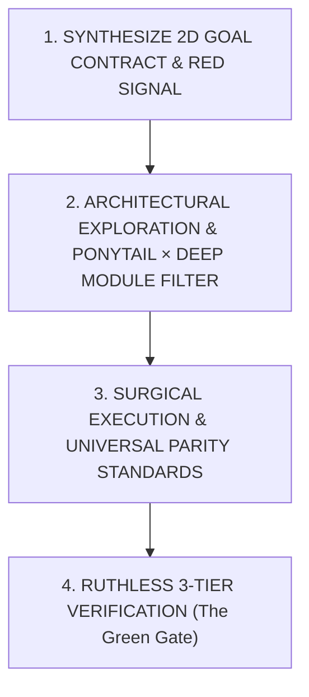

# Antigravity BoostX Protocol (`/boostx`)

When `/boostx` is invoked or high-discipline engineering is required, enter the **Antigravity BoostX Protocol**. This protocol dynamically synthesizes a **Task-Smart × Project-Smart Goal Contract**, enforces systematic root-cause analysis, anti-overengineering constraints (Ponytail × Deep Module Ladder), Dual-OS + OneDrive + IDE/CLI parity, composable `/goal` marathon discipline, and non-negotiable verification gates.

---

## 1. Execution Engine & Complexity Tier Selection

### A. Host Execution Engine
Depending on host runtime capabilities, select the appropriate execution engine:

* **Engine A: Unified Direct Persona (Default when running inline)**:
  * Operate directly in a **disciplined dual-phase persona**:
    1. **Investigator Persona**: Isolate root causes, map boundary conditions, define invariants, and construct a failing repro signal or pre-flight contract probe before touching production code.
    2. **Builder Persona**: Apply the Ponytail × Deep Module ladder, implement the shortest working diff, and execute 3-tier verification.
* **Engine B: Multi-Agent & Context-Compressed Delegation (`invoke_subagent` / `/cavecrew`)**:
  * Delegate specialized subtasks to preserve main-thread context across long sessions:
    * **`DeepCoder` / `cavecrew-builder`**: Minimal diff implementation (`invoke_subagent`).
    * **`DeepInvestigator` / `cavecrew-investigator`**: Root cause analysis, invariant mapping, or scanning >4 unfamiliar files so raw file dumps do not bloat the main context window.
    * **`cavecrew-reviewer`**: Adversarial diff review prior to completion.

### B. Dynamic Complexity Tier Scaling
Match ceremony to task scope in Step 0:
* **Tier 1 — Tactical Strike (1–2 files, localized bug/feature)**:
  1-line falsifiable hypothesis → minimal Ponytail surgical diff → 1 red→green verification check → done.
* **Tier 2 — Architectural Build (Multi-file feature, simulation solver, or refactor)**:
  Load workspace invariants (`/brief` mindset) → design Deep Module seam → incremental red→green verification → sync project logs.
* **Tier 3 — `/goal` Marathon Mode (Long-running autonomous execution)**:
  Activate Section 4.A (`/goal` Autonomous Marathon Contract) with scratch checkpointing, 3-strike anti-spin circuit breakers, subagent context offloading, and a strict exit gate before emitting `<!-- GOAL_COMPLETE -->`.

---

## 2. The 4-Phase BoostX Lifecycle

Every task executed under BoostX strictly advances through four progressive gates:



---

### Phase 1: Synthesize 2D Goal Contract & Build the Signal (Mandatory Pre-Edit Gate)

**Never write production code based on assumptions or surface symptoms.**

#### 1. Synthesize the 2D Goal Contract (`Task-Smart × Project-Smart`)
Select **ONLY the active Task Row** (zero overhead from unselected rows) and cross it with the active **Project Domain** to lock the task's Definition of Done:

| Task Archetype (Task-Smart Intent) | Dynamic Goal Contract & Execution Strategy |
| :--- | :--- |
| **`DEBUG / RCA`** *(Fix / Diagnose)* | **Goal**: *Reproduce exact failure (Red) → test cheapest falsifiable hypothesis with 0 speculative edits → apply minimal surgical fix → prove failure is gone (Green) with 0 regressions.* |
| **`BUILD / FEATURE`** *(Create / Add)* | **Goal**: *Design a Deep Module interface (simple I/O, rich internals) → build happy path with stdlib/native APIs first (Ponytail) → verify end-to-end + boundary edge cases → sync logs/docs.* |
| **`SIMULATE / SOLVER`** *(Physics / GH / Numerical)* | **Goal**: *Lock governing physics/math & unit bridge (`mm`/`cm`/`m` ↔ SI `m`/`kg`/`s`/`N`/`W/m²`, `deg` ↔ `rad`) → enforce timestep (`dt`) & max-iteration caps so UI/canvas never freezes → pass the **Physics Triad** (1: zero load/gradient = `0.0` with no `NaN`/`Inf`; 2: 1D analytical toy benchmark; 3: symmetry/conservation/monotonicity).* |
| **`REFACTOR / SIMPLIFY`** *(Clean / Restructure)* | **Goal**: *Capture baseline behavior snapshot BEFORE touching code → strip bloat, wrappers, and dead abstractions → verify 100% bit-for-bit behavioral equivalence.* |
| **`OPTIMIZE / SCALE`** *(Speed / Memory / Cost)* | **Goal**: *Record quantitative baseline first (ms, MB, query bytes, tokens) → isolate #1 hot bottleneck → optimize hot path only → prove measurable `Before → After` delta.* |
| **`AUDIT / PLAN / SHIP`** *(Inspect / Release)* | **Goal**: *For audits/plans: zero premature file mutations; deliver ranked findings with falsifiable trade-offs. For shipping: pre-flight secret/path/portability scan, version parity, and clean artifact build.* |

Cross the selected Task Row with the **Project Archetype Verification Harness**:
* **CAD / Rhino / Grasshopper (`.cs`, `.gh`, `.py`)**: Headless build (`dotnet build`), DataTree branch alignment (`{0;0}` topology invariants), non-blocking solver execution, and `/components-log` sync.
* **GIS / QGIS (`metadata.txt`, `qgis.core`, `PyQt5/6`)**: CRS transformation safety, Qt5/Qt6 enum parity (`/publish-qgis`), memory layer cleanup, and headless PyQGIS validation.
* **Web UI / Figma / Diagrams (`.html`, `.tsx`, `.css`, `.svg`)**: Zero console/runtime errors, DOM/viewport overflow bounds, and `/ui-design-brain` or `/diagram-design` token parity.
* **Data / GCP / ML (`bigquery`, `spark`, `.sql`, `.ipynb`)**: Step 0 Auth Pre-Flight (`/google-cloud-auth-verification`), SQL `--dry_run` cost check, schema grain integrity, and `/ml-best-practices` anti-leakage checks.
* **Agent Skills / CLI / Configs (`SKILL.md`, `hooks.json`, `.gemini`)**: `/create-skill` token/trigger hygiene, zero hardcoded user profile paths, and OneDrive + IDE/CLI surface parity.

State the 3-line contract concisely before mutating files:
> **🎯 BoostX Goal Contract** — `[Task Archetype]` × `[Project Archetype]` (`Tier 1|2|3`)
> • **Target State**: <1-sentence concrete outcome>
> • **Red → Green Proof**: <Exact falsifiable check for this task & stack>
> • **Guardrails**: <Ponytail boundary + Parity/OneDrive/Unit invariant>

#### 2. Construct the Feedback Signal (Tri-Track)
* **Track A: Bugs, Failures & Regressions**:
  - Formulate **one exact command** (test invocation, python script, CLI call, or curl) that reproduces the failure.
  - **Execute the command and observe it go RED**: If you cannot prove it fails before the change, you cannot prove your code fixed it afterward.
* **Track B: Greenfield Features, New Modules & Pipelines**:
  - Execute a **Pre-Flight Contract Probe**:
    1. Verify prerequisite input data, schemas, and dependencies exist on disk.
    2. Define explicit mathematical/data invariants, schema, and output contract.
    3. Run an import/presence probe confirming the absence or baseline state before writing code.
* **Track C: Simulations, Solvers & Physics Engines (`SIMULATE / SOLVER`)**:
  - Establish a **First-Principles & Dimensional Probe**:
    1. Explicitly map CAD document units (e.g., Rhino `ModelUnitSystem` `mm`/`cm`/`m`) to SI solver units (`m`, `kg`, `s`, `N`, `W/m²`, `radians`).
    2. Define numerical stability bounds (Courant/CFL timestep `dt`, damping factor, convergence epsilon `ε`, and hard iteration cap).
    3. Build a 1-element / 2-node analytical toy case with a known closed-form result.

---

### Phase 2: Architectural Exploration & Ponytail × Deep Module Ladder

Before implementing, use fast semantic triage (`/laya` mindset) to prune dead-end hypotheses and evaluate 2–3 solution vectors against the **Ponytail × Deep Module Ladder**:

1. **Vector Comparison**:
   - **Vector A (Simplification / Deletion / Config)**: Eliminates the complexity altogether (YAGNI) or fixes config/stdlib usage.
   - **Vector B (Surgical Local Fix)**: Smallest touchpoint; patches the root cause at the immediate seam.
   - **Vector C (Deep Module Seam)**: When new structure is genuinely needed, design a **Deep Module** (`/codebase-design`): *a tiny, obvious public interface hiding substantial internal logic*—never shallow pass-through wrappers or speculative abstractions.
2. **The Ponytail Ladder Filter**:
   - **Step 1 (YAGNI)**: Does this feature or abstraction really need to exist? Delete or skip speculative code.
   - **Step 2 (Codebase Reuse)**: Does a helper, utility, or established pattern already exist in the repository?
   - **Step 3 (Stdlib / Native First)**: Prefer standard library functions (`os`, `sys`, `json`, `math`, `pathlib`) and native platform features over adding external libraries.
   - **Step 4 (Shortest Working Diff & Debt Tagging)**: Choose the approach with minimal blast radius. Tag any deliberate shortcut with `// ponytail: <reason>` so `/ponytail-debt` can harvest it.

---

### Phase 3: Surgical Execution & Dual-OS Standards

1. **Single Variable Mutation**:
   - Modify only one logical seam at a time to satisfy the invariants. Never stack multiple untested edits across files.
2. **Surgical Line Edits Over Whole-File Overwrites**:
   - For modifying existing code, always use surgical line-replacement tools (`replace_file_content` / `multi_replace_file_content`).
   - Reserve `write_to_file` strictly for new files to prevent accidental deletion of existing comments, types, or docstrings.
   - Never pass `ArtifactMetadata` when modifying or writing project codebase files.
3. **Preserve Documentation & Comments**:
   - Maintain existing comments, docstrings, and type annotations unless specifically obsolete.
4. **Clean Typography**:
   - Use direct Unicode symbols (`→`, `←`, `×`, `≈`, `±`, `≤`, `≥`, `✓`, `✨`) instead of inline LaTeX math notation.

---

### Phase 4: Ruthless 3-Tier Verification (The Green Gate)

A BoostX task is **only complete when terminal execution logs provide concrete proof**:

1. **Tier 1: Before State (Repro / Baseline Proof)**:
   - Confirm the initial failure log (Track A), pre-flight baseline probe (Track B), or analytical toy benchmark (Track C).
2. **Tier 2: After State (Pass, Boundary & Mutation Proof)**:
   - Run the exact feedback signal on the updated code and demonstrate a clean **GREEN** pass.
   - Verify at least one boundary edge case (null/empty input, zero-load/`dt=0` identity case with zero `NaN`/`Inf`, max limit).
   - **Mutation Sanity Check**: Confirm that reverting the core fix would cause the verification check to fail.
3. **Tier 3: Ponytail Bloat Strip, Regression & Anti-Hardcode Sweep**:
   - Strip any newly added helper, import, or wrapper that can be removed without breaking the Green signal.
   - Run sibling tests/compilers to guarantee zero regressions.
   - **Portability & Anti-Hardcode Audit**: Sweep all modified or created files for hardcoded machine user paths (`C:\Users\<User>\...`, `/Users/<username>/...`, `/home/<username>/...`) or secrets:
     - PowerShell (Windows):
       ```powershell
       git diff --name-only | ForEach-Object { Select-String -Path $_ -Pattern '(?i)([a-z]:[/\\]users|/Users/|/home/)' }
       ```
     - Bash/Zsh (macOS/Linux):
       ```bash
       git diff --name-only | xargs grep -E -i "([a-z]:/users|/Users/|/home/)"
       ```

---

## 3. Universal Parity Protocol (Dual-OS + OneDrive Multi-PC + IDE/CLI)

Whenever engineering across the multi-machine ecosystem (Windows Desktop PC, ASUS Laptop, macOS MacBook synced via OneDrive, across both **Antigravity IDE** and **Antigravity CLI `agy`**):

1. **Strict Relative & Dynamic Home Path Invariant (OneDrive Multi-PC Safe)**:
   - Never hardcode machine-specific user profile paths (`C:\Users\<User>\...` or `/Users/<username>/...`) in configuration files, plugin hooks, skills, scripts, or documentation—hardcoded usernames break other PCs as soon as OneDrive syncs.
   - Always derive paths relative to script location or current working directory:
     ```python
     SCRIPT_DIR = os.path.dirname(os.path.abspath(__file__))
     ```
   - For global configuration entries, use home-relative `~/` or runtime environment expansion (`$env:USERPROFILE`, `$HOME`, `pathlib.Path.home()`, `os.path.expanduser("~")`).
2. **POSIX Path Separators**:
   - Always use forward slashes `/` or `pathlib.Path` / `os.path.join` across Python, JavaScript, and configuration files.
3. **Shell Dialect & NTFS Junction Awareness**:
   - Distinguish between PowerShell on Windows (`Get-ChildItem`, `Select-String`, `$env:VAR`) and zsh/bash on macOS/Linux (`ls`, `grep`, `export VAR`).
   - Remember that in Windows PowerShell 5.1, `Get-ChildItem -Recurse` does not traverse into NTFS directory junctions (such as `~/.gemini/config` → `OneDrive/gemini-config`) unless you `cd` into or directly target the resolved path.
4. **Antigravity Dual-Surface Parity (`Antigravity IDE` ↔ `Antigravity CLI / agy`)**:
   - `agy` CLI executes plugin hooks (`PreToolUse`/`PostToolUse` in `hooks.json`) strictly as direct process invocations without a shell wrapper and **fails-closed** on non-zero exit codes.
   - Always use relative script filenames inside plugin hook definitions (never hardcoded user profile paths or shell-only `; exit 0` suffixes) so hooks work identically across IDE and CLI on all OneDrive-synced machines.
5. **Encoding & Line Endings Standard**:
   - Always enforce UTF-8 output streams in Python tools:
     ```python
     if sys.stdout and hasattr(sys.stdout, "reconfigure"):
         sys.stdout.reconfigure(encoding="utf-8")
     ```
   - Ensure git attributes enforce LF normalization to prevent CRLF sync churn across OneDrive or Git.
6. **Atomic File Writes for Cloud Sync**:
   - When writing to cloud-synced folders (OneDrive, Google Drive), write to a temporary file and atomically replace to avoid creating sync-conflict duplicates (`filename (1).ext`) or leaving `.lck` files.
7. **Zero-Directory-Nesting Invariant**:
   - When copying or moving directory trees, prevent self-named recursive subdirectories (`dir/dir`). Never create nested secondary NTFS junctions inside `skills/<name>/`.
8. **Ephemeral Scratch Hygiene**:
   - All temporary repro scripts or scratch test files must live in designated scratch folders or be removed prior to task completion (`git status --short`).
9. **Dual-OS Shell Launcher Parity Invariant**:
   - Any server runner, pipeline precomputation job, or batch execution script created in the workspace must provide synchronized dual entry-points (`.bat`/`.cmd` for Windows and `.sh` with `#!/usr/bin/env bash` for macOS/Linux).

---

## 4. Composable `/goal` Marathon, `/researchx` Escalation & Session Timeout Safety

### A. `/goal` Autonomous Marathon Contract
When `/boostx` is paired with `/goal` for long-running autonomous execution:
1. **Persistent Scratch Checkpoint Ledger**: For runs >10 steps, maintain `<artifactDir>/scratch/boostx_state.md` tracking:
   - *Step 0 BoostX Goal Contract & Acceptance Criteria*
   - *Verified Completed Milestones (with command proof)*
   - *Falsified Dead Ends (so post-compaction rounds never repeat failed approaches)*
2. **3-Strike Anti-Spin Circuit Breaker**:
   - If the same command, test, or approach fails **3 times**, **STOP** editing production files. Isolate a <30-line reproduction script in `scratch/` or pivot hypotheses.
   - If a global environment lock (e.g., broken system hook or missing external credential) blocks tool execution and cannot be bypassed in-session, output a concise diagnostic + copy-paste fix and terminate cleanly rather than spinning in an infinite loop.
3. **Anti-Premature `GOAL_COMPLETE` Gate**:
   - Never emit `<!-- GOAL_COMPLETE -->` on the same turn a major code edit is written unless fresh Phase 4 verification has executed and passed *after* the final edit.

### B. Composable `/researchx` & `/deep-researchx` Escalation Rule (Zero Default Overhead)
* **Stay Local & Fast by Default**: Do **not** run external web/literature research on standard debugging, refactoring, or UI tasks.
* **When to Escalate**:
  * Invoke [`/researchx`](../researchx/SKILL.md) for fast tactical primary-source lookups (checking an unfamiliar SDK signature, pinned version, or single physical constant).
  * Invoke [`/deep-researchx`](../deep-researchx/SKILL.md) when the user explicitly pairs `/deep-researchx` or `/deep-research`, OR when a task requires multi-agent precedent harvesting, blind adversarial fact-auditing, multi-system architecture benchmarking, or full mathematical/standard formulation with a 1D analytical benchmark.

### C. Anti-Hanging & Session Timeout Safety
* **No Long Blocking Commands**: Never run commands that block synchronously for >30 seconds.
* **Non-Interactive CLI Flags**: Always invoke CLI tools (`pip`, `npm`, `npx`, `conda`, `dotnet`, `git`) with non-interactive flags (`-y`, `--yes`, `--no-input`, `--quiet`, `--batch`, `PAGER=cat`, `CI=true`).
* **Background Task Protocol**: For long builds, test suites, or simulations, launch with a small `WaitMsBeforeAsync` (e.g. `500ms`), immediately end your turn, and never poll `manage_task(Action='status')`.

---

## 5. BoostX Verification Checklist & Knowledge Ratchet

Before declaring any BoostX task finished (and mandatory before `<!-- GOAL_COMPLETE -->`), verify all checkpoints:

- [ ] **2D Goal Contract Locked**: Explicitly matched Task Archetype × Project Archetype in Phase 1.
- [ ] **Signal / Contract Established**: Proved the failure state (Track A), pre-flight contract probe (Track B), or dimensional/toy benchmark (Track C) prior to editing.
- [ ] **Ponytail × Deep Module Applied**: Solution is minimal, stdlib-first, uses Deep Module interfaces where structured, and strips speculative bloat.
- [ ] **Surgical Edits Used**: Modified existing files via line replacements; zero accidental whole-file wipes or metadata leakage.
- [ ] **Universal Parity Checked**: Paths are relative/dynamic (`~/`, `$env:USERPROFILE`, `$HOME`), UTF-8 enforced, OneDrive multi-PC safe, and IDE/CLI hook-safe.
- [ ] **Dual-OS Launcher Parity Verified**: Any dev server or batch script provides paired `.bat` and `.sh` launchers.
- [ ] **Non-Interactive CLI Enforced**: Commands pass `-y` / `--no-input` / `PAGER=cat` to prevent session hanging.
- [ ] **Green Signal & Physics Triad Verified**: Fresh verification output proves pass state, boundary safety (`NaN`/`Inf`/null guards), and mutation validity.
- [ ] **Zero Regressions & Anti-Hardcode Sweep**: Confirmed sibling modules intact; zero machine-specific user paths (`C:\Users\<User>\...`, `/Users/<username>/...`) or secrets in diff.
- [ ] **Scratch Debris Cleaned & Knowledge Ratcheted**: Temporary test scripts removed; any newly discovered project invariant is noted or synced via `/update-doc` / `/components-log`.
