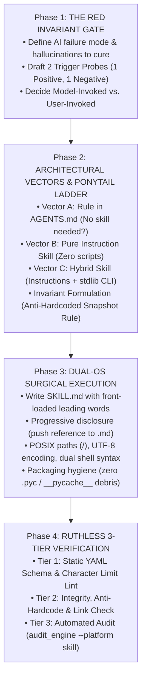
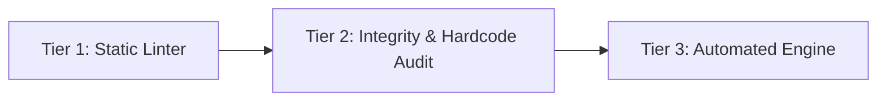

# Antigravity Skill Creator (`/create-skillx`) — BoostX Edition

Authoring, distilling, optimizing, and verifying production-grade agent skills across **Antigravity IDE**, **Claude Code**, and cross-platform multi-agent environments.

This skill synthesizes three core frameworks:
1. **The BoostX Protocol**: 4-phase engineering lifecycle (Red Invariant Gate → Ponytail Architectural Gate → Dual-OS Surgical Build → Ruthless 3-Tier Verification).
2. **`writing-great-skills` Discipline**: Information hierarchy, progressive disclosure, leading words, and context-load vs. cognitive-load optimization.
3. **Universal Cross-Platform Globalization**: Physical directory allocation, dual-OS path normalization (Windows PowerShell + macOS/Linux bash), and zero-breakage cloud synchronization (OneDrive / Google Drive).

---

## 1. Scope & Universal Globalization Policy

Every agent skill authored via `/create-skillx` **MUST be created in the Global Customizations Root** so that it is instantly accessible across **every workspace** and synchronized across **every device** (Windows Desktop PC, ASUS Laptop, and macOS MacBook):

| Target Path | Physical Cloud Storage | Behavior Across Workspaces & Devices |
| :--- | :--- | :--- |
| **`~/.gemini/config/skills/<skill-name>/`** | **OneDrive (`gemini-config/skills/<name>/`)**<br>• Windows: `C:\Users\<User>\OneDrive\gemini-config\skills\<name>\`<br>• macOS: `~/Library/CloudStorage/OneDrive-Personal/gemini-config/skills/<name>/` | **Universal Globalization**: Automatically loaded into every workspace on all machines. Real-time background sync via OneDrive. Zero git-push or symlink chore required. |

> [!IMPORTANT]
> **The Universal Globalization Invariant (Zero Project-Local Silos)**:
> Never create skills inside a workspace-local `.agents/skills/<name>/` folder. Local project skills become isolated silos that are invisible when opening other repositories, and they cause version drift between machines. Always write directly to `~/.gemini/config/skills/<name>/`.

> [!IMPORTANT]
> **The NTFS Junction & Real Directory Rule**:
> When authoring global skills on Windows where `~/.gemini/config` is an NTFS junction to `OneDrive\gemini-config`, **always create real directories** inside `skills/<name>/`. Never create nested secondary junctions, as IDE file watchers and Node.js globbers refuse to traverse recursive reparse points.

> [!TIP]
> **Global Git Ledger & Rollback Protection**:
> The `OneDrive\gemini-config` root is version-controlled via a local Git repository. After creating or updating a skill, commit the change:
> ```powershell
> git -C "$env:USERPROFILE\OneDrive\gemini-config" add -A
> git -C "$env:USERPROFILE\OneDrive\gemini-config" commit -m "feat(skills): add <skill-name>"
> ```
> This protects your global skills against cloud sync conflicts and gives you instant rollback capability.

---

## 2. Ingestion Modes

The skill operates in two distinct modes based on context:

### Mode A: Session Distillation ("Make this a skill")
* Triggered when the user says *"make this a skill"*, *"package what we just did"*, or *"turn this workflow into a reusable skill"*.
* Reads the active conversation history / transcript (`transcript.jsonl`).
* Extracts the sequence of successful shell commands, error recoveries, tool calls, and output schemas.
* Strips debugging detours and synthesizes the distilled, repeatable path into clear steps.

### Mode B: Greenfield Architecture ("Create a skill for X")
* Triggered when building a skill from an API, library documentation, PRD, or new domain (e.g. QGIS analysis, Grasshopper solver, Docx processing).
* Conducts a focused, non-bloated 3-question interview (Intent, Tools/Inputs/Outputs, Edge Cases).

---

## 3. The 4-Phase BoostX Skill Creation Lifecycle



---

### Phase 1: The Red Invariant Gate (Pre-Creation)

Answer these three questions before drafting:

1. **What is the Red Failure Mode?**
   * What does the model get wrong without this skill? (e.g. uses deprecated methods, hallucinates non-existent tools, ignores rate limits, fails on cross-platform paths).
2. **Invocation Decision (Context Load vs. Cognitive Load)**:
   * **Model-Invoked** (Default): Keeps a rich `description` with triggers and branch keywords. Contributes context load every turn; agent can trigger it autonomously during pair-programming.
   * **User-Invoked**: Set `disable-model-invocation: true`. Strips agent triggers. Only fires when typed explicitly by the user (e.g., destructive operations, maintenance runs). Zero context load.
     > [!WARNING]
     > **`disable-model-invocation: true` suppresses prompt context**: In Antigravity IDE, setting this flag completely strips the skill from the agent prompt's `<skills>` catalog. The agent will **NOT** know this skill exists and cannot invoke it autonomously. Only set this for manual user-typed commands.
3. **Trigger Probes**:
   * **Positive Probe**: A user prompt that *must* trigger the skill.
   * **Negative Probe**: A related but out-of-scope prompt that *must NOT* trigger it.

---

### Phase 2: Architectural Vectors & The Ponytail Ladder

Run the Ponytail Senior Dev Filter to determine the simplest structure:

* **Rung 1 (YAGNI / Rule Check)**: Does this actually need a skill? If it's a 2-line behavioral preference ("always use UTF-8", "no LaTeX math"), put it in `AGENTS.md` / rules instead.
* **Rung 2 (Tool Reuse)**: Do native tools or installed MCP servers (`gh`, `git`, `qgis`, `rhino`) already do this? If yes, instruct the model to call them directly. Do NOT write wrapper code.
* **Rung 3 (Structure Selection)**:
  * **Workflow Archetype**: Ordered steps, sequential checklist, completion criteria (e.g., `/syncx`, deployment pipeline).
  * **Task Toolkit Archetype**: Independent sub-actions with quick-starts (e.g., `/illustrator`, PDF toolkit).
  * **Reference Archetype**: Rules, domain definitions, style guidelines (e.g., `writing-great-skills`).
* **Rung 4 (Code vs. No-Code)**:
  * Default to **Pure Instruction (Zero Code)**.
  * Only produce a script (`scripts/run.py`) if deterministic file parsing, mathematical transformations, or API rate-limiting are required.
  * If a script is required: use Python stdlib (`argparse`, `pathlib`, `json`, `urllib`) — avoid third-party dependencies unless strictly necessary.

#### Core Architectural Invariant: Anti-Hardcoded Ephemeral Metrics
* **Strict Rule**: Never hardcode transient, volatile dataset counts (e.g. "all [N] layers", "14,203 rows", "5,924 complaints") into general skill guardrails or instructions.
* **Rationale**: Datasets grow, shrink, and evolve across project milestones. Hardcoding snapshot numbers causes instant documentation staleness, triggers false-positive synchronization diffs between machines, and obscures the universal architectural principle.
* **Invariant Formulation Pattern**: Always formulate guardrails as **timeless behavioral protocols** paired with actionable alternative patterns:
  - *Anti-Pattern*: "Never query across all [N] layers."
  - *Invariant Standard*: "**Bounded Scope (Zero Full-Project Dumps)**: Never execute unbounded discovery calls across the canvas root (e.g. avoid unfiltered `get_layers()`, root `get_layer_tree()`, or dumping `mapLayers().values()`). Treat the layer tree as an indexed database: use `find_layer(name="...")` or scope-bound group probes."

---

### Phase 3: Dual-OS Surgical Execution

When authoring the skill files, enforce strict cross-platform standards:

#### 1. Structure Blueprint
```
skill-name/
├── SKILL.md              ← Required. Frontmatter + Core Instructions (< 500 lines)
├── references/           ← Optional. Deep docs loaded on-demand via pointers
└── scripts/              ← Optional. Deterministic CLI helpers (stdlib-first)
```

#### 2. YAML Frontmatter Template
```yaml
---
name: [lowercase-hyphenated-name-max-64-chars]
description: >
  [Leading-word summary in 1 sentence].
  Use this skill when [primary triggers, exact keywords, slash command].
  Also use when [secondary triggers, synonyms, user intents].
  Do NOT use for [explicit negative exclusions to prevent false triggers].
---
```

> [!NOTE]
> **Antigravity Schema Standardization**: Antigravity natively standardizes on `name` and `description`. Avoid non-standard fields like `argument-hint: "<task>"` unless cross-compiling for Claude Code CLI, as non-standard keys can break slash autocomplete indexing in some Antigravity IDE builds.

#### 3. Dual-OS & Portability Invariants
* **POSIX Paths**: Use forward slashes (`/`) exclusively in markdown links and code paths.
* **No Hardcoded Absolute Roots**: Never hardcode `C:\Users\...` or `/Users/...`. Derive paths relative to workspace or use home-relative `~/` or `%USERPROFILE%` / `%APPDATA%` paths.
* **Strict Forward-Slash Links**: Zero backslashes (`\`) inside markdown links `[...](...)`. Backslashes break in web renderers, GitHub markdown, and Unix platforms.
* **Cross-Platform Command Lines**: When providing terminal commands in `SKILL.md`, provide dual-OS global syntax:
  - macOS/Linux: `python ~/.gemini/config/skills/...`
  - Windows (PowerShell): `python "$env:USERPROFILE\.gemini\config\skills\..."`
* **Packaging Hygiene**: Keep skill directories clean. Never commit or distribute `__pycache__` directories or `.pyc` bytecode files.
* **UTF-8 & Bytecode Python Header Standard**: Every generated Python helper script or verification probe must start with `sys.dont_write_bytecode = True` and the standard BoostX stream guard to prevent `__pycache__` debris and Windows terminal `cp1252` encoding crashes on symbols (`✓`, `→`, `✨`):
  ```python
  import sys
  sys.dont_write_bytecode = True
  if sys.stdout and hasattr(sys.stdout, "reconfigure"):
      sys.stdout.reconfigure(encoding="utf-8")
  ```

---

### Phase 4: Ruthless 3-Tier Verification (The Green Gate)

A skill is **NOT finished** until it passes all three automated verification tiers:



#### Tier 1: Static Frontmatter Linter
* `name` matches regex `^[a-z0-9-]+$` and is ≤ 64 characters.
* `description` exists and is ≤ 1024 characters.
* **Context Budget Conciseness**: Target description length is ≤ 250 characters (strictly ≤ 400 characters). Overly long descriptions bloat the system prompt and trigger Antigravity's context budget limit, causing other skills to be silently excluded.
* If model-invoked: Description contains both positive trigger keywords and an explicit `Do NOT use for` negative exclusion clause.
* Frontmatter starts on line 1 with `---` and ends with `---`.

#### Tier 2: Integrity, Anti-Hardcode & Ephemeral Scan
* **Universal Globalization Verification**: Verify that the skill is stored in the Global Customizations Root (`~/.gemini/config/skills/<name>/` / `OneDrive\gemini-config\skills\<name>\`). Flag any skill saved inside a workspace-local `.agents/` folder as non-globalized.
* **Zero-Hardcode & Secret Audit**: Run an automated regex check across all created files (`.md`, `.py`, `.sh`, `.json`):
  * **Machine Paths**: Flag any line matching `(?i)([a-z]:[/\\]users[/\\]|/Users/|/home/)` (unless sanitized as `<User>` or `<username>`).
  * **Secrets & Tokens**: Flag any unredacted token matching `(?i)(api[_-]?key|secret|token)\s*[:=]\s*["'][a-zA-Z0-9_\-\.]{16,}["']`.
* **Zero-Recursive-Nesting Invariant**: Verify no self-named child folder exists (`assert not (skill_dir / skill_dir.name).exists()`).
* **Anti-Hardcoded Ephemeral Metrics**: Scan for `all \d+ layers` or transient dataset counts; replace with behavioral protocols.
* **Markdown Link Integrity & Forward-Slash Check**:
  * Every relative link (`[file](...)`, `references/...`, `scripts/...`) must resolve to a real file on disk.
  * Zero backslashes inside markdown link parentheses (`assert not re.search(r'\[.*?\]\([^\)]*\\[^\)]*\)', text)`).
* **Script Compilation**: If Python scripts are included, compile them for syntax:
  ```bash
  python -m py_compile scripts/*.py
  ```

#### Tier 3: Automated Pre-Flight Engine Verification
Execute the universal audit engine with the `--platform skill` profile:

**macOS / Linux**:
```bash
python ~/.gemini/config/skills/publishx-audit/scripts/audit_engine.py <skill_directory> --platform skill
```

**Windows (PowerShell)**:
```powershell
python "$env:USERPROFILE\.gemini\config\skills\publishx-audit\scripts\audit_engine.py" <skill_directory> --platform skill
```

Must exit with **`VERDICT: PASS`** (0 blocking issues) before declaring completion.

---

## 4. Post-Creation Summary Rubric

When reporting the newly created skill to the user, provide:
1. **Skill Name & Scope**: Global Customizations Root (`~/.gemini/config/skills/<name>/`).
2. **Physical Location**: Clickable file link to `SKILL.md`.
3. **Trigger Invariants**: The primary slash command and keywords that trigger it.
4. **Verification Pass**: Confirmation that Tier 1, 2, and 3 checks passed cleanly via `audit_engine.py --platform skill`.
