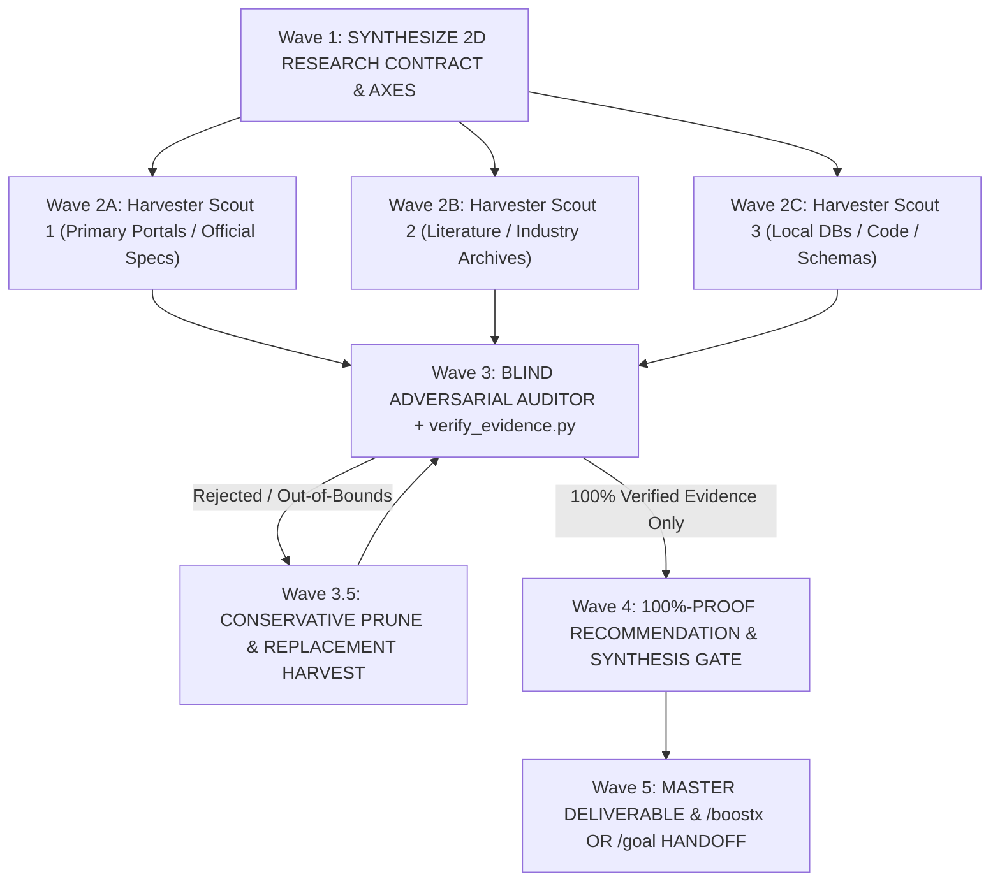

# Antigravity Deep-ResearchX Protocol (`/deep-researchx`)

When `/deep-researchx` (or `/deep-research`) is invoked, enter the **Antigravity Deep-ResearchX Protocol**. Deep-ResearchX is a universal, domain-agnostic **5-Wave Multi-Agent Harvester ↔ Blind Adversarial Auditor & 100%-Proof Synthesis Engine**.

Unlike quick single-pass lookups ([`/researchx`](../researchx/SKILL.md)), `/deep-researchx` dynamically synthesizes its own evaluation framework, fans out parallel harvester subagents, spawns an independent **Blind Adversarial Auditor** to falsify dates/attributions/metrics/URLs, prunes and re-harvests invalid candidates, and binds every recommendation to a primary-source receipt.

---

## 1. The 5-Wave Deep-ResearchX Lifecycle

Every `/deep-researchx` execution strictly advances through five progressive waves:



---

## 2. Wave 1: Synthesize 2D Research Contract & Criteria (`Step 0`)

**Never start searching or scraping before locking the evaluation framework and proof criteria.**

### A. Context Inheritance First (`/briefx` Hook)
Before inventing new rules, perform a fast bounded check of the active workspace for existing domain conventions (`CONTEXT.md`, `AGENTS.md`, `Guidelines/*.md`, `docs/*protocol*.md`, or target `.json`/`.sqlite` schemas). If local rules exist, inherit their exact schema, category/date buckets, and narrative format.

### B. Synthesize the 2D Research Contract (`Intent × Domain`)
Select **ONLY the active Research Intent Row** and cross it with the active **Knowledge Domain Harness**:

| Research Intent Archetype | Self-Synthesized Goal, Criteria & Execution Strategy |
| :--- | :--- |
| **`HARVEST / CURATE`** *(Case Studies, Precedents, Datasets, Catalogs)* | **Goal**: *Derive target schema, category/date/scope bounds, and quota count → fan out Harvester Scouts to scrape primary pages → run **Blind Adversarial Auditor** on every record → **delete & re-harvest** out-of-bounds or unverifiable entries until 100% of quota passes.* |
| **`VERIFY / AUDIT`** *(Fact-Checking Existing JSON / DB / Drafts / Claims)* | **Goal**: *Treat existing records/claims as untrusted → run `verify_evidence.py` + Blind Auditor against primary sources → classify `VERIFIED` / `INCORRECT` / `UNVERIFIED` with discrepancy evidence → apply conservative in-bounds fixes or prune & replace.* |
| **`BENCHMARK / COMPARE`** *(Evaluating Competing Tools, Systems, Precedents)* | **Goal**: *Synthesize 4–6 orthogonal evaluation axes → spawn 1 Scout per candidate → extract quantitative metrics, trade-offs, and failure modes → build `mermaid` architecture comparison + weighted decision matrix.* |
| **`FORMULATE / MODEL`** *(Physics, Algorithms, Mathematical Models, Specs)* | **Goal**: *Lock governing equations, dimensional unit bridge (input units ↔ SI), empirical coefficients, boundary conditions, and stability limits from standards/papers → construct a closed-form **1D Analytical Toy Benchmark**.* |
| **`REVERSE-ENGINEER / TRACE`** *(SDKs, Databases, Binaries, Undocumented APIs)* | **Goal**: *Lock local pinned versions from manifests first → inspect local schemas/binaries/ASTs + upstream source code, tests, and specs → map exact internal pipeline and invariants.* |
| **`STRATEGIZE / RECOMMEND`** *(Design Proposals, Architecture Decisions, Policy)* | **Goal**: *Establish verified facts & constraints first → pass the **100%-Proof Recommendation Gate**: every recommendation must bind to `[VERIFIED FACT]` receipts and explicitly separate proven facts from `[RECOMMENDED SYNTHESIS]`.* |

Cross the selected Intent with the **Universal Domain Proof Harness**:
* **Built Environment, Design & Case Study Precedents** *(Architecture, Landscape, Urbanism, Industrial Design)*:
  * **Primary Sources**: Official designer/firm portfolios, municipal/institutional portals, accredited award archives, and primary industry publications.
  * **Hard Proof Criteria**:
    1. **Temporal Disambiguation**: Strictly distinguish `Physical Completion / Inauguration Year` from `Policy Launch Year`, `Masterplan / Competition Year`, or `Ongoing Maintenance Year`.
    2. **Attribution Lock**: Verify the actual `Lead Designer / Author of Record` directly on the project page.
    3. **Narrative & Outcome Completeness**: Capture `Overview`, `Problem / Goal`, `Systemic Solution / Approach`, `Physical / Material / Spatial Elements`, and `Verified Quantitative/Qualitative Impacts` (zero invented percentages).
* **Physical Sciences, Simulation & Quantitative Modeling** *(Physics, Hydrology, Environmental, Structural, Numerical Solvers)*:
  * **Primary Sources**: International/national standards (ISO, EN, ASHRAE, IEEE, ASTM, CIRIA), peer-reviewed literature, and government technical manuals.
  * **Hard Proof Criteria**: Dimensional homogeneity (SI unit balance across every equation term), valid parameter bounds, numerical stability limits (`dt`, CFL, convergence `ε`), and a closed-form **1D Analytical Toy Benchmark**.
* **Software, Systems & Computational Engineering** *(Code, APIs, CAD/3D, GIS, Cloud, ML)*:
  * **Primary Sources**: Pinned workspace manifests (`package.json`, `pyproject.toml`, `Cargo.toml`, `*.csproj`, `metadata.txt`), local package/binary/DB probes (`sqlite3`, `xml`, `ast`), official version-matched specs, upstream source & tests.
  * **Hard Proof Criteria**: Pinned version parity, exact type/method signatures, `file:line` or deep-link citations, and O(N) runtime/memory bounds.
* **Natural Sciences, Ecology & Empirical Datasets** *(Biology, Botany, Climate, Geodata)*:
  * **Primary Sources**: Canonical scientific registries, peer-reviewed empirical studies, and official institutional datasets.
  * **Hard Proof Criteria**: Taxonomic/nomenclatural accuracy, SI measurement units, geographic/climatic scope bounds, and primary study citations.
* **Policy, Strategy, Market & General Research** *(Economics, Law, Business, Humanities)*:
  * **Primary Sources**: Statutory/regulatory filings, primary institutional reports, first-party documentation, and audited datasets.
  * **Hard Proof Criteria**: Publication date currency, jurisdiction/scope alignment, and multi-source corroboration for quantitative claims.

Output the 4-line contract before spawning scouts:
> **🧠 Deep-ResearchX Contract** — `[Research Intent]` × `[Knowledge Domain]`
> • **Target Deliverable & Quota**: <Exact output files, schema, and record/axis count>
> • **Orthogonal Research Axes**: <3–6 distinct axes to investigate>
> • **Hard Disambiguation & Proof Rules**: <Exact date/version/unit/attribution gates that will reject invalid candidates>

---

## 3. Wave 2: Parallel Harvester Swarm (`invoke_subagent`)

Decompose the investigation across **2–4 concurrent Harvester Subagents** via parallel `invoke_subagent` calls in the same turn (e.g., splitting by category, era bucket, candidate system, or local code vs. external standards):

1. **Deep-Link Content Scraping Mandatory**:
   * Harvesters must **never** trust search-snippet blurbs alone. For every candidate fact or case study, the Harvester must fetch the actual page or file text (`read_file`, `read_url_content`, `search_web`, or Python `urllib`) to extract verbatim evidence.
   * **Ban on Root-Domain Lazy Links**: Never cite a bare homepage (`https://example.org/`) as proof. Every citation must be a specific deep link (`https://example.org/projects/specific-project-slug`) or exact local `file:///path#L10-L20`.
2. **Structured Evidence Dossier Return**:
   * Each Harvester returns a structured dossier containing:
     * `Candidate / Claim ID`
     * `Extracted Fields / Equations / Metrics`
     * `Primary Deep-Link URL or Local Path`
     * `Verbatim Evidence Snippet` (the exact 1–2 sentences or table row from the source proving the date, author, formula, or metric)

---

## 4. Wave 3: Blind Adversarial Auditor & Prune-and-Replace Loop

**Core Rule: Never let the Harvester grade its own homework.**

### A. Independent Adversarial Audit
After Wave 2 completes, run a two-layer audit on all harvested candidates:
1. **Deterministic Script Gate (`scripts/verify_evidence.py`)**:
   Run the bundled verification CLI against the draft Markdown or JSON file to catch bare root-domain URLs, placeholder tokens (`[TBD]`, `TODO`), schema/count mismatches, out-of-bounds years, and dead HTTP links:
   * **Windows (PowerShell)**:
     ```powershell
     python "$env:USERPROFILE\.gemini\config\skills\deep-researchx\scripts\verify_evidence.py" "<target_md_or_json>" --check-http
     ```
   * **macOS / Linux**:
     ```bash
     python ~/.gemini/config/skills/deep-researchx/scripts/verify_evidence.py "<target_md_or_json>" --check-http
     ```
2. **Blind Adversarial Auditor Subagent**:
   For multi-record datasets, case studies, or critical specifications, spawn a dedicated **Auditor Subagent** instructed with a **Red-Team Falsification Prompt**:
   * *"Assume the Harvester conflated project names, confused policy/proposal years with physical completion years, misattributed authors, or cited unsupported numbers. Independently verify each record against its primary source and classify as `VERIFIED`, `INCORRECT (with actual truth)`, or `UNVERIFIED`."*

### B. Wave 3.5: Conservative Prune & Replacement Harvest Loop (Zero Data Forgery)
When the Wave 3 Auditor flags an entry as `INCORRECT` or `UNVERIFIED`:
* **In-Bounds Correction**: If the true verified fact still satisfies the user's constraints (e.g., correcting `2024` → `2025` within a `2024–2026` bucket, or updating a parameter coefficient to match the official standard), update the record with the verified value and source.
* **Out-of-Bounds Deletion & Re-Harvest**: If the true verified fact violates the user's scope bounds (e.g., a project was actually built in `2013` instead of `2020–2026`, or a project title does not exist), **delete the entry immediately**. Never forge dates, authors, or metrics to fit a narrative slot.
* **Replacement Dispatch**: Immediately spawn a targeted Wave 3.5 Replacement Scout to harvest a genuine replacement for the missing slot and re-audit it through Wave 3 until **100% of required slots/axes pass verification**.

---

## 5. Wave 4: The 100%-Proof Recommendation & Synthesis Gate

Before writing any conclusion, design proposal, architectural recommendation, or strategy report, enforce **100% Claim-to-Receipt Binding**:

1. **No Naked Claims or Recommendations**:
   Every factual assertion, metric, or parameter must carry an inline **Evidence Receipt**:
   * **Format**: `<Claim / Metric / Equation> — Proven by: "<Verbatim quote or exact parameter>" ([Primary Source, Year/Version](https://deep-link-or-file))`
2. **Strict Separation of `[VERIFIED FACT]` vs. `[RECOMMENDED SYNTHESIS]`**:
   When recommending how the user should design, build, or strategize based on the research, explicitly distinguish:
   * **`[VERIFIED FACT / PRECEDENT]`**: 100% proven by primary-source receipts from Waves 2–3.
   * **`[RECOMMENDED SYNTHESIS]`**: Your reasoned engineering/design recommendation derived from combining `[VERIFIED FACT #1 + #2]`. Never present an extrapolation or design suggestion as an historical or empirical fact.

---

## 6. Wave 5: Master Deliverable & Composable `/boostx` / `/goal` Handoff

### A. Dual-Output Persistence Contract
1. **Master Markdown Study (`docs/research/` or `docs/RESEARCH_<TOPIC_SLUG>.md`)**:
   * Always persist a structured Markdown study matching the repository's convention (or `<artifactDir>/RESEARCH_<TOPIC_SLUG>.md` when no repository is open).
   * Required sections:
     1. **Header & Audit Scorecard**: `2D Contract`, `Primary Sources Inspected`, `Wave 3 Verification Score (N/N Verified, M Pruned & Replaced)`.
     2. **Executive Verdict & Decision Matrix**: High-density summary table + `mermaid` architecture/system comparison diagram.
     3. **Deep-Dive Evidence by Axis**: Detailed findings with inline Evidence Receipts (and for `FORMULATE / MODEL` tasks: **Governing Equations, SI Unit Bridge Table, Empirical Coefficients, and 1D Analytical Toy Benchmark**).
     4. **Wave 3 Discrepancy & Pruning Log**: Transparent record of any misconceptions, doc-vs-code conflicts, or out-of-bounds candidates caught and replaced during auditing.
     5. **Actionable Blueprint (`[VERIFIED FACTS]` → `[RECOMMENDED SYNTHESIS]`)**.
2. **Structured Dataset Payload (`.json` / `.sqlite` / `.csv`)**:
   * When executing `HARVEST / CURATE` or `VERIFY / AUDIT` on a dataset, write the 100% verified records to the target dataset file, rebuild any paired SQLite database, and validate with `verify_evidence.py`.
3. **Context-Compressed Main Chat Digest (`≤ 150 Words`)**:
   * Never dump the full multi-page study into the chat window. Output a concise executive digest, the Wave 3 Verification Scorecard, and clickable `file://` links to the saved artifacts.

### B. Composable Power Modes (`/deep-researchx` × `/layax` × `/planx` × `/boostx` × `/obsidianx` × `/goal`)
* **Default Isolation Rule (Without `/obsidianx`)**:
  * When `/obsidianx` is **not** in the user's command, never read from or write to any Obsidian vault.
* **Paired with [`/layax`](../layax/SKILL.md) (`/deep-researchx /layax`)**:
  * **Wave 2.5 Fast Candidate Triage**: Between Wave 2 (Harvester Swarm) and Wave 3 (Blind Adversarial Auditor), use `/layax` (`score` + `noul`) to locally score harvested records for relevance and scope compliance in milliseconds, pruning out-of-bounds candidates before spawning expensive Auditor turns.
* **Paired with [`/planx`](../planx/SKILL.md) (`/deep-researchx /planx`)**:
  * **Evidence-to-Plan Bridge**: Pass Wave 4's `[VERIFIED FACT]` receipts, equations, and benchmarks directly into `/planx` Phase 1 to construct `implementation_plan.md` with inline grilling options.
* **Paired with [`/boostx`](../boostx/SKILL.md) (`/deep-researchx /boostx`)**:
  * **Automatic Spec-to-Code Bridge**: Once Wave 5 locks the verified governing equations, SI unit bridge, schema, and **1D Analytical Toy Benchmark** into `RESEARCH_<TOPIC>.md`, immediately transition into **BoostX Phase 1–4** in the same workflow—using the researched analytical benchmark as the exact **Red → Green verification gate** for the code implementation.
* **Paired with [`/obsidianx`](../obsidianx/SKILL.md) (`/deep-researchx /obsidianx` or `/deep-researchx /boostx /obsidianx`)**:
  * **Wave 1 Second Brain Prior-Art Check**: Dynamically resolve `VAULT_ROOT` via [`/obsidianx`](../obsidianx/SKILL.md) and inspect `00 *Index*.md` → `Hub - *.md` so existing verified precedents, species, or mathematical models are not redundantly re-harvested.
  * **Wave 5 Automatic Knowledge Ratchet**: After Wave 4 verification passes, automatically mint or update the reusable atomic notes (`#tier/method`, `#tier/asset`, `#tier/career-cluster`) and parent `Hub - *.md` tables in `VAULT_ROOT` with unique `[[wikilink]]` neighbor signatures, then run the 1-line Vault Graph Integrity check (`BROKEN=0`, `ORPHANS=0`, `DUP_NEIGHBOR_GROUPS=0`).
* **Paired with `/goal` (`/goal /deep-researchx` or `/deep-researchx /boostx /obsidianx /goal`)**:
  * **Autonomous Marathon Mode**: Maintain `<artifactDir>/scratch/deep_research_state.md` tracking Wave progress, verified records (`X/Y verified`), and rejected candidates across turns. Continue looping Wave 2 ↔ Wave 3.5 across turns until **100% of the target quota and verification gates pass with zero unverified claims** before emitting `<!-- GOAL_COMPLETE -->`.

---

## 7. Deep-ResearchX Completion Rubric

Before declaring `/deep-researchx` finished (and mandatory before `<!-- GOAL_COMPLETE -->`), verify all checkpoints:

- [ ] **2D Research Contract Locked**: Synthesized `[Research Intent] × [Knowledge Domain]` and inherited any local workspace guidelines in Wave 1.
- [ ] **Parallel Harvester Fan-Out**: Scraped primary source pages/files directly (zero reliance on search-snippet blurbs alone).
- [ ] **Blind Adversarial Audit Executed**: Separate Auditor pass + `verify_evidence.py` verified exact dates/versions, attributions, units, and deep-link URLs.
- [ ] **Zero Data Forgery (Prune & Replace)**: All out-of-bounds or unverifiable candidates were deleted and replaced with verified records until 100% of quotas passed.
- [ ] **100%-Proof Recommendation Gate**: Every claim has a primary-source receipt, and `[VERIFIED FACT]` is cleanly separated from `[RECOMMENDED SYNTHESIS]`.
- [ ] **Deliverable Persisted & Verified**: Saved Markdown study (and any `.json`/`.sqlite` payload) passes `verify_evidence.py` with `0 Blocking Errors` (and if `/obsidianx` was included, the Second Brain ratchet passed `BROKEN=0`, `ORPHANS=0`, `DUP_NEIGHBOR_GROUPS=0`).

