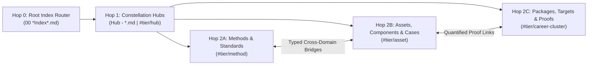

# AI-First Obsidian Second Brain Protocol (`/obsidianx`)

Operate an AI-first Obsidian Second Brain structured as a **Flat-Root 2-Hop Small-World Knowledge Graph (GraphRAG)**. This skill is 100% repository-agnostic and resolves the active vault dynamically across Windows, macOS, and Linux—even when the IDE workspace is opened inside a child project or separate repository.

> [!IMPORTANT]
> **Strict Opt-In Combinator Invariant**:
> Other workspace skills (`/briefx`, `/planx`, `/syncx`, `/researchx`, `/deep-researchx`, `/boostx`, `/ultrax`, `/kickoffx`, `/goal`) **MUST NEVER** read from or write to the Obsidian vault unless `/obsidianx` (or legacy alias `/obsidian-vault`) is explicitly included in the user's command combination (e.g., `/researchx /boostx /obsidianx`).

---

## 1. Dynamic Cross-Platform Vault Resolution (`Step 0`)

Never hardcode vault folder names, project names, or machine user paths. Whenever `/obsidianx` is invoked (standalone or in a skill combination), resolve `VAULT_ROOT` and the Hop-0 Index Router dynamically using this 2-tier stdlib resolver:

1. **Tier 1 — OS-Native Obsidian Global Registry (`obsidian.json`)**:
   * **Windows**: `%APPDATA%/obsidian/obsidian.json`
   * **macOS**: `~/Library/Application Support/obsidian/obsidian.json`
   * **Linux**: `~/.config/obsidian/obsidian.json`
   * Select the registered vault directory with `"open": true` (or most recent timestamp `ts`) that exists on disk.
2. **Tier 2 — Upward & Sibling `.obsidian/` Marker Fallback**:
   * If `obsidian.json` is unavailable, scan the current working directory and up to 2 parent levels (`./*`, `../*`, `../../*`) for any directory containing an `.obsidian/` configuration folder.
3. **Hop-0 Router Discovery**:
   * Inside `VAULT_ROOT`, locate the root index router matching `00 *Index*.md` (or `00_*.md`).

```python
import sys, os, json, pathlib
sys.dont_write_bytecode = True
if sys.stdout and hasattr(sys.stdout, "reconfigure"):
    sys.stdout.reconfigure(encoding="utf-8")

appdata = os.environ.get("APPDATA", "").strip()
candidates = (
    ([pathlib.Path(appdata) / "obsidian/obsidian.json"] if appdata else [])
    + [
        pathlib.Path.home() / "Library/Application Support/obsidian/obsidian.json",
        pathlib.Path.home() / ".config/obsidian/obsidian.json",
    ]
)
vault = None
for cfg in candidates:
    if cfg.is_file():
        v_map = json.loads(cfg.read_text(encoding="utf-8")).get("vaults", {})
        ranked = sorted(v_map.values(), key=lambda v: (bool(v.get("open")), v.get("ts", 0)), reverse=True)
        for item in ranked:
            p = pathlib.Path(item.get("path", ""))
            if p.is_dir():
                vault = p
                break
    if vault:
        break
if not vault:
    for base in [pathlib.Path.cwd(), *pathlib.Path.cwd().parents[:2]]:
        found = [d.parent for d in base.glob("*/.obsidian") if d.is_dir()]
        if found:
            vault = found[0]
            break
routers = sorted(vault.glob("00*Index*.md")) if vault else []
print("VAULT_ROOT:", vault)
print("HOP0_ROUTER:", routers[0] if routers else None)
```

---

## 2. 2-Hop Small-World GraphRAG Architecture

The vault uses a **100% flat root directory (`<VAULT_ROOT>/*.md`)** so file tools (`read_file` / `view_file`, `grep`, `glob`) resolve every note deterministically without subfolder guessing:



* **Hop 0 (Root Index Router — `00 *Index*.md`)**: Single-file manifest cataloging all Master Domain Hubs and Subsystem Constellation Hubs. **Always read Hop 0 first.**
* **Hop 1 (Constellation Hubs — `Hub - *.md`, `#tier/hub`)**: High-degree index notes organizing each domain subsystem with structured summary tables and direct `[[wikilinks]]` to atomic leaf nodes.
* **Hop 2 (Atomic Leaf Nodes)**:
  * `#tier/method`: Governing equations, numerical algorithms, statutory/engineering standards, architectural invariants, and analytical proofs.
  * `#tier/asset`: Reusable software/CAD components, empirical material/ecological/species parameters, spatial/infrastructure profiles, and verified case study precedents.
  * `#tier/career-cluster`: Open-source packages, target organizations, and quantified engineering portfolio proofs.

### Fast 2-Hop Retrieval Workflow
1. **Hop 0 Read**: View `00 *Index*.md` inside `VAULT_ROOT` to identify the relevant `Hub - *.md` file(s).
2. **Hop 1 Read**: View the target `Hub - *.md` table to identify the exact atomic notes (`[[Note Name]]`), then read only the 1–3 atomic notes needed for the task.

---

## 3. Authoring, Anti-Parachute & Graph Integrity Invariants

Whenever creating or updating notes in `VAULT_ROOT`, enforce all five invariants:

1. **Zero Ephemeral Repo Duplication**:
   * Never copy transient project schedules, sprint task lists, or local repo file trees into the vault. Store only **reusable domain knowledge**: equations, SI unit bridges, standards, verified case studies, reusable code/component contracts, and empirical parameters.
2. **Strict Frontmatter & Tag Schema**:
   * Every note must begin with YAML frontmatter declaring `title`, `type`, `domain`, and hierarchical `tags` (`tier/hub`, `tier/method`, `tier/asset`, or `tier/career-cluster`, plus `domain/*` and `status/verified`).
3. **Unique Neighborhood Signature Invariant (`0` Parachutes)**:
   * Never batch-generate leaf notes that link only to the same parent hub or share identical `[[wikilink]]` sets (which causes Force-Atlas-2 graph layout engines to collapse them into artificial peripheral "parachute" arcs).
   * Every atomic note must link to:
     1. Its primary `[[Hub - ...]]` parent (`#tier/hub`)
     2. At least **2–4 content-specific cross-domain bridges** (`#tier/method` ↔ `#tier/asset` ↔ `#tier/career-cluster`)
     3. At least **2 distinct peer notes** so that **zero node pairs share an identical set of undirected neighbors**.
4. **Zero-LaTeX Native Unicode Typography**:
   * Never use inline or block dollar-sign math delimiters. Always use direct UTF-8 Unicode symbols (`→`, `←`, `↔`, `×`, `÷`, `±`, `≈`, `≠`, `≤`, `≥`, `∑`, `√`, `∝`, `²`, `³`, `°`, `µ`).
5. **Obsidian Graph Config Persistence Rule (`.obsidian/graph.json`)**:
   * Obsidian caches `.obsidian/graph.json` in memory while running and overwrites disk edits on exit. Before programmatically modifying `.obsidian/graph.json`, terminate the `Obsidian` process first, write the JSON atomically, and relaunch Obsidian afterward.

### 1-Line Graph Integrity Verification Gate
After adding or modifying vault notes, run this stdlib audit to confirm **`0` broken wikilinks, `0` orphans, and `0` duplicate neighbor sets**:

```python
import re, pathlib, collections
v = pathlib.Path("<VAULT_ROOT>")
notes = {p.stem: p.read_text(encoding="utf-8") for p in v.glob("*.md")}
adj = {k: set() for k in notes}
broken = []
for src, txt in notes.items():
    for raw in re.findall(r"\[\[([^\]]+)\]\]", txt):
        dst = raw.split("|")[0].split("#")[0].strip()
        if dst and dst not in notes:
            broken.append((src, dst))
        elif dst and dst != src:
            adj[src].add(dst)
            adj[dst].add(src)
orphans = [k for k, nb in adj.items() if not nb]
sigs = collections.Counter(frozenset(nb) for nb in adj.values())
dup_groups = sum(1 for s, c in sigs.items() if c > 1)
print(f"NOTES={len(notes)} | BROKEN={len(broken)} | ORPHANS={len(orphans)} | DUP_NEIGHBOR_GROUPS={dup_groups}")
assert not broken and not orphans and dup_groups == 0
```

---

## 4. Composable Skill Combination Protocol (Opt-In Wiring)

When `/obsidianx` is combined with other slash skills in the same prompt, execute the corresponding composite workflow:

| Skill Combination | Step 0 Retrieval (Read from Vault) | Completion Action (Automatic Knowledge Ratchet) |
| :--- | :--- | :--- |
| **`/briefx /obsidianx`** | Resolve `VAULT_ROOT` → Read `00 *Index*.md` → `Hub - *` to load domain equations, precedents, and component invariants alongside the 8-file Repo SSOT cap. | Include Second Brain domain invariants in the Briefing Table (no vault writes unless requested). |
| **`/planx /obsidianx`** | Resolve `VAULT_ROOT` → Read `00 *Index*.md` → `Hub - *` to pull reusable equations, SI unit bridges, and component contracts into Phase 1 of `/planx`. | Bind reusable Second Brain specs directly into `implementation_plan.md` Architecture & Verification sections. |
| **`/researchx /obsidianx`** | Resolve `VAULT_ROOT` → Check `00 *Index*.md` → `Hub - *` as a **Tier-1 Prior-Art Cache** before running external web searches or redundant local DB probes. | Save the primary research study to the repo **AND** automatically mint/update reusable atomic notes + `Hub - *` index tables in `VAULT_ROOT`, then run the Graph Integrity Gate. |
| **`/deep-researchx /obsidianx`** | In Wave 1, inspect `00 *Index*.md` → `Hub - *` so existing verified precedents, species, or formulas are not re-harvested. | In Wave 5, automatically ratchet newly verified precedents, formulas, or dataset summaries into `VAULT_ROOT` and run the Graph Integrity Gate. |
| **`/boostx /obsidianx`** | In BoostX Phase 1, load governing physics formulas, SI unit bridges, or component contracts from `00 *Index*.md` → `Hub - *`. | In BoostX Phase 4, automatically ratchet any newly engineered reusable algorithm, solver contract, or architectural pattern into `VAULT_ROOT`. |
| **`/researchx /boostx /obsidianx`** *(+ optional `/goal`)* | **Full-Stack Loop**: Vault Cache Check → `/researchx` Primary-Source Probe on delta → Lock 2D Contract & Analytical Toy Benchmark into `/boostx` Phase 1. | Execute BoostX Phases 1–4 → Ratchet reusable findings & component specs into `VAULT_ROOT` → Run Graph Integrity Gate (`BROKEN=0`, `ORPHANS=0`, `DUP_NEIGHBOR_GROUPS=0`) before `<!-- GOAL_COMPLETE -->`. |
| **`/syncx /obsidianx`** | Resolve `VAULT_ROOT` alongside the workspace relation set. | Synchronize both project repository documentation AND matching atomic notes / `Hub - *` tables in `VAULT_ROOT`. |
| **`/obsidianx /ultrax`** *(or combined with `/deep-researchx` / `/boostx`)* | Resolve `VAULT_ROOT` → Parallel 2-Hop Scouts inspect candidate `Hub - *.md` constellations (`≤ 3` notes/agent). | Partition atomic note authoring across non-overlapping neighbor sets via [`/ultrax`](../ultrax/SKILL.md), synchronize parent `Hub - *.md` tables sequentially in the main thread, and run the Blind Graph Integrity Verifier (`BROKEN=0`, `ORPHANS=0`, `DUP_NEIGHBOR_GROUPS=0`). |

---

## 5. Completion Checklist

- [ ] **Dynamic Vault Resolution**: Located `VAULT_ROOT` and `00 *Index*.md` via `obsidian.json` or `.obsidian/` marker scan with zero hardcoded paths.
- [ ] **2-Hop Navigation Used**: Traversed `00 *Index*.md` → `Hub - *.md` → Atomic Nodes without blind full-vault dumping.
- [ ] **Hub Index Synchronized**: Every newly created atomic note is linked inside its parent `Hub - *.md` table and `00 *Index*.md` (if a new hub was added).
- [ ] **Graph Integrity Verified**: Confirmed `BROKEN=0`, `ORPHANS=0`, and `DUP_NEIGHBOR_GROUPS=0` via the 1-line verification check.

