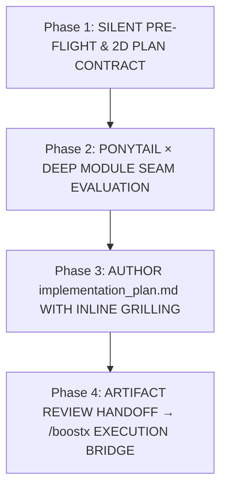
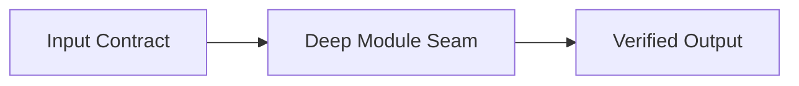

# Antigravity Architectural & Implementation Planner (`/planx`)

When `/planx` (or `/plan`) is invoked, enter the **Antigravity PlanX Protocol**. PlanX constructs a rigorous, decision-complete [`implementation_plan.md`](file:///implementation_plan.md) artifact combining **inline structured grilling**, **Ponytail × Deep Module seam evaluation**, **Mermaid architecture diagrams**, and a **falsifiable Red → Green verification matrix**—with **zero chat-window interrogation**.

Portable across Antigravity IDE, `agy` CLI, Claude Code, and multi-agent environments across Windows, macOS, and Linux.

Red failure modes to prevent:
1. **Chat Interruption Anti-Pattern**: Asking clarifying questions in the chat bubble (or blocking on modal prompts) instead of writing structured decision options inside `implementation_plan.md`.
2. **Speculative Over-Engineering**: Proposing bloated wrapper classes, unnecessary dependencies, or multi-file abstractions without passing the Ponytail × Deep Module filter.
3. **Unfalsifiable Verification Plans**: Writing vague manual checks (*"run the app and verify it works"*) instead of exact Red → Green CLI commands, boundary checks, or 1D analytical toy benchmarks.
4. **SSOT & Deferred-Zone Amnesia**: Proposing edits that violate locked workspace cardinalities or touch sections marked `[FROZEN]` / `[DEFERRED]` / `[RESEARCH FIRST]`.

---

## 1. When Not to Use

| Need | Use Instead |
| :--- | :--- |
| Execute code changes, fix bugs, or run Red → Green loops directly | [`/boostx`](../boostx/SKILL.md) |
| Read workspace docs and execute a non-planning task immediately | [`/briefx`](../briefx/SKILL.md) |
| Tactical primary-source API/SDK/DB lookup | [`/researchx`](../researchx/SKILL.md) |
| 5-wave precedent harvesting, blind fact-auditing, or dataset curation | [`/deep-researchx`](../deep-researchx/SKILL.md) |
| Synchronize documentation and metrics after an implementation | [`/syncx`](../syncx/SKILL.md) |
| Generate an end-of-session handoff prompt for a fresh chat | [`/kickoffx`](../kickoffx/SKILL.md) |

---

## 2. The 4-Phase PlanX Lifecycle



---

### Phase 1: Silent Pre-Flight Discovery & 2D Plan Contract (`Step 0`)

**Never ask questions in chat or propose file mutations before inspecting local ground truth.**

#### 1. Composable Pre-Flight Hooks (Zero Default Overhead)
* **Workspace SSOT & Boundary Check ([`/briefx`](../briefx/SKILL.md) Mindset)**:
  * Perform a bounded read of pinned files and top-authority specs (`README.md`, `AGENTS.md`, latest `*_vLatest.md`) using Pass A (headings/cardinality) → Pass B (relevant sections).
  * Record any `[FROZEN]`, `[DO NOT EDIT]`, or `[DEFERRED]` zones so the plan strictly respects them.
* **Primary-Source & Manifest Lock ([`/researchx`](../researchx/SKILL.md) / [`/deep-researchx`](../deep-researchx/SKILL.md) Hook)**:
  * Check local manifests (`package.json`, `pyproject.toml`, `*.csproj`, `metadata.txt`) and target source files via `read_file` so proposed APIs match exact pinned versions and line ranges.
* **Strict Opt-In [`/obsidianx`](../obsidianx/SKILL.md) Combinator (`/planx /obsidianx`)**:
  * **Default (Without `/obsidianx`)**: Never read from or write to any Obsidian vault.
  * **Opt-In (`/planx /obsidianx` or `/briefx /planx /obsidianx`)**: Resolve `VAULT_ROOT` dynamically (`00 *Index*.md` → `Hub - *.md`) to pull reusable governing equations, SI unit bridges, or component contracts into the plan.
* **Opt-In [`/layax`](../layax/SKILL.md) Sidecar (`/planx /layax`)**:
  * When planning across a large, unpinned documentation corpus, use `/layax` (`shortlist_choice` / `score`) to shortlist relevant specification sections with zero context bloat.
* **Opt-In [`/ultrax`](../ultrax/SKILL.md) Multi-Architect Scout Mode (`/planx /ultrax`)**:
  * When `/ultrax` is included in the command, spawn **3 parallel Architect Scouts** (Vector A: Simplification/Stdlib, Vector B: Surgical Local Seam, Vector C: Deep Module Interface) to stress-test trade-offs and edge cases before synthesizing their findings into `implementation_plan.md`.

#### 2. Synthesize the 2D Plan Contract (`Task Archetype × Project Archetype`)
Cross the active **Task Intent** (`BUILD / FEATURE`, `REFACTOR / SIMPLIFY`, `SIMULATE / SOLVER`, `OPTIMIZE / SCALE`, `SHIP / RELEASE`) with the **Project Domain Harness** (`CAD / Rhino / Grasshopper`, `GIS / QGIS`, `Web UI / Figma / Diagrams`, `Data / GCP / ML`, `Agent Skills / CLI / Configs`):
* **Tier 1 Plan (1–2 files, localized change)**: Compact seam diff + 1 inline decision (if any) + 1 Red → Green command.
* **Tier 2 Plan (Multi-file feature, refactor, or UI)**: Full `mermaid` architecture diagram + Deep Module interface spec + component-by-component change matrix.
* **Tier 3 Plan (`SIMULATE / SOLVER` — Physics, Numerical, Grasshopper/CAD)**: Mandatory **SI Unit Bridge Table** (`mm`/`cm`/`m` ↔ `m`/`kg`/`s`/`N`/`W/m²`, `deg` ↔ `rad`), stability bounds (`dt`, convergence `ε`, max iterations), and the **Physics Triad** verification plan (zero-load identity = `0.0` with no `NaN`/`Inf`, 1D analytical toy benchmark, conservation/symmetry check).

---

### Phase 2: Ponytail × Deep Module Seam Evaluation

Before drafting `Proposed Changes`, evaluate candidate architectures against the **Ponytail × Deep Module Ladder**:

1. **Vector A — Simplification / Config / Deletion (YAGNI First)**:
   * Can the requirement be solved by deleting dead complexity, adjusting configuration, or calling an existing repo helper?
2. **Vector B — Surgical Local Seam**:
   * Can we extend an existing function/module with a minimal, stdlib-first diff?
3. **Vector C — Deep Module Interface (`/codebase-design`)**:
   * When a new module is genuinely warranted, design a **Deep Module**: *a tiny, obvious public signature (`Inputs → Outputs → Invariants`) hiding substantial internal logic*—never shallow pass-through wrappers.

---

### Phase 3: Authoring `implementation_plan.md` & Structured Inline Grilling

#### 1. The Zero-Chat-Question Invariant
* Do **NOT** ask clarifying questions directly in the chat response, and do **NOT** call `ask_question` during `/planx`.
* Every ambiguity, architectural fork, or scope trade-off **MUST** be written inside `implementation_plan.md` under **`## 1. User Review Required & Inline Grilling Decisions`**.

#### 2. Required `implementation_plan.md` Schema
Structure `<appDataDir>/brain/<conversation-id>/implementation_plan.md` using this exact 5-section blueprint (using native Unicode `→`, `×`, `≈`, `±`, `≤`, `≥`, `✓` and **zero LaTeX `$...$` math**):

```markdown
# Implementation Plan: <Concise Title>

> **📐 PlanX 2D Contract** — `[Task Archetype]` × `[Project Archetype]` (`Tier 1|2|3`)
> - **Target Outcome**: <1-sentence concrete state after implementation>
> - **SSOT & Scope Guardrails**: <Locked cardinalities, [FROZEN]/[DEFERRED] zones, Dual-OS/OneDrive invariants>
> - **Primary Sources / Inspected Files**: `[file.py](file:///path/to/file.py#L1-L50)`, `[spec.md](file:///path/to/spec.md#L10-L30)`

---

## 1. User Review Required & Inline Grilling Decisions

*(If zero ambiguities exist, state: `None — all requirements and invariants are locked by SSOT.` Otherwise, structure each inquiry as follows:)*

### Decision 1: <Short Decision Title>
- **Question / Decision Point**: <Explain the exact engineering challenge, trade-off, or ambiguity>
- **Options**:
  - **Option A (Recommended — <Short Label>)**: <Description, blast radius, and Ponytail × Deep Module rationale>
  - **Option B (<Alternative Label>)**: <Description and trade-offs>
- **Recommendation**: **Option A (Recommended)** — <Why this path is cleanest, safest, and most maintainable>
- **Doc / Code References**: `[module.py](file:///.../module.py#L40-L65)`, `[ROADMAP.md](file:///.../ROADMAP.md#L12-L25)`

---

## 2. Architecture & Ponytail × Deep Module Seam Design

- **Selected Vector**: `Vector A (Simplification)` | `Vector B (Surgical Seam)` | `Vector C (Deep Module)`
- **Module Interface Contract**:
  - **Signature**: `<function_or_class_signature(inputs) -> outputs>`
  - **Invariants**: <Null/empty guards, unit conversions, O(N) bounds, Dual-OS path safety>



---

## 3. Proposed File Changes (By Component)

### Component 1: <Component Name>
#### [MODIFY | NEW | DELETE] `[filename.ext](file:///absolute/path/to/filename.ext#L10-L45)`
- **Seam & Summary**: <Exact functions/classes to modify or add>
- **Key Implementation Details**: <Concise bullet points of logic changes; preserve existing docstrings/comments>

---

## 4. Red → Green Verification Matrix (BoostX Phase 4 Ready)

| Tier | Verification Gate | Exact Command / Probe | Expected Pass Signal |
| :---: | :--- | :--- | :--- |
| **Tier 1 (Red / Baseline)** | Repro failure / Pre-flight probe / 1D Toy Benchmark | `<exact CLI command>` | Proves baseline state or closed-form match |
| **Tier 2 (Green + Boundary)** | Core pass + null/zero-load/`NaN` edge case | `<exact CLI command>` | `0` errors, exact expected output |
| **Tier 3 (Parity & Hygiene)** | Regression suite + Anti-hardcode path sweep | `<exact CLI command>` | `0` regressions, `0` hardcoded user paths |
```

---

### Phase 4: Artifact Persistence & `/boostx` Execution Handoff

1. **Write the Plan Artifact**:
   * Save the plan to `<appDataDir>/brain/<conversation-id>/implementation_plan.md` using `write_file` (or `edit_file` when updating an existing plan).
   * Always pass `ArtifactMetadata` with `RequestFeedback = true` and `UserFacing = true`.
2. **Concise Chat Handoff (Zero Redundant Wall-of-Text)**:
   * Do **not** re-summarize or paste the plan contents into the chat response.
   * Point the user to [`implementation_plan.md`](file:///implementation_plan.md), list only the **Decision IDs** (e.g., `Decision 1`, `Decision 2`) that need their selection, and note:
     *"Reply with your option choices (e.g. `1A, 2A`) or click **Proceed** to execute via `/boostx`."*
3. **Automatic `/planx` → [`/boostx`](../boostx/SKILL.md) Bridge**:
   * Once the user approves the plan or selects their options, immediately lock Section 4 (`Red → Green Verification Matrix`) as the **BoostX Phase 1 Goal Contract** and execute the surgical implementation.

---

## 3. Quality Rubric

- [ ] **Zero Direct Questions in Chat**: All ambiguities and architectural choices are written inside `## 1. User Review Required & Inline Grilling Decisions` in `implementation_plan.md`.
- [ ] **Structured Decision Format**: Every inquiry includes `Question / Decision Point`, `Options`, `(Recommended)` choice with rationale, and clickable `file://` `Doc / Code References`.
- [ ] **2D Plan Contract & SSOT Alignment**: Checked pinned versions, locked cardinalities, and `[FROZEN]` / `[DEFERRED]` zones before proposing changes.
- [ ] **Ponytail × Deep Module Evaluated**: Justified Vector A/B/C choice and included a `mermaid` architecture diagram (with native Unicode symbols and zero LaTeX `$...$` math).
- [ ] **Falsifiable Red → Green Verification Matrix**: Included exact CLI commands for Tier 1 (Baseline/Toy), Tier 2 (Green + Boundary), and Tier 3 (Regression + Portability).
- [ ] **Artifact Metadata & Concise Chat Pointer**: Saved with `RequestFeedback = true` and `UserFacing = true`, without duplicating the plan body in chat.
