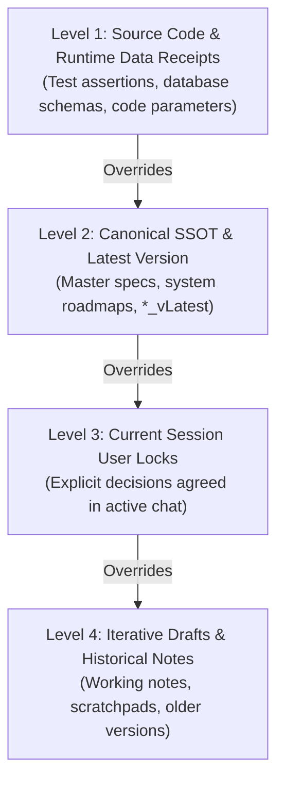

# `/syncx` (Portable Cross-Document Synchronizer)

Cross-document synchronization, conflict arbitration, and zero-stale audit for **whatever repository is open now**.

Discover changes from **the active conversation**, then systematically scan and align **all markdown, HTML, and web documentation in the current workspace**. Portable across Antigravity IDE, `agy` CLI, Claude Code, Cursor, and multi-agent platforms across Windows, macOS, and Linux.

Do not assume specific project filenames, layer counts, or local author paths.

Red failure modes to prevent:
1. Touching only 1–2 surface files while leaving stale metrics, outdated cardinalities, or dead links in related documents.
2. Silently propagating conflicting claims between documents without formal arbitration against code or ground truth.
3. Leaving ghost links pointing to files that were renamed, merged, or deleted in earlier turns.
4. Copying numbers from doc to doc without verifying against underlying code or data receipts.

---

## 1. Anti-Lazy Invariant (Scoped)

> [!IMPORTANT]
> The task is strictly incomplete until every file **in the relation set** is updated or explicitly verified current.
>
> The relation set consists of all files that share the changed symbols, numbers, cardinalities, status words, links, visual cards, or presentation slides. Files inspected and found already compliant must be recorded in the final ledger as `VERIFIED_CURRENT`.

---

## 2. Public Claim & Terminology Vocabulary

Use these 5 canonical terms in public documentation and deliverables:

| Term | Operational Meaning |
| :--- | :--- |
| **LIVE** | A stranger can use it now (install, URL, or download works). |
| **REGISTERED** | Listed somewhere; a public version or install may still be pending. |
| **PREPARED** | Built locally; not a public product page yet. |
| **IN PIPELINE** | Intended next; not released. |
| **DRAFT** | Internal only. |

Do not write LIVE, Published, or 1-click install without a verifiable receipt (URL, version table, or installer). [`/publishx-audit`](../publishx-audit/SKILL.md) advises on these terms; this skill owns their formal definitions.

### Formatting and Typography Rules
* **No Em or En Dashes**: Use standard ASCII hyphens `-` in all user-facing lines and generated documentation.
* **Strict Zero-LaTeX Math Policy**: In markdown docs, HTML, and chat responses, NEVER use LaTeX math delimiters (such as inline or block dollar math, `\times`, `\rightarrow`). ALWAYS use direct native Unicode symbols: `→`, `←`, `↔`, `•`, `✓`, `✨`, `²`, `³`, `°`, `×`, `÷`, `±`, `≈`, `≤`, `≥`.
* **Diagrams and Visuals**: Fenced Mermaid blocks (` ```mermaid ... ``` `) for workflows; clean GFM tables with outer pipes (`| Col 1 | Col 2 |`). Zero ASCII box art in documentation.

---

## 3. Conflict Arbitration Hierarchy

When two or more documents contradict each other, resolve the discrepancy using this strict 4-level authority ladder:



1. **Level 1 (Code & Data Receipts)**: Real source code constants, database tables, test assertions, and generated data files strictly override written Markdown prose.
2. **Level 2 (Canonical SSOT & Version Leaders)**: Master architectural plans, specifications, and latest version files (`*_v5`) strictly override older iterative drafts (`*_v4`, `*_v3`).
3. **Level 3 (Current Session User Lock)**: Decisions locked by the user in the current conversation override older written documentation across all tiers.
4. **Level 4 (Conflict Quarantine)**: If two top-tier specs have an unresolved structural contradiction not addressed in the chat, **do not guess**. Quarantine the conflict in a `Conflict Ledger` and halt for user confirmation.

---

## 4. Standard Operating Procedure (Every Run)

### Step 1: Delta Formulation & Deprecation Registry

From the active conversation and git status, explicitly record:
1. **What changed**: Exact identifiers, formulas, cardinalities, paths, statuses, or slide counts.
2. **Canonical source of truth**: Passing test, running benchmark, schema file, or user lock.
3. **Deprecated values**: Terms, numbers, and old counts that must reach **zero hits** in the active relation set.
4. **Deleted / Renamed Artifacts**: Files merged, renamed, or deleted that require a ghost reference sweep.
5. **Historical Boundary**:
   * *Active SSOTs*: Architecture maps, READMEs, API tables, active links, and status badges must be 100% updated.
   * *Immutable Historical Records*: Changelog entries and historical logs that record past events preserve historical context while logging the new milestone.

### Step 2: Dynamic Workspace Scan, `/layax` Sidecar & Ghost Sweep

Search markdown, HTML, and web documentation across the workspace (excluding `.git/`, `node_modules/`, and **any directory containing an `.obsidian/` subfolder**):

1. **Target Asset Discovery & Composable Boundaries**:
   * *Markdown Suites*: Root README, module docs, schemas, roadmaps, specifications, and portfolios.
   * *Interactive Web Artifacts*: Presentation slide decks, architecture viewers, dashboard portals, storyboards, and reports.
   * *Shadow Mirrors*: Identify whether modified documents are duplicated in distribution packages (e.g. `dist/docs/`, `package_name/docs_reference/`, or mirrored sub-workspaces).
   * *Strict Opt-In [`/obsidianx`](../obsidianx/SKILL.md) Boundary (`/syncx /obsidianx`)*: By default, **never** scan or modify an Obsidian vault (`*/.obsidian/..`) during `/syncx`. Only when `/obsidianx` (or `/obsidian-vault`) is explicitly paired in the command (`/syncx /obsidianx`) should you resolve the active vault via [`/obsidianx`](../obsidianx/SKILL.md) and synchronize affected reusable atomic notes and `Hub - *.md` tables alongside repository docs.
   * *Opt-In [`/layax`](../layax/SKILL.md) Semantic Contradiction Pre-Filter (`/syncx /layax`)*: When chained with `/layax` (or `/laya`), run the `noul` hypothesis scanner across candidate `.md` and `.html` paragraphs to detect semantic contradictions against the SSOT that keyword grep misses, then apply surgical fixes via `edit_file`.
2. **Ghost Reference & Dead Link Sweep**:
   * If any file was renamed, merged, or deleted, grep the workspace for its old base name and relative path.
   * Update or remove dangling hyperlinks, navigation cards, and table references pointing to the deceased file.
3. **Quantitative Variation Sweep**:
   * When a number, total count, or structural cardinality changes (e.g. from old to new count), search for:
     * The old exact count: `[OldNumber] [Unit]` (e.g. old act count, deprecated item total, former slide count).
     * Sequential counters: check whether `SLIDE 01 / [Old]` was updated to `SLIDE 01 / [New]`.
     * Mismatched pluralities or schema sizes.

### Step 3: Construct the 5-Tier Document Matrix

Classify every discovered file into the 5-tier architecture:

| Tier | Kind | Artifacts in This Repository |
| :---: | :--- | :--- |
| **1** | In-code contracts | Docstrings, types, route handlers, XML summaries |
| **2** | Component specifications | Module READMEs, local specs, data schemas, test manifests |
| **3** | Subsystem handshakes | Pipeline runbooks, intermediate indices, ETL handoffs |
| **4** | Master architecture | System maps, master roadmaps, interactive viewers, proposals |
| **5** | Public deliverables | Changelogs, presentation decks, release notes, portfolios |

*Superseded Version Rule*: Ensure all active navigation cards, README links, and system architecture maps point exclusively to the latest active canonical version (`_vLatest`).

### Step 4: Inner-to-Outer Synchronization

Apply updates systematically from the inside out (Tier 1-2 → Tier 3 → Tier 4 → Tier 5) using surgical `edit_file` (`replace_file_content`) replacements:

1. **Inner Specs First**: Update code signatures, parameter tables, and module READMEs to anchor local truth.
2. **Ground-Truth Receipt Check**: Before writing a technical metric into high-level docs, run a 1-line check against the actual artifact (e.g. SQLite query, checking `df.shape`, reading JSON/CSV headers, or inspecting code constants). Never propagate unverified claims.
3. **Pipelines and Architecture**: Update system flowcharts, roadmaps, and workspace indices.
4. **Interactive HTML Deliverable Parity**:
   * *DOM Structure*: Verify that container counts (e.g. `<section class="slide">`, `.card`) match the upgraded narrative or data model.
   * *Index and Headings*: Update sequential slide headers (`SLIDE 01 / N`), step counters, and metadata badges.
   * *Embedded JavaScript State*: Synchronize control variables (e.g. `const totalSlides = N;`, thumbnail navigation arrays, HUD counters).
   * *Visual Design System*: Ensure newly added HTML elements inherit native CSS variables and design tokens rather than ad-hoc inline styles.
5. **Distribution Mirror Parity**: When updating a canonical file, synchronize all identified mirror files byte-for-byte (verified via SHA-256 hash equality) so distribution bundles never drift.

### Step 5: Programmatic Verification & Sync Ledger

Verify completion programmatically before concluding:

1. **Zero-Stale Grep Sweep**: Search the active relation set for deprecated terms. Expected result: **zero hits** (outside historical changelogs).
2. **Hyperlink and Anchor Verification**: Verify all relative links (`../`) and HTML anchor IDs resolve properly.
3. **Execute Universal Sync Verifier**: Run the bundled repo-agnostic auditor (which also delegates to a local `scripts/audit_docs.py` if present in the repo) and verify exit code `0`:
   * **Windows (PowerShell)**:
     ```powershell
     python "$env:USERPROFILE\.gemini\config\skills\syncx\scripts\audit_workspace_docs.py" "<workspace_root>" --deprecated "<old_val_1>,<old_val_2>"
     ```
   * **macOS / Linux**:
     ```bash
     python ~/.gemini/config/skills/syncx/scripts/audit_workspace_docs.py "<workspace_root>" --deprecated "<old_val_1>,<old_val_2>"
     ```
4. **Render the Synchronization Ledger**: Present the final audit scorecard:

| Tier | File Path | Action | Deprecated Value Purged | Ground-Truth Invariant Verified | Status |
| :---: | :--- | :---: | :--- | :--- | :---: |
| **T4** | `path/to/spec.md` | Updated | Old Term / Number | New Invariant / Receipt | `SYNCED` |
| **T5** | `path/to/deck.html` | Updated | Old Counter | Container & JS state parity | `SYNCED` |
| **T2** | `path/to/schema.md` | Inspected | Verified current | Ground-truth match | `VERIFIED_CURRENT` |

---

## 5. Domain Archetypes (Adapt as Hints)

* **Computational Simulation & Numerical Solvers**: XML/docstring contracts (T1) → solver component manuals & benchmark latency (T2) → pipeline runbooks & GPU requirements (T3) → system dataflow diagrams (T4) → technical portfolio & conference decks (T5).
* **Web Applications, APIs & Dashboards**: Route annotations & fetch handlers (T1) → endpoint schemas & query dictionaries (T2) → dev server scripts & CORS policies (T3) → portal launch cards & system architecture viewers (T4) → release notes & UI previews (T5).
* **Embedded Hardware & IoT Firmware**: Pinout headers & baud rate constants (T1) → wiring diagrams & sensor specs (T2) → telemetry handoffs & field sampling protocols (T3) → hardware inventory & power budgets (T4) → field testing whitepapers & hardware photos (T5).
* **Spatial Data, GIS & Cadastre**: Attribute codebooks & CRS metadata (T1) → layer specs & QML style rules (T2) → drawing plate checklists & data pipeline manifests (T3) → master spatial plans & zoning matrices (T4) → publication plates & presentation deck maps (T5).

---

## 6. Self-Check Completion Rubric

- [ ] Chat delta recorded (changed items, canonical source, deprecated values, ghost references).
- [ ] Conflict Arbitration Hierarchy applied if any two documents disagree.
- [ ] Ghost references and dead links to deleted/merged files purged across the workspace.
- [ ] Quantitative Cardinality Sweep executed (deprecated counts have zero hits in relation set).
- [ ] Ground-truth receipts verified against real code, data, or tests before writing doc claims.
- [ ] 5-tier classification matrix followed (Tiers 1-2 → 3 → 4 → 5).
- [ ] Interactive HTML artifacts synchronized (DOM structure, slide counters, JS variables, CSS tokens).
- [ ] Distribution mirror targets synchronized byte-for-byte (SHA-256 verified) with primary SSOTs.
- [ ] Zero-LaTeX Math Policy strictly verified (native Unicode characters only).
- [ ] Synchronization Ledger displayed with file tiers, actions, and verification status.
