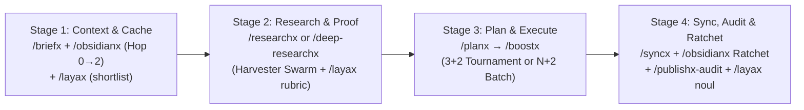

# Antigravity UltraX Protocol (`/ultrax`)

When `/ultrax` (or `/ultra`) is invoked standalone or chained with any BoostX `-x` skill, enter the **UltraX Dynamic Swarm & Adversarial Verification Protocol**. UltraX multiplies System 2 compute across isolated subagent context windows while keeping the **Main Thread at Compaction Round 0** (`🟢 HEALTHY`).

Unlike fixed headcount spawners, `/ultrax` inspects task structure first—matching agent topology to **Independent Targets (`N`) × Orthogonal Axes (`K`)**, enforcing a **Maker ≠ Checker Blind Falsification Gate**, and requiring **Disk-First + ≤ 150-Word Caveman Receipts** so raw work never bloats the main conversation.

Portable across **Google Gemini / Antigravity, Claude Code, Grok, Cursor, and Codex** on **Windows, macOS, and Linux**.

---

## 1. When to Use & Step 0 Complexity Floor

| Workload Profile | `/ultrax` Action |
| :--- | :--- |
| **Single-target complex design, UI/motion prototype, or solver (`N = 1`)** | **Archetype 1 (`3 + 2` Tournament — `4-5` Agents)**: `3` orthogonal builders/architects (`_vA`, `_vB`, `_vC` or isolated worktree) + `1-2` blind critics. |
| **Multi-target audit, multi-module build, deck, dataset, or vault (`N = 2..10`)** | **Archetype 2 (`N + 2` Partitioned Swarm — `4-12` Agents)**: `1` dedicated agent per target (`≤ 3` items/agent cap) + `1-2` cross-target blind auditors. |
| **Full-stack multi-stage pipeline (`/obsidianx /deep-researchx /boostx /syncx /ultrax`)** | **Archetype 3 (Multi-Wave DAG)**: Normalizes stages into causal order (`Context → Research → Build → Sync`) and runs a parallel swarm wave per stage. |
| **Trivial 1-file edit (`N = 1`, `< 50` LOC diff, `0` design ambiguity)** | **Auto-Downshift (`2-Agent Fast Pair`)**: `1` surgical builder + `1` blind verifier. Never spawn 5+ agents on a trivial fix. |
| **Zero-token local heading shortlist or contradiction pre-filter** | Chain [`/layax`](../layax/SKILL.md) (`/layax /ultrax`) so System 1 filters chunks in milliseconds before spawning System 2 subagents. |

---

## 2. Step 0: Canonical Stage DAG Normalization & Dynamic Topology Sizer

### A. Order-Independent Canonical Stage DAG Normalization
Users may chain slash commands in any prompt order (e.g., `/obsidianx /deep-researchx /syncx /boostx /layax /goal /ultrax`). Never execute a downstream stage (such as `/syncx`) before an upstream build stage (`/boostx`). Always sort active skills into the **4 Causal Lifecycle Stages** wrapped by active cross-cutting modifiers:

* **Cross-Cutting Modifiers Active Across All Stages**:
  * **[`/layax`](../layax/SKILL.md)**: System 1 zero-token local pre-filter (`laya_triage.py`) before each System 2 wave.
  * **`/ultrax`**: System 2 parallel subagent fan-out + `Maker ≠ Checker` blind falsification at each stage.
  * **`/goal`**: Persistent state tracking (`<artifactDir>/scratch/boostx_state.md`) looping across stages and turns until 100% of verification gates pass (`<!-- GOAL_COMPLETE -->`).

### B. Dynamic Task Decomposition (`N × K` Sizer)
Before spawning subagents, output the 4-line **UltraX Swarm Contract**:
> **⚡ UltraX Swarm Contract** — `[Archetype 1 Tournament | Archetype 2 Partitioned Batch | Archetype 3 Multi-Wave]`
> • **Normalized Pipeline**: `<Stage 1 → Stage 2 → Stage 3 → Stage 4>`
> • **Wave 1 Generators (`M` Agents)**: `<Exact role, orthogonal hypothesis/bucket, and disjoint output path per agent>`
> • **Wave 2 Blind Critics (`C` Agents)**: `<Exact falsification probe, CLI script, and ground-truth receipt check>`

1. **Archetype 1 — `3 + 2` Orthogonal Tournament (`N = 1` Target, `4-5` Agents)**:
   * **Forced Orthogonal Priors**: Never give 3 competing builders the same generic prompt (which produces 3 copies of the same blind spot). Lock each builder into a **distinct architectural vector, algorithm, or visual paradigm**:
     * *Builder A*: Vector A — Minimal stdlib / synchronous / clean editorial baseline.
     * *Builder B*: Vector B — Deep Module / high-throughput / kinetic or rich interactive paradigm.
     * *Builder C*: Vector C — Alternative data structure, GPU/vectorized kernel, or high-contrast spatial layout.
   * **Paired Critics (`1-2` Agents)**: `1` Functional/Benchmark Verifier + `1` Visual/Spec Auditor.
2. **Archetype 2 — `N + 2` Partitioned Batch (`N = 2..10` Targets, `4-12` Agents)**:
   * **Attention Density Cap (`≤ 3` Items per Agent)**: LLMs suffer from "Lost-in-the-Middle" attention dilution when auditing or editing 8+ files/slides/records in one window. Assign **1 dedicated agent per 1–3 items** so every target receives 100% attention density.
   * **Pre-Locked Shared Seam Header**: Before launching `N` parallel builders, lock a **5-line Shared Seam Header** (exact function signatures, type contracts, CSS design tokens, or JSON schema keys) inside every subagent prompt so all `N` outputs integrate cleanly.

---

## 3. Universal Domain Adaptation & Multi-Host Dispatch

### A. 5-Domain Adaptation Matrix (100% Project-Agnostic)

| Project Domain | Wave 1: Generator / Builder Strategy | Wave 2: Blind Adversarial Critic (`Maker ≠ Checker`) |
| :--- | :--- | :--- |
| **1. Backend, APIs & Distributed Systems** *(Go, Rust, TS, Python, C#, SQL)* | `3` competing algorithms (`Workspace="share"`) or `N` disjoint module builders with locked interface types. | Runs unit/integration tests, concurrency/race probes, `O(N)` latency benchmarks, and AST security checks. |
| **2. Frontend, Web UI, Diagrams & Motion** *(React, Vue, HTML/CSS, SVG, Canvas, WebGL)* | `3` side-by-side visual/motion prototypes (`<stem>_vA.<ext>`, `_vB`, `_vC`) or `N` component/frame builders sharing CSS tokens. | Captures viewport screenshots/DOM metrics to verify `0` console errors, overflow bounds, typography contrast, and token parity. |
| **3. Data Engineering, Cloud & ML** *(BigQuery, Spark, dbt, PyTorch, Notebooks)* | `3` feature/query/model pipelines or `N` table/DAG stage workers. | Audits train/test leakage, schema grain uniqueness, null rates, and SQL `--dry_run` cost bounds. |
| **4. Physical Sciences, Solvers, CAD & GIS** *(FEM/CFD, C#/ILGPU, Rhino/GH, PyQGIS)* | `3` numerical schemes or `N` solver/layer workers bound to an explicit SI Unit Bridge. | Verifies the **Physics Triad** (`zero-load = 0.0` with no `NaN`/`Inf`, 1D Analytical Toy Benchmark, conservation/CFL stability). |
| **5. Research, Security & Knowledge Graphs** *(Docs, Specs, Literature, Obsidian)* | `N` high-density scouts (`≤ 3` records/scout) or disjoint 5-Tier doc/vault workers. | Executes `verify_evidence.py`, `audit_workspace_docs.py`, `audit_engine.py`, and Graph Integrity (`BROKEN=0`). |

### B. Multi-Host Dispatch Adapter & Build-Lock Safety

| Host Runtime | Parallel Subagent Dispatch | Read-Only Scout | Read-Write Builder / Critic | Workspace & Build-Lock Isolation |
| :--- | :--- | :--- | :--- | :--- |
| **Gemini / Antigravity** | Parallel `invoke_subagent` calls in same turn | `TypeName="research"` | `TypeName="self"` | `Workspace="share"`/`"branch"` (compiled code) or disjoint `_vA.._vC` files |
| **Claude Code** | Parallel `Task` calls in single assistant turn | `subagent_type="Explore"` | `subagent_type="general-purpose"` | Disjoint file paths or git worktrees in `<scratch>/ultrax/` |
| **Grok / Cursor / Codex** | Native parallel background agent tool | Read-only scout | Full execution agent | Disjoint output paths + serialized build verification |
| **Single-Agent Fallback** | **Sequential Multi-Persona Tournament** | Bounded Pass A → B reads | Writes `_vA`, `_vB`, `_vC` to disk → switches to **Blind Critic Persona** | Disjoint files + mandatory deterministic CLI verification |

> [!IMPORTANT]
> **Build-Lock & Git-Index Serialization Gate (Zero Race Conditions)**:
> When running with shared disk state (`Workspace="inherit"`), parallel Builder subagents **MUST NEVER** execute package installers (`npm install`, `pip`, `cargo`), global repo compilers (`dotnet build`, `tsc`), or `git` index mutations concurrently. Builders write their disjoint files only; **Wave 2 (the single Verification Critic)** executes the unified build/test runner once all file writes finish.

---

## 4. Zero-Hallucination (`Maker ≠ Checker`) & Zero-Bloat Contracts

### A. Zero-Trust Deterministic Critic Contract (Anti-"Rubber-Stamp" Rule)
No generator subagent may grade its own work, and no Critic subagent may return `PASS` based on reading prose/code alone:
1. **Mandatory Red-Team Prompt**: Instruct every Critic subagent: *"Assume the builders introduced subtle regressions, hallucinated unverified numbers/links, violated frozen boundaries, or caused visual clipping. Attempt to falsify every claim against ground truth."*
2. **Mandatory Deterministic Execution Receipt**: Every Critic must run at least one deterministic CLI probe (unit tests, compiler, `verify_evidence.py`, `audit_workspace_docs.py`, `audit_engine.py`, SQLite/CSV query, or headless screenshot check) and return an `Invariant | Probe Command | Observed Output | Verdict` table.
3. **Partial-Wave Fault Recovery**: All subagents enforce non-interactive CLI flags (`CI=true`, `--yes`, `--no-input`, `PAGER=cat`, `< 30s` timeout). If 1 subagent in a wave fails, preserve all passing outputs and spawn a single targeted replacement for the failed bucket only.

### B. Caveman Receipt Contract (`≤ 150 Words`) & Winner Promotion Policy
1. **Disk-First Persistence**: Subagents write all code, prototypes, markdown studies, and logs directly to disk. Returning raw multi-hundred-line file dumps in subagent replies is strictly forbidden.
2. **Compact Receipt (`≤ 150 Words` / `≤ 12 Lines`)**: Each subagent reply to the main thread contains only:
   * `Saved Path`: Clickable `[filename](file:///...)`
   * `Metrics & Proof`: LOC, runtime `ms`, test/CLI exit code, or verified record count
   * `Key Trade-Off / Findings`: 2–3 concise bullets
3. **Objective vs. Aesthetic Winner Promotion (`Best-of-3`)**:
   * **Objective Code / Solver / Data Tasks**: Once the Wave 2 Critic proves a clear winner on correctness, performance, and Ponytail simplicity, automatically promote the winning variant to the canonical target path and clean up temporary `_vA`/`_vB`/`_vC` scratch files.
   * **Aesthetic / Web UI / Diagram / Motion Tasks**: Preserve all passing variants side-by-side (`<stem>_vA.<ext>`, `<stem>_vB.<ext>`, `<stem>_vC.<ext>`) and present the Critic's Visual QA Scorecard so the user can inspect all 3 live or hybridize (`vA layout + vB motion`) before cleanup.

---

## 5. Composable BoostX Skill Combination Matrix

| Skill Combination | Wave 1: Parallel Swarm Execution | Wave 2: Blind Adversarial Critic Gate |
| :--- | :--- | :--- |
| **[`/briefx`](../briefx/SKILL.md) `/ultrax`** | `2-4` Read-Only Scouts reading Pass A → Pass B across Repo SSOTs, Schemas, and active specs in disposable windows. | `1` Cross-Doc Contradiction & Boundary Scout checking `[FROZEN]`/`[DEFERRED]` zones and version leaders. |
| **[`/planx`](../planx/SKILL.md) `/ultrax`** | `3` Orthogonal Architect Scouts (`Design-It-3x`: Vector A Stdlib, Vector B Surgical Seam, Vector C Deep Module). | `1` Red-Team Seam & SSOT Breaker checking unit bridges, portability, and blast radius before authoring `implementation_plan.md`. |
| **[`/boostx`](../boostx/SKILL.md) `/ultrax`** | `3` Competing Builders (`N = 1` tournament) OR `N` Disjoint Module/Frame Builders (`N = 2..8` batch with Shared Seam Header). | `1-2` Blind Critics running the 3-Tier Green Gate, Physics Triad (`zero-load = 0.0`, 1D Toy Benchmark), or Visual QA screenshots + anti-hardcode sweep. |
| **[`/researchx`](../researchx/SKILL.md) `/ultrax`** | `3-5` Primary-Source Scouts probing (1) Local Manifests/AST/DB, (2) Official Specs, (3) Upstream Tests, (4) Standards. | `1` Blind Primary-Source Verifier checking every `file:line`, method signature, and SI unit before saving `RESEARCH_<TOPIC>.md`. |
| **[`/deep-researchx`](../deep-researchx/SKILL.md) `/ultrax`** | Expands Wave 2 to `N` High-Density Harvester Scouts (`≤ 3` records/scout, mandatory deep-link scraping). | Spawns `2` Orthogonal Blind Auditors in Wave 3 (`Temporal/Attribution Falsifier` + `Quantitative/Schema Falsifier` + `verify_evidence.py`). |
| **[`/syncx`](../syncx/SKILL.md) `/ultrax`** | `3-6` Disjoint Tier Workers synchronizing Tiers 1-2 (Code/Specs), Tiers 3-4 (Roadmaps), and Tier 5 (HTML/Mirrors). | `1` Blind Ground-Truth & Ghost-Link Auditor running `audit_workspace_docs.py` + SHA-256 mirror verification. |
| **[`/obsidianx`](../obsidianx/SKILL.md) `/ultrax`** *(Strict Opt-In)* | `N` Parallel Vault Workers minting disjoint `#tier/method`, `#tier/asset`, and `#tier/career-cluster` notes in `VAULT_ROOT`. | `1` Graph Topology Auditor updating `Hub - *.md` tables and running the Graph Integrity Gate (`BROKEN=0`, `ORPHANS=0`, `DUP_NEIGHBOR_GROUPS=0`). |
| **[`/publishx-audit`](../publishx-audit/SKILL.md) `/ultrax`** | Runs `audit_engine.py` + `2-3` Specialized Audit Scouts (`Secret/Path`, `AST/Portability`, `Public-Claim Receipt`). | `1` Release Gatekeeper verifying `0` blocking issues and `0` unverified `LIVE` claims. |

---

## 6. Completion Rubric

- [ ] **Canonical Stage DAG Normalized**: Multi-skill chains executed in strict causal order (`Context → Research → Plan/Build → Sync/Ratchet`).
- [ ] **Dynamic `N × K` Topology Matched**: Sized to `3+2` Tournament (`N = 1`), `N+2` Partitioned Batch (`≤ 3` items/agent), or `2-Agent Fast Pair` (trivial floor).
- [ ] **Collision & Build-Lock Safe**: Disjoint file paths or isolated worktrees used; compilers/tests serialized in Wave 2.
- [ ] **Maker ≠ Checker Verified**: Independent Blind Critic executed deterministic CLI probes/screenshots and verified ground-truth receipts.
- [ ] **Main Context Protected**: All subagents returned `≤ 150-word` Caveman Receipts with clickable `file://` links.
