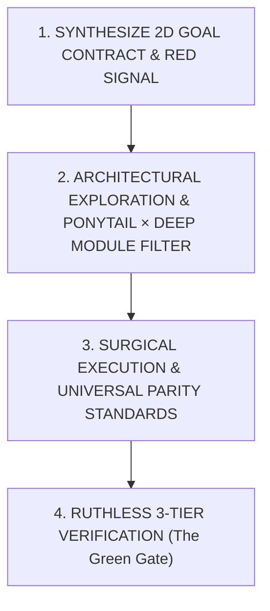

# Antigravity XBoost Protocol (`/xboost`)

When `/xboost` is invoked or high-discipline engineering is required, enter the **Antigravity XBoost Protocol**. This protocol dynamically synthesizes a **Task-Smart × Project-Smart Goal Contract**, enforces systematic root-cause analysis, anti-overengineering constraints (Ponytail × Deep Module Ladder), Dual-OS + OneDrive + IDE/CLI parity, composable `/goal` marathon discipline, and non-negotiable verification gates.

---

## 1. Execution Engine & Complexity Tier Selection

### A. Host Execution Engine
Depending on host runtime capabilities, select the appropriate execution engine:

* **Engine A: Unified Direct Persona (Default when running inline)**:
  * Operate directly in a **disciplined dual-phase persona**:
    1. **Investigator Persona**: Isolate root causes, map boundary conditions, define invariants, and construct a failing repro signal or pre-flight contract probe before touching production code.
    2. **Builder Persona**: Apply the Ponytail × Deep Module ladder, implement the shortest working diff, and execute 3-tier verification.
* **Engine B: Multi-Agent & Context-Compressed Delegation (`invoke_subagent` / `/cavecrew`)**:
  * Delegate specialized subtasks to preserve main-thread context across long sessions:
    * **`DeepCoder` / `cavecrew-builder`**: Minimal diff implementation (`invoke_subagent`).
    * **`DeepInvestigator` / `cavecrew-investigator`**: Root cause analysis, invariant mapping, or multi-file unfamiliar subsystem exploration so raw file dumps do not bloat the main context window.
    * **`cavecrew-reviewer`**: Adversarial diff review prior to completion.
* **Engine C: Opt-In [`/xultra`](../xultra/SKILL.md) Elastic Cognitive Swarm & Blind Verification Multiplier (`/xboost /xultra`)**:
  * When `/xultra` is included in the command, delegate execution topology to [`/xultra`](../xultra/SKILL.md)'s **Elastic Cognitive Swarm (`N × K × C × T`)**: run Law 1 deterministic probes, fan out **Orthogonal `K`-Vector Tournament Builders**, **Elastic Cognitive-Density Module Shards** (with a Pre-Locked Shared Seam Header), **4-Axis Forensic Audit Shards** ([`references/deep_audit_protocol.md`](references/deep_audit_protocol.md)), or **Evolutionary Ratchet Loops (`T` generations)**, and enforce the Anti-Inline-Shortcut `Maker ≠ Checker` **Wave 2A Elastic Critic Shards (`C ≥ 1`) → Wave 2B Main Checker Gate** + **Wave 2.5 Surgical Coordinate-Wise Remediation Loop** in Phase 4.

### B. Dynamic Complexity Tier Scaling
Match ceremony to task scope in Step 0:
* **Tier 1 — Tactical Strike (1–2 files, localized bug/feature)**:
  1-line falsifiable hypothesis → minimal Ponytail surgical diff → 1 red→green verification check → done.
* **Tier 2 — Architectural Build (Multi-file feature, simulation solver, or refactor)**:
  Load workspace invariants ([`/xbrief`](../xbrief/SKILL.md) mindset) → design Deep Module seam → incremental red→green verification → sync project logs.
* **Tier 3 — `/goal` Marathon Mode (Long-running autonomous execution)**:
  Activate Section 4.A (`/goal` Autonomous Marathon Contract) with scratch checkpointing, 3-strike anti-spin circuit breakers, subagent context offloading, and a strict exit gate before emitting `<!-- GOAL_COMPLETE -->`.

---

## 2. The 4-Phase XBoost Lifecycle

Every task executed under XBoost strictly advances through four progressive gates:



---

### Phase 1: Synthesize 2D Goal Contract & Build the Signal (Mandatory Pre-Edit Gate)

**Never write production code based on assumptions or surface symptoms.**

#### 1. Synthesize the 2D Goal Contract (`Task-Smart × Project-Smart`)
Select **ONLY the active Task Row** (zero overhead from unselected rows) and cross it with the active **Project Domain** to lock the task's Definition of Done:

| Task Archetype (Task-Smart Intent) | Dynamic Goal Contract & Execution Strategy |
| :--- | :--- |
| **`DEBUG / RCA`** *(Fix / Diagnose)* | **Goal**: *Reproduce exact failure (Red) → test cheapest falsifiable hypothesis with 0 speculative edits → apply minimal surgical fix → prove failure is gone (Green) with 0 regressions.* |
| **`BUILD / FEATURE`** *(Create / Add)* | **Goal**: *Design a Deep Module interface (simple I/O, rich internals) → build happy path with stdlib/native APIs first (Ponytail) → verify end-to-end + boundary edge cases → sync logs/docs.* |
| **`SIMULATE / SOLVER`** *(Physics / Numerical / Scientific)* | **Goal**: *Lock governing equations, discretization step measure (`Δμ`: `Δt`, `Δx`, weight), & SI unit bridge (source schema units ↔ SI `m`/`kg`/`s`/`N`/`W/m²`, `deg` ↔ `rad`) → enforce timestep (`dt`) & max-iteration caps so UI/runtime never freezes → pass the **Physics & Numerical Triad** (1: zero load/gradient = `0.0` with no `NaN`/`Inf`; 2: 1D analytical toy benchmark; 3: conservation/monotonicity/step-scaling invariance `UL-01..UL-08`).* |
| **`REFACTOR / SIMPLIFY`** *(Clean / Restructure)* | **Goal**: *Capture baseline behavior snapshot BEFORE touching code → strip bloat, wrappers, and dead abstractions → verify 100% bit-for-bit behavioral equivalence.* |
| **`OPTIMIZE / SCALE`** *(Speed / Memory / Cost)* | **Goal**: *Record quantitative baseline first (ms, MB, query bytes, tokens) → isolate #1 hot bottleneck (commute `exp/sqrt` after `argmax`, hoist sub-key loop invariants, vectorize prefix scans, fix `cache.clear()` thrashing) → prove measurable `Before → After` delta with `0.0` numerical drift.* |
| **`AUDIT / FORENSIC / SHIP`** *(Deep Audit / Release)* | **Goal**: *Load [`references/deep_audit_protocol.md`](references/deep_audit_protocol.md) → execute the **3-Wave 4-Axis Forensic Audit** across **`UL-01` to `UL-08`** (`Axis 1: Truth & Zero-Cheat`, `Axis 2: Criteria & Scale Parity`, `Axis 3: Wiring, Partition Conservation & Rollback`, `Axis 4: Hot-Path Complexity`) → prove every defect via an **Ephemeral Runtime Probe** (`ΔX → ΔY ≠ 0`, `∑ Child_k + Remainder == Parent`, `A_pos ∧ A_neg`, `N_proc == N_exp`, live production callable) → apply Coordinate-Wise surgical fixes & promote assertions into the cumulative ratchet suite (`Wave 2.5`). For shipping: run [`/xpublish-audit`](../xpublish-audit/SKILL.md).* |

Cross the selected Task Row with the **Universal System Verification Dimensions**:
* **1. Static, Schema & Type Contract**: Clean compilation/typecheck (`0` errors), exact input/output schema parity, and explicit dimensional unit bridges.
* **2. Live-Callable Behavioral & Perturbation Proof (`UL-05`, `UL-06`, `UL-08`)**: Import and execute the actual production callable and live input resolver (`callable.__module__ == prod_module`), verify bidirectional counter-anchors (`A_pos ∧ A_neg`), verify non-tautological piece-wise branch reachability (`count(Branch_k) > 0`), and verify parameter sensitivity (`ΔX → ΔY ≠ 0`, `N_processed == N_expected`, `source != "fallback"`).
* **3. Partition, Bracketed Support & Step-Scaling Invariance (`UL-01`..`UL-04`, `UL-07`)**: Verify closed-system partition & remainder conservation (`∑ Child_k + Remainder == Parent`), bracketed interpolation (`x_left ≤ x ≤ x_right`), exact refinement (`S_exact ⊆ S_cand`), discretization step invariance (`Δμ → Δμ/2`), and read-only feature-stream decoupling (`0` `T(T(x))` cache compounding).
* **4. Complexity, Concurrency & Non-Blocking Resource Bounds (`UL-08`)**: Verify `O(1)`/`O(log N)` inner-loop complexity, bounded FIFO/LRU cache eviction, and non-blocking execution bounds.
* **5. Cross-Platform, Surface & Ecosystem Parity**: Enforce Dual-OS + OneDrive relative path safety, IDE/CLI hook parity, and optional composable sibling verification when applicable (`/ui-design-brain`, `/diagram-design`, [`/xcreate-skill`](../xcreate-skill/SKILL.md), [`/xpublish-qgis`](../xpublish-qgis/SKILL.md)).

State the 3-line contract concisely before mutating files:
> **🎯 XBoost Goal Contract** — `[Task Archetype]` × `[Project Archetype]` (`Tier 1|2|3`)
> • **Target State**: <1-sentence concrete outcome>
> • **Red → Green Proof**: <Exact falsifiable check for this task & stack>
> • **Guardrails**: <Ponytail boundary + Parity/OneDrive/Unit invariant>

#### 2. Construct the Feedback Signal (Tri-Track)
* **Track A: Bugs, Failures & Regressions**:
  - Formulate **one exact command** (test invocation, python script, CLI call, or curl) that reproduces the failure.
  - **Execute the command and observe it go RED**: If you cannot prove it fails before the change, you cannot prove your code fixed it afterward.
* **Track B: Greenfield Features, New Modules & Pipelines**:
  - Execute a **Pre-Flight Contract Probe**:
    1. Verify prerequisite input data, schemas, and dependencies exist on disk.
    2. Define explicit mathematical/data invariants, schema, and output contract.
    3. Run an import/presence probe confirming the absence or baseline state before writing code.
* **Track C: Simulations, Solvers & Physics Engines (`SIMULATE / SOLVER`)**:
  - Establish a **First-Principles & Dimensional Probe**:
    1. Explicitly map source schema or coordinate units (`mm`/`cm`/`m`, step intervals `Δt`/`Δx`) to canonical SI or normalized solver units (`m`, `kg`, `s`, `N`, `W/m²`, `radians`).
    2. Define numerical stability bounds (Courant/CFL timestep `dt`, damping factor, convergence epsilon `ε`, and hard iteration cap).
    3. Build a 1-element / 2-node analytical toy case with a known closed-form result.
* **Cumulative Multi-Turn & Bidirectional Counter-Anchor Pre-Gate (`UL-05`, `UL-08`)**:
  - Whenever tuning thresholds, classifiers, or multi-stage pipelines—or iterating across multiple turns (`Turn 1..t`)—lock **both** positive target anchors (`A_pos`) and negative counter-veto cases (`A_neg`) simultaneously in the Phase 1 probe (executing the actual production callable on live-resolved inputs, never a duplicate toy formula), and run `Ratchet_Suite(1..t) ∪ New_Signal(t+1)` so a new turn never undoes a prior turn's fix (`Pass_Set(t+1) ⊇ Pass_Set(t)`).

---

### Phase 2: Architectural Exploration & Ponytail × Deep Module Ladder

Before implementing, use fast semantic triage ([`/xlaya`](../xlaya/SKILL.md) mindset) to prune dead-end hypotheses and evaluate orthogonal solution vectors against the **Ponytail × Deep Module Ladder**:

1. **Vector Comparison**:
  - **Vector A (Simplification / Deletion / Config)**: Eliminates the complexity altogether (YAGNI) or fixes config/stdlib usage.
  - **Vector B (Surgical Local Fix)**: Smallest touchpoint; patches the root cause at the immediate seam.
  - **Vector C (Deep Module Seam)**: When new structure is genuinely needed, design a **Deep Module** (`/codebase-design`): *a tiny, obvious public interface hiding substantial internal logic*—never shallow pass-through wrappers or speculative abstractions.
2. **The Ponytail Ladder Filter**:
  - **Step 1 (YAGNI)**: Does this feature or abstraction really need to exist? Delete or skip speculative code.
  - **Step 2 (Codebase Reuse)**: Does a helper, utility, or established pattern already exist in the repository?
  - **Step 3 (Stdlib / Native First)**: Prefer standard library functions (`os`, `sys`, `json`, `math`, `pathlib`) and native platform features over adding external libraries.
  - **Step 4 (Shortest Working Diff & Debt Tagging)**: Choose the approach with minimal blast radius. Tag any deliberate shortcut with `// ponytail: <reason>` so `/ponytail-debt` can harvest it.

---

### Phase 3: Surgical Execution, 5 Universal Guardrails & Dual-OS Standards

1. **Single Variable / Coordinate-Wise Mutation**:
  - Modify only one logical seam at a time (`Coordinate-Wise Marginal Attribution`) to satisfy the invariants. Never stack multiple untested edits across files, and ensure any state rollback atomically restores all auxiliary caches, deduplication sets, and logs.
2. **The 5 Universal Anti-Illusion & Deep-Audit Guardrails (`UL-01..UL-08` in [`references/deep_audit_protocol.md`](references/deep_audit_protocol.md))**:
  - **G1 (Anti-"Green-Linter" & Live-Callable Gate — `UL-08`)**: Static syntax/linter `0 warnings` never proves system truth; every task requires a runtime behavioral proof invoking the actual production callable and live input resolver (`callable.__module__ == prod_module`).
  - **G2 (End-to-End Wiring, Reachability & Zero Silent Fallbacks — `UL-06`, `UL-08`)**: Never write broad `except Exception: return default` blocks that mask schema/solver failures, never let live circuit-breaker defaults silently truncate offline batch datasets (`verify N_processed == N_expected`), verify piece-wise branch/tier reachability (`count(Branch_k) > 0`), and verify every parameter/control drives output (`ΔInput X → ΔOutput Y ≠ 0`).
  - **G3 (Universal Conservation, Causality & Invariance Triad — `UL-01`..`UL-04`, `UL-07`)**: Enforce hierarchical partition & remainder conservation (`∑ Child_k + Remainder == Parent`, `0` blocking-`continue` drops), bracketed interpolation (`x_left ≤ x ≤ x_right`), exact refinement (`S_exact = {x ∈ S_cand : P(x)}`), step-measure scaling invariance (`Δμ → Δμ/2`), strict prefix/graph-cut causality (`0.0` future leakage, pessimistic `Failure > Success` tie-breaking), and read-only feature-stream decoupling (`never overwrite ground-truth x or store post-transform T(x) back into base cache`).
  - **G4 (Bidirectional Counter-Anchors, Smoothness & Scale Parity — `UL-05`, `UL-06`)**: Lock simultaneous positive and negative counter-anchors (`A_pos ∧ A_neg`) plus domain extremes `(x_min, x_max)` to prevent one-sided see-saw tuning, preserve upstream weight scaling across module seams before unit-interval clipping, use smooth ramps over binary step cliffs, use exact `log1p` compounding over linear `cumsum`, and enforce feasible initial seeds.
  - **G5 (Hot-Path Complexity Discipline — `UL-08`)**: Commute monotonic transforms (`argmax` in log/squared-norm space before `exp`/`sqrt`), hoist sub-key loop invariants, vectorize zero-order-hold latches (`maximum.accumulate`) and sparse transitions (`flatnonzero`), and use FIFO/LRU eviction over all-or-nothing `cache.clear()`.
3. **Surgical Line Edits Over Whole-File Overwrites**:
  - For modifying existing code, always use surgical line-replacement tools (`edit_file` / `replace_file_content` / `multi_replace_file_content`).
  - Reserve `write_file` (`write_to_file`) strictly for new files to prevent accidental deletion of existing comments, types, or docstrings.
  - Never pass `ArtifactMetadata` when modifying or writing project codebase files.
4. **Preserve Documentation & Comments**:
  - Maintain existing comments, docstrings, and type annotations unless specifically obsolete.
5. **Clean Typography**:
  - Use direct Unicode symbols (`→`, `←`, `×`, `≈`, `±`, `≤`, `≥`, `✓`, `✨`) instead of inline LaTeX math notation.

---

### Phase 4: Ruthless 3-Tier Verification (The Green Gate & Wave 2.5 Remediation Loop)

An XBoost task is **only complete when terminal execution logs provide concrete runtime proof** (static compiler/linter output alone is strictly insufficient):

1. **Tier 1: Before State (Repro / Baseline / 4-Axis Forensic Probe)**:
  - Confirm the initial failure log (Track A), pre-flight baseline probe (Track B), analytical toy benchmark (Track C), or 4-Axis Forensic Audit baseline ([`references/deep_audit_protocol.md`](references/deep_audit_protocol.md)).
2. **Tier 2: After State (Pass, Perturbation Sensitivity `ΔX → ΔY ≠ 0` & Conservation Proof)**:
  - Run the exact feedback signal on the updated code and demonstrate a clean **GREEN** pass.
  - **Perturbation & Provenance Check**: Perturb at least one modified/critical input parameter `X → X'` and confirm non-zero, directionally valid output response (`ΔY ≠ 0`), full dataset coverage (`N_processed == N_expected`), and non-fallback provenance (`source != "fallback"`).
  - **Conservation, Boundary & Mutation Check**: Verify at least one boundary edge case (null/empty input, zero-load/`dt=0` identity case with zero `NaN`/`Inf`, conservation `∑ Parts == Whole`, or future-mutation invariance `0.0` diff) and confirm reverting the core fix causes the check to fail.
3. **Tier 3: Wave 2.5 Surgical Remediation, Ponytail Bloat Strip & Anti-Hardcode Sweep**:
  - If Tier 2 uncovers any silent fallback, dead wiring, scale clipping, or regression, loop through **Wave 2.5 Surgical Coordinate-Wise Remediation** until `0` defects remain and lock a permanent regression test.
  - Strip any newly added helper, import, or wrapper that can be removed without breaking the Green signal.
  - Run sibling tests/compilers to guarantee zero regressions.
  - **Portability & Anti-Hardcode Audit**: Sweep all modified or created files for hardcoded machine user paths (`C:\Users\<User>\...`, `/Users/<username>/...`, `/home/<username>/...`) or secrets:
    - PowerShell (Windows):
      ```powershell
      git diff --name-only | ForEach-Object { Select-String -Path $_ -Pattern '(?i)([a-z]:[/\\]users|/Users/|/home/)' }
      ```
    - Bash/Zsh (macOS/Linux):
      ```bash
      git diff --name-only | xargs grep -E -i "([a-z]:/users|/Users/|/home/)"
      ```

---

## 3. Universal Parity Protocol (Dual-OS + OneDrive Multi-PC + IDE/CLI)

Whenever engineering across a multi-machine ecosystem (Windows, macOS, and Linux workstations synced via cloud storage or Git, across both **Antigravity IDE** and **Antigravity CLI `agy`**):

1. **Strict Relative & Dynamic Home Path Invariant (OneDrive Multi-PC Safe)**:
  - Never hardcode machine-specific user profile paths (`C:\Users\<User>\...` or `/Users/<username>/...`) in configuration files, plugin hooks, skills, scripts, or documentation—hardcoded usernames break other PCs as soon as OneDrive syncs.
  - Always derive paths relative to script location or current working directory:
    ```python
    SCRIPT_DIR = os.path.dirname(os.path.abspath(__file__))
    ```
  - For global configuration entries, use home-relative `~/` or runtime environment expansion (`$env:USERPROFILE`, `$HOME`, `pathlib.Path.home()`, `os.path.expanduser("~")`).
2. **POSIX Path Separators**:
  - Always use forward slashes `/` or `pathlib.Path` / `os.path.join` across Python, JavaScript, and configuration files.
3. **Shell Dialect & NTFS Junction Awareness**:
  - Distinguish between PowerShell on Windows (`Get-ChildItem`, `Select-String`, `$env:VAR`) and zsh/bash on macOS/Linux (`ls`, `grep`, `export VAR`).
  - Remember that in Windows PowerShell 5.1, `Get-ChildItem -Recurse` does not traverse into NTFS directory junctions (such as `~/.gemini/config` → `OneDrive/gemini-config`) unless you `cd` into or directly target the resolved path.
4. **Antigravity Dual-Surface Parity (`Antigravity IDE` ↔ `Antigravity CLI / agy`)**:
  - `agy` CLI executes plugin hooks (`PreToolUse`/`PostToolUse` in `hooks.json`) strictly as direct process invocations without a shell wrapper and **fails-closed** on non-zero exit codes.
  - Always use relative script filenames inside plugin hook definitions (never hardcoded user profile paths or shell-only `; exit 0` suffixes) so hooks work identically across IDE and CLI on all OneDrive-synced machines.
5. **Encoding & Line Endings Standard**:
  - Always enforce UTF-8 output streams in Python tools:
    ```python
    if sys.stdout and hasattr(sys.stdout, "reconfigure"):
        sys.stdout.reconfigure(encoding="utf-8")
    ```
  - Ensure git attributes enforce LF normalization to prevent CRLF sync churn across OneDrive or Git.
6. **Atomic File Writes for Cloud Sync**:
  - When writing to cloud-synced folders (OneDrive, Google Drive), write to a temporary file and atomically replace to avoid creating sync-conflict duplicates (`filename (1).ext`) or leaving `.lck` files.
7. **Zero-Directory-Nesting Invariant**:
  - When copying or moving directory trees, prevent self-named recursive subdirectories (`dir/dir`). Never create nested secondary NTFS junctions inside `skills/<name>/`.
8. **Ephemeral Scratch Hygiene vs. Cumulative Invariant Ratchet**:
  - Remove disposable scratch exploration scripts prior to task completion (`git status --short`), while promoting **Verified Invariant & Counterexample Assertions (`UL-05`, `UL-08`)** into the repo's permanent test suite or `<artifactDir>/scratch/ratchet_invariants.py` so multi-turn iterations never regress prior fixes.
9. **Dual-OS Shell Launcher Parity Invariant**:
  - Any server runner, pipeline precomputation job, or batch execution script created in the workspace must provide synchronized dual entry-points (`.bat`/`.cmd` for Windows and `.sh` with `#!/usr/bin/env bash` for macOS/Linux).

---

## 4. Composable `/goal` Marathon, `/xdeep-research` Escalation & Session Timeout Safety

### A. `/goal` & Multi-Turn Iterative Ratchet Contract
When `/xboost` is paired with `/goal` or invoked across multiple iterative turns in the same session:
1. **Unified Scratch Checkpoint Ledger (`<artifactDir>/scratch/boostx_state.md`)**: Across multi-stage, multi-wave, or multi-turn iterative runs, maintain a single unified `<artifactDir>/scratch/boostx_state.md` tracking:
  - *Step 0 XBoost Goal Contract, Active Canonical `RESEARCH_<TOPIC>.md` Path, & Acceptance Criteria*
  - *Cumulative Ratchet Assertions (`Ratchet_Suite(1..t)`: pinned `A_pos ∧ A_neg` counterexamples & invariants that every subsequent turn `t+1` must keep `100%` Green)*
  - *Falsified Dead Ends & `Session_Touched_Vault_Notes` (flagging any note touched earlier in the session as `DIRTY_IN_SESSION` if subsequent turns modify its underlying formula/contract)*
2. **3-Strike Anti-Spin Circuit Breaker**:
  - If the same command, test, or approach fails **3 times**, **STOP** editing production files. Isolate a minimal standalone reproduction script in `scratch/` or pivot hypotheses.
  - If a global environment lock (e.g., broken system hook or missing external credential) blocks tool execution and cannot be bypassed in-session, output a concise diagnostic + copy-paste fix and terminate cleanly rather than spinning in an infinite loop.
3. **Anti-Premature `GOAL_COMPLETE` Gate**:
  - Never emit `<!-- GOAL_COMPLETE -->` on the same turn a major code edit is written unless fresh Phase 4 verification (including `100%` pass on `Ratchet_Suite(1..t)`) has executed and passed *after* the final edit.

### B. Composable `/xplan`, `/xdeep-research`, `/xultra` & Opt-In `/xobsidian` Rules (Zero Default Overhead)
* **Stay Local & Fast by Default**: Do **not** run external web/literature research, spawn multi-agent swarms, or touch any Obsidian vault on standard debugging, refactoring, or UI tasks unless the corresponding skill is triggered.
* **Approved 3-Block Plan Bridge ([`/xplan`](../xplan/SKILL.md) → `/xboost`)**:
  * When transitioning from an approved `implementation_plan.md` artifact created via [`/xplan`](../xplan/SKILL.md), lock all three plan blocks directly into Phase 1 and `boostx_state.md`: **(1) Header SSOT & `[FROZEN]`/`[DEFERRED]` Guardrails**, **(2) Section 1 Selected Grilling Options + Section 2 `Shared Seam Header` / SI Unit Bridge**, and **(3) Section 4 `Red → Green Verification Matrix` (including `UL-05` Bidirectional Counter-Anchors and `UL-08` Live-Callable Entrypoint checks)**.
* **Opt-In [`/xultra`](../xultra/SKILL.md) Multiplier (`/xboost /xultra` or `/xboost /xultra /goal`)**:
  * **Default (Without `/xultra`)**: Execute inline or via standard single-task delegation (`Engine A` / `Engine B`).
  * **With `/xultra`**: Normalize any multi-skill command into the Canonical Stage DAG (`Context → Research → Plan/Build → Sync/Ratchet`), route Phase 2–3 through `/xultra`'s **Elastic Cognitive Swarm (`N × K × C × T`)** (`Orthogonal K-Vector Tournament`, `Elastic Cognitive-Density Fleet` with Pre-Locked Shared Seam Header & Build-Lock Serialization, **4-Axis Forensic Audit Shards (`Truth`, `Criteria`, `Wiring`, `Perf`)** via [`references/deep_audit_protocol.md`](references/deep_audit_protocol.md), or `Evolutionary Ratchet Loop` across `T` generations), and enforce the Anti-Inline-Shortcut `Maker ≠ Checker` **Wave 2A Elastic Critic Shards (`C ≥ 1`) → Wave 2B Serialized Main Checker Gate** + **Wave 2.5 Surgical Coordinate-Wise Remediation Loop** in Phase 4.
* **When to Escalate to [`/xdeep-research`](../xdeep-research/SKILL.md)**:
  * Invoke [`/xdeep-research`](../xdeep-research/SKILL.md) in **Tier 1 (Fast Inline Probe)** for quick primary-source lookups (checking an unfamiliar SDK signature, pinned manifest version, local SQLite/XML schema, or single constant), or in **Tier 3 (5-Wave Swarm)** when a task requires multi-agent precedent harvesting, blind adversarial fact-auditing, multi-system architecture benchmarking, or full mathematical/standard formulation with a 1D analytical benchmark.
  * When paired (`/xdeep-research /xboost` or `/xdeep-research /xboost /xultra`), bridge external primary-source/standard verification (`Wave 1–3` of `/xdeep-research`) directly into `/xboost`'s **4-Axis Internal Forensic Audit & Implementation** ([`references/deep_audit_protocol.md`](references/deep_audit_protocol.md)), locking the verified equation, SI unit bridge, or API signature into Phase 1 as the Red → Green verification gate, and updating the single canonical `RESEARCH_<TOPIC>.md` in-place across iterative rounds without forking duplicate files.
* **Automatic [`/xocr`](../xocr/SKILL.md) PDF & Table Ingestion Rule**:
  * Whenever task input data, structured specification tables, or Phase 4 verification ground truth lives inside a `.pdf` or raster image report, automatically route extraction through [`/xocr`](../xocr/SKILL.md) ([`../xocr/scripts/ocr_runner.py`](../xocr/scripts/ocr_runner.py)) and verify `garble_ratio == 0.0` in `ocr_manifest.json` rather than writing ad-hoc `pypdf` snippets.
* **Strict Opt-In `/xobsidian` & Session Dirty-Note Coherency Rule**:
  * **Without `/xobsidian`**: Never read from or write to any Obsidian vault (unless a vault note was already modified earlier in the *same* conversation and marked `DIRTY_IN_SESSION` in `boostx_state.md` after a subsequent code/math pivot).
  * **With `/xobsidian` (`/xboost /xobsidian` or `/xdeep-research /xboost /xobsidian`)**: Dynamically resolve `VAULT_ROOT` via [`/xobsidian`](../xobsidian/SKILL.md) in Phase 1 (`00 *Index*.md` → `Hub - *.md`) to load reusable domain formulas, contracts, and invariants, and defer vault writes until **after** Phase 4 / Wave 2 passes (`0` verified defects), ratcheting converged patterns into `VAULT_ROOT` and verifying `BROKEN=0`, `ORPHANS=0`, `DUP_NEIGHBOR_GROUPS=0`.

### C. Anti-Hanging & Session Timeout Safety
* **No Long Blocking Commands**: Never run commands that block synchronously for >30 seconds.
* **Non-Interactive CLI Flags**: Always invoke CLI tools (`pip`, `npm`, `npx`, `conda`, `dotnet`, `git`) with non-interactive flags (`-y`, `--yes`, `--no-input`, `--quiet`, `--batch`, `PAGER=cat`, `CI=true`).
* **Background Task Protocol**: For long builds, test suites, or simulations, launch with a small `WaitMsBeforeAsync` (e.g. `500ms`), immediately end your turn, and never poll `manage_task(Action='status')`.

---

## 5. XBoost Verification Checklist & Knowledge Ratchet

Before declaring any XBoost task finished (and mandatory before `<!-- GOAL_COMPLETE -->`), verify all checkpoints:

- [ ] **2D Goal Contract Locked**: Explicitly matched Task Archetype × Project Archetype in Phase 1.
- [ ] **Signal / Contract Established**: Proved the failure state (Track A), pre-flight contract probe (Track B), or dimensional/toy benchmark (Track C) prior to editing.
- [ ] **Ponytail × Deep Module Applied**: Solution is minimal, stdlib-first, uses Deep Module interfaces where structured, and strips speculative bloat.
- [ ] **Surgical Edits Used**: Modified existing files via line replacements; zero accidental whole-file wipes or metadata leakage.
- [ ] **Universal Parity Checked**: Paths are relative/dynamic (`~/`, `$env:USERPROFILE`, `$HOME`), UTF-8 enforced, OneDrive multi-PC safe, and IDE/CLI hook-safe.
- [ ] **Dual-OS Launcher Parity Verified**: Any dev server or batch script provides paired `.bat` and `.sh` launchers.
- [ ] **Non-Interactive CLI Enforced**: Commands pass `-y` / `--no-input` / `PAGER=cat` to prevent session hanging.
- [ ] **Green Signal, Perturbation (`ΔX → ΔY ≠ 0`) & Conservation Triad Verified**: Fresh runtime verification proves pass state, perturbation sensitivity (`0` dead wiring or silent fallback masking), `100%` expected row/bar coverage, conservation/causality (`∑ Parts == Whole`, `0.0` future leakage), and boundary safety (`NaN`/`Inf`/null guards).
- [ ] **Zero Regressions & Anti-Hardcode Sweep**: Confirmed sibling modules intact; zero machine-specific user paths (`C:\Users\<User>\...`, `/Users/<username>/...`) or secrets in diff.
- [ ] **Scratch Debris Cleaned & Knowledge Ratcheted**: Disposable scratch scripts removed while verified counterexample assertions (`UL-05`, `UL-08`) remain locked in the cumulative test suite; workspace docs/registries synced via [`/xsync`](../xsync/SKILL.md) (and if `/xobsidian` was included or session notes were marked `DIRTY_IN_SESSION`, reusable specs ratcheted to the vault with `0` broken links).
