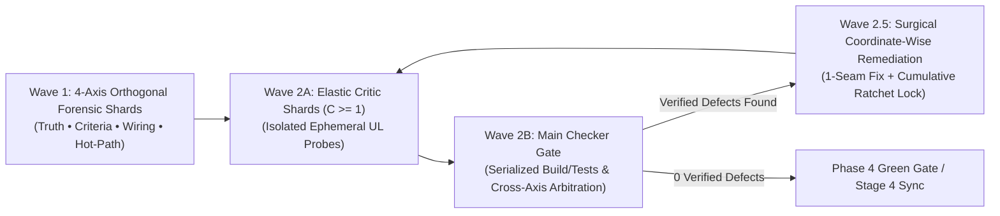

# Universal 4-Axis Deep Forensic Audit Protocol (`XBoost Reference`)

Read this reference on-demand when executing **`AUDIT / FORENSIC / SHIP`** tasks, hardening **`SIMULATE / SOLVER`** or **`OPTIMIZE / SCALE`** engines, or running **Phase 4 / Wave 2–2.5 Blind Adversarial Verification** under [`/xboost`](../SKILL.md) and [`/xultra`](../../xultra/SKILL.md).

This protocol is **100% language-, topic-, and workspace-agnostic**. It operates from universal mathematical, physical, and systems-engineering first principles rather than brittle language-specific regexes.

---

## 1. The 3-Wave Deep Forensic Audit Lifecycle (`Wave 1 → Wave 2 → Wave 2.5`)

Whenever auditing a codebase, simulation solver, data/ML pipeline, UI dashboard, or strategy matrix (standalone via `/xboost` or scaled across parallel subagents via `/xboost /xultra`), advance through three progressive waves:

1. **Wave 1 — 4-Axis Orthogonal Forensic Shards (`Cognitive-Density Inspection`)**:
   - Inspect the target system across four orthogonal forensic dimensions (in `/xboost /xultra`, spawn 1 dedicated Read-Only Forensic Scout per axis or subsystem shard):
     - **Axis 1 (`TRUTH & ZERO-CHEAT`)**: Causality, bracketed interpolation, exact-predicate refinement, and holdout isolation (`UL-01`, `UL-02`).
     - **Axis 2 (`CRITERIA, OBJECTIVES & SCALE PARITY`)**: Step-measure invariance, bidirectional counter-anchors, piece-wise codomain reachability, and scale preservation (`UL-03`, `UL-05`, `UL-06`).
     - **Axis 3 (`WIRING PROVENANCE, PARTITION CONSERVATION & ROLLBACK`)**: Hierarchical partition & remainder conservation, read-only feature decoupling, exception transparency, DAG init order, and atomic state rollback (`UL-04`, `UL-07`, `UL-08`).
     - **Axis 4 (`HOT-PATH PERFORMANCE & COMPLEXITY`)**: Loop-invariant hoisting, monotonic commutation, vectorization/indexing, and bounded cache eviction (`UL-08`).
2. **Wave 2 — Elastic Blind Falsification Shards (`Wave 2A`) & Main Checker Gate (`Wave 2B`, `Maker ≠ Checker`)**:
   - Never accept speculative prose findings or static linter passes at face value, and never hardcode a fixed number of Critic subagents ([`/xultra`](../../xultra/SKILL.md) Law 3):
     - **Wave 2A (`Elastic Critic Shards`, `C ≥ 1`)**: For localized 1-seam edits, auto-downshift to `C = 1` Blind Critic. For heavy multi-module or full-system audits, spawn dedicated parallel Critic Shards per active `UL` cluster or subsystem. Each shard executes **isolated, non-mutating Ephemeral Runtime Probes** (`python -c`, `node -e`, `sqlite3`, or single-function callables with `0` global build-lock contention) to classify findings strictly as **`[VERIFIED DEFECT]`** (with exact `file:line` and observed delta) or **`[FALSE POSITIVE — PRUNED]`**.
     - **Wave 2B (`Main Checker / Lead Verifier Gate`)**: Ingests the Wave 2A shard receipts, executes any lock-sensitive global build or full regression suite **once** (serialized barrier), arbitrates cross-shard conflicts (`Truth/Conservation UL-01..UL-07` strictly overrides `Performance UL-08`), verifies cross-stage contract fidelity (`Spec/Research Formula == Plan Matrix == Live Code`), and sequences defects into a deduplicated Wave 2.5 queue.
3. **Wave 2.5 — Surgical Coordinate-Wise Remediation & Cumulative Monotonic Ratchet (`Pass_Set(t+1) ⊇ Pass_Set(t)`)**:
   - When fixing verified defects, apply **Coordinate-Wise Marginal Attribution**: patch and benchmark one logical seam at a time so beneficial fixes are never bundled with or cancelled out by regressions.
   - **Ephemeral-to-Permanent Ratchet Promotion**: Distinguish disposable scratch exploration scripts from **Verified Invariant & Counterexample Assertions (`UL-05`, `UL-08`)**, which MUST be promoted into the permanent regression suite (or `<artifactDir>/scratch/ratchet_invariants.py` + logged in `<artifactDir>/scratch/boostx_state.md`) so round `t+1` can never regress round `1..t` fixes.

---

## 2. The 5 Universal First-Principles Guardrails (`Builder Gates`)

| Guardrail | First-Principles Rule | Mandatory Runtime Proof / Probe |
| :--- | :--- | :--- |
| **G1. Anti-"Green-Linter" Illusion Gate** | Compiler, typechecker, or static AST/linter `0 warnings` proves **syntax only—never semantic, physical, or mathematical truth**. | Pair every static check with an executed **Live-Callable Runtime Provenance & Behavioral Probe (`UL-08`)** importing and invoking the live production entrypoint directly before signing off. |
| **G2. End-to-End Perturbation & Coverage Law (`ΔX → ΔY ≠ 0`)** | Every upstream parameter, input control, config key, or feature `X` must actively drive terminal output `Y` inside its intended active operating regime (`∃ x ∈ Active_Regime(X) : ΔY ≠ 0`, while allowing `ΔY == 0` inside intentional deadbands/free zones) across `100%` of expected records without silent truncation, unreachable clamping, or fallback masking. | **1. Perturbation & Reachability (`UL-06`, `UL-08`)**: Perturb `X → X'` inside its active regime, verify `ΔY ≠ 0`, and confirm via a synthetic full-range sweep `[x_min, x_max]` that every piece-wise branch/tier is reachable (`> 0` hits). **2. Coverage & Provenance**: Verify `N_processed == N_expected` and `source != "fallback"`. |
| **G3. Universal Conservation, Causality & Invariance Triad** | Generalizes conservation and boundary laws across all systems: • **Extensive Partition, Remainder & Peer-Branch Completeness (`∑ Child_k + Remainder ≈ Parent`, `K_peer ⊆ K_eval`, `UL-04`)** • **Prefix Causality, Bracketed Support & Exact Refinement (`UL-01`, `UL-02`)** • **Step-Measure Invariance (`Δμ`, `UL-03`), Stream Decoupling & Post-Gate Non-Regression (`UL-07`)** | **1. Conservation & Branch Routing**: For extensive conserved measures, verify `abs((sum(Child_k) + Remainder) - Parent) <= max(1e-9 * max(1.0, abs(Parent)), 1e-9)` and zero accidentally orphaned peer branches. **2. Prefix / Support Probe**: For causal sequential/temporal operators, mutating `t+1..T` yields `0.0` diff at `0..t`; out-of-interval `x ∉ [x_left, x_right]` is rejected/clamped. **3. Step-Scaling & Post-Gate Integrity**: Halving step measure `Δμ → Δμ/2` converges at theoretical order `O(Δμ^p)`; post-gate auxiliary refreshes never silently invalidate the gate condition. |
| **G4. Bidirectional Counter-Anchors, Goal-Aligned Objective & Seam Scaling Gate** | Scoring curves, filters, and seams must match the problem's mathematical structure: • **Bidirectional Counter-Anchors (`A_pos ∧ A_neg`, `UL-05`)** • **Goal-Aligned Utility & Dispersion (`UL-05`)**: Keep `\|∂J/∂M\| > 0` across active search ranges on unbounded objectives; match dispersion to goal polarity (`symmetric σ/MSE` for setpoint tracking `x ≈ τ` vs. `one-sided σ_fail` when upper-tail gains `x > τ` are desirable); match constraints to type (`strict binary` vs. `continuous cost` vs. `budgeted allowance`). • **Theoretical Seam Scaling Order (`UL-06`)**: Verify producer-consumer scaling on the baseline-subtracted marginal delta `ΔY(α) = Y(α) - Y(0)` at interior points `α_1, α_2 ∈ Interior(Dom(α))` matches the domain equation (`\|ΔY(α_2) / ΔY(α_1)\| ≈ (α_2 / α_1) ^ p_theory`: `p_theory = 1` for linear weights without accidental `α²` double-application or premature clipping; `p_theory = 2` for quadratic physics/area). | Verify simultaneous `100%` pass on `A_pos ∧ A_neg` plus `(x_min, x_max)`, non-vanishing gradient across active unbounded search intervals, marginal scaling ratio `\|ΔY(α_2) / ΔY(α_1)\|` matching `(α_2 / α_1) ^ p_theory`, and strict feasibility dominance (`∀ x_infeas, x_feas : J(x_infeas) ≺ J(x_feas)`). |
| **G5. Hot-Path Complexity & Resource Discipline** | Inner loops must run in `O(1)` or vectorized/indexed memory with zero redundant invariant recomputation, zero cache-clear thrashing, and zero eager pre-gate formatting (`UL-08`). | Measure `Before → After` wall-clock latency (`ms`) or objective improvement (`J_after > J_before`) and verify numerical equivalence within ULP/relative tolerance (`max(\|y_opt - y_base\|) <= max(rtol·\|y_base\|, atol)`) for pure performance refactors. |

---

## 3. Complete 4-Axis Forensic Audit Taxonomy (`Wave 1 Scout Catalog`)

### Axis 1 — `TRUTH & ZERO-CHEAT` (Anti-Illusion, Anti-Leakage & Boundary Integrity)
1. **Unbounded Extrapolation vs. Bracketed Interpolation & Graph-Cut Shortcuts (`UL-01`)**:
   - *Flaw*: Extrapolating values unboundedly from a single boundary into unconstrained space instead of requiring opposing verified anchors (`x_left ≤ x ≤ x_right`); or approximating graph shortest-path distance `d_G(u, v)` with unconstrained norm `||u - v||` across absent/disconnected graph edges `(u, v) ∉ E`.
   - *Fix*: Restrict interpolation strictly to bracketed interior intervals, decay or flag `OUT_OF_BOUNDS` outside anchor support, and route strictly along valid subgraph edges `E`.
2. **Coarse Candidate Pre-Filter (`S_cand`) vs. Exact Condition (`P(x)`) Contamination (`UL-02`)**:
   - *Flaw*: Computing feature averages, aggregates, or membership decisions directly over a coarse index, window, or bounding box lookup (`S_cand ⊇ S_exact`), allowing background/boundary items (`S_cand ∖ S_exact`) to dilute statistics.
   - *Fix*: Treat coarse lookups strictly as Stage 1 candidate generators and evaluate all statistics and predicates exclusively on the exact subset `S_exact = {x ∈ S_cand : P(x)}`.
3. **Post-Event Clamping, Absorbing-Failure Bypass & Optimistic Tie-Breaking (`UL-02`)**:
   - *Flaw*: Using end-of-step `min/max` clamping (`max(end_state, -limit)`) when a trajectory breaches a fatal limit mid-step (`τ ∈ [t, t + Δt]`), or checking `if success` before `if failure` on coarse discrete steps without deducting state-transition overhead.
   - *Fix*: Enforce immediate absorbing-state termination upon intra-step failure breach and **Pessimistic Priority (`Failure > Success`)** on ambiguous discrete steps.
4. **Temporal Prefix Leakage, Warm-Seed Contamination & Holdout Reuse (`UL-01`, `UL-07`)**:
   - *Flaw*: Joining coarse-to-fine sequences by period *open* timestamp instead of *completion* timestamp (`t_end_A <= t_end_B`); loading warm fallback checkpoints during cold-start benchmarks; or querying the blind Holdout split across iterative tuning generations.
   - *Fix*: Enforce closed-interval point-in-time joins, prefix causality (`f(x[:T_1])[:t] == f(x[:T_2])[:t]` for `t < T_1 < T_2`, and finite-lookback `W` sufficiency `f(x)[k:] == f(x[k - W + 1:])[W - 1:]`), cold-start cache isolation, and a masked **3-Way Split (`Train / Validation / Blind Holdout`)**.

### Axis 2 — `CRITERIA, OBJECTIVES & SCALE PARITY` (Anti-Goodhart, Goal-Matched Math & Seam Scaling)
1. **One-Sided See-Saw Tuning, Premature Gradient Saturation & Goal-Polarity Mismatch (`UL-05`)**:
   - *Flaw*: Tuning thresholds or weights solely against false positives (or solely against false negatives), causing iterative see-saw oscillation; averaging high secondary scores to mask a violated hard feasibility constraint (`c_k(x) == 0`); wrapping an **unbounded** primary objective `M(x)` in a narrow sigmoid/`tanh(M/S)` that saturates (`∂J/∂M → 0`) well below the achievable frontier (`M ≫ 3S`); or mismatching dispersion polarity—using symmetric `std` on a directional `More-is-Better` metric (penalizing desirable upper-tail breakthroughs `x ≫ μ`), or conversely using one-sided variance on a bilateral setpoint-tracking problem (`x ≈ τ` where both `+δ` and `-δ` are errors).
   - *Fix*: Lock simultaneous **Bidirectional Counter-Anchors (`A_pos ∧ A_neg`)** plus `(x_min, x_max)`, enforce **Strict Feasibility Dominance (`∀ x_infeas, x_feas : J(x_infeas) ≺ J(x_feas)`)** (`J(x) = (∏ c_k(x)) · ∑ w_i u_i(x)` for non-negative maximization, or `< inf J_feas` / `+∞` when utilities can be negative or minimized), ensure `|∂J/∂M| > 0` across the active range of any unbounded objective (while preserving intentional caps on credit-bounded specs), and match dispersion to goal polarity (`symmetric MSE/σ` for setpoint/tolerance tracking vs. `one-sided failure semivariance σ_fail` for directional optimization).
2. **Piece-Wise Clamp Tautologies, Unintended Double-Scaling Across Seams (`T_α(T_α(u))`) & Compounding Damper Starvation (`UL-06`)**:
   - *Flaw*: Clamping an upstream component to `[a_i, b_i]` where `a_i ≥ τ_gate` (turning downstream gate `S ≥ τ_gate` into a `100%` tautology); applying a linear weight `α` **twice** across a producer-consumer seam (e.g., Producer `A` scales by `α` and divides by `max(1.0, α)`—leaving `0 < α < 1` unnormalized—and Consumer `B` multiplies by `α` again to yield `α²`, or Producer `A` clips `[-1, 1]` before normalizing `α > 1`); or multiplying `M` uncalibrated stage dampers (`Γ_eff = ∏_{m=1}^M γ_m ≪ 1`) that unintentionally starve clean baseline inputs.
   - *Fix*: Verify `inf S_i < τ_gate ≤ sup S_i` and non-empty pre-image measure across every declared branch/tier (`Range(S) ∩ [τ_k, τ_{k+1}) ≠ ∅`), verify that the marginal seam scaling ratio `|ΔY(α_2) / ΔY(α_1)|` (`ΔY(α) = Y(α) - Y(0)`) at interior points `α_1, α_2 ∈ Interior(Dom(α))` matches the **intended theoretical order of the domain equation** (`(α_2 / α_1) ^ p_theory`: `p_theory = 1` for single-application linear weights, `p_theory = 2` for physical quadratic/area laws), and verify that cascaded stage multipliers preserve expected nominal gain on clean inputs.
3. **Hardcoded Index-Count Operators, Upsampling Illusions & Process/Geometry Scaling Mismatch (`UL-03`)**:
   - *Flaw*: Parameterizing windows, derivatives, or thresholds by raw index counts (`k` steps) instead of the discretization step measure `Δμ` (`Δt`, `Δx`, weight); treating interpolated/upsampled grids as higher-resolution ground truth; using linear `1 + cumsum(r)` on multiplicative compounding processes; or scaling **2D area-encoded data glyphs** linearly by radius (`R ∝ Value` instead of `R ∝ √Value`, causing quadratic `Value²` visual distortion).
   - *Fix*: Scale all operators explicitly by step measure `Δμ`, match accumulation to process dynamics (`exp(cumsum(log1p(r)))` for multiplicative compounding vs. `cumsum(r · Δμ)` for additive conserved fluxes), replace binary step cliffs with smooth monotonic ramps, and match geometric encoding to target dimension (`R ∝ √Value` for 2D area-encoded bubble glyphs, `R = Value` for physical CAD/GIS buffers and 1D lengths, `R ∝ ∛Value` for 3D volume glyphs).
4. **Infeasible Initial Seeds, Path-Dependent Ceiling Lock-In & Constraint-Type Mismatch (`UL-05`)**:
   - *Flaw*: Selecting an unconstrained initial incumbent seed `x_0` that violates hard constraints; or dynamically tightening a **budgeted resource allowance** to the current incumbent (`c(x_{t+1}) ≤ c(x_t)`, trapping search in an early conservative corner and rejecting `99%+` of candidates despite unused allocated budget `τ_budget - c(x_t) ≫ 0`).
   - *Fix*: Enforce identical feasibility guards on initial seeds (`∏ c_k(x_0) == 1`), execute **Coordinate-Wise Marginal Attribution**, and match constraint math to the constraint's true role: (a) **Strict Invariants** (syntax, conservation, legal/safety bounds) use a hard binary gate; (b) **Co-Minimized Costs** use a continuous penalty; (c) **Budgeted Allowances** (where any `c(x) ≤ τ_budget` is acceptable) keep `Penalty = 0.0` inside the free budget zone (`c ≤ τ_free`) with an optional soft buffer (`τ_free < c ≤ τ_hard`) before the hard wall, avoiding path-dependent incumbent lock-in.

### Axis 3 — `WIRING PROVENANCE, PARTITION CONSERVATION & ROLLBACK` (Connectivity & State Hygiene)
1. **Parent-to-Child Constraint Bypass, Blocking-`continue` Remainder Drop & Accidental Peer-Branch Omission (`UL-04`)**:
   - *Flaw*: Checking size/validity limits on split child fragments (`C_i ⊂ P`) instead of the parent entity (`P`); executing a blocking `continue` after Stage A consumes `5%` of `P` (`P_A ⊂ P`) instead of forwarding the remainder `P_rem = P ∖ P_A` to Stage B/C; silently dropping `> 50%` of upstream outputs in an unlogged post-filter; or evolving/generating `K` peer candidate branches (`{k_1, k_2, k_3}`) intended for downstream selection while the selector loop hardcodes a subset (`{k_2, k_3}`), accidentally orphaning branch `k_1`.
   - *Fix*: Propagate parent macro-constraints to all child fragments (`C_i.parent_id == P.id`), forward unconsumed remainders `P_rem = P ∖ P_A`, assert closed-system conservation on extensive measures (`abs((∑ μ(C_i) + μ(P_rem)) - μ(P)) <= max(1e-9 * max(1.0, abs(μ(P))), 1e-9)`), and verify **Intended Peer-Branch Completeness (`K_peer_branches ⊆ K_evaluated`)** (while allowing intentional read-only metadata/diagnostic fields to remain unconsumed).
2. **Read-Only Feature Transform (`φ(x)`) Overwriting or Double-Compounding Ground Truth (`x`) (`UL-07`)**:
   - *Flaw*: Applying a non-linear contrast/sensitivity transform `φ(x)` to aid detection/ranking and then evaluating hard physical/accounting constraints on `φ(x)` instead of raw `x`, multiplying redundant colinear weights (`W(x) · g(φ(x))`), or writing post-transform outputs `T(x)` back into a base cache slot (`T(T(x))`).
   - *Fix*: Isolate `φ(x)` in a read-only representation stream, evaluate hard constraints and conservation strictly on raw `x`, and keep base caches pre-transform (`y1 = run(x); y2 = run(x) ⇒ y1 == y2`).
3. **Test-vs-Live Callable Drift, Circuit-Breaker Truncation & Silent `try/except` Fallbacks (`UL-08`)**:
   - *Flaw*: Writing duplicate toy formulas or loading stale cached inputs inside test scripts while production resolves different live inputs; letting live safety defaults (`timeout`, `limit`, circuit breakers) truncate offline batch runs after `1%` of records with `exit code 0`; or masking broken schemas via `except Exception: return default_val`.
   - *Fix*: Import and invoke the live production entrypoint and live input resolver directly in verification probes, pass explicit offline limits (`assert N_processed == N_expected`), surface schema exceptions (`source != "fallback"`), and verify every parameter/control inside its active operating regime (`∃ x ∈ Active_Regime(X) : ΔY ≠ 0`).
4. **DAG Initialization-Order Inversion, Unverified Post-Gate Mutation & Non-Atomic Rollback (`UL-07`)**:
   - *Flaw*: Computing an auxiliary table *after* a consumer has already checked `if exists(): join()`; mutating auxiliary calibration/lookup state `θ_new` *after* candidate `x_cand` passes an acceptance gate in a way that silently invalidates the gate criterion (`Mutate-After-Approve` drift); or rolling back a rejected candidate's pointer while leaving visited sets (`V_visited`) or elite archives (`A_elite`) corrupted.
   - *Fix*: Enforce strict DAG dependency order (`t_write < t_read`), **Post-Gate Non-Regression Verification** (when a monotonic acceptance gate is used, verify that any post-gate auxiliary state refresh `θ_new` preserves the acceptance condition before committing), and atomic tuple rollback preserving `A_elite ← top_k(A_elite ∪ {s'})`.

### Axis 4 — `HOT-PATH PERFORMANCE & ALGORITHMIC COMPLEXITY` (Speed & Memory Discipline)
1. **Monotonic Transform Commutation & Sub-Key Loop Hoisting (`UL-08`)**:
   - *Flaw*: Calling expensive transcendental/root functions (`exp`, `log`, `sqrt`) across `N × K` matrices before finding `argmax`/`min`, or recomputing quantities that depend only on `(A, B)` inside an inner `(C)` loop.
   - *Fix*: Find `argmax`/`min` in log-space or squared-norm space first and apply `exp`/`sqrt` only to the winner; hoist sub-key invariants into outer caches.
2. **Zero-Order-Hold Prefix Scans, Sparse Events & Tree/Index Lookups (`UL-08`)**:
   - *Flaw*: Writing sequential interpreter `for` loops for state latching ("freeze value at entry until exit"), recurrence scans, or `O(N²)` all-pairs lookups.
   - *Fix*: Vectorize zero-order-hold latches via `np.maximum.accumulate(np.where(is_entry, np.arange(n), 0))`, iterate only over sparse transition indices (`np.flatnonzero(can_change)`), pre-allocate contiguous arrays (`double[]`), and enforce `O(log N)` tree/B-tree/composite indexes.
3. **Sibling-Consumer Deduplication & Lazy Post-Gate Serialization (`UL-08`)**:
   - *Flaw*: Multiple sibling consumers running identical transforms/simulations on the same inputs, or building heavy UI/telemetry snapshots for every candidate *before* the selection gate filters out losers.
   - *Fix*: Share cached simulation artifacts across sibling consumers and defer snapshot formatting strictly to the winning candidate.
4. **Cache-Clear Thrashing & Read-Only Slice Copy Bloat (`UL-08`)**:
   - *Flaw*: Evicting caches via `if len(cache) > M: cache.clear()` when `M < working_set_size` (causing cyclic 100% cache misses), or calling `.copy()` on read-only array/DataFrame slices inside sweeps.
   - *Fix*: Use zero-copy slice views and single-entry FIFO/LRU eviction (`cache.pop(next(iter(cache)))`).

---

## 4. The 8 Universal First-Principles Laws & Ephemeral Probe Matrix (`UL-01` to `UL-08`)

Every Wave 2 Blind Critic shard must execute the corresponding **Ephemeral Runtime Probe** in the project's native runtime (`0` domain jargon; `100%` applicable across all languages, algorithms, data pipelines, solvers, and UIs):

| Law ID | Universal Law Name | Formal Mathematical & Systems Formulation | Mandatory Wave 2 Ephemeral Runtime Probe (`assert ...`) | Interlock (`Gate × Axis`) |
| :---: | :--- | :--- | :--- | :---: |
| **`UL-01`** | **Bounded Interpolation vs. Unbounded Extrapolation & Graph-Cut Isolation** | **1. Bracketed Support**: Interpolate missing states only when bracketed on opposing sides by verified anchors (`x_left ≤ x ≤ x_right`); never extrapolate unboundedly from a single boundary. **2. Graph-Cut & Prefix Isolation**: On graph `G = (V, E, w)`, never approximate `d_G(u, v)` with unconstrained norm `\|\|u - v\|\|` across absent edges `(u, v) ∉ E`; for causal sequential/temporal operator `F`, `F(x)[0..t] == F(x[0..t])` with `0` blind holdout (`D_test`) queries. | Probe `x_ext ∉ [x_left, x_right]` → assert `status == OUT_OF_BOUNDS` or bounded prior clamp; for causal operators, mutate `x[t+1..T] ← 10 × x[t+1..T]` → assert `max(\|F(x_mut)[0..t] - F(x)[0..t]\|) == 0.0`; sever edge `e` → assert routing strictly within `E ∖ {e}`. | `G3` × `Axis 1.1, 1.4` |
| **`UL-02`** | **Two-Stage Candidate Pre-Filter (`S_cand`) vs. Exact Condition (`P(x)`) & Absorbing Failure** | **1. Exact Refinement**: Any index, window, bucket, or bounding lookup returns a candidate superset (`S_cand ⊇ S_exact`); compute all statistics and membership decisions strictly on `S_exact = {x ∈ S_cand : P(x)}`. **2. Absorbing Failure Priority**: If intra-step state `s(τ)` (`τ ∈ [t, t + Δt]`) breaches `F_fail`, terminate immediately (`Failure > Success` on ties) without end-of-step `min/max` recovery. | Construct boundary noise item `x_noise ∈ S_cand ∖ S_exact` → assert `x_noise ∉ Output` and aggregate statistics match `S_exact` exactly; inject mid-step breach `g(s(t + Δt/2)) < 0` → assert terminal state `∈ F_fail`. | `G3` × `Axis 1.2, 1.3` |
| **`UL-03`** | **Discretization & Step-Measure Scaling Invariance (`Δμ`)** | Parameterize window spans, derivatives, decay rates, and thresholds explicitly by the discretization step measure `Δμ` (`Δt`, `Δx`, sample weight, batch span) rather than raw index counts (`k` steps). Rescaling resolution (`Δμ → Δμ/2`) must converge at theoretical order `O(Δμ^p)` (`∑ f(x_i) Δμ_i → I`), and interpolated/upsampled grids must never be treated as native high-resolution truth. | Resample input sequence at `2×` and `0.5×` step size (`Δμ/2`, `2·Δμ`); assert `O(Δμ^p)` integral/rate convergence `abs(I(Δμ) - I(Δμ/2)) < ε(Δμ)` and **Zero-Forcing Equilibrium Identity** (`Δx = 0 ⇒ Δy = 0.0 / y == y_eq` with `0` `NaN`/`Inf`). | `G3, G4` × `Axis 2.3` |
| **`UL-04`** | **Hierarchical Partition, Remainder Conservation & Intended Peer-Branch Completeness** | When decomposing or routing parent entity `P` or parallel peer candidate branches `K_peer` across stages (`Stage 1 → 2 → 3`): **1. Parent Provenance**: Child fragments `C_i ⊂ P` inherit macro-constraints of `P` (`C_i.parent_id == P.id`). **2. Remainder Forwarding**: Partial stage matches (`P_A ⊂ P`) must forward unconsumed remainder `P_rem = P ∖ P_A` downstream (never drop `P` via blocking `continue`). **3. Extensive Conservation & Peer Routing**: For extensive conserved measures, `∑ μ(C_i) + μ(P_rem) ≈ μ(P)` (with `C_i ∩ C_j == ∅` on disjoint partitions, or `∑ w_i(x) == 1` on overlapping windows), and `K_peer_branches ⊆ K_evaluated` (`0` accidentally orphaned peer branches, while allowing read-only diagnostic/metadata keys). | For extensive measures, assert `abs((sum(Child_k) + Remainder) - Parent) <= max(1e-9 * max(1.0, abs(Parent)), 1e-9)`, pairwise disjointness `len(C_i & C_j) == 0` (for disjoint partitions), `K_peer_branches <= K_evaluated`, `0` child fragments bypassing rejected parent `P`, and logged stage survival ratios `\|Out_k\| ÷ \|In_k\|`. | `G3` × `Axis 3.1` |
| **`UL-05`** | **Bidirectional Counter-Anchors (`A_pos ∧ A_neg`) & Goal-Matched Objective/Constraint Polarity** | **1. Bidirectional Counter-Anchors & Strict Feasibility Dominance**: Lock simultaneous positive (`A_pos`) and negative (`A_neg`) anchors plus `(x_min, x_max)`; enforce **Strict Feasibility Dominance (`∀ x_infeas, x_feas : J(x_infeas) ≺ J(x_feas)`)** (`J(x) = (∏_k c_k(x)) · ∑_i w_i u_i(x)` for non-negative maximization, or `< inf J_feas` / `+∞` when utilities can be negative or minimized). **2. Goal-Matched Utility & Dispersion**: Keep `\|∂J/∂M\| > 0` across active search ranges of unbounded objectives (preserving intentional caps on bounded specs); match dispersion to goal polarity (`symmetric MSE/σ` for setpoint tracking `x ≈ τ` vs. `one-sided σ_fail` for directional `More-is-Better` objectives). **3. Constraint Role Alignment**: Use strict binary gates for hard invariants, continuous penalties for co-minimized costs, and budgeted free/soft/hard zones (`Penalty = 0` inside allocated budget `c ≤ τ_free`) when a resource budget is explicitly granted. | Execute single-command assertion over `(A_pos, A_neg, x_min, x_max)`: assert `100%` pass on `A_pos ∧ A_neg`, `sign(f(x + δ) - f(x)) == expected_sign`, `\|∂J/∂M\| > 0` on unbounded active ranges, and strict feasibility dominance (`J(x_infeas) ≺ J(x_feas)`). | `G4` × `Axis 2.1, 2.4` |
| **`UL-06`** | **Piece-Wise Codomain Reachability & Theoretical Seam Scaling Order (`\|ΔY(α_2)/ΔY(α_1)\| ≈ (α_2/α_1)^p_theory`)** | **1. Reachability**: Every piece-wise branch `S_i(x) ∈ [a_i, b_i]`, gate `τ_gate`, and bucket `[τ_k, τ_{k+1})` must satisfy `a_i < b_i`, `inf S_i < τ_gate ≤ sup S_i`, and `Range(S) ∩ [τ_k, τ_{k+1}) ≠ ∅` on a synthetic full-range domain sweep. **2. Theoretical Seam Scaling Order**: Across any producer-consumer seam `B(A(u, α), α)`, the marginal delta `ΔY(α) = Y(α) - Y(0)` at interior points `α_1, α_2 ∈ Interior(Dom(α))` must satisfy `\|ΔY(α_2) / ΔY(α_1)\| ≈ (α_2 / α_1) ^ p_theory` (e.g., `p_theory = 1` for single-application linear weights without accidental `α²` double-application or premature clipping; `p_theory = 2` for quadratic energy/area laws). **3. Multi-Stage Gain**: Verify cascaded stage multipliers preserve expected nominal gain on clean inputs. | Execute synthetic full-range sweep across `[x_min, x_max]`: assert `0 < pass_rate(τ_gate) < 1`, `count(Bucket_k) > 0`, and marginal scaling ratio `abs(ΔY(α_2) / ΔY(α_1))` at interior `α_1, α_2 ∈ Interior(Dom(α))` matches `(α_2 / α_1) ^ p_theory`. | `G2, G4` × `Axis 2.2` |
| **`UL-07`** | **Read-Only Feature Transform (`φ(x)`) Decoupling, Cache Idempotency & Post-Gate Non-Regression** | **1. Stream Decoupling**: Non-linear feature transforms `φ(x)` must reside in a read-only representation stream and never overwrite raw ground-truth `x` or write post-transform state `T(x)` into base caches (`T(T(x))`). **2. Post-Gate Non-Regression & Atomic Rollback**: When a monotonic acceptance gate promotes `x_cand`, verify that any post-gate auxiliary state refresh `θ_new` does not silently invalidate the promotion condition; on candidate rejection, atomically restore `(state, visited_set, elite_archive)`. | Run cached pipeline twice (`y1 = run(x); y2 = run(x)`) → assert `max(\|y1 - y2\|) == 0.0`; verify post-gate auxiliary refreshes preserve the acceptance condition; verify atomic state equality after rollback. | `G3` × `Axis 3.2, 3.4` |
| **`UL-08`** | **Live-Callable Parity, Active-Regime Sensitivity (`ΔX → ΔY ≠ 0`) & Counterexample Ratchet** | **1. Production-Callable Parity**: Test harnesses must import and invoke the live production entrypoint and live input resolver directly—never re-type duplicate toy formulas or run against stale cached inputs. **2. Active-Regime Sensitivity & Coverage**: Perturb each input `x_i → x_i + δ` inside its active operating regime (`x ∈ Active_Regime(x_i)`) and assert `ΔY ≠ 0`, `N_processed == N_expected`, and `provenance != "fallback"`. **3. Cumulative Ratchet**: Pin every user-flagged failure `(x_bad → expected)` into the persistent regression suite (`Pass_Set(t+1) ⊇ Pass_Set(t)`). | Import and call `prod_fn` directly; assert `prod_fn(x + δ) != prod_fn(x)` for `x ∈ Active_Regime(x_i)`, `N_processed == N_expected`, `provenance != "fallback"`, `t_opt < t_base` within ULP/relative tolerance (`max(\|y_opt - y_base\|) <= max(rtol·\|y_base\|, atol)`), and `100%` pass on `Ratchet_Suite(1..t)`. | `G1, G2, G5` × `Axis 3.3, 4.1–4.4` |
