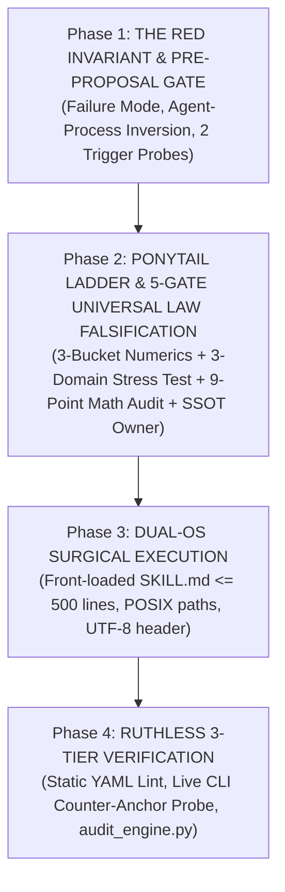
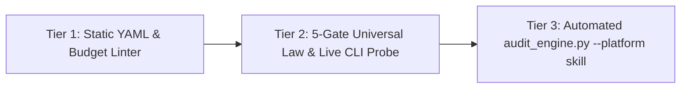

# Antigravity Skill Creator & Universal Law Auditor (`/xcreate-skill`)

Authoring, distilling, evolving, and verifying production-grade global agent skills across **Antigravity IDE**, **Antigravity CLI (`agy`)**, **Claude Code**, and cross-platform multi-agent environments.

This skill synthesizes four core frameworks:
1. **The [`/xboost`](../xboost/SKILL.md) Protocol**: 4-phase engineering lifecycle (Red Invariant Gate → Ponytail × 5-Gate Universal Law Filter → Dual-OS Surgical Build → Ruthless 3-Tier Verification).
2. **`writing-great-skills` Discipline**: Information hierarchy, progressive disclosure, leading words, single-source-of-truth (`SSOT`) co-location, and context-load vs. cognitive-load optimization.
3. **The 5-Gate Universal Law Falsification Protocol**: Pre-proposal counter-domain stress testing (`Archetypes A × B × C`), Agent-Process vs. Domain-Equation separation, and mathematical boundary auditing so project-specific equations or scripts never leak into global skills.
4. **Universal Cross-Platform Globalization**: Physical directory allocation, dual-OS path normalization (Windows PowerShell + macOS/Linux bash), and zero-breakage cloud synchronization (OneDrive / Google Drive).

---

## 1. Scope & Universal Globalization Policy

Every agent skill authored or upgraded via `/xcreate-skill` **MUST reside in the Global Customizations Root** so that it is instantly accessible across **every workspace** and synchronized across **every device** (Windows, macOS, and Linux workstations):

| Target Path | Physical Cloud Storage | Behavior Across Workspaces & Devices |
| :--- | :--- | :--- |
| **`~/.gemini/config/skills/<skill-name>/`** | **OneDrive (`gemini-config/skills/<name>/`)**<br>• Windows: `C:\Users\<User>\OneDrive\gemini-config\skills\<name>\`<br>• macOS: `~/Library/CloudStorage/OneDrive-Personal/gemini-config/skills/<name>/` | **Universal Globalization**: Automatically loaded into every workspace on all machines. Real-time background sync via OneDrive. Zero git-push or symlink chore required. |

> [!IMPORTANT]
> **The Universal Globalization Invariant (Zero Project-Local Silos)**:
> Never create skills inside a workspace-local `.agents/skills/<name>/` folder. Local project skills become isolated silos that are invisible when opening other repositories, and they cause version drift between machines. Always write directly to `~/.gemini/config/skills/<name>/`.

> [!IMPORTANT]
> **The NTFS Junction & Real Directory Rule**:
> When authoring global skills on Windows where `~/.gemini/config` is an NTFS junction to `OneDrive\gemini-config`, **always create real directories** inside `skills/<name>/`. Never create nested secondary junctions, as IDE file watchers and Node.js globbers refuse to traverse recursive reparse points.

> [!TIP]
> **Global Git Ledger & Rollback Protection (Dual-OS)**:
> The global config root is version-controlled via Git. After creating or updating a skill, commit the change:
> - **macOS / Linux**:
>   ```bash
>   git -C ~/.gemini/config add -A && git -C ~/.gemini/config commit -m "feat(skills): update <skill-name>"
>   ```
> - **Windows (PowerShell)**:
>   ```powershell
>   git -C "$env:USERPROFILE\.gemini\config" add -A; git -C "$env:USERPROFILE\.gemini\config" commit -m "feat(skills): update <skill-name>"
>   ```

---

## 2. Ingestion Modes (`Mode A`, `Mode B`, `Mode C`)

Operate in one of three distinct modes based on user intent:

### Mode A: Session Workflow Distillation ("Make this a new skill")
* Triggered when the user says *"make this a skill"*, *"package what we just did"*, or *"turn this workflow into a reusable skill"*.
* Reads the active conversation history / transcript (`transcript.jsonl`), extracts the sequence of successful commands, tool calls, and output schemas, strips debugging detours, and synthesizes a repeatable workflow skill.

### Mode B: Greenfield Domain / Tool Architecture ("Create a skill for X")
* Triggered when building a brand-new skill from an API, library documentation, standard, or domain (e.g., QGIS analysis, Grasshopper solver, Docx processing).
* Conducts a focused, non-bloated 3-question interview (`Intent`, `Tools/Inputs/Outputs`, `Edge Cases`).

### Mode C: Post-Session Skill Evolution, Universal Law Ratchet & Ecosystem Audit ("Upgrade existing skills with what we learned")
* Triggered when the user asks to **inspect what can be learned from a session to upgrade existing skills** (e.g., [`/xboost`](../xboost/SKILL.md), [`/xdeep-research`](../xdeep-research/SKILL.md), [`/xultra`](../xultra/SKILL.md), [`/xplan`](../xplan/SKILL.md), [`/xsync`](../xsync/SKILL.md)) or asks to **re-audit existing skills** for universal applicability and conflicts.
* **Mandatory Pre-Proposal Abstraction & Falsification Sieve (Run BEFORE Suggesting in Chat — Even on "Suggest-Only" Prompts)**:
  To prevent **Session Hangover / Recency Bias** (proposing disguised project equations, fixed-equation heuristics, or redundant rules), every candidate lesson must pass **five pre-proposal steps before you present any suggestion to the user**:
  1. **Agent-Process Law vs. Domain-Equation Inversion**:
     * Core `/x*` skills govern **how the AI agent investigates, plans, verifies, and orchestrates subagents**—they are **NOT** domain physics/finance/ML textbooks.
     * Never copy a project's domain equation or solver heuristic into a global skill. Instead ask: *"What flaw in the AI agent's reasoning or verification process allowed this bug to happen, and is it already covered by an existing `UL-01..UL-08` probe?"*
  2. **The Global CLI Script Ban**:
     * **Never** propose adding a project-specific helper script (or domain-specific CLI check) into `~/.gemini/config/skills/<skill>/scripts/*.py`. Global skill scripts may only operate on universal primitives shared across all projects (`.md` links, `.json` schemas, `.pdf` OCR, `git` diffs, Python AST security, SQLite transcript telemetry). Keep domain scripts inside the project repository's own `scripts/` folder.
  3. **Anti-Confirmation-Bias Counter-Paradigm Stress Test (`∀` Non-Breakage vs. `∃` Happy-Path Trap)**:
     * Finding *one* example in Domains A, B, and C where a candidate rule works (`∃ example : works`) does **NOT** prove universality! If there exists **any standard paradigm** in another field where the rule causes mathematical errors, solver divergence, deadlocks, or false positives (`∃ valid_paradigm : breaks`), the rule is **FALSIFIED and MUST BE PRUNED**. Every candidate rule must explicitly survive all **5 Counter-Paradigm Stress Checks**:
       1. **Regularization & Pareto Trade-Offs**: Must *never* enforce a greedy primary-objective floor (`M_primary(x_cand) ≥ M_primary(x_inc)`) that blocks legitimate regularization (`L_data + λ·R_sec` in ML, Tikhonov inverse problems, LQR control), simulated annealing, or Pareto frontier trade-offs.
       2. **Exact Differentiability & Solver Precision**: Must *never* mandate quantizing/bucketing continuous cache keys (`int(x // Δb)`) in a way that zeroes out finite-difference Jacobians (`f(x + δ) == f(x) ⇒ ∂f/∂x = 0` in Newton-Raphson/FEM/CAD solvers) or breaks `UL-03` `O(Δμ^p)` convergence.
       3. **Lazy Dirty-Flag DAGs, Stateful Filters & Lossy Serialization**: Must *never* force eager intermediate re-evaluation that breaks lazy DAGs (Grasshopper, React, incremental compilers), nor demand exact `== 0.0` float equality across text/quantized serialize-reload round-trips (`Gate 3.6`) or online stateful filters (Kalman/EMA/momentum buffers).
       4. **Pre-Aggregated `O(1)` Prefix/Tree Structures**: Must *never* ban reading valid `O(1)` pre-computed prefix/tree aggregates (Segment/Fenwick trees, container completeness headers) in favor of `O(N)` array re-slicing.
       5. **Transient Readiness & Existing `UL-01..UL-08` Redundancy**: Must *never* unconditionally lock one-time init flags on transient I/O or warmup-incomplete (`t < W`) failures, and must *not* duplicate bugs already caught by existing `UL-01..UL-08` runtime probes (e.g., `UL-01` future-mutation probe, `UL-05` `A_pos ∧ A_neg`, `UL-07` DAG order, `UL-08` Axis 4.1 sub-key loop hoisting).
  4. **Mandatory Pre-Proposal Blind Critic Gate (`Maker ≠ Checker` BEFORE Chat Suggestion) & Zero-Upgrade Outcome**:
     * Whenever subagent tools (`invoke_subagent` / `Task`) are available in Mode C—**even when the user says *"suggest only, don't edit anything yet"***—you **MUST** spawn the **Wave 2A Blind Counter-Domain Critic (`TypeName="research"`) BEFORE presenting candidate suggestions to the user**. Never present self-graded suggestions first and wait for the user to spot fixed-equation conflicts!
     * Treat **`"0 Upgrades Needed — Current Universal Laws Are Already Complete"`** as a first-class, high-discipline conclusion whenever all candidates are pruned by the Critic or covered by `UL-01..UL-08`.
  5. **Mandatory "Pruned Project-Specific Ideas" Ledger & 3-Domain Proof Table in Chat**:
     * In your chat response, always present the **`PRUNED — Project-Specific / Fixed-Equation / Covered by Existing UL`** ledger first (with exact counter-domain failure reasons and where those heuristics belong instead, e.g., project `docs/`). Only for any surviving rule that passed the Blind Critic with `0` counter-domain conflicts, include a 3-column proof table across **(A) Continuous / Stateful Solver & CAD/Physics**, **(B) Discrete / Web UI / API / CRUD**, and **(C) Non-Code Research / Docs / Knowledge Graph**.

---

## 3. The 4-Phase XBoost Skill Creation & Evolution Lifecycle



---

### Phase 1: The Red Invariant Gate (Pre-Creation / Pre-Upgrade)

Answer these three questions before drafting or proposing edits:

1. **What is the Red Agent Failure Mode?**
   * What does the AI agent get wrong without this skill or rule? (e.g., trusts green linters without calling the live entrypoint, extrapolates outside bracketed bounds, spawns redundant subagents, fails on cross-platform paths).
2. **Invocation Decision (Context Load vs. Cognitive Load)**:
   * **Model-Invoked** (Default): Keeps a rich `description` (`≤ 400` chars target) with leading words, positive triggers, and an explicit `Do NOT use for...` exclusion clause. Contributes context load every turn; agent can trigger it autonomously.
   * **User-Invoked**: Set `disable-model-invocation: true`. Note that `description` is **still mandatory in YAML frontmatter** (write a concise 1-line human-facing summary; positive/negative trigger clauses become optional).
     > [!WARNING]
     > **`disable-model-invocation: true` suppresses prompt context**: In Antigravity IDE, setting this flag completely strips the skill from the agent prompt's `<skills>` catalog. Only set this for manual user-typed commands.
3. **Bidirectional Trigger & Behavioral Probes (`A_pos ∧ A_neg`)**:
   * **Positive Probe (`A_pos`)**: A prompt or input fixture that *must* trigger/pass the skill or rule.
   * **Negative Counter-Anchor (`A_neg`)**: A related out-of-scope prompt or counter-domain fixture that *must NOT* falsely trigger or break under the rule.

---

### Phase 2: Ponytail Ladder, 3-Bucket Numeric Rule & 5-Gate Universal Law Falsification

#### A. The Ponytail Senior Dev Filter (Rungs 1–4)
* **Rung 1 (YAGNI / Rule Check)**: Does this actually need a new skill or rule? If the model already obeys it by default (**No-Op** in `writing-great-skills`), delete it.
* **Rung 2 (Tool & SSOT Reuse)**: Do native tools, MCP servers, or an existing owner skill already cover this? If yes, point to the existing owner (`[label](../skill/SKILL.md)`) rather than duplicating prose.
* **Rung 3 (Structure Selection)**: Choose **Workflow Archetype** (ordered steps + completion criteria), **Task Toolkit Archetype** (independent sub-actions), or **Reference Archetype** (flat peer rules).
* **Rung 4 (Code vs. No-Code)**: Default to **Pure Instruction (Zero Code)**. Only add `scripts/<name>.py` for deterministic, 100% domain-agnostic parsing/auditing using Python stdlib (`argparse`, `pathlib`, `json`, `re`, `ast`).

#### B. Core Invariant 1: The 3-Bucket Numeric Litmus Test & Zero-Persona Neutrality
Classify every numeric bound (`≤ N`, `N..M`, `< N`) into one of three buckets:
1. **Bucket 1 — Physical / Platform Constants (Keep & Cite Source)**: Hardware, model, or runtime limits (`512`-token `ModernBERT` window, `< 30s` synchronous tool timeout, `2-Hop` GraphRAG diameter, `≤ 400`-char target / `≤ 500`-char advisory YAML description budget, `≤ 500`-line `SKILL.md` progressive disclosure budget).
2. **Bucket 2 — Per-Window Cognitive Working-Set Bounds (Keep Per Window, Scale via `/xultra` Shards)**: Per-thread reading caps (such as `/xbrief`'s `8`-file Pass-B cap per single context window) paired with horizontal [`/xultra`](../xultra/SKILL.md) shard scaling when corpus size exceeds one window.
3. **Bucket 3 — Arbitrary Task / Subagent Quotas, Snapshot Counts & Persona Leaks (Strictly Forbidden)**: Never hardcode fixed subagent headcounts (`3+2`, `4–12`, `2–4 scouts`), arbitrary output word/line caps (`≤ 150 words`, `1–2 notes`, `< 30 lines`), transient dataset row counts (`14,203 rows`), or personal hardware/persona strings into global skill instructions.

#### C. Core Invariant 2: The 5-Gate Universal Law Falsification Protocol
Whenever Mode A or Mode C distills a rule, mathematical invariant, or verification probe into any global skill, it **MUST pass all 5 gates in order**:

| Gate | Falsification Check | Pass / Conditioning / Removal Criterion |
| :---: | :--- | :--- |
| **Gate 1** | **Domain-Jargon & Vocabulary Strip** | Strip 100% of source-project nouns, domain metrics, and filenames. Express strictly in universal systems primitives: `Input/Control (X)`, `Output/Objective (Y, J)`, `Active_Regime(X)`, `Step Measure (Δμ)`, `Candidate Superset vs. Exact Subset (S_cand ⊇ S_exact)`, `Parent vs. Child + Remainder (P = ∪ C_i ∪ P_rem)`. |
| **Gate 2** | **3-Domain Counter-Paradigm Stress Test (`Archetypes A × B × C`, `∀` vs. `∃`)** | Test against **(A) Continuous/Stateful Numerical or Physics Solver**, **(B) Discrete/Web UI/API/CRUD System**, and **(C) Non-Code Research/Docs/Knowledge Graph**—and explicitly check for conflicts against **Regularization/Pareto trade-offs, Exact Jacobians, Lazy DAGs, `O(1)` Prefix Trees, and Transient Retry**. If falsified on *any* legitimate paradigm, **prune (`REMOVE`)** or prefix an explicit **Context-Conditioned Branch Guard (`When [Condition C] holds: ...`)**. |
| **Gate 3** | **9-Point Mathematical & Regime Boundary Audit** *(See Table below & [`deep_audit_protocol.md`](../xboost/references/deep_audit_protocol.md))* | Verify that equations and runtime probes do not fail on affine offsets (`y_eq ≠ 0`), non-zero intercepts (`Y(0) ≠ 0`), intensive measures (means/rates/temps), intentional deadbands/free budget zones (`τ_free`), stateful warmup lookbacks (`W > 1`), IEEE-754 float/serialization reductions (`rtol/atol`), `@decorator` wrappers, exact finite-difference Jacobians (`∂f/∂x`), or regularized `L_data + λ·R_sec` trade-offs. |
| **Gate 4** | **Ponytail YAGNI, No-Op & "Delete-Over-Debug" Filter** | Delete rules that (a) the model obeys by default (`No-Op`), (b) duplicate an existing `UL-01..UL-08` runtime probe, (c) force project-specific ceremony (e.g., mandatory `.bat`+`.sh` launchers) onto repos that don't need them, or (d) clash with standard language idioms or global typography rules. |
| **Gate 5** | **Cross-Skill SSOT Co-Location & Pointer-Over-Paste** | Every universal law has **one canonical owner file** (e.g., `UL-01..UL-08` live in [`../xboost/references/deep_audit_protocol.md`](../xboost/references/deep_audit_protocol.md); `N × K × C × T` swarm sizing lives in [`../xultra/SKILL.md`](../xultra/SKILL.md)). Never copy-paste 20-line tables across multiple skills; use a 1–2 line summary + relative **Context Pointer**, and keep `SKILL.md ≤ 500` lines. |

##### Gate 3 Reference: The 9-Point Mathematical & Regime Boundary Table

| # | Boundary Axis | ❌ Forbidden Over-Specific Form | ✅ Mandatory Universal / Context-Conditioned Form |
| :---: | :--- | :--- | :--- |
| **3.1** | **Equilibrium / Intercept** | `x = 0 → y = 0` *(fails on affine offsets `y = mx + b` & Kelvin/ambient baselines)* | **Zero-Forcing Equilibrium (`UL-03`)**: `Δx = 0 ⇒ Δy = 0.0` (or `y == y_eq`) with `0` `NaN`/`Inf`. |
| **3.2** | **Seam Scaling Order** | `d log\|Y\|/d log α == p` or `\|Y(α)/Y(1)\| == α^p` *(fails when `Y(0) ≠ 0` or at clamp walls)* | **Interior Baseline-Subtracted Marginal Scaling (`UL-06`)**: With `ΔY(α) = Y(α) - Y(0)` at `α_1, α_2 ∈ Interior(Dom(α))`, `\|ΔY(α_2) / ΔY(α_1)\| ≈ (α_2 / α_1) ^ p_theory`. |
| **3.3** | **Partition Conservation** | Unqualified `sum(Child) == Parent` *(fails on intensive means/rates/temps & partial matches)* | **Extensive Partition & Remainder Conservation (`UL-04`)**: *For extensive conserved measures*, `abs((∑ μ(C_i) + μ(P_rem)) - μ(P)) <= max(rtol·max(1.0, abs(μ(P))), atol)`. |
| **3.4** | **Parameter Sensitivity** | Unqualified `∀ x, f(x + δ) ≠ f(x)` *(flags intentional deadbands & free budget zones)* | **Active-Regime Sensitivity (`UL-08`)**: `∃ x ∈ Active_Regime(X) : ΔY ≠ 0` (permitting `ΔY == 0` in deadbands and `Penalty = 0.0` inside budgeted free zones `c ≤ τ_free` per `UL-05`). |
| **3.5** | **Prefix Causality** | Memoryless `f(x)[k:] == f(x[k:])` *(fails on stateful filters/EMA/ODEs with warmup `W > 1`)* | **Prefix Causality & Warmup Lookback (`UL-01`)**: `f(x[:T_1])[:t] == f(x[:T_2])[:t]` (`t < T_1 < T_2`), and finite-lookback `W` sufficiency `f(x)[k:] == f(x[k - W + 1:])[W - 1:]`. |
| **3.6** | **Float & Serialization Equivalence** | Exact `max(\|y_opt - y_base\|) == 0.0` on float reductions or `Eval_Live(S) == Eval_Disk(Load(Save(S)))` on text/quantized formats & stateful filters | **ULP / Relative Tolerance (`UL-08`)**: `max(\|y_opt - y_base\|) <= max(rtol·\|y_base\|, atol)` for numerical refactors and serialize-reload paths; reserve exact `0.0` for in-process deterministic cache replay (`UL-07`). |
| **3.7** | **Callable Provenance** | `callable.__module__ == prod_module` *(breaks on `@wraps` decorators, re-exports, C-exts)* | **Wrapper-Safe Live Entrypoint Proof (`UL-08`)**: Import & invoke the live production entrypoint directly on live-resolved inputs; assert `N_processed == N_expected` & `source != "fallback"`. |
| **3.8** | **Memo Key Precision vs. Bucketing** | Universal `int(x // Δb)` float-key bucketing *(zeroes out finite-difference Jacobians `∂f/∂x = 0` & breaks `O(Δμ^p)` convergence in exact solvers)* | **Exact Keying vs. Opt-In Heuristic Coarsening (`UL-03`, `UL-08`)**: Preserve exact floating-point inputs on continuous numerical/CAD solvers; restrict coarse bucket keys strictly to discrete heuristic regime classifiers. |
| **3.9** | **Regularization & Pareto Freedom** | Greedy primary floor `M_primary(x_cand) ≥ M_primary(x_inc)` *(destroys `L_data + λ·R_sec` ML/Tikhonov regularization & Pareto trade-offs)* | **Feasibility Dominance & Anchor Calibration (`UL-05`)**: Enforce `J(x_infeas) ≺ J(x_feas)` and calibrate objective weights via bidirectional counter-anchors (`A_pos ∧ A_neg`) without banning valid regularized trade-offs. |

---

### Phase 3: Dual-OS Surgical Execution

When authoring or editing skill files, enforce strict cross-platform standards:

#### 1. Structure Blueprint & Progressive Disclosure (`≤ 500` Lines)
```text
skill-name/
├── SKILL.md              ← Required. Frontmatter + Core Steps & Invariants (≤ 500 lines)
├── references/           ← Optional. Deep taxonomies/matrices loaded on-demand via context pointers
└── scripts/              ← Optional. Universal, 100% domain-agnostic CLI helpers (stdlib-first)
```

#### 2. YAML Frontmatter Template (`≤ 400`-Char Target Budget)
```yaml
---
name: [lowercase-hyphenated-name-max-64-chars]
description: >
  [Leading-word summary in 1 sentence].
  Use when [primary triggers, exact slash commands, and distinct branches].
  Do NOT use for [explicit negative exclusions to prevent false triggers].
---
```

> [!NOTE]
> **Antigravity Schema Standardization**: Antigravity natively standardizes on `name` and `description`. Avoid non-standard fields like `argument-hint: "<task>"`, as non-standard keys can break slash autocomplete indexing in some IDE builds.

#### 3. Dual-OS, Shell Escaping & Portability Invariants
* **POSIX Forward Slashes**: Zero backslashes (`\`) inside markdown links `[...](...)`.
* **No Hardcoded Machine User Paths**: Never hardcode `C:\Users\<User>\...` or `/Users/<username>/...`. Use relative paths (`../<skill>/SKILL.md`) or home-relative `~/` and `$env:USERPROFILE` / `%APPDATA%`.
* **PowerShell & Bash Backtick Safety in One-Liners**: Inside `python -c "..."` double-quoted commands, never write literal backticks `` ` `` (PowerShell treats `` ` `` as an escape character and Bash treats `` `...` `` as command substitution); always use hex escape `\x60` inside regexes.
* **UTF-8 & Bytecode Python Header Standard**: Every helper script in `scripts/*.py` must start with `sys.dont_write_bytecode = True`, `sys.stdout.reconfigure(encoding="utf-8")`, and pass `encoding="utf-8", errors="replace"` to all `subprocess.run(..., text=True)` calls.

---

### Phase 4: Ruthless 3-Tier Verification (The Green Gate)

A skill creation or evolution task is **NOT finished** until it passes all three verification tiers:



#### Tier 1: Static Frontmatter & Progressive Disclosure Linter
* `name` matches `^[a-z0-9-]+$` (`≤ 64` chars) and matches folder name.
* `description` is present (`≤ 400` chars target, `≤ 500` chars advisory ceiling, `1024` hard max) and includes both positive triggers and `Do NOT use for...` (unless `disable-model-invocation: true`).
* `SKILL.md` is `≤ 500` lines (disclosing deep reference tables into `references/*.md` when needed) and contains zero raw LaTeX math macros (`\rightarrow`, `\times`, `\approx`).

#### Tier 2: 5-Gate Universal Law, Anti-Hardcode & Live CLI Counter-Anchor Scan
* **Universal Globalization Check**: Confirm the skill lives in `~/.gemini/config/skills/<name>/` (never in workspace `.agents/skills/`).
* **Zero-Hardcode & Secret Audit**: Scan all `.md`, `.py`, `.sh`, `.json` files using the exact case-sensitive boundary patterns enforced by [`audit_engine.py`](../xpublish/scripts/audit_engine.py):
  * **Windows Path**: `(?i)\b([a-z]:[/\\]users[/\\](?!<)[a-zA-Z0-9_\-\.]+)`
  * **macOS Path** *(case-sensitive `/Users/` with trailing `/` so REST routes like `/users/profile` never false-positive)*: `(?:^|[\s"'`=:(])(/Users/(?!<|shared\b|runner\b)[a-zA-Z0-9_\-\.]+/)`
  * **Linux Path**: `(?:^|[\s"'`=:(])(/home/(?!<)[a-z0-9_\-\.]+)`
* **3-Bucket Numeric & 5-Gate Over-Specific Equation Sweep**: Verify zero Bucket 3 magic quotas, zero personal hardware/project strings, and zero unqualified Gate 3 anti-patterns (`x = 0 → y = 0`, `d log|Y|/d log α == p`, memoryless `f(x)[k:] == f(x[k:])`, intensive `sum(Child) == Parent`, or `callable.__module__ == prod_module`).
* **Live CLI Smoke & Bidirectional Counter-Anchor Probe (`scripts/*.py`)**:
  * Never rely on `py_compile` alone (`Anti-"Green-Linter" Gate`). For every modified or created script in `scripts/*.py`:
    1. Run `python -m flake8 --max-line-length=120 <script.py>` (`0` violations) and `python <script.py> --help` (`exit code 0`).
    2. Execute a live **Bidirectional Counter-Anchor Probe (`A_pos ∧ A_neg`)**: verify the script returns `0 Blocking` on valid edge-case inputs (`A_pos`, e.g., bold Markdown links `**[Label](https://...)**`, `$100 to $200` currency, paths with spaces) and accurately flags a synthetic defect (`A_neg`).

#### Tier 3: Automated Pre-Flight Engine Verification (`audit_engine.py --platform skill`)
Execute [`/xpublish`](../xpublish/SKILL.md) with `--platform skill` across all created or modified skills:

* **macOS / Linux**:
  ```bash
  python3 ~/.gemini/config/skills/xpublish/scripts/audit_engine.py ~/.gemini/config/skills/<skill-name> --platform skill
  ```
* **Windows (PowerShell)**:
  ```powershell
  python "$env:USERPROFILE\.gemini\config\skills\xpublish\scripts\audit_engine.py" "$env:USERPROFILE\.gemini\config\skills\<skill-name>" --platform skill
  ```
Must exit with **`VERDICT: PASS`** (`0` blocking issues, `0` unaddressed advisories) before committing to `~/.gemini/config`.

---

## 4. Composable BoostX Ecosystem Chaining (`/xcreate-skill` × `/x*`)

| Chained Command | Execution Upgrade |
| :--- | :--- |
| **`/xcreate-skill /xdeep-research`** | **Primary-Source Spec & Equation Lock**: Inspects local pinned manifests/SDKs or authoritative literature in Wave 1 before drafting Mode B tool skills or Mode C mathematical laws (`0` hallucinated CLI flags or unverified equations). |
| **`/xcreate-skill /xboost`** | **4-Phase Red→Green Skill & CLI Engineering**: Applies the 5-Gate Universal Law Falsification Protocol, authors stdlib-first CLI verifiers (`scripts/*.py`), and runs live `A_pos ∧ A_neg` counter-anchor probes in Phase 4. |
| **`/xcreate-skill /xultra`** | **3-Wave Adversarial Skill Audit Swarm (`Maker ≠ Checker`)**:<br>• **Wave 1**: Runs Law 1 deterministic `audit_engine.py --platform skill` + 3-Bucket & Gate 3 regex scans.<br>• **Wave 2A (`Blind Counter-Domain Critic Subagent — Mandatory Pre-Proposal in Mode C`)**: Spawns an independent Read-Only Critic (`TypeName="research"`) **before** presenting Mode C suggestions to the user (even on *"suggest-only"* prompts) to attack candidate rules across **Archetypes A × B × C** and the 5 Counter-Paradigm Stress Checks, classifying items into **`REMOVE (Ponytail YAGNI / Fixed-Equation / Covered by Existing UL)`** vs. **`SURGICAL FIX`**.<br>• **Wave 2B**: Applies approved surgical edits (or reports `"0 Upgrades Needed"` when all candidates are pruned), verifies cross-skill SSOT pointers, and re-runs `audit_engine.py --platform skill`. |
| **`/xcreate-skill /xsync`** | **Cross-Skill Relation-Set Sync**: Sweeps all sibling skills in `~/.gemini/config/skills/` sharing modified CLI flags, mode names, regexes, or `UL` law IDs so zero cross-skill contradictions remain. |
| **`/xcreate-skill /xobsidian`** *(Strict Opt-In)* | Without `/xobsidian`, never touch any Obsidian vault. When `/xobsidian` is included, ratchet converged `#tier/method` or `#tier/package` ecosystem notes into `VAULT_ROOT` after Tier 3 passes (`BROKEN=0`, `ORPHANS=0`, `DUP_NEIGHBOR_GROUPS=0`). |

---

## 5. Post-Creation / Evolution Summary Rubric

When reporting a newly created or upgraded skill to the user, provide:
1. **Pruned Project-Specific Items vs. Approved Universal Laws** *(for Mode C upgrades)*: What session-specific items were filtered out and why.
2. **3-Domain Translation Proof (`Archetypes A × B × C`)**: Concise proof that every added law holds across Continuous Solvers, Discrete Web/API Systems, and Non-Code Research/Docs.
3. **SSOT Location & Changed Files**: Clickable `file://` links to modified `SKILL.md`, `references/*.md`, and `scripts/*.py`.
4. **Verification Scorecard**: Confirmation that `audit_engine.py --platform skill`, `flake8`, live `A_pos ∧ A_neg` CLI probes, and `~/.gemini/config` Git commit passed `100% CLEAN`.
