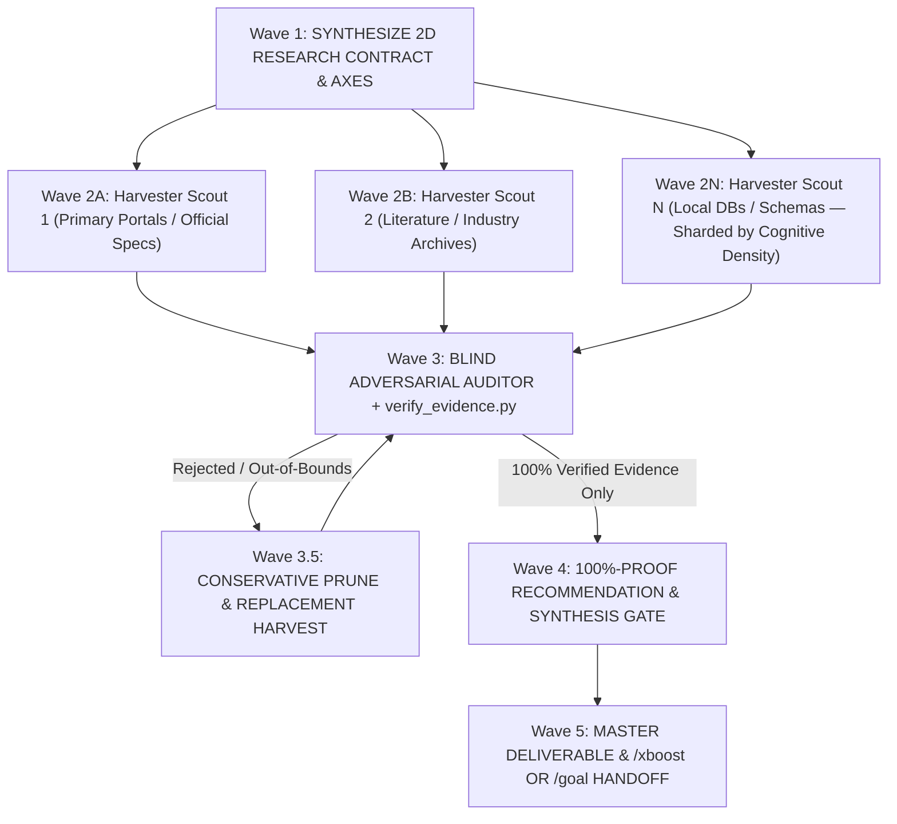

# Antigravity XDeep-Research Protocol (`/xdeep-research`)

When `/xdeep-research` (or aliases `/deep-research`, `/xresearch`) is invoked, enter the **Antigravity XDeep-Research Protocol**. XDeep-Research unifies **fast primary-source SDK/DB/binary inspection** with a **5-Wave Multi-Agent Harvester ↔ Blind Adversarial Auditor & 100%-Proof Synthesis Engine**.

It scales ceremony to research scope—executing **Tier 1 Fast Inline Probes** with zero subagent latency for single API/manifest/SQLite checks, and scaling to the full **5-Wave Harvester ↔ Blind Adversarial Auditor Swarm** with [`verify_evidence.py`](scripts/verify_evidence.py) for precedent harvesting, dataset fact-checking, multi-system benchmarks, and scientific/standard formulation.

---

## 1. Adaptive 3-Tier Scope Routing & Subagent Capability Gate

Match execution topology to research scope and host subagent capabilities in Step 0:

### A. 3-Tier Scope & Parallelism Routing

| Tier | Scope & Trigger Condition | Execution Strategy |
| :--- | :--- | :--- |
| **Tier 1 — Fast Inline Probe** | ≤ 2 known sources, single API signature check, or quick local manifest/SQLite/XML/AST schema probe. | Execute directly in the main thread (`read_file` / `view_file`, `read_url_content`, `search_web`, or 1-liner Python stdlib inspection). **Zero subagent cold-start latency.** |
| **Tier 2 — Single Isolated Scout** | Deep single-topic investigation requiring 3+ docs, upstream code tracing, or heavy web reading. | Spawn **1 background subagent** (returning a **Pointer Receipt** or **Telegraphic Evidence Table**) so raw search/file dumps stay out of the main context window. |
| **Tier 3 — 5-Wave Deep Research Swarm** | Precedent/dataset harvesting, fact-checking existing JSON/DB/drafts, comparing ≥ 2 architectures, or formulating mathematical/standard models. | Execute the full **5-Wave Harvester ↔ Blind Adversarial Auditor Lifecycle** (Cognitive-Density Harvester Sharding + `verify_evidence.py` + Orthogonal Blind Auditor + Prune-and-Replace Loop). |

### B. Host Subagent Write-Permission & Pointer-Not-Payload Return Contract
In multi-agent runtimes (Antigravity IDE, `agy` CLI, Claude Code), prevent **Read-Only Subagent Deadlocks**, **Arbitrary Evidence Truncation**, and **Main-Context Bloat**:
1. **Capability-Aware Subagent Selection**:
   * **Direct-Write Subagent (`TypeName="self"` in Antigravity / `general-purpose` in Claude Code)**: Use when the subagent should both investigate *and* write the Markdown report or dataset directly to disk.
   * **Read-Only Subagent (`TypeName="research"` in Antigravity / `Explore` / `cavecrew-investigator`)**: Has **read-only tools** (`enable_write_tools=false`). Never instruct a read-only subagent to save files; instead, instruct it to return a structured citation payload so the main thread writes the Markdown file.
2. **Pointer-Not-Payload Return Contract (`/cavecrew` & [`/xultra`](../xultra/SKILL.md) Discipline)**:
   * **For Write-Capable Subagents**: Write the research Markdown or dataset directly to disk. Never paste the full report into the reply message; return a **Compact Pointer Receipt** containing only:
     1. `Saved Path`: Clickable `[filename.md](file:///...)`
     2. `TL;DR Verdict & Scorecard`: Concise bullet conclusions with exact version/source citations
     3. `Open Gaps`: Any unverified claim or recommended `/prototype` spike
   * **For Read-Only Harvester Scouts**: Return a **Schema-Complete Telegraphic Evidence Dossier** (Markdown table or JSON) containing 100% of required primary-source fields, deep links, line ranges (`#L<start>-L<end>`), and verbatim proof snippets—with zero conversational filler and zero arbitrary word-count truncation of verified facts.
3. **Causality & Anti-Timeout Turn Rule**:
   * **Parallel Safe**: Keep working in the main thread *only* if you have strictly independent tasks that do not depend on the research answer.
   * **Dependency Blocked**: If the next code edit or architectural decision depends on the research result (e.g., [`/xboost`](../xboost/SKILL.md) Section 4.B escalation), **never write speculative code while waiting**. Launch the subagent and **end your turn immediately** to wait for reactive wakeup.

---

## 2. The 4-Tier Primary-Source Authority Ladder

Follow every technical claim back to the source that owns it. Rank evidence strictly by this hierarchy:

1. **Tier 1 — Local Pinned Ground Truth (Highest Authority)**:
   * **Manifests & Lockfiles**: Always inspect `package.json`, `pnpm-lock.yaml`, `pyproject.toml`, `requirements.txt`, `*.csproj`, or `metadata.txt` **first** so you never research v5 docs for a repo pinned to v3.
   * **Installed Code, Types & Local Databases**: Inspect `.d.ts` type definitions, `.venv`/`node_modules` source, compiled assemblies, or local `.sqlite`/`.xml`/binary files on disk via non-destructive Python stdlib probes (`sqlite3`, `xml.etree.ElementTree`, `zipfile`, `inspect`, `ast`). Local runtime truth beats outdated documentation.
2. **Tier 2 — Version-Matched First-Party Specs & Official Documentation**:
   * Official API references, language specifications, W3C/IETF RFCs, institutional portals, and vendor docs matching the target version (`read_url_content`, `search_web`, or Python `urllib`).
3. **Tier 3 — Upstream Source Code, Test Suites & Issue Trackers**:
   * Canonical upstream repository source files (`file:line`), unit tests (which prove actual expected inputs/outputs), release notes, and maintainer issue threads.
4. **Tier 4 — Engineering Standards & Peer-Reviewed Literature**:
   * Published international/industry standards (ISO, EN, IEEE, ASTM, ASHRAE, W3C) and peer-reviewed papers for physical constants and numerical algorithms.
   * **Automatic [`/xocr`](../xocr/SKILL.md) PDF & Image Table Ingestion Rule**: Whenever a primary source (local or downloaded) is a `.pdf` or raster image table (`.png`, `.jpg`, `.webp`, `.tif`), automatically execute [`../xocr/scripts/ocr_runner.py`](../xocr/scripts/ocr_runner.py) (using `--pages` for targeted page slicing) and harvest from `extracted_document.md`, `table_p*.csv`, and `ocr_manifest.json` (`garble_ratio == 0.0`) instead of raw `read_file` or ad-hoc `pypdf` snippets (which drop borderless vector tables and complex/non-ASCII glyph encodings).

> [!IMPORTANT]
> **Zero Secondary-Slop Rule**:
> Secondary blog tutorials, SEO summaries, and unverified forum guesses are **leads, never citations**. If a secondary post points to a flag or API, verify it in Tier 1–4 before recording it as fact. If a claim cannot be verified against a primary source, label it **`[UNVERIFIED]`**.

---

## 3. The 5-Wave Deep Research Lifecycle

For Tier 3 investigations (and as the structured backbone for Tier 1–2 studies), advance through five progressive waves:



---

## 4. Wave 1: Synthesize 2D Research Contract & Criteria (`Step 0`)

**Never start searching or scraping before locking the evaluation framework and proof criteria.**

### A. Context Inheritance & Existing-Study Check First ([`/xbrief`](../xbrief/SKILL.md) Hook)
Before inventing new rules or spawning external search waves:
1. Perform a fast bounded check of the active workspace for existing domain conventions (`CONTEXT.md`, `AGENTS.md`, `Guidelines/*.md`, `docs/*protocol*.md`, or target `.json`/`.sqlite` schemas). If local rules exist, inherit their exact schema, category/date buckets, and narrative format.
2. **Single-SSOT In-Place Upsert & Iterative Delta Routing**: Check `<artifactDir>/scratch/boostx_state.md` and `docs/` (`docs/research/` or module `docs/`) for an existing `RESEARCH_<TOPIC>.md` covering the active subsystem. If a canonical study already exists, **never fork a duplicate `RESEARCH_*.md` file** and **never re-run full 5-wave external web searches for facts already locked**; route Waves 2–3 strictly to unresearched delta questions and internal 4-Axis Forensic Codebase Auditing (`UL-01..UL-08`), updating the existing `RESEARCH_<TOPIC>.md` in-place with sequential heading numbering.

### B. Synthesize the 2D Research Contract (`Intent × Domain`)
Select **ONLY the active Research Intent Row** and cross it with the active **Knowledge Domain Harness**:

| Research Intent Archetype | Self-Synthesized Goal, Criteria & Execution Strategy |
| :--- | :--- |
| **`HARVEST / CURATE`** *(Case Studies, Precedents, Datasets, Catalogs)* | **Goal**: *Derive target schema, category/date/scope bounds, and quota count → fan out Harvester Scouts to scrape primary pages → run **Blind Adversarial Auditor** on every record → **delete & re-harvest** out-of-bounds or unverifiable entries until 100% of quota passes.* |
| **`VERIFY / AUDIT`** *(Fact-Checking Existing JSON / DB / Drafts / Claims / Codebase Mechanics)* | **Goal**: *Treat existing records/claims/simulators as untrusted → run `verify_evidence.py` + 3-Bucket Numeric/Parameter Litmus Test + Blind Auditor against primary sources (and when paired with [`/xboost`](../xboost/SKILL.md), execute the 4-Axis Deep Forensic Audit across `UL-01..UL-08` in [`deep_audit_protocol.md`](../xboost/references/deep_audit_protocol.md)) → classify `VERIFIED` / `INCORRECT` / `UNVERIFIED` with discrepancy evidence → apply conservative in-bounds fixes or prune & replace.* |
| **`BENCHMARK / COMPARE`** *(Evaluating Competing Tools, Systems, Precedents)* | **Goal**: *Synthesize domain-relevant orthogonal evaluation axes → spawn 1 Scout per candidate → extract quantitative metrics, trade-offs, and failure modes → build `mermaid` architecture comparison + weighted decision matrix.* |
| **`FORMULATE / MODEL`** *(Physics, Algorithms, Mathematical Models, Specs)* | **Goal**: *Lock governing equations, discretization step measure (`Δμ`), dimensional unit bridge (input units ↔ SI), empirical coefficients, bracketed support bounds (`UL-01`), and bidirectional counter-anchors (`A_pos ∧ A_neg`, `UL-05`) from standards/papers → construct a closed-form **1D Analytical Toy Benchmark**.* |
| **`REVERSE-ENGINEER / TRACE`** *(SDKs, Databases, Binaries, Undocumented APIs)* | **Goal**: *Lock local pinned versions from manifests first → inspect local schemas/binaries/ASTs + upstream source code, tests, and specs → map exact internal pipeline, method signatures, and invariants.* |
| **`STRATEGIZE / RECOMMEND`** *(Design Proposals, Architecture Decisions, Policy)* | **Goal**: *Establish verified facts & constraints first → pass the **100%-Proof Recommendation Gate**: every recommendation must bind to `[VERIFIED FACT]` receipts and explicitly separate proven facts from `[RECOMMENDED SYNTHESIS]`.* |

Cross the selected Intent with the **Universal Domain Proof Harness**:
* **Software, Systems & Computational Engineering** *(Code, APIs, Distributed Systems, Databases, Cloud, ML)*:
  * **Primary Sources**: Pinned workspace manifests (`package.json`, `pyproject.toml`, `Cargo.toml`, `*.csproj`, `metadata.txt`), local package/binary/DB probes (`sqlite3`, `xml`, `ast`), official version-matched specs, upstream source & tests.
  * **Hard Proof Criteria**: Pinned version parity, exact type/method signatures, `file:line` or deep-link citations, and `O(N)` runtime/memory bounds.
* **Physical Sciences, Simulation & Quantitative Modeling** *(Physics, Numerical Solvers, Signal Processing, Optimization)*:
  * **Primary Sources**: International/national standards (ISO, EN, IEEE, ASTM, ASHRAE), peer-reviewed literature, and authoritative technical manuals.
  * **Hard Proof Criteria**: Dimensional homogeneity (SI unit balance across every equation term), discretization step-measure invariance (`Δμ`, `UL-03`), numerical stability limits (`dt`, CFL, convergence `ε`), and a closed-form **1D Analytical Toy Benchmark**.
* **Case Studies, Precedents & System Benchmarks** *(Engineering, Design, Product, & Operational Precedents)*:
  * **Primary Sources**: Official creator/organization records, institutional portals, accredited archives, and primary publications.
  * **Hard Proof Criteria**:
    1. **Temporal & Lifecycle Disambiguation**: Strictly distinguish `Actual Release / Completion Year` from `Proposal / Announcement Year`, `Specification Draft Year`, or `Ongoing Maintenance Year`.
    2. **Attribution Lock**: Verify the actual `Primary Author / Maintainer / Organization of Record` directly on the primary source page.
    3. **Narrative & Outcome Completeness**: Capture `Overview`, `Problem / Goal`, `Systemic Solution / Approach`, `Core Architecture / Elements`, and `Verified Quantitative/Qualitative Impacts` (zero invented percentages).
* **Natural Sciences & Empirical Datasets** *(Empirical Sciences, Environmental, Biomedical, Geodata)*:
  * **Primary Sources**: Canonical scientific registries, peer-reviewed empirical studies, and official institutional datasets.
  * **Hard Proof Criteria**: Taxonomic/nomenclatural accuracy, SI measurement units, domain/scope bounds, and primary study citations.
* **Policy, Strategy, Market & Regulatory Research** *(Economics, Law, Governance, Standards)*:
  * **Primary Sources**: Official regulatory filings, primary institutional reports, first-party documentation, and audited datasets.
  * **Hard Proof Criteria**: Publication date currency, jurisdiction/scope alignment, and multi-source corroboration for quantitative claims.

Output the 4-line contract before probing or spawning scouts:
> **🧠 XDeep-Research Contract** — `[Research Intent]` × `[Knowledge Domain]` (`Tier 1|2|3`)
> • **Target Deliverable & Quota**: <Exact output files, schema, and record/axis count>
> • **Orthogonal Research Axes**: <Distinct axes or primary sources to investigate>
> • **Hard Disambiguation & Proof Rules**: <Exact date/version/unit/attribution gates that will reject invalid candidates>

---

## 5. Wave 2: Parallel Harvester Swarm (`invoke_subagent`)

For Tier 3 investigations, decompose across **parallel Harvester Subagents sized by Cognitive-Density Sharding** ([`/xultra`](../xultra/SKILL.md) Law 3 — 1 dedicated Harvester Scout per heavy category, candidate architecture, or deep-scrape bucket; clustered scouts for lightweight lookups) via parallel `invoke_subagent` calls in the same turn:

1. **Deep-Link Content Scraping Mandatory**:
   * Harvesters must **never** trust search-snippet blurbs alone. For every candidate fact or case study, the Harvester must fetch the actual page or file text (`read_file`, `read_url_content`, `search_web`, Python `urllib`, or [`../xocr/scripts/ocr_runner.py`](../xocr/scripts/ocr_runner.py) for `.pdf`/image sources) to extract verbatim evidence.
   * **Ban on Root-Domain Lazy Links**: Never cite a bare homepage (`https://example.org/`) as proof. Every citation must be a specific deep link (`https://example.org/projects/specific-project-slug`) or exact local `file:///path#L10-L20`.
2. **Structured Evidence Dossier Return**:
   * Each Harvester returns a structured dossier containing:
     * `Candidate / Claim ID`
     * `Extracted Fields / Equations / Metrics`
     * `Primary Deep-Link URL or Local Path`
     * `Verbatim Evidence Snippet` (the exact verbatim passage, equation, or table row from the source proving the date, author, formula, or metric)

---

## 6. Wave 3: Blind Adversarial Auditor & Prune-and-Replace Loop

**Core Rule: Never let the Harvester grade its own homework.**

### A. Independent Adversarial Audit
After Wave 2 completes, run a two-layer audit on all harvested candidates:
1. **Deterministic Script Gate ([`scripts/verify_evidence.py`](scripts/verify_evidence.py))**:
   Run the bundled verification CLI against the draft Markdown or JSON file to catch bare root-domain URLs, placeholder tokens (`[TBD]`, `TODO`), schema/count mismatches, out-of-bounds years, and dead HTTP links:
   * **Windows (PowerShell)**:
     ```powershell
     python "$env:USERPROFILE\.gemini\config\skills\xdeep-research\scripts\verify_evidence.py" "<target_md_or_json>" --check-http
     ```
   * **macOS / Linux**:
     ```bash
     python3 ~/.gemini/config/skills/xdeep-research/scripts/verify_evidence.py "<target_md_or_json>" --check-http
     ```
2. **Blind Adversarial Auditor Subagent(s)**:
   For multi-record datasets, case studies, or critical specifications, spawn dedicated **Auditor Subagent(s)** (`C ≥ 1` sized by [`/xultra`](../xultra/SKILL.md) Law 3) instructed with a **Red-Team Falsification Prompt**:
   * *"Assume the Harvester conflated entity names, confused announcement/draft years with actual release/completion years, misattributed authors, or cited unsupported numbers. Independently verify each record against its primary source and classify as `VERIFIED`, `INCORRECT (with actual truth)`, or `UNVERIFIED`."*

### B. Wave 3.5: Conservative Prune & Replacement Harvest Loop (Zero Data Forgery)
When the Wave 3 Auditor flags an entry as `INCORRECT` or `UNVERIFIED`:
* **In-Bounds Correction**: If the true verified fact still satisfies the user's constraints (e.g., correcting `2024` → `2025` within a `2024–2026` bucket, or updating a parameter coefficient to match the official standard), update the record with the verified value and source.
* **Out-of-Bounds Deletion & Re-Harvest**: If the true verified fact violates the user's scope bounds (e.g., an entity was actually released outside the required date window, or a cited title does not exist), **delete the entry immediately**. Never forge dates, authors, or metrics to fit a narrative slot.
* **Replacement Dispatch**: Immediately spawn a targeted Wave 3.5 Replacement Scout to harvest a genuine replacement for the missing slot and re-audit it through Wave 3 until **100% of required slots/axes pass verification**.

---

## 7. Wave 4: The 100%-Proof Recommendation & Synthesis Gate

Before writing any conclusion, design proposal, architectural recommendation, or strategy report, enforce **100% Claim-to-Receipt Binding**:

1. **No Naked Claims or Recommendations**:
   Every factual assertion, metric, or parameter must carry an inline **Evidence Receipt**:
   * **Format**: `<Claim / Metric / Equation> — Proven by: "<Verbatim quote or exact parameter>" ([Primary Source, Year/Version](https://deep-link-or-file))`
2. **Strict Separation of `[VERIFIED FACT]` vs. `[RECOMMENDED SYNTHESIS]`**:
   When recommending how the user should design, build, or strategize based on the research, explicitly distinguish:
   * **`[VERIFIED FACT / PRECEDENT]`**: 100% proven by primary-source receipts from Waves 2–3.
   * **`[RECOMMENDED SYNTHESIS]`**: Your reasoned engineering/design recommendation derived from combining `[VERIFIED FACT #1 + #2]`. Never present an extrapolation or design suggestion as an historical or empirical fact.

---

## 8. Wave 5: Master Deliverable & Composable `/xboost` / `/goal` Handoff

### A. Dual-Output Persistence Contract & 3-Step Save Destination
Never drop loose `.md` files into a repository root (preserving clean `git status` and scratch hygiene):
1. **Master Markdown Study (`docs/research/` or `docs/RESEARCH_<TOPIC_SLUG>.md`)**:
   * Use the user-specified path, existing `docs/research/` convention, or `<artifactDir>/RESEARCH_<TOPIC_SLUG>.md` when no repository is open.
   * Structure so downstream [`/xbrief`](../xbrief/SKILL.md), [`/xplan`](../xplan/SKILL.md), and [`/xboost`](../xboost/SKILL.md) runs can consume it in seconds:
     1. **Header & Audit Scorecard**: `2D Contract`, `Target Stack / Version`, `Primary Sources Inspected`, `Wave 3 Verification Score (N/N Verified, M Pruned & Replaced)`.
     2. **Executive Verdict & Decision Matrix**: High-density summary table + `mermaid` architecture/system comparison diagram.
     3. **Deep-Dive Evidence by Axis**: Detailed findings with inline Evidence Receipts (and for `FORMULATE / MODEL` tasks: **Governing Equations, SI Unit Bridge Table, Empirical Coefficients, and 1D Analytical Toy Benchmark**).
     4. **Wave 3 Discrepancy & Pruning Log**: Transparent record of any misconceptions, doc-vs-code conflicts, or out-of-bounds candidates caught and replaced during auditing.
     5. **Actionable Blueprint (`[VERIFIED FACTS]` → `[RECOMMENDED SYNTHESIS]`)**.
2. **Structured Dataset Payload (`.json` / `.sqlite` / `.csv`)**:
   * When executing `HARVEST / CURATE` or `VERIFY / AUDIT` on a dataset, write the 100% verified records to the target dataset file, rebuild any paired SQLite database, and validate with `verify_evidence.py`.
3. **Pointer-First Main Chat Digest**:
   * Never dump the full multi-page study into the chat window. Output a concise executive digest, the Wave 3 Verification Scorecard, and clickable `file://` links to the saved artifacts.

### B. Composable Power Modes (`/xdeep-research` × `/xlaya` × `/xplan` × `/xboost` × `/xobsidian` × `/xultra` × `/goal`)
* **Default Isolation Rule (Without `/xobsidian`)**:
  * When `/xobsidian` is **not** in the user's command, never read from or write to any Obsidian vault.
* **Paired with [`/xultra`](../xultra/SKILL.md) (`/xdeep-research /xultra` or `/xdeep-research /xboost /xultra`)**:
  * **Elastic Cognitive-Density Harvester Fleet & Axis-Matched Blind Audit**: Scale Wave 2 Harvester Scouts dynamically via [`/xultra`](../xultra/SKILL.md)'s **Elastic Cognitive Swarm (`N × K × T`)**—assigning 1 dedicated Harvester Scout per heavy candidate/category shard across rolling waves, running Law 1 deterministic checks (`verify_evidence.py`), and spawning **Axis-Matched Blind Adversarial Auditors** (e.g., `Temporal/Attribution/Signature Falsifier` + `Quantitative/Schema/Unit Falsifier`) in Wave 3.
* **Paired with [`/xlaya`](../xlaya/SKILL.md) (`/xdeep-research /xlaya`)**:
  * **Wave 2.5 Fast Candidate Triage**: Between Wave 2 (Harvester Swarm) and Wave 3 (Blind Adversarial Auditor), use `/xlaya` (`score` + `noul`) to locally score harvested records or shortlist candidate specification sections in milliseconds before spawning expensive Auditor turns.
* **Paired with [`/xplan`](../xplan/SKILL.md) (`/xdeep-research /xplan`)**:
  * **Evidence-to-Plan Bridge**: Pass Wave 4's `[VERIFIED FACT]` receipts, API signatures, equations, and benchmarks directly into `/xplan` Phase 1 to construct `implementation_plan.md` with inline grilling options.
* **Paired with [`/xboost`](../xboost/SKILL.md) (`/xdeep-research /xboost` or `/xdeep-research /xboost /xultra`)**:
  * **Automatic Spec-to-Code & 4-Axis Forensic Audit Bridge**: Once `/xdeep-research` locks the verified API signature, governing equations, SI unit bridge, schema, and **1D Analytical Toy Benchmark** into `RESEARCH_<TOPIC>.md`, immediately transition into **XBoost Phase 1–4** (and [`deep_audit_protocol.md`](../xboost/references/deep_audit_protocol.md) when auditing an existing engine/simulator across `Truth/Zero-Cheat`, `Criteria/Scale`, `Wiring/Fallbacks`, and `Hot-Path Perf`) in the same workflow—using the researched analytical benchmark and perturbation/conservation laws as the exact **Red → Green verification gate** for the implementation.
* **Paired with [`/xobsidian`](../xobsidian/SKILL.md) (`/xdeep-research /xobsidian` or `/xdeep-research /xboost /xobsidian`)**:
  * **Wave 1 Second Brain Prior-Art Check**: Dynamically resolve `VAULT_ROOT` via [`/xobsidian`](../xobsidian/SKILL.md) and inspect `00 *Index*.md` → `Hub - *.md` so existing verified precedents, empirical parameters, component contracts, or mathematical models are not redundantly re-harvested.
  * **Wave 5 Converged-Only Knowledge Ratchet**: After verification passes (`0` unverified claims and `0` Wave 2 code defects when chained with `/xboost`), automatically mint or update the reusable atomic notes (`#tier/method`, `#tier/asset`, `#tier/package` / `#tier/proof`) and parent `Hub - *.md` tables in `VAULT_ROOT` with unique `[[wikilink]]` neighbor signatures, record touched notes in `<artifactDir>/scratch/boostx_state.md` (`Session_Touched_Vault_Notes`), and run the 1-line Vault Graph Integrity check (`BROKEN=0`, `ORPHANS=0`, `DUP_NEIGHBOR_GROUPS=0`).
* **Paired with `/goal` (`/goal /xdeep-research` or `/xdeep-research /xboost /xobsidian /goal`)**:
  * **Autonomous Marathon Mode**: Maintain the unified `<artifactDir>/scratch/boostx_state.md` ledger tracking Wave progress, canonical `RESEARCH_<TOPIC>.md` path, verified records (`X/Y verified`), cumulative ratchet assertions (`Ratchet_Suite(1..t)`), and rejected candidates across turns. Continue looping Wave 2 ↔ Wave 3.5 across turns until **100% of the target quota and verification gates pass with zero unverified claims** before emitting `<!-- GOAL_COMPLETE -->`.

---

## 9. XDeep-Research Completion Rubric

Before declaring `/xdeep-research` finished (and mandatory before `<!-- GOAL_COMPLETE -->`), verify all checkpoints:

- [ ] **Version & Local Truth Checked First**: Pinned workspace versions (`package.json`, `pyproject.toml`, `*.csproj`, `metadata.txt`) or local binaries/DBs were checked before external web search.
- [ ] **2D Research Contract Locked**: Synthesized `[Research Intent] × [Knowledge Domain]` and inherited any local workspace guidelines in Wave 1.
- [ ] **Primary-Source Citations Only**: Scraped primary source pages/files directly (`file:///...#L10-L20` or deep-link URLs); zero secondary blog posts or bare root domains cited as proof.
- [ ] **Blind Adversarial Audit Executed**: Separate Auditor pass + `verify_evidence.py` verified exact dates/versions, attributions, units, and deep-link URLs.
- [ ] **Zero Data Forgery (Prune & Replace)**: All out-of-bounds or unverifiable candidates were deleted and replaced with verified records until 100% of quotas passed.
- [ ] **100%-Proof Recommendation Gate**: Every claim has a primary-source receipt, and `[VERIFIED FACT]` is cleanly separated from `[RECOMMENDED SYNTHESIS]`.
- [ ] **Deliverable Persisted & Verified**: Saved Markdown study (and any `.json`/`.sqlite` payload) passes `verify_evidence.py` with `0 Blocking Errors` (and if `/xobsidian` was included, the Second Brain ratchet passed `BROKEN=0`, `ORPHANS=0`, `DUP_NEIGHBOR_GROUPS=0`).
