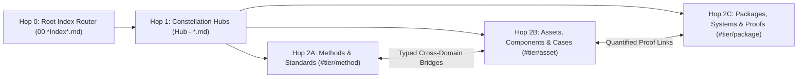

# AI-First Obsidian Second Brain Protocol (`/xobsidian`)

Operate an AI-first Obsidian Second Brain structured as a **Flat-Root 2-Hop Small-World Knowledge Graph (GraphRAG)** (`/xobsidian`, alias `/obsidian-vault`). This skill is 100% repository-agnostic and resolves the active vault dynamically across Windows, macOS, and Linux—even when the IDE workspace is opened inside a child project or separate repository.

> [!IMPORTANT]
> **Strict Opt-In Combinator Invariant**:
> Other workspace skills ([`/xbrief`](../xbrief/SKILL.md), [`/xplan`](../xplan/SKILL.md), [`/xsync`](../xsync/SKILL.md), [`/xdeep-research`](../xdeep-research/SKILL.md), [`/xboost`](../xboost/SKILL.md), [`/xultra`](../xultra/SKILL.md), [`/xkickoff`](../xkickoff/SKILL.md), `/goal`) **MUST NEVER** read from or write to the Obsidian vault unless `/xobsidian` (or `/obsidian-vault`) is explicitly included in the user's command combination (e.g., `/xdeep-research /xboost /xobsidian`).

---

## 1. Dynamic Cross-Platform Vault Resolution (`Step 0`)

Never hardcode vault folder names, project names, or machine user paths. Whenever `/xobsidian` is invoked (standalone or in a skill combination), resolve `VAULT_ROOT` and the Hop-0 Index Router dynamically using this 2-tier stdlib resolver:

1. **Tier 1 — Local & Sibling `.obsidian/` Marker Discovery (Workspace-First)**:
   * Check whether the current working directory itself or any immediate child/sibling directory up to 2 parent levels (`./.obsidian`, `./*/.obsidian`, `../*/.obsidian`, `../../*/.obsidian`) contains an `.obsidian/` folder. This ensures workspace-local vaults are preferred over unrelated global entries.
2. **Tier 2 — OS-Native Obsidian Global Registry (`obsidian.json`)**:
   * **Windows**: `%APPDATA%/obsidian/obsidian.json`
   * **macOS**: `~/Library/Application Support/obsidian/obsidian.json`
   * **Linux**: `~/.config/obsidian/obsidian.json`
   * Select the registered vault directory with `"open": true` (or most recent timestamp `ts`) that exists on disk.
3. **Hop-0 Router Discovery**:
   * Inside `VAULT_ROOT`, locate the root index router matching `00 *Index*.md` (or `00_*.md`).

```python
import sys, os, json, pathlib
sys.dont_write_bytecode = True
if sys.stdout and hasattr(sys.stdout, "reconfigure"):
    sys.stdout.reconfigure(encoding="utf-8")

vault = None
for base in [pathlib.Path.cwd(), *pathlib.Path.cwd().parents[:2]]:
    if (base / ".obsidian").is_dir():
        vault = base
        break
    found = [d.parent for d in base.glob("*/.obsidian") if d.is_dir()]
    if found:
        vault = found[0]
        break
if not vault:
    appdata = os.environ.get("APPDATA", "").strip()
    candidates = (
        ([pathlib.Path(appdata) / "obsidian/obsidian.json"] if appdata else [])
        + [
            pathlib.Path.home() / "Library/Application Support/obsidian/obsidian.json",
            pathlib.Path.home() / ".config/obsidian/obsidian.json",
        ]
    )
    for cfg in candidates:
        if cfg.is_file():
            v_map = json.loads(cfg.read_text(encoding="utf-8")).get("vaults", {})
            ranked = sorted(v_map.values(), key=lambda v: (bool(v.get("open")), v.get("ts", 0)), reverse=True)
            for item in ranked:
                p = pathlib.Path(item.get("path", ""))
                if p.is_dir():
                    vault = p
                    break
        if vault:
            break
routers = sorted(list(vault.glob("00*Index*.md")) + list(vault.glob("00_*.md"))) if vault else []
print("VAULT_ROOT:", vault)
print("HOP0_ROUTER:", routers[0] if routers else None)
```

---

## 2. 2-Hop Small-World GraphRAG Architecture

The vault uses a **100% flat root directory (`<VAULT_ROOT>/*.md`)** so file tools (`read_file` / `view_file`, `grep`, `glob`) resolve every note deterministically without subfolder guessing:



* **Hop 0 (Root Index Router — `00 *Index*.md`)**: Single-file manifest cataloging all Master Domain Hubs and Subsystem Constellation Hubs. **Always read Hop 0 first.**
* **Hop 1 (Constellation Hubs — `Hub - *.md`, `#tier/hub`)**: High-degree index notes organizing each domain subsystem with structured summary tables and direct `[[wikilinks]]` to atomic leaf nodes.
* **Hop 2 (Atomic Leaf Nodes)**:
  * `#tier/method`: Governing equations, numerical algorithms, engineering standards, architectural invariants, and analytical proofs.
  * `#tier/asset`: Reusable software/system components, empirical domain parameters, dataset schemas, and verified case study precedents.
  * `#tier/package` (or vault-specific `#tier/proof` / `#tier/career-cluster`): Open-source packages, production systems, and quantified engineering proofs.

### Fast 2-Hop Retrieval Workflow
1. **Hop 0 Read**: View `00 *Index*.md` inside `VAULT_ROOT` to identify the relevant `Hub - *.md` file(s).
2. **Hop 1 Read**: View the target `Hub - *.md` table to identify the exact atomic notes (`[[Note Name]]`), then read only the specific atomic notes linked to the active task.

---

## 3. Authoring, Anti-Parachute & Graph Integrity Invariants

Whenever creating or updating notes in `VAULT_ROOT`, enforce all five invariants:

1. **Zero Ephemeral Repo Duplication**:
   * Never copy transient project schedules, sprint task lists, or local repo file trees into the vault. Store only **reusable domain knowledge**: equations, SI unit bridges, standards, verified case studies, reusable code/component contracts, and empirical parameters.
2. **Strict Frontmatter & Tag Schema (Inherit Active Vault Convention)**:
   * Every note must begin with YAML frontmatter inheriting the active vault's established schema (e.g., `role / tier / domain / hub / status` or `title / type / domain`, plus hierarchical `tags` such as `tier/hub`, `tier/method`, `tier/asset`, `tier/package`, `domain/*`, and `status/verified`).
3. **Unique Neighborhood Signature Invariant (`0` Parachutes)**:
   * Never batch-generate leaf notes that link only to the same parent hub or share identical `[[wikilink]]` sets (which causes Force-Atlas-2 graph layout engines to collapse them into artificial peripheral "parachute" arcs).
   * Every atomic note must link to:
     1. Its primary `[[Hub - ...]]` parent (`#tier/hub`)
     2. **At least 2 content-specific cross-domain bridges** (`#tier/method` ↔ `#tier/asset` ↔ `#tier/package`, sized to genuine domain couplings with zero arbitrary upper cap)
     3. At least **2 distinct peer notes** so that **zero node pairs share an identical set of undirected neighbors**.
4. **Zero-LaTeX Native Unicode Typography**:
   * Never use inline or block dollar-sign math delimiters. Always use direct UTF-8 Unicode symbols (`→`, `←`, `↔`, `×`, `÷`, `±`, `≈`, `≠`, `≤`, `≥`, `∑`, `√`, `∝`, `²`, `³`, `°`, `µ`).
5. **Obsidian Graph Config Persistence Rule (`.obsidian/graph.json`)**:
   * Obsidian caches `.obsidian/graph.json` in memory while running and overwrites disk edits on exit. Before programmatically modifying `.obsidian/graph.json`, terminate the `Obsidian` process first, write the JSON atomically, and relaunch Obsidian afterward.

### 1-Line Graph Integrity Verification Gate
After adding or modifying vault notes, run this stdlib audit to confirm **`0` broken wikilinks, `0` orphans, and `0` duplicate neighbor sets**:

```python
import re, pathlib, collections
v = pathlib.Path("<VAULT_ROOT>")
notes = {p.stem: p.read_text(encoding="utf-8") for p in v.glob("*.md")}
adj = {k: set() for k in notes}
broken = []
media_exts = (".png", ".jpg", ".jpeg", ".svg", ".gif", ".webp", ".pdf", ".mp4", ".csv")
for src, txt in notes.items():
    clean = re.sub(r"(\x60{3,}|~{3,})[\s\S]*?\1", "", txt)
    clean = re.sub(r"\x60[^\x60\n]+\x60", "", clean)
    for raw in re.findall(r"(?<!!)\[\[([^\]]+)\]\]", clean):
        dst = raw.split("|")[0].split("#")[0].strip()
        if not dst or dst.lower().endswith(media_exts):
            continue
        if dst not in notes:
            broken.append((src, dst))
        elif dst != src:
            adj[src].add(dst)
            adj[dst].add(src)
orphans = [k for k, nb in adj.items() if not nb]
sigs = collections.Counter(frozenset(nb) for nb in adj.values())
dup_groups = sum(1 for s, c in sigs.items() if c > 1)
print(f"NOTES={len(notes)} | BROKEN={len(broken)} | ORPHANS={len(orphans)} | DUP_NEIGHBOR_GROUPS={dup_groups}")
assert not broken and not orphans and dup_groups == 0
```

---

## 4. Composable Skill Combination Protocol (Opt-In Wiring)

When `/xobsidian` is combined with other slash skills in the same prompt, execute the corresponding composite workflow:

| Skill Combination | Step 0 Retrieval (Read from Vault) | Completion Action (Automatic Knowledge Ratchet) |
| :--- | :--- | :--- |
| **`/xbrief /xobsidian`** | Resolve `VAULT_ROOT` → Read `00 *Index*.md` → `Hub - *` to load domain equations, precedents, and component invariants alongside the 8-file Repo SSOT cap. | Include Second Brain domain invariants in the Briefing Table (no vault writes unless requested). |
| **`/xplan /xobsidian`** | Resolve `VAULT_ROOT` → Read `00 *Index*.md` → `Hub - *` to pull reusable equations, SI unit bridges, and component contracts into Phase 1 of [`/xplan`](../xplan/SKILL.md). | Bind reusable Second Brain specs directly into `implementation_plan.md` Architecture & Verification sections. |
| **`/xdeep-research /xobsidian`** | In Wave 1, inspect `00 *Index*.md` → `Hub - *` as a **Tier-1 Prior-Art Cache** so existing verified precedents, empirical parameters, API specs, or formulas are not redundantly re-harvested. | In Wave 5, save the primary research study to the repo **AND** automatically mint/update reusable atomic notes + `Hub - *` index tables in `VAULT_ROOT`, record touched notes in `<artifactDir>/scratch/boostx_state.md` (`Session_Touched_Vault_Notes`), and run the Graph Integrity Gate. |
| **`/xboost /xobsidian`** | In XBoost Phase 1, load governing formulas, SI unit bridges, component contracts, or domain audit invariants ([`deep_audit_protocol.md`](../xboost/references/deep_audit_protocol.md)) from `00 *Index*.md` → `Hub - *`. | **Converged-Only Ratchet & Dirty-Note Rule**: Defer vault writes until **after** Phase 4 / Wave 2 passes (`0` verified defects). Record touched notes in `boostx_state.md` (`Session_Touched_Vault_Notes`); if a later turn in the same session modifies the backing code/formula, mark the note `DIRTY_IN_SESSION` and sync it before task exit. |
| **`/xdeep-research /xboost /xobsidian`** *(+ optional `/goal`)* | **Full-Stack Loop**: Vault Cache Check → `/xdeep-research` Primary-Source Probe / Harvester on delta → Lock 2D Contract & Analytical Toy Benchmark into [`/xboost`](../xboost/SKILL.md) Phase 1. | Execute XBoost Phases 1–4 → Ratchet converged findings & component specs into `VAULT_ROOT` (`0` intermediate unverified writes) → Run Graph Integrity Gate (`BROKEN=0`, `ORPHANS=0`, `DUP_NEIGHBOR_GROUPS=0`) before `<!-- GOAL_COMPLETE -->`. |
| **`/xsync /xobsidian`** | Resolve `VAULT_ROOT` alongside the workspace relation set. | Synchronize both project repository documentation AND matching atomic notes / `Hub - *` tables in `VAULT_ROOT` (clearing any `DIRTY_IN_SESSION` flags). |
| **`/xocr /xobsidian`** *(or auto-triggered on PDF/image sources)* | Resolve `VAULT_ROOT` and run [`/xocr`](../xocr/SKILL.md) ([`../xocr/scripts/ocr_runner.py`](../xocr/scripts/ocr_runner.py)) on target PDF papers, technical reports, or image tables (`garble_ratio == 0.0`). | Distill `extracted_document.md` and `table_p*.csv` into atomic vault notes (`#tier/method`, `#tier/asset`) + `Hub - *.md` tables with `0%` glyph/encoding corruption (`garble_ratio == 0.0`) or collapsed tables, then run the Graph Integrity Gate. |
| **`/xobsidian /xultra`** *(or combined with `/xdeep-research` / `/xboost`)* | Resolve `VAULT_ROOT` → Parallel 2-Hop Scouts inspect candidate `Hub - *.md` constellations by domain cluster. | Lock a **Pre-Assigned Bridge Matrix** in the [`/xultra`](../xultra/SKILL.md) Shared Seam Header (assigning each target note a guaranteed-unique `[[wikilink]]` neighbor signature before spawning builders), fan out rolling Vault Builder waves, synchronize parent `Hub - *.md` tables sequentially in the main thread, and run the Blind Graph Integrity Verifier (`BROKEN=0`, `ORPHANS=0`, `DUP_NEIGHBOR_GROUPS=0`). |

---

## 5. Completion Checklist

- [ ] **Dynamic Vault Resolution**: Located `VAULT_ROOT` and `00 *Index*.md` via `obsidian.json` or `.obsidian/` marker scan with zero hardcoded paths.
- [ ] **2-Hop Navigation Used**: Traversed `00 *Index*.md` → `Hub - *.md` → Atomic Nodes without blind full-vault dumping.
- [ ] **Hub Index Synchronized**: Every newly created atomic note is linked inside its parent `Hub - *.md` table and `00 *Index*.md` (if a new hub was added).
- [ ] **Graph Integrity Verified**: Confirmed `BROKEN=0`, `ORPHANS=0`, and `DUP_NEIGHBOR_GROUPS=0` via the 1-line verification check.
