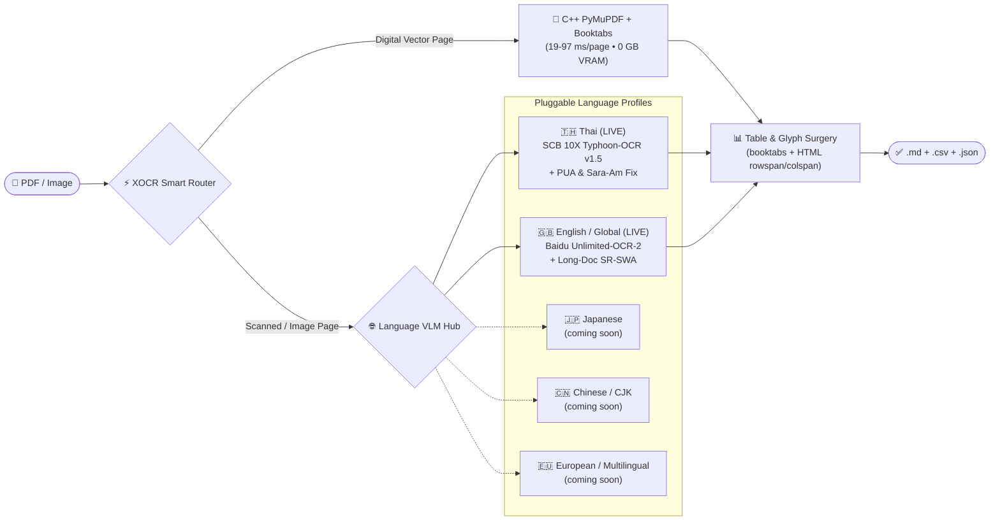

# Antigravity XOCR Protocol (`/xocr` v2.1.0)

High-throughput, zero-corruption PDF & image extraction engine (`/xocr`, legacy aliases `/ocrx`, `/ocr`, `/unlimited-ocr`) engineered for **sub-second vector extraction**, **0%-error table & Thai glyph fidelity**, and **100% local offline VLM execution**.

---

## 1. Speed × Zero-Error Hybrid Architecture



### Core Engineering Guarantees
1. **Single-Pass C++ Vector & Two-Stage `booktabs` Table Extraction (`PyMuPDF` `fitz`)**:
   - Extracts reading-order text (`page.get_text("text", sort=True)`) and structured tables in a single C++ pass without reopening the PDF in slow pure-Python parsers.
   - **Pre-Cached Two-Stage Grid + 3-Rule LaTeX `booktabs` Resolver**: Pre-caches `page.find_tables()` objects before any clipped re-query (preventing PyMuPDF C-buffer invalidation on multi-table pages), merges vertically adjacent `1-2` row rule strips (`< 15 pt` gap), and scans vector drawing paths (`page.get_drawings()`) for pure 3-rule `\toprule`/`\midrule`/`\bottomrule` tables (`width ≥ 200 pt`) to recover missing header bands and compact 3-row benchmark tables.
   - **False-Positive Diagram & Chart Immunity**: Automatically filters out 1-cell callout boxes, figure legends, and sparse bar-chart gridlines (`≥ 2` rows, `≥ 2` populated columns, `≥ 60%` multi-column row density, and `≥ 52%` pruned cell fill ratio required).
2. **Zero-Mojibake Thai/English Glyph Normalization**:
   - Deterministically remaps legacy Windows/Adobe Thai Private Use Area codepoints (`U+F700..U+F71A` shifted tone marks and vowels in Angsana/Cordia/Sarabun PDFs) to canonical Unicode (`U+0E00..U+0E7F`).
   - Normalizes both toneless and toned decomposed Sara Am (`\u0e4d([\u0e48-\u0e4b]?)\u0e32` → `\1\u0e33`, fixing `ก\u0e4d\u0e32ลัง` → `กำลัง` and `น\u0e4d\u0e49\u0e32` → `น้ำ`) and strips zero-width artifacts (`\u200b`, `\ufeff`).
3. **Surgical Per-Page Garble & Image-Coverage Router**:
   - Inspects each page for broken font CMaps (`(cid:123)` tokens), `\ufffd` replacement characters, and full-page raster scan coverage (`image_area_ratio ≥ 0.45` with sparse text `< 250` non-whitespace chars, catching scanned pages that carry a digital Bates stamp or running header).
   - Clean vector pages bypass 300-DPI PNG rendering entirely; only pages with `needs_ocr=True` are rasterized across worker-batched threads (`--workers`, opening `fitz.Document` once per worker batch).
4. **4-Tier Automatic OCR Backend Ladder + Scanned HTML `<table>` → CSV Surgery**:
   - **Tier 1 (Live SGLang VLM Server)**: Queries `http://127.0.0.1:10000` via `infer.py` (`--image_dir` / `--pdf` / `--output_dir`, staging `.tif`/`.tiff` files as `.png` automatically).
   - **Tier 2A (SCB 10X `Typhoon-OCR v1.5` Local CUDA VLMs - Apache-2.0 License)**: Runs `typhoon-ai/typhoon-ocr1.5-2b` (`Qwen3-VL-2B-Instruct`, `bfloat16`, `5.01 GB` Peak VRAM, `23.63 tok/s`) or `typhoon-ai/typhoon-ocr1.5-3b-qat` (`Qwen2.5-VL-3B-QAT` in `bfloat16` `8.36 GB` or `4-bit NF4` `3.65 GB` Peak VRAM) 100% locally offline with downscale-only `1800px` preprocessing, deterministic greedy decoding (`do_sample=False, repetition_penalty=1.1`), and automatic CUDA VRAM release (`unload_vlm_models()`).
   - **Tier 2B (HuggingFace [`baidu/Unlimited-OCR-2`](https://github.com/baidu/Unlimited-OCR) & `baidu/Unlimited-OCR` CUDA VLM - MIT License)**: Runs `baidu/Unlimited-OCR-2` (`SR-SWA` Sparse Reference Sliding Window Attention + `Unlimited-Horizon Decoding`, with automatic fallback to v1 `baidu/Unlimited-OCR`), executing `model.infer` or `model.infer_multi` (`<PAGE>` delimiter aware) with `no_repeat_ngram_size=35`.
   - **Scanned HTML `<table>` (`rowspan`/`colspan`) → RFC-4180 `.csv` Surgery**: Automatically parses HTML `<table>...</table>` blocks emitted by `Typhoon-OCR v1.5` or `Unlimited-OCR-2` on scanned PDFs and standalone images (`extract_html_tables_from_text()`), expands `rowspan`/`colspan` into a 2D grid, normalizes Thai PUA/Sara-Am glyphs, and writes `table_p{page}_{id}.csv` (`utf-8-sig`) + inline GFM Markdown tables.
   - **Tier 3 (Local `EasyOCR`)**: Offline CPU/GPU neural recognition (`_EASYOCR_READERS` singleton cache per language tuple, default `['th', 'en']`).
   - **Tier 4 (Local `pytesseract`)**: Offline Tesseract bridge fallback.

---

## 2. Deterministic CLI Execution

**macOS / Linux**:
```bash
python3 ~/.gemini/config/skills/xocr/scripts/ocr_runner.py "<path_to_pdf_or_image>" \
  --output "<output_dir>" \
  --mode auto \
  --vlm-backend auto \
  --pages "1-10" \
  --workers 4
```

**Windows (PowerShell)**:
```powershell
python "$env:USERPROFILE\.gemini\config\skills\xocr\scripts\ocr_runner.py" "<path_to_pdf_or_image>" `
  --output "<output_dir>" `
  --mode auto `
  --vlm-backend auto `
  --pages "1-10" `
  --workers 4
```

### CLI Options
* `<input_path>` or `--input`, `-i <path>`: Target PDF (`.pdf`) or image (`.png`, `.jpg`, `.jpeg`, `.webp`, `.bmp`, `.tif`, `.tiff`).
* `--output`, `-o <dir>` (default: `./ocr_output`): Destination directory for all extracted artifacts.
* `--mode auto|pdf|vlm` (default: `auto`):
  - `auto`: Single-pass C++ vector text + table extraction on clean pages, with surgical OCR only on scanned/garbled pages (`needs_ocr=True`).
  - `pdf`: Pure deterministic vector text + C++ table extraction without loading VLM/OCR weights.
  - `vlm`: Forces 300-DPI page rasterization and VLM/OCR inference across all selected pages.
* `--vlm-backend auto|typhoon-2b|typhoon-3b-qat|typhoon-3b-4bit|unlimited-ocr|sglang` (default: `auto`):
  - `auto`: Tries live SGLang server (`:10000`), then local `typhoon-ai/typhoon-ocr1.5-2b`, then `baidu/Unlimited-OCR-2`, then local `EasyOCR`.
  - `typhoon-2b`: Local `typhoon-ai/typhoon-ocr1.5-2b` (`Qwen3-VL-2B`, `bfloat16`, `~5.0 GB` VRAM).
  - `typhoon-3b-qat`: Local `typhoon-ai/typhoon-ocr1.5-3b-qat` (`Qwen2.5-VL-3B-QAT`, `bfloat16`, `~8.4 GB` VRAM).
  - `typhoon-3b-4bit`: Local `typhoon-ai/typhoon-ocr1.5-3b-qat` quantized in `4-bit NF4` (`~3.7 GB` VRAM for 4-8 GB GPUs).
  - `unlimited-ocr`: Local `baidu/Unlimited-OCR-2` / `baidu/Unlimited-OCR`.
  - `sglang`: Live SGLang server (`http://127.0.0.1:10000`).
* `--pages "<range>"` (optional, e.g. `"1-5,8,12-15"`): Surgically extract only specific 1-based page numbers without scanning an entire multi-hundred-page volume.
* `--workers <int>` (default: `min(8, cpu_count)`): Parallel worker threads for 300-DPI page rasterization.
* `--dpi <int>` (default: `300`): Rasterization resolution for scanned pages.
* `--langs "<codes>"` (default: `"th,en"`): Comma-separated language codes for local `EasyOCR` fallback.

---

## 3. Verifiable Output Artifacts

Every run emits pure JSON telemetry on `stdout` and writes four deterministic artifacts to `--output`:
* `extracted_document.md`: Reading-order Markdown containing `## Page N` sections and **inline GitHub Flavored Markdown tables** (`| Col A | Col B |`).
* `extracted_text.txt`: Plain page-delimited text (`--- PAGE N ---`) for legacy regex/NLP pipelines.
* `table_p{page}_{table_id}.csv`: UTF-8 with BOM (`utf-8-sig`) RFC-4180 CSV tables (from both vector PDFs and VLM HTML `<table>` outputs on scanned pages/images) ready for `pandas.read_csv()` or Excel.
* `ocr_manifest.json`: Per-page audit telemetry (`page`, `char_count`, `table_count`, `garble_ratio`, `image_area_ratio`, `needs_ocr`, `engine`, and `elapsed_ms`).

---

## 4. Automatic Ecosystem Routing (`/xdeep-research`, `/xbrief`, `/xboost`, `/xobsidian`, `/xultra`)

Other BoostX `/x*` skills automatically invoke [`scripts/ocr_runner.py`](scripts/ocr_runner.py) whenever they encounter a `.pdf` or raster image table - even when the user does not explicitly type `/xocr`:

| Chained / Calling Skill | Automatic `/xocr` Ingestion & Verification Handoff |
|:---|:---|
| **[`/xdeep-research`](https://github.com/iscvlab/boostx/blob/main/skills/xdeep-research/SKILL.md)** | **Primary-Source PDF & Table Harvester (Law 1)**: Automatically runs `ocr_runner.py` (with `--pages` when targeted) on statutory PDFs, financial filings, and academic papers, citing exact rows from `table_p*.csv` and `extracted_document.md` with `ocr_manifest.json` receipts. |
| **[`/xbrief`](https://github.com/iscvlab/boostx/blob/main/skills/xbrief/SKILL.md)** | **PDF Specification Briefing**: When a user-pinned or canonical workspace specification exists only as a `.pdf` or image plate, runs `ocr_runner.py` first to load structural headings (`## Page N`) and tables into the Briefing Table. |
| **[`/xlaya`](https://github.com/iscvlab/boostx/blob/main/skills/xlaya/SKILL.md)** | **Sub-Second Section Shortlisting**: Passes `extracted_document.md` headings into `/xlaya` (`shortlist` / `score`) to pinpoint high-signal pages in milliseconds before LLM reading. |
| **[`/xboost`](https://github.com/iscvlab/boostx/blob/main/skills/xboost/SKILL.md)** | **Zero-Error Quantitative Verification**: Checks `ocr_manifest.json` (`garble_ratio == 0.0`, `tables_extracted > 0`) and cross-verifies CSV column sums (`df.sum()`) against printed "Total" rows. |
| **[`/xobsidian`](https://github.com/iscvlab/boostx/blob/main/skills/xobsidian/SKILL.md)** | **Clean Second-Brain Distillation**: Runs `ocr_runner.py` before distilling PDF papers or statutory reports into atomic vault notes so `0%` Thai PUA/Sara-Am mojibake or collapsed tables enter `VAULT_ROOT`. |
| **[`/xultra`](https://github.com/iscvlab/boostx/blob/main/skills/xultra/SKILL.md)** | **Sharded Multi-PDF / Page-Range Swarm (`Pointer-Not-Payload`)**: Shards massive PDF corpora or multi-hundred-page volumes across workers by **disjoint PDF files** or **disjoint `--pages` ranges** (`--pages 1-50`, `--pages 51-100`) writing to isolated `--output` folders and returning Compact Pointer Receipts (`ocr_manifest.json` + `table_p*.csv` paths). |
