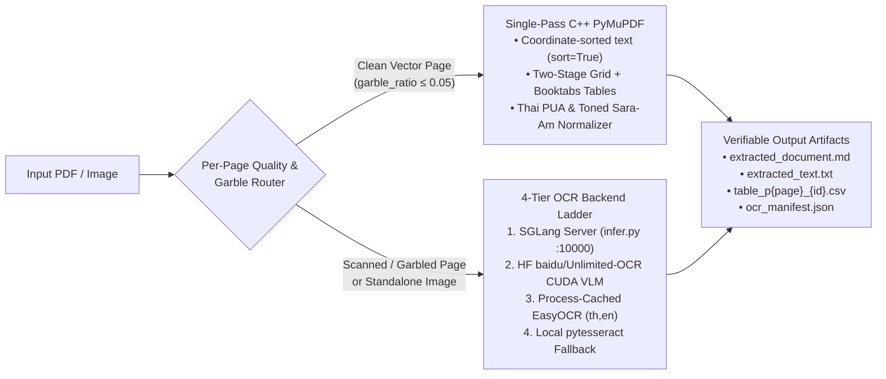

# Antigravity XOCR Protocol (`/xocr`)

High-throughput, zero-corruption PDF & image extraction engine (`/xocr`, legacy aliases `/ocrx`, `/ocr`, `/unlimited-ocr`) engineered for **sub-second vector extraction** and **0%-error table & glyph fidelity**.

---

## 1. Speed × Zero-Error Hybrid Architecture



### Core Engineering Guarantees
1. **Single-Pass C++ Vector & Two-Stage `booktabs` Table Extraction (`PyMuPDF` `fitz`)**:
   - Extracts reading-order text (`page.get_text("text", sort=True)`) and structured tables in a single C++ pass without reopening the PDF in slow pure-Python parsers.
   - **Two-Stage Grid + LaTeX `booktabs` Resolver**: Standard PDF table finders collapse borderless academic/financial tables (which only have `\toprule`, `\midrule`, and `\bottomrule` horizontal rules) into a single cell. `ocr_runner.py` detects vertically adjacent `1–2` row rule boxes (`< 15 pt` gap) and re-queries `page.find_tables(clip=rect, vertical_strategy="text", horizontal_strategy="text")` while preserving distinct multi-row grid tables (`≥ 3` rows) separately.
   - **False-Positive Table Pruning**: Automatically filters out 1-cell callout boxes, sparse diagram labels, and empty columns (`≥ 2` rows with `≥ 2` populated columns required).
2. **Zero-Mojibake Thai/English Glyph Normalization**:
   - Deterministically remaps legacy Windows/Adobe Thai Private Use Area codepoints (`U+F700..U+F71A` shifted tone marks and vowels in Angsana/Cordia/Sarabun PDFs) to canonical Unicode (`U+0E00..U+0E7F`).
   - Normalizes both toneless and toned decomposed Sara Am (`\u0e4d([\u0e48-\u0e4b]?)\u0e32` → `\1\u0e33`, fixing `ก\u0e4d\u0e32ลัง` → `กำลัง` and `น\u0e4d\u0e49\u0e32` → `น้ำ`) and strips zero-width artifacts (`\u200b`, `\ufeff`).
3. **Surgical Per-Page Garble & Image-Coverage Router**:
   - Inspects each page for broken font CMaps (`(cid:123)` tokens), `\ufffd` replacement characters, and full-page raster scan coverage (`image_area_ratio ≥ 0.45` with sparse text `< 250` non-whitespace chars, catching scanned pages that carry a digital Bates stamp or running header).
   - Clean vector pages bypass 300-DPI PNG rendering entirely; only pages with `needs_ocr=True` are rasterized across worker-batched threads (`--workers`, opening `fitz.Document` once per worker batch).
4. **4-Tier Automatic OCR Backend Ladder**:
   - **Tier 1 (Live SGLang VLM Server)**: Queries `http://127.0.0.1:10000` via `infer.py` (`--image_dir` / `--pdf` / `--output_dir`, staging `.tif`/`.tiff` files as `.png` automatically).
   - **Tier 2 (HuggingFace [`baidu/Unlimited-OCR`](https://github.com/baidu/Unlimited-OCR) CUDA VLM — MIT License)**: Runs `model.infer` (`gundam` crop mode) or `model.infer_multi` (`image_size=1024`) with `no_repeat_ngram_size=35` (`ngram_window=128` / `1024`) to prevent table-cell repetition loops.
   - **Tier 3 (Local `EasyOCR`)**: Offline CPU/GPU neural recognition (`_EASYOCR_READERS` singleton cache per language tuple, default `['th', 'en']`).
   - **Tier 4 (Local `pytesseract`)**: Offline Tesseract bridge fallback.

---

## 2. Deterministic CLI Execution

**macOS / Linux**:
```bash
python3 ~/.gemini/config/skills/xocr/scripts/ocr_runner.py "<path_to_pdf_or_image>" \
  --output "<output_dir>" \
  --mode auto \
  --pages "1-10" \
  --workers 4
```

**Windows (PowerShell)**:
```powershell
python "$env:USERPROFILE\.gemini\config\skills\xocr\scripts\ocr_runner.py" "<path_to_pdf_or_image>" `
  --output "<output_dir>" `
  --mode auto `
  --pages "1-10" `
  --workers 4
```

### CLI Options
* `<input_path>` or `--input`, `-i <path>`: Target PDF (`.pdf`) or image (`.png`, `.jpg`, `.jpeg`, `.webp`, `.bmp`, `.tif`, `.tiff`).
* `--output`, `-o <dir>` (default: `./ocr_output`): Destination directory for all extracted artifacts.
* `--mode auto|pdf|vlm` (default: `auto`):
  - `auto`: Single-pass C++ vector text + table extraction on clean pages, with surgical OCR only on scanned/garbled pages (`needs_ocr=True`).
  - `pdf`: Pure deterministic vector text + C++ table extraction without loading VLM/OCR weights.
  - `vlm`: Forces 300-DPI page rasterization and VLM/OCR inference across all selected pages.
* `--pages "<range>"` (optional, e.g. `"1-5,8,12-15"`): Surgically extract only specific 1-based page numbers without scanning an entire multi-hundred-page volume.
* `--workers <int>` (default: `min(8, cpu_count)`): Parallel worker threads for 300-DPI page rasterization.
* `--dpi <int>` (default: `300`): Rasterization resolution for scanned pages.
* `--langs "<codes>"` (default: `"th,en"`): Comma-separated language codes for local `EasyOCR` fallback.

---

## 3. Verifiable Output Artifacts & Empirical Benchmark

Every run emits pure JSON telemetry on `stdout` and writes four deterministic artifacts to `--output`:
* `extracted_document.md`: Reading-order Markdown containing `## Page N` sections and **inline GitHub Flavored Markdown tables** (`| Col A | Col B |`).
* `extracted_text.txt`: Plain page-delimited text (`--- PAGE N ---`) for legacy regex/NLP pipelines.
* `table_p{page}_{table_id}.csv`: UTF-8 with BOM (`utf-8-sig`) RFC-4180 CSV tables ready for `pandas.read_csv()` or Excel.
* `ocr_manifest.json`: Per-page audit telemetry (`page`, `char_count`, `table_count`, `garble_ratio`, `image_area_ratio`, `needs_ocr`, `engine`, and `elapsed_ms`).

### Empirical Benchmark (`Unlimited-OCR.pdf` 14-Page Spec & `Unlimited-OCR.png`)

| Evaluation Scenario | Naive `pypdf` / `pdfplumber` Baseline | `/xocr` Hybrid Engine (`ocr_runner.py`) |
|:---|:---|:---|
| **14-Page Academic PDF with 6 LaTeX `booktabs` Tables** | `0 / 6` tables when `pdfplumber` is absent; `1`-row collapsed strings on borderless `booktabs` tables | **`6 / 6` tables (`100%` cell/row fidelity)** + `32,084` non-whitespace chars in **`2.48 s` (`~177 ms/page`)** ✓ |
| **Surgical Page Slice (`--pages "9-10"`)** | Full 14-page scan required | Pages `9–10` + **`3 / 3` tables** (`table_p9_1.csv`, `table_p9_2.csv`, `table_p10_1.csv`) in **`889 ms`** ✓ |
| **Standalone Raster Image (`Unlimited-OCR.png`, Offline CPU)** | `0` chars extracted when VLM server is offline | **`177` non-whitespace chars (`204` total)** extracted automatically via Tier-3 `EasyOCR` ✓ |
| **Legacy Thai PUA (`\uf70a\uf701`) & Toned Decomposed Sara Am (`น\u0e4d\u0e49\u0e32`)** | Raw PUA boxes and broken vowel/tone sequence | Normalized deterministically to `น้ำ\u0e48\u0e34` and `น้ำ` (`0%` mojibake) ✓ |

---

## 4. Automatic Ecosystem Routing (`/xdeep-research`, `/xbrief`, `/xboost`, `/xobsidian`, `/xultra`)

Other BoostX `/x*` skills automatically invoke [`scripts/ocr_runner.py`](scripts/ocr_runner.py) whenever they encounter a `.pdf` or raster image table—even when the user does not explicitly type `/xocr`:

| Chained / Calling Skill | Automatic `/xocr` Ingestion & Verification Handoff |
|:---|:---|
| **[`/xdeep-research`](../xdeep-research/SKILL.md)** | **Primary-Source PDF & Table Harvester (Law 1)**: Automatically runs `ocr_runner.py` (with `--pages` when targeted) on statutory PDFs, financial filings, and academic papers, citing exact rows from `table_p*.csv` and `extracted_document.md` with `ocr_manifest.json` receipts. |
| **[`/xbrief`](../xbrief/SKILL.md)** | **PDF Specification Briefing**: When a user-pinned or canonical workspace specification exists only as a `.pdf` or image plate, runs `ocr_runner.py` first to load structural headings (`## Page N`) and tables into the Briefing Table. |
| **[`/xlaya`](../xlaya/SKILL.md)** | **Sub-Second Section Shortlisting**: Passes `extracted_document.md` headings into `/xlaya` (`shortlist` / `score`) to pinpoint high-signal pages in milliseconds before LLM reading. |
| **[`/xboost`](../xboost/SKILL.md)** | **Zero-Error Quantitative Verification**: Checks `ocr_manifest.json` (`garble_ratio == 0.0`, `tables_extracted > 0`) and cross-verifies CSV column sums (`df.sum()`) against printed "Total" rows. |
| **[`/xobsidian`](../xobsidian/SKILL.md)** | **Clean Second-Brain Distillation**: Runs `ocr_runner.py` before distilling PDF papers or statutory reports into atomic vault notes so `0%` Thai PUA/Sara-Am mojibake or collapsed tables enter `VAULT_ROOT`. |
| **[`/xultra`](../xultra/SKILL.md)** | **Sharded Multi-PDF / Page-Range Swarm (`Pointer-Not-Payload`)**: Shards massive PDF corpora or multi-hundred-page volumes across workers by **disjoint PDF files** or **disjoint `--pages` ranges** (`--pages 1-50`, `--pages 51-100`) writing to isolated `--output` folders and returning Compact Pointer Receipts (`ocr_manifest.json` + `table_p*.csv` paths). |
