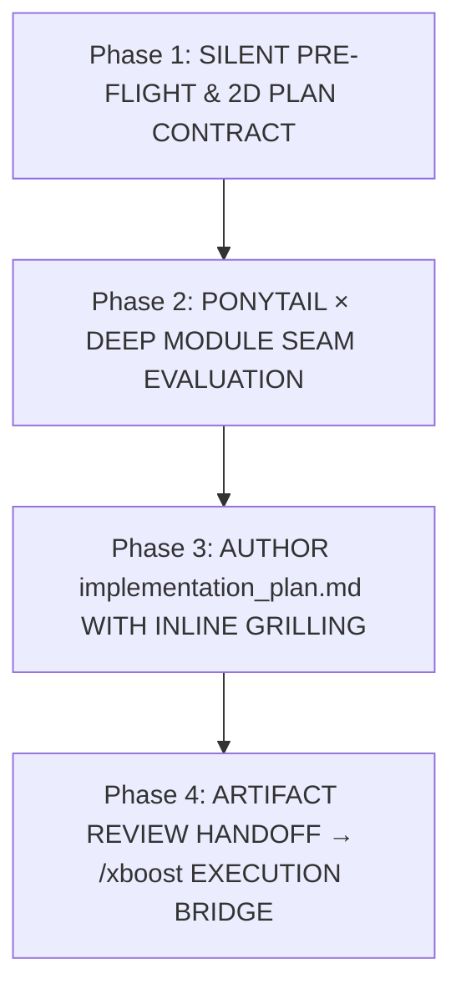
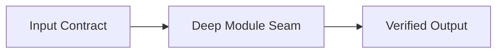

# Antigravity Architectural & Implementation Planner (`/xplan`)

When `/xplan` (or alias `/plan`) is invoked, enter the **Antigravity XPlan Protocol**. XPlan constructs a rigorous, decision-complete `implementation_plan.md` artifact combining **inline structured grilling**, **Ponytail × Deep Module seam evaluation**, **Mermaid architecture diagrams**, and a **falsifiable Red → Green verification matrix**—with **zero chat-window interrogation**.

Portable across Antigravity IDE, `agy` CLI, Claude Code, and multi-agent environments across Windows, macOS, and Linux.

Red failure modes to prevent:
1. **Chat Interruption Anti-Pattern**: Asking clarifying questions in the chat bubble (or blocking on modal prompts) instead of writing structured decision options inside `implementation_plan.md`.
2. **Speculative Over-Engineering**: Proposing bloated wrapper classes, unnecessary dependencies, or multi-file abstractions without passing the Ponytail × Deep Module filter.
3. **Unfalsifiable Verification Plans**: Writing vague manual checks (*"run the app and verify it works"*) instead of exact Red → Green CLI commands, boundary checks, or 1D analytical toy benchmarks.
4. **SSOT & Deferred-Zone Amnesia**: Proposing edits that violate locked workspace cardinalities or touch sections marked `[FROZEN]` / `[DEFERRED]` / `[RESEARCH FIRST]`.

---

## 1. When Not to Use

| Need | Use Instead |
| :--- | :--- |
| Execute code changes, fix bugs, or run Red → Green loops directly | [`/xboost`](../xboost/SKILL.md) |
| Read workspace docs and execute a non-planning task immediately | [`/xbrief`](../xbrief/SKILL.md) |
| Primary-source API/SDK/DB lookup or 5-wave precedent harvesting | [`/xdeep-research`](../xdeep-research/SKILL.md) |
| Synchronize documentation and metrics after an implementation | [`/xsync`](../xsync/SKILL.md) |
| Generate an end-of-session handoff prompt for a fresh chat | [`/xkickoff`](../xkickoff/SKILL.md) |

---

## 2. The 4-Phase XPlan Lifecycle



---

### Phase 1: Silent Pre-Flight Discovery & 2D Plan Contract (`Step 0`)

**Never ask questions in chat or propose file mutations before inspecting local ground truth.**

#### 1. Composable Pre-Flight Hooks (Zero Default Overhead)
* **Workspace SSOT & Boundary Check ([`/xbrief`](../xbrief/SKILL.md) Mindset)**:
  * Perform a bounded read of pinned files and top-authority specs (`README.md`, `AGENTS.md`, latest `*_vLatest.md`) using Pass A (headings/cardinality) → Pass B (relevant sections).
  * Record any `[FROZEN]`, `[DO NOT EDIT]`, or `[DEFERRED]` zones so the plan strictly respects them.
* **Primary-Source & Manifest Lock ([`/xdeep-research`](../xdeep-research/SKILL.md) Hook)**:
  * Check local manifests (`package.json`, `pyproject.toml`, `*.csproj`, `metadata.txt`) and target source files via `read_file` so proposed APIs match exact pinned versions and line ranges.
* **Strict Opt-In [`/xobsidian`](../xobsidian/SKILL.md) Combinator (`/xplan /xobsidian`)**:
  * **Default (Without `/xobsidian`)**: Never read from or write to any Obsidian vault.
  * **Opt-In (`/xplan /xobsidian` or `/xbrief /xplan /xobsidian`)**: Resolve `VAULT_ROOT` dynamically (`00 *Index*.md` → `Hub - *.md`) to pull reusable governing equations, SI unit bridges, or component contracts into the plan.
* **Opt-In [`/xlaya`](../xlaya/SKILL.md) Sidecar (`/xplan /xlaya`)**:
  * When planning across a large, unpinned documentation corpus, use `/xlaya` (`shortlist` / `score`) to shortlist relevant specification sections with zero context bloat.
* **Opt-In [`/xultra`](../xultra/SKILL.md) Multi-Architect Scout Mode (`/xplan /xultra`)**:
  * When `/xultra` is included in the command, spawn **`K` Orthogonal Architect Scouts** ([`/xultra`](../xultra/SKILL.md) Law 2: Vector A Simplification/Stdlib, Vector B Surgical Local Seam, Vector C Deep Module Interface, plus any domain-specific numerical/layout vector) paired with **Elastic Red-Team Seam & SSOT Critic(s) (`C ≥ 1` by Law 3)** to stress-test trade-offs, bidirectional counter-anchors (`UL-05`), and live-callable parity (`UL-08`) before synthesizing their findings into `implementation_plan.md`.

#### 2. Synthesize the 2D Plan Contract (`Task Archetype × Project Archetype`)
Cross the active **Task Intent** (`BUILD / FEATURE`, `REFACTOR / SIMPLIFY`, `SIMULATE / SOLVER`, `OPTIMIZE / SCALE`, `SHIP / RELEASE`) with the **Project Domain Harness** (`Backend / APIs / Distributed Systems`, `Web UI / Figma / Diagrams`, `Data / Cloud / ML`, `Numerical Solvers / Simulation / CAD / GIS`, `Agent Skills / CLI / Configs`) across [`/xboost`](../xboost/SKILL.md)'s 3 complexity tiers:
* **Tier 1 Plan (1–2 files, localized tactical change)**: Compact seam diff + inline grilling decisions (if any) + 1 Red → Green command.
* **Tier 2 Plan (Multi-file architectural feature, refactor, solver, or UI)**: Full `mermaid` architecture diagram + Deep Module interface spec + component-by-component change matrix.
* **Tier 3 Plan (Multi-subsystem / `/goal` marathon initiative)**: Multi-wave execution roadmap, persistent `boostx_state.md` ratchet checkpoints, and cross-subsystem verification gates.
* **`SIMULATE / SOLVER` Overlay (Any Tier — Physics, Numerical, Scientific)**: Attach a mandatory **SI Unit & Step-Measure Bridge Table** (source schema units & discretization step `Δμ` ↔ SI `m`/`kg`/`s`/`N`/`W/m²`, `deg` ↔ `rad`), stability bounds (`dt`, convergence `ε`, max iterations), and the **Physics & Numerical Triad** verification plan (zero-forcing equilibrium identity `Δx = 0 ⇒ Δy = 0.0 / y == y_eq` with no `NaN`/`Inf`, 1D analytical toy benchmark, conservation/step-scaling convergence `UL-01..UL-08`).

---

### Phase 2: Ponytail × Deep Module Seam Evaluation

Before drafting `Proposed Changes`, evaluate candidate architectures against the **Ponytail × Deep Module Ladder**:

1. **Vector A — Simplification / Config / Deletion (YAGNI First)**:
   * Can the requirement be solved by deleting dead complexity, adjusting configuration, or calling an existing repo helper?
2. **Vector B — Surgical Local Seam**:
   * Can we extend an existing function/module with a minimal, stdlib-first diff?
3. **Vector C — Deep Module Interface (`/codebase-design`)**:
   * When a new module is genuinely warranted, design a **Deep Module**: *a tiny, obvious public signature (`Inputs → Outputs → Invariants`) hiding substantial internal logic*—never shallow pass-through wrappers.

---

### Phase 3: Authoring `implementation_plan.md` & Structured Inline Grilling

#### 1. The Zero-Chat-Question Invariant
* Do **NOT** ask clarifying questions directly in the chat response, and do **NOT** call `ask_question` during `/xplan`.
* Every ambiguity, architectural fork, or scope trade-off **MUST** be written inside `implementation_plan.md` under **`## 1. User Review Required & Inline Grilling Decisions`**.

#### 2. Required `implementation_plan.md` Schema
Structure `<appDataDir>/brain/<conversation-id>/implementation_plan.md` using this exact 5-section blueprint (using native Unicode `→`, `×`, `≈`, `±`, `≤`, `≥`, `✓` and **zero LaTeX `$...$` math**):

```markdown
# Implementation Plan: <Concise Title>

> **📐 XPlan 2D Contract** — `[Task Archetype]` × `[Project Archetype]` (`Tier 1|2|3`)
> - **Target Outcome**: <1-sentence concrete state after implementation>
> - **SSOT & Scope Guardrails**: <Locked cardinalities, [FROZEN]/[DEFERRED] zones, Dual-OS/OneDrive invariants>
> - **Primary Sources / Inspected Files**: `[file.py](file:///path/to/file.py#L1-L50)`, `[spec.md](file:///path/to/spec.md#L10-L30)`

---

## 1. User Review Required & Inline Grilling Decisions

*(If zero ambiguities exist, state: `None — all requirements and invariants are locked by SSOT.` Otherwise, structure each inquiry as follows:)*

### Decision 1: <Short Decision Title>
- **Question / Decision Point**: <Explain the exact engineering challenge, trade-off, or ambiguity>
- **Options**:
  - **Option A (Recommended — <Short Label>)**: <Description, blast radius, and Ponytail × Deep Module rationale>
  - **Option B (<Alternative Label>)**: <Description and trade-offs>
- **Recommendation**: **Option A (Recommended)** — <Why this path is cleanest, safest, and most maintainable>
- **Doc / Code References**: `[module.py](file:///.../module.py#L40-L65)`, `[ROADMAP.md](file:///.../ROADMAP.md#L12-L25)`

---

## 2. Architecture & Ponytail × Deep Module Seam Design

- **Selected Vector**: `Vector A (Simplification)` | `Vector B (Surgical Seam)` | `Vector C (Deep Module)`
- **Module Interface Contract**:
  - **Signature**: `<function_or_class_signature(inputs) -> outputs>`
  - **Invariants**: <Null/empty guards, unit conversions, O(N) bounds, Dual-OS path safety>
  - **Swarm Wave & Shared Seam Blueprint (When executing via `/xboost /xultra`)**: <Pre-Locked Shared Seam Header (signatures/tokens/schemas), Cognitive-Density Shard Partitioning (`N × K × C × T`), and Wave 2A Critic Shards → Wave 2B Main Checker probes>



---

## 3. Proposed File Changes (By Component)

### Component 1: <Component Name>
#### [MODIFY | NEW | DELETE] `[filename.ext](file:///absolute/path/to/filename.ext#L10-L45)`
- **Seam & Summary**: <Exact functions/classes to modify or add>
- **Key Implementation Details**: <Concise bullet points of logic changes; preserve existing docstrings/comments>

---

## 4. Red → Green Verification Matrix (XBoost Phase 4 Ready)

| Tier | Verification Gate | Exact Command / Probe | Expected Pass Signal |
| :---: | :--- | :--- | :--- |
| **Tier 1 (Red / Baseline & Counter-Anchors)** | Repro failure / Pre-flight probe / 1D Toy Benchmark + domain-matched positive & negative counter-anchors (`A_pos ∧ A_neg`, `UL-05` where applicable) | `<exact CLI command>` | Proves baseline state, closed-form match, and simultaneous positive + negative counter-anchor bounds |
| **Tier 2 (Green + Live Entrypoint, Sensitivity & Invariants)** | Live production entrypoint (`UL-08`) + active-regime sensitivity (`ΔInput X → ΔOutput Y ≠ 0`) + domain invariants (`UL-01..UL-07` in [`deep_audit_protocol.md`](../xboost/references/deep_audit_protocol.md) where applicable) | `<exact CLI command>` | `0` errors, live entrypoint verified, non-zero active-regime sensitivity, `100%` expected coverage, `0` silent fallback masking |
| **Tier 3 (Parity, Cumulative Ratchet & Hygiene)** | Cumulative regression suite (`Pass_Set(t+1) ⊇ Pass_Set(t)`) + Anti-hardcode path sweep | `<exact CLI command>` | `0` regressions across prior turns, `0` hardcoded user paths |
```

---

### Phase 4: Artifact Persistence & Conditional `/xboost` Execution Handoff

1. **Write the Plan Artifact**:
   * Save the plan to `<appDataDir>/brain/<conversation-id>/implementation_plan.md` using `write_file` (or `edit_file` when updating an existing plan in-place).
   * Pass `ArtifactMetadata` with `UserFacing = true` and `RequestFeedback = true` when halting for user decision/approval (or `RequestFeedback = false` when auto-advancing immediately under `/xplan /xboost` with `0` open decisions or `/goal`).
2. **Concise Chat Handoff (Zero Redundant Wall-of-Text)**:
   * Do **not** re-summarize or paste the plan contents into the chat response.
   * Point the user to the generated `implementation_plan.md` artifact (`[implementation_plan.md](file:///<appDataDir>/brain/<conversation-id>/implementation_plan.md)`), list only the **Decision IDs** (e.g., `Decision 1`, `Decision 2`) that need their selection, and note:
     *"Reply with your option choices (e.g. `1A, 2A`) or click **Proceed** to execute via `/xboost`."*
3. **Conditional Stage 3A → 3B Bridge (`/xplan` → [`/xboost`](../xboost/SKILL.md))**:
   * **When Open Grilling Decisions Exist (`Decision 1..M`) and `/goal` is Not Active**: Halt after saving `implementation_plan.md` so the user can select options or click **Proceed**.
   * **When User Approves OR When Chained (`/xplan /xboost`) with `0` Open Ambiguities (or with `/goal`)**: Lock all 3 plan blocks—**(1) Header `[FROZEN]`/`[DEFERRED]` Guardrails**, **(2) Selected Options + `Shared Seam Header` / SI Unit Bridge**, and **(3) Section 4 `Red → Green Verification Matrix` (`UL-05` + `UL-08`)**—into `<artifactDir>/scratch/boostx_state.md` and execute [`/xboost`](../xboost/SKILL.md) immediately.

---

## 3. Quality Rubric

- [ ] **Zero Direct Questions in Chat**: All ambiguities and architectural choices are written inside `## 1. User Review Required & Inline Grilling Decisions` in `implementation_plan.md`.
- [ ] **Structured Decision Format**: Every inquiry includes `Question / Decision Point`, `Options`, `(Recommended)` choice with rationale, and clickable `file://` `Doc / Code References`.
- [ ] **2D Plan Contract & SSOT Alignment**: Checked pinned versions, locked cardinalities, and `[FROZEN]` / `[DEFERRED]` zones before proposing changes.
- [ ] **Ponytail × Deep Module Evaluated**: Justified Vector A/B/C choice and included a `mermaid` architecture diagram (with native Unicode symbols and zero LaTeX `$...$` math).
- [ ] **Falsifiable Red → Green Verification Matrix**: Included exact CLI commands for Tier 1 (Baseline/Toy), Tier 2 (Green + Boundary), and Tier 3 (Regression + Portability).
- [ ] **Artifact Metadata & Concise Chat Pointer**: Saved with `RequestFeedback = true` and `UserFacing = true`, without duplicating the plan body in chat.
