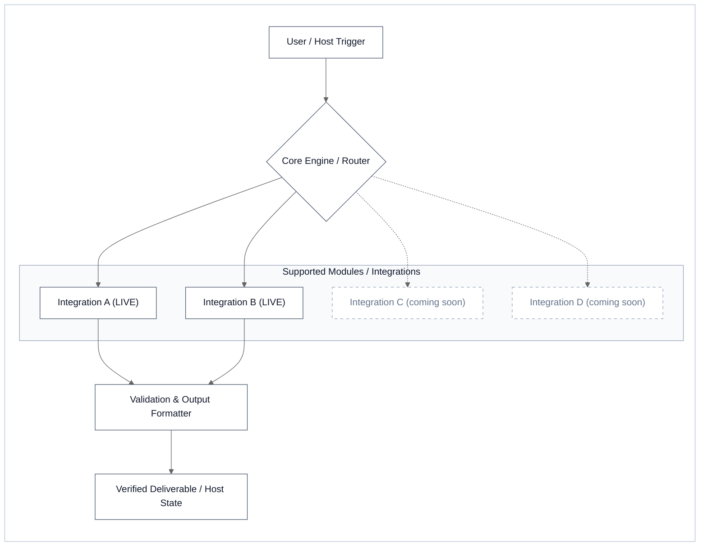
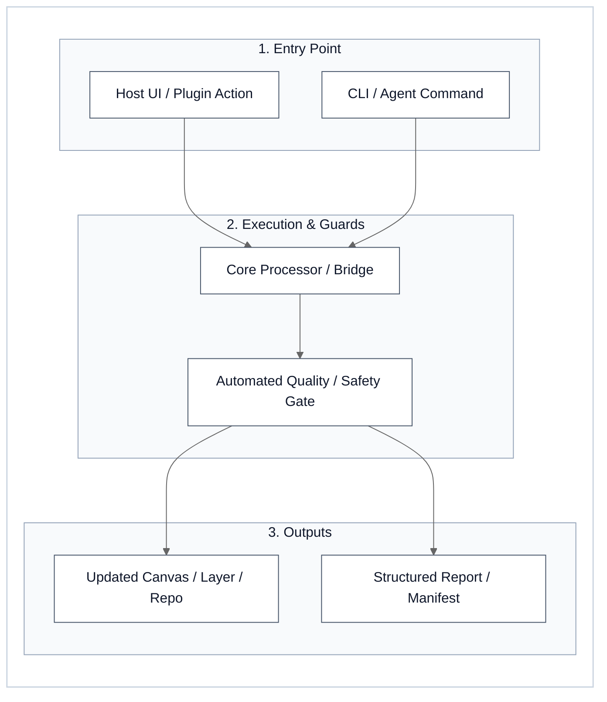

# GitHub Repository Publishing, Visual README & Upstream PR Protocol (`v1.3`)

> **Scope**: Universal, domain-agnostic standard for authoring high-impact open-source GitHub repositories across **Agent Skills**, **MCP Server Bridges**, **Desktop GIS/CAD Plugins (QGIS / Rhino / Grasshopper)**, and **CLI / Compute Engines**, plus cross-account profile synchronization and Upstream Pull Requests (`PRs`) via `/xpublish` (`audit_engine.py`, `package_qgis.py`, `check_qt6.py`).  
> **Core Philosophy**: **Executive Scannability in `< 5 Seconds`**, **Zero-Iframe Visual Bar Charts (`0 ms` Render)**, **White-Mode Minimalist Mermaid Diagrams (`< 30 KB` SVG)**, **Viewport-Safe Table Geometry (`≤ 4` Prose Columns)**, **Zero-Mojibake `UTF-16LE` Clipboard Automation**, **Single-Pass Review-Bot Convergence (`--platform pr`)**, and **Progressive Disclosure (`<details>`)**.

---

## 1. Document Hierarchy & Archetype-Adaptive Top-of-Repo Design

Every public repository `README.md` follows a clean 6-layer visual hierarchy, adapting its `TL;DR` and comparison metrics to the repository's actual domain (**never force ML/VRAM metrics onto a plugin, MCP bridge, or skill repo**):

1. **Header & Badges Block**:
   - Concise `# Title — 1-Line Value Proposition`
   - Actionable status badges (`Version`, `License`, `Platform / Host Compatibility`, `Test / Audit Status`)
   - 1-paragraph bold summary stating what the project does, who it is for, and its primary improvement over manual or baseline workflows.
2. **`## ⚡ TL;DR — Capabilities & Performance at a Glance`**:
   - **`3–5` Executive Highlights**: Concise bullet points summarizing the core capability and empirical impact.
   - **One-Prompt Universal Agent Install (Mandatory for Archetypes A & B — Agent Skills & MCP Bridges)**:
     Include a copy-pasteable `text` prompt block right in the `TL;DR` (and in `Universal Installation`) so any user on **any AI agent (cloud, IDE, CLI, or local LLM)** can simply paste 1 prompt into their agent to auto-detect their OS/skill directory, install, and verify the suite without manual path hunting, framed with universal **`Any AI Agent (Cloud • IDE • CLI • Local LLM)`** compatibility rather than locking to a fixed vendor list.
   - **Archetype-Adaptive Focus & Routing Guide** *(include a configuration/mode routing guide only if the project offers multiple modes, tools, or profiles)*:

| Repository Archetype | What to Highlight in `TL;DR` Bullets | What to Compare in the Horizontal Bar Table |
| :--- | :--- | :--- |
| **A. Agent Skills & Workflow Suites**<br>*(e.g., `xboost`)* | Composable slash commands, context-window noise reduction, and deterministic verification gates. | `Defect Catch Rate (%)`, `Context Token Compression (%)`, `Triage / Gate Latency (ms)` |
| **B. MCP Bridges & Host Integrations**<br>*(e.g., `mcp-bridges`)* | Connected desktop/cloud hosts, zero-UI-freeze execution safety, and bidirectional sync speed. | `Automated vs. Manual Steps`, `Round-Trip Tool Latency (ms)`, `API / Component Coverage (%)` |
| **C. Desktop GIS / CAD Plugins**<br>*(e.g., QGIS / Rhino / GH plugins)* | Core geometric/spatial transformation, cross-version compatibility (`QGIS 3/4`, `Qt5/Qt6`, `Rhino 7/8`), and 1-click workflow. | `Processing Speed vs. Manual CAD/GIS`, `Feature / Layer Preservation (%)`, `Zero-Dependency Portability` |
| **D. CLI Tools, Solvers & AI Engines**<br>*(e.g., data pipelines, solvers, OCR)* | Speedup vs. baseline, accuracy/fidelity delta, and *when multiple modes/models exist*, which flag to pick for speed vs. accuracy vs. memory. | `End-to-End Speedup (×)`, `Benchmark Accuracy (%)`, `Memory / Resource Footprint` |

3. **`## 1. Architecture & Usage Workflow`**:
   - Maximum **`1–2` White-Mode Mermaid `flowchart` diagrams** (`< 30 KB` SVG each) with minimal text:
     - **Diagram A (System Architecture & Ecosystem)**: How the tool connects inputs, core modules, and host platforms/plugins (marking active modules as `(LIVE)` and planned extensions with a small `(coming soon)` subtitle).
     - **Diagram B (Usage Workflow)**: `1. Trigger / Entry Point` → `2. Core Processing / Selection` → `3. Output / Canvas State`.
4. **`## 2. Quick Start & Installation`**:
   - Copy-pasteable installation and minimal working usage examples (CLI command, slash command, MCP config JSON, or plugin UI steps).
5. **`## 3. Benchmarks, Verification & Deep Reference`**:
   - Clean GFM summary tables on the surface, paired with collapsible `<details>` blocks for deep specifications (e.g., full MCP tool schemas, plugin parameter matrices, or **LaTeX `booktabs`** tables for academic/research repos) so the main page never bloats with text.
6. **`## 4. Citation, License & Contributing`**:
   - Citation block (if applicable) and license link.

---

## 2. Instant-Render Native Markdown Horizontal Bar Charts (`0 ms` Load)

### Why We Ban `xychart-beta` on GitHub
Never use Mermaid's experimental `xychart-beta` in GitHub Markdown:
1. **Coordinate Transpose Bug**: Combining `horizontal` with `bar [...]` and `line [...]` plots `bar` in `(y, x)` space while `line` plots in `(x, y)` space, causing lines to shoot vertically off the bottom of the canvas.
2. **Literal Quoted Labels & Missing Legends**: `xychart-beta` renders literal `"..."` quotation marks around axis labels and provides no series legend (`Bar 1`, `Line 1`).
3. **Iframe Timeout Penalty**: Every Mermaid block on GitHub spawns a separate sandboxed `viewscreen.githubusercontent.com` iframe (`~2 MB` JS payload). Having `4–5` charts on one page causes multi-second loading spinners and frequent `Unable to render rich display` timeouts.

### The Standard: 20-Block Unicode Bar Table (`█` + `░`)
Always render quantitative comparisons using a **20-character Native Markdown Horizontal Bar Table**:
- **Filled Block**: `█` (`U+2588` Full Block)
- **Empty Track**: `░` (`U+2591` Light Shade)
- **Formula (`20` characters total)**:
  - For metrics where **Higher = Better** (Speedup, Accuracy, Coverage, Recall, Compression): `filled = round(20 * value / max_reference)`
  - For metrics where **Lower = Better** (Latency, Manual Steps, Resource Usage): Either plot the **Efficiency / Reduction %** (`-97.5% Noise`) or plot the relative footprint and explicitly label `(Lower = Better)`.

#### Universal Reusable Template
```markdown
### Horizontal Bar Comparison

| Evaluation Dimension | Workflow / Configuration | Visual Comparison Bar | Measured Result & Delta vs. Baseline |
| :--- | :--- | :--- | :--- |
| **1. Workflow Speed / Throughput ↑** | **Automated Engine / Plugin**<br>Manual / Legacy Baseline | `████████████████████` **`15.0× Faster`**<br>`█░░░░░░░░░░░░░░░░░░░` `1.0×` | **`1.2 s`** (`-93%` execution time)<br>`18.0 s` (Baseline) |
| **2. Quality / Verification Recall ↑** | **Full Pipeline (With Guards)**<br>Standard Mode<br>Unchecked Baseline | `████████████████████` **`100.0%`**<br>`████████████████░░░░` `80.0%`<br>`████░░░░░░░░░░░░░░░░` `20.0%` | **`0` Regressions / Errors**<br>Standard Coverage<br>Baseline Reference |
| **3. Context / Overhead Reduction ↓**<br>*(Lower = Better)* | **Bounded / Optimized Mode**<br>Unbounded Baseline | `█░░░░░░░░░░░░░░░░░░░` **`2.5% Overhead`**<br>`████████████████████` `100.0% Overhead` | **`-97.5%` Bloat Removed**<br>Full Unfiltered Load |
```

---

## 3. White-Mode Minimalist Mermaid Diagrams & The 4 Lexer Guardrails

### A. Enforcing Crisp White Mode Across Both Light & Dark GitHub Themes
When a viewer opens GitHub in Dark Mode, default Mermaid diagrams often render with low-contrast dark-gray boxes and invisible arrows between subgraphs. Furthermore, using `theme: 'base'` bloats the SVG payload from `~26 KB` to `> 113 KB`. To guarantee **100% crisp White-Mode diagrams (`< 30 KB` SVG)** on every device and theme:
1. Prepend the **`theme: 'neutral'` Lightweight Init Directive**:
   ```text
   %%{init: {'theme': 'neutral'}}%%
   ```
2. Wrap the entire diagram inside an outer **`subgraph Canvas [" "]`** styled with a pure `#ffffff` fill and explicit `classDef default`:
   ```text
   classDef default fill:#ffffff,stroke:#475569,color:#0f172a,stroke-width:1px
   style Canvas fill:#ffffff,stroke:#cbd5e1,stroke-width:1.5px,color:#0f172a
   style SubGroup fill:#f8fafc,stroke:#94a3b8,color:#0f172a
   ```
   This creates a self-contained **White Card Canvas (`~23-29 KB` SVG)** so arrows connecting inner subgraphs never sit on GitHub Dark Mode's `#0d1117` background.
3. Style roadmap / future-extension nodes (`coming soon`) with dashed slate borders:
   ```text
   style FutureNode fill:#ffffff,stroke:#94a3b8,stroke-dasharray: 5 5,color:#64748b
   ```

### B. The 4 Hard GitHub Mermaid Lexer Guardrails (Mandatory)
To prevent GitHub's `Unable to render rich display` error and keep SVG payloads under `35 KB`:

| # | Forbidden Pattern inside ` ```mermaid ` | Why It Breaks GitHub's Renderer | Mandatory Clean Replacement |
| :---: | :--- | :--- | :--- |
| **1** | **Double-hyphens `--` inside node/edge labels**<br>*(e.g., `Node["--mode auto"]` or `Node["--platform skill"]`)* | Mermaid's lexer parses `--` as an edge token even inside quotes on several GitHub `viewscreen` versions, throwing a fatal parse error. | Use colon or key-value syntax: `Node["mode: auto"]` or `Node["platform: skill"]`. |
| **2** | **HTML tags `<br>`, `<br/>`, `<b>`, `<i>`**<br>*(e.g., `Node["Line 1<br/>Line 2"]`)* | Causes XHTML vs. HTML5 sanitizer mismatches and vertical label clipping inside SVG `<foreignObject>` boxes. | Keep node labels concise on a single line (`≤ 45` chars): `Node["Primary Name (Concise Subtitle)"]`. |
| **3** | **Chained ampersand `&` edges**<br>*(e.g., `A & B --> C & D`)* | Fails when combined with styled subgraphs or edge labels in GitHub's bundled Mermaid version. | Declare one explicit `1-to-1` edge per line (`A --> C`, `B --> C`). |
| **4** | **Multi-codepoint emojis & regional flags**<br>*(e.g., `🇹🇭`, `🇬🇧`, `🏎️`, `⚡`)* | Surrogate-pair and ZWJ emojis inflate Mermaid SVG font-metric calculations (`>110 KB` SVG) and break text centering. | Use clean ASCII text badges inside diagrams: `(LIVE)`, `(Default)`, `(coming soon)`. |

### C. Canonical White-Mode Diagram Templates (Adapt to Repo Archetype)

#### Template 1: Modular System / Bridge / Plugin Architecture (`flowchart LR`)


#### Template 2: 3-Step Usage Workflow (`flowchart LR`)


---

## 4. Viewport-Safe Table Column Geometry (`README.md` vs. Pull Request Box)

GitHub renders Markdown tables inside fixed-width containers (`~890px` for repository `README.md` files, and only **`~820-840px` inside Pull Request / Issue comment boxes**). When a table has too many descriptive columns or unbreakable inline code spans (`> 30` chars), the rightmost column gets crushed (`Measured In...`) or forces an ugly horizontal scrollbar.

| Table Context & Type | Max Columns | Column Merging & Token Width Rules |
| :--- | :---: | :--- |
| **1. Explanatory / Bug-Fix / Feature Tables**<br>*(Inside PR Descriptions or `README.md`)* | **`≤ 4` Columns** | • Merge index `#` and `Component / Target` into a single first column: **`# & Target`** (e.g., `**1. func_name** (module.py)`).<br>• Use the 4-column layout: `# & Target` \| `Problem / Baseline` \| `Solution / Mechanism` \| `Impact / Verification`.<br>• Keep individual inline code tokens `≤ 28` characters so the browser can wrap text naturally between words. |
| **2. Numeric Comparison Matrices**<br>*(Compact numbers in columns `3..N`)* | **`≤ 6` Columns** | • Allowed up to `6` columns **only** when columns `3..6` hold compact numeric values (`10.1 ms`, `100.0%`, `25 / 25`).<br>• Keep column headers `≤ 22` characters and use `-` (ASCII hyphen) for empty cells. |

---

## 5. Progressive Disclosure (`<details>` for Deep Specs & Academic `booktabs`)

To prevent `README.md` files from becoming walls of text while still providing 100% technical completeness:
1. **Surface Layer**: Keep visible tables concise (`≤ 8` rows per table), with clear units (`ms`, `s`, `%`, `LOC`) and **bolded best results**.
2. **Collapsible Deep Layer (`<details>`)**: Place lengthy reference material inside collapsible `<details>` blocks directly beneath the summary table:
   - *For Agent Skills, MCP Bridges & Plugins*: Collapsible full tool/command parameter schemas, configuration JSONs, or Qt5/Qt6 compatibility matrices.
   - *For Research & Benchmark Repos*: Collapsible **LaTeX (`booktabs`)** source tables (`\toprule`, `\midrule`, `\bottomrule`) for direct copy-paste into academic manuscripts.

---

## 6. Upstream Pull Request (`PR`), Dual-Credit & Review-Bot Convergence Protocol

### A. High-Impact PR Title Formula (`55-78` Characters)
- **Why Length & Framing Matter**: Titles over `~80` characters truncate (`...`) in GitHub's PR input box, PR list, email notifications, and `git log --oneline`. Conversely, vague titles (`fix bugs & update code`) fail to communicate engineering value to maintainers or portfolio reviewers.
- **Canonical Formula (`55-78` chars)**:
  ```text
  <type>(<scope>): <quantified improvement / capability> & <headline feature>
  ```
- **Examples Across Domains**:
  - *Plugin / CAD / GIS*: `feat(qgis): add Qt6 compatibility & 12x faster batch geometry transform` (`71` chars)
  - *MCP / Agent Tooling*: `feat(mcp): add non-blocking socket bridge & 14 deterministic verification gates` (`79` chars)
  - *Compute / AI Pipeline*: `feat(ocr): 1.3x-15x faster pipeline (-35.9% token bloat) & offline local VLM` (`76` chars)

### B. Dual-Credit Fork Strategy (Organization Fork + Personal Author Commit)
To maximize credibility for both the research lab/organization and the individual engineer's career portfolio (CV / graduate applications):
1. **Fork under the Organization**: Create the upstream fork under the lab organization (`https://github.com/<org>/<upstream-repo>`).
2. **Commit with Personal Git Identity**: Author the commits using the engineer's personal GitHub email (`git config user.email "<personal-email>"`).
3. **Resulting Public Header on Upstream Repo**:
   `<personal-username> wants to merge N commits into <upstream>:master from <org>:<branch-name>`
   This permanently records **both** the personal account (as commit author & PR opener) and the organization fork on the upstream repository.

### C. Zero-Mojibake Clipboard & Browser Pre-Fill Automation (Windows / macOS / Linux Tri-OS)
> [!CAUTION]
> **Never Use PowerShell 5.1 `Get-Content | Set-Clipboard` or `clip.exe` for Unicode / Multilingual Markdown**:
> In Windows PowerShell 5.1, pipeline strings default to legacy ANSI codepages (`cp1252` / `cp874`), which silently corrupts non-ASCII characters—turning Unicode arrows/bars (`→`, `█`), Thai tone marks (`่ ้ ๊ ๋`), decomposed vowels (`นํ้า`), bullets (`•`), and em-dashes (`—`) into `` replacement diamonds when pasted into GitHub's editor.

Always use these two rules when automating PR or README pasting:
1. **ASCII Punctuation Hygiene in PR Bodies**: Use standard ASCII hyphens `-` instead of `•` or `—` in section headers and empty table cells.
2. **Tri-OS Zero-Mojibake Clipboard Loader (`CF_UNICODETEXT` / `pbcopy` / `wl-copy`) + Pre-Filled Browser Launch**:
   Since isolated agent browser profiles are not logged into the user's personal GitHub session, pre-fill the PR Title via URL query parameters (`?expand=1&title=...`) in the user's default logged-in browser and load the PR Description directly into the system clipboard with zero encoding loss across Windows (`UTF-16LE` `CF_UNICODETEXT`), macOS (`UTF-8` `pbcopy`), and Linux (`wl-copy` / `xclip`):

```python
import os, sys, ctypes, shutil, urllib.parse, subprocess
sys.dont_write_bytecode = True

def copy_utf16_clipboard(text: str) -> None:
    """Copy Unicode text (bars, symbols, multilingual text) to clipboard with zero mojibake across Windows/macOS/Linux."""
    if sys.platform == "win32":
        CF_UNICODETEXT, GMEM_MOVEABLE = 13, 0x0002
        user32, kernel32 = ctypes.windll.user32, ctypes.windll.kernel32
        kernel32.GlobalAlloc.argtypes = [ctypes.c_uint, ctypes.c_size_t]
        kernel32.GlobalAlloc.restype = ctypes.c_void_p
        kernel32.GlobalLock.argtypes = [ctypes.c_void_p]
        kernel32.GlobalLock.restype = ctypes.c_void_p
        kernel32.GlobalUnlock.argtypes = [ctypes.c_void_p]
        user32.SetClipboardData.argtypes = [ctypes.c_uint, ctypes.c_void_p]

        encoded = text.replace("\r\n", "\n").replace("\n", "\r\n").encode("utf-16le") + b"\x00\x00"
        user32.OpenClipboard(0)
        user32.EmptyClipboard()
        h_mem = kernel32.GlobalAlloc(GMEM_MOVEABLE, len(encoded))
        ptr = kernel32.GlobalLock(h_mem)
        ctypes.memmove(ptr, encoded, len(encoded))
        kernel32.GlobalUnlock(h_mem)
        user32.SetClipboardData(CF_UNICODETEXT, h_mem)
        user32.CloseClipboard()
    elif sys.platform == "darwin":
        subprocess.run(
            ["pbcopy"],
            input=text.encode("utf-8"),
            env={**os.environ, "LANG": "en_US.UTF-8"},
            check=True,
        )
    else:
        cmd = ["wl-copy"] if shutil.which("wl-copy") else ["xclip", "-selection", "clipboard"]
        subprocess.run(cmd, input=text.encode("utf-8"), check=True)

def launch_prefilled_github_pr(upstream_repo: str, org_fork: str, branch: str, title: str, body: str) -> None:
    copy_utf16_clipboard(body)
    q_title = urllib.parse.quote(title)
    url = f"https://github.com/{upstream_repo}/compare/master...{org_fork}:{branch}?expand=1&title={q_title}"
    if sys.platform == "win32":
        os.startfile(url)
    elif sys.platform == "darwin":
        subprocess.run(["open", url], check=True)
    else:
        subprocess.run(["xdg-open", url], check=True)
```

### D. Upstream PR Etiquette, Closing-Keyword Parity & Review-Bot Convergence (`--platform pr`)

When contributing to external upstream repositories, enforce these four rules before and after opening a PR:

1. **Issue-Claim Etiquette & Maintainer Governance Check**:
   - Before opening an upstream PR or posting a public comment, inspect `CONTRIBUTING.md`, `.github/PULL_REQUEST_TEMPLATE*`, issue assignees, and linked open PRs via GitHub API/CLI (`Law 1`).
   - **Direct-PR Repos**: If the issue is unassigned, has no competing open PR, and `CONTRIBUTING.md` does not mandate prior approval, implement the fix + regression test on a clean feature branch and open the PR directly.
   - **Discussion-First Repos**: If `CONTRIBUTING.md` or maintainer norms require discussing before opening a PR (or when an issue is labeled internal `to-do`), prepare and verify the local branch first, then post a concise 3-line technical root-cause + proposed fix comment on the issue and wait for maintainer sign-off before pushing the PR.
   - **Human-Consent Gate for Public Posts**: Always obtain explicit user approval before posting public comments or opening PRs under the user's GitHub identity.
2. **Closing Keyword Parity (`Fixes #N` vs. `Part of #N` / `Addresses #N`)**:
   - Write auto-closing keywords (`Fixes #N`, `Closes #N`, `Resolves #N`) **only** when the PR satisfies `100%` of the issue's stated sub-requirements, acceptance checkboxes, and target platforms.
   - When a PR intentionally addresses a subset of a multi-part issue (or fixes one platform/module while leaving sibling items open), use non-closing references (`Part of #N` or `Addresses #N`) and explicitly state which items are covered vs. remaining so neither maintainers nor review bots flag a scope mismatch.
3. **Diff-Scoped Hygiene (`audit_engine.py --platform pr`)**:
   - Always run [`../scripts/audit_engine.py`](../scripts/audit_engine.py) with `--platform pr` prior to `git push`.
   - Format and lint (`ruff`, `flake8`, `black`, `prettier`) **strictly on touched lines/files** so the PR diff never includes unrelated style churn or fails on pre-existing upstream lint debt.
4. **Automated Review-Bot & Outside-Diff Convergence (`@coderabbitai`, etc.)**:
   - After opening or pushing to a PR on repositories with automated review bots (`@coderabbitai[bot]`, `sourcery-ai`, `sonarcloud`), fetch **both**:
     1. Inline diff comments (`/repos/<owner>/<repo>/pulls/<id>/comments`)
     2. Top-level review bodies (`/repos/<owner>/<repo>/pulls/<id>/reviews`), specifically expanding `<details>` sections for **`Outside diff range comments`** and **`Nitpick comments`** (where assertive bots place findings about callers, sibling state-reset methods, or test assertions outside the modified diff hunk).
   - **In-Scope Relevance Filter**: Implement fixes for bot comments that affect correctness, state lifecycle, security, or test coverage of the touched feature/function; politely decline or defer out-of-scope pre-existing refactoring suggestions to keep the PR atomic.

---

## 7. Cross-Account Profile & Mirror Synchronization Hygiene

When updating a repository's version badge or headline metrics across an organization profile (`<org>/.github/profile/README.md`) and personal profile (`<user>/<user>/README.md`):
1. **Pull Before Push**: Always run `git pull --rebase origin main` before pushing profile READMEs that may have been edited from another machine or web UI.
2. **Post-Merge Duplicate Row Check**: If a merge conflict occurs on a portfolio table row (e.g., an older version row vs. an upgraded version row), never blindly keep both lines—inspect the table to ensure **zero duplicate index rows** (e.g., two `01 //` rows) remain before pushing.

---

## 8. Pre-Publish Verification Checklist (Automated Gate)

Before pushing any `README.md`, benchmark report, or Upstream PR to GitHub, run these 7 deterministic checks:

- [ ] **Iframe Budget (`≤ 2` Mermaid Blocks per Page)**: Does `README.md` contain at most `2` `flowchart` blocks and **`0` `xychart-beta` blocks**?
- [ ] **White-Mode Canvas Wrapper**: Does every Mermaid block include `%%{init: {'theme': 'neutral'}}%%` and an outer `subgraph Canvas [" "]` with `style Canvas fill:#ffffff,...`?
- [ ] **4-Guardrail Lexer Scan (`0` Hazards)**:
  - `0` occurrences of `<br>` or `<br/>` inside ` ```mermaid ` blocks
  - `0` occurrences of `--` inside quoted Mermaid labels `["..."]`
  - `0` occurrences of chained `&` edges (`A & B --> C`)
  - `0` multi-byte emojis inside ` ```mermaid ` blocks
- [ ] **Live `mermaid.ink` Compiler Check**: Does every Mermaid block compile via `https://mermaid.ink/svg/pako:...` with `HTTP 200`, `role="flowchart-v2"`, `SyntaxError=False`, and SVG size `< 45 KB`?
- [ ] **Viewport-Safe Table Width (`≤ 4` Prose Columns)**: Do all explanatory/fix tables have `≤ 4` columns (`# & Target` merged) so the rightmost column never clips inside an `840px` GitHub PR box?
- [ ] **Zero-Mojibake Encoding Check**: Were all clipboard/file writes executed via UTF-8 (`encoding="utf-8"`) or Win32 `CF_UNICODETEXT` (`UTF-16LE`) with `0` replacement characters (`\ufffd`)?
- [ ] **Link, Diff & Mirror Integrity**: Do `audit_workspace_docs.py --allow-latex` and `audit_engine.py --platform <github|pr>` pass with `0` blocking issues and `0` advisory warnings?
