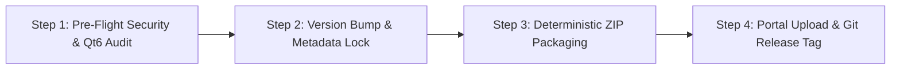

# QGIS Plugin Release & Publishing Protocol (`/xpublish --platform qgis`)

> **Scope**: Deterministic release packaging, Qt6 forward-compatibility enforcement, and publication protocol for the official QGIS Python Plugins Repository ([plugins.qgis.org](https://plugins.qgis.org/plugins/)) via [`../SKILL.md`](../SKILL.md) (`/xpublish`, aliases `/xpublish-qgis`, `/publish-qgis`).  
> **Guarantees**: Eliminates packaging rejections, enforces semantic versioning, guarantees the green **"QGIS 4 Ready"** badge, and validates metadata against Django/Python `configparser` interpolation constraints.

---

## 1. Non-Negotiable QGIS Packaging Invariants

| Invariant | Mandatory Requirement |
| :--- | :--- |
| **1. Root Slug Continuity** | The ZIP file MUST have a single top-level folder matching the portal's original `package_name`. NEVER zip loose files at the root. |
| **2. Zero Raw `%` in INI** | Python's `configparser` treats `%` as variable interpolation. Always write `percent` or `%%` in `metadata.txt`. |
| **3. `classFactory` Hook** | `__init__.py` MUST define `def classFactory(iface): return MyPlugin(iface)`. |
| **4. Qt6 / QGIS 4 Scoping** | All enums must be scoped (`Qt.AlignmentFlag.AlignCenter`) and imported via the `qgis.PyQt` shim to earn the green **"QGIS 4 Ready"** badge. |

---

## 2. Qt6 / QGIS 4 Forward-Compatibility Protocol ("QGIS 4 Ready")

When plugins are uploaded to `plugins.qgis.org`, the portal executes an automated AST migration check (`pyqt5_to_pyqt6.py`). Any unscoped enum or direct `PyQt5` import triggers red warning banners and blocks the **"QGIS 4 Ready"** badge.

### Scoped Enum Migration Reference

| Legacy / Unscoped PyQt5 | Scoped Qt6 / QGIS 4 (Portable via `qgis.PyQt`) |
| :--- | :--- |
| `Qt.AlignCenter` | `Qt.AlignmentFlag.AlignCenter` |
| `Qt.KeepAspectRatio` | `Qt.AspectRatioMode.KeepAspectRatio` |
| `Qt.IgnoreAspectRatio` | `Qt.AspectRatioMode.IgnoreAspectRatio` |
| `Qt.SmoothTransformation` | `Qt.TransformationMode.SmoothTransformation` |
| `Qt.Horizontal` / `Qt.Vertical` | `Qt.Orientation.Horizontal` / `Qt.Orientation.Vertical` |
| `QFrame.NoFrame` | `QFrame.Shape.NoFrame` |
| `Qt.ScrollBarAlwaysOff` | `Qt.ScrollBarPolicy.ScrollBarAlwaysOff` |
| `QSizePolicy.Expanding` / `Fixed` | `QSizePolicy.Policy.Expanding` / `QSizePolicy.Policy.Fixed` |
| `QComboBox.AdjustTo...WithIcon` | `QComboBox.SizeAdjustPolicy.AdjustToMinimumContentsLengthWithIcon` |
| `QKeySequence.Copy` | `QKeySequence.StandardKey.Copy` |
| `QImage.Format_ARGB32_Premultiplied` | `QImage.Format.Format_ARGB32_Premultiplied` |
| `QImage.Format_ARGB32` | `QImage.Format.Format_ARGB32` |
| `QPainter.Antialiasing` | `QPainter.RenderHint.Antialiasing` |
| `QPainter.SmoothPixmapTransform` | `QPainter.RenderHint.SmoothPixmapTransform` |
| `QPainter.HighQualityAntialiasing` | **Removed in Qt6.** Use `QPainter.RenderHint.Antialiasing`. |
| `Qt.RoundCap` | `Qt.PenCapStyle.RoundCap` |
| `Qt.RoundJoin` | `Qt.PenJoinStyle.RoundJoin` |
| `Qt.SolidLine` | `Qt.PenStyle.SolidLine` |
| `Qt.NoBrush` | `Qt.BrushStyle.NoBrush` |
| `Qt.transparent` | `Qt.GlobalColor.transparent` |
| `Qt.IntersectClip` | `Qt.ClipOperation.IntersectClip` |
| `Qt.OddEvenFill` | `Qt.FillRule.OddEvenFill` |
| `QIODevice.ReadOnly` / `WriteOnly` | `QIODevice.OpenModeFlag.ReadOnly` / `WriteOnly` |
| `Qt.WaitCursor` | `Qt.CursorShape.WaitCursor` |
| `QgsWkbTypes.PolygonGeometry` | `QgsWkbTypes.GeometryType.PolygonGeometry` |
| `QgsUnitTypes.LayoutMillimeters` | `QgsUnitTypes.LayoutUnit.LayoutMillimeters` |
| `QPageSize.Point` / `Millimeter` | `QPageSize.Unit.Point` / `QPageSize.Unit.Millimeter` |
| `QPageLayout.Portrait` / `Landscape` | `QPageLayout.Orientation.Portrait` / `QPageLayout.Orientation.Landscape` |

> [!IMPORTANT]
> **Zero Direct `from PyQt5` Imports:** Never import directly from `PyQt5.QtCore` or `PyQt5.QtGui`, even in fallback `except ImportError` blocks. Always import from `qgis.PyQt.*`.

---

## 3. Release Lifecycle: 4 Progressive Steps



### Step 1: Execute Pre-Flight Audits
Before packaging, run the universal security, Flake8, and Qt6 forward-compatibility scan ([`../scripts/audit_engine.py`](../scripts/audit_engine.py) and [`../scripts/check_qt6.py`](../scripts/check_qt6.py), where `<SKILL_DIR>` is the `xpublish` skill directory):

```bash
python "<SKILL_DIR>/scripts/audit_engine.py" "<plugin_dir>" --platform qgis
python "<SKILL_DIR>/scripts/check_qt6.py" "<plugin_dir>"
```

### Step 2: Semantic Version Management & Metadata Verification
QGIS enforces strict unique version numbers per plugin name in its database. You **cannot overwrite** an existing version number via the upload form.

**Uploaded occupies the number even if not approved.** Always `--bump patch` from the **highest uploaded** version, not from the last public one:
- **Patch release** (`1.1.0` → `1.1.1`): Bug fixes, metadata updates, packaging hotfixes, Qt6 forward scoping.
- **Minor release** (`1.1.0` → `1.2.0`): New features, additional framing modes, new projection sliders.
- **Major release** (`1.0.0` → `2.0.0`): Breaking architecture changes or native QGIS 4 architecture.

#### Required Fields in `metadata.txt`:
```ini
[general]
name=My Plugin Name
qgisMinimumVersion=3.16
description=Short one-sentence summary in English.
about=Detailed description. If using percentages, write '50 percent' or '50%%' - NEVER raw '%'.
category=Cartography
version=1.0.0
author=Your Name
email=your.personal@email.com
homepage=https://github.com/username/plugin-repo
tracker=https://github.com/username/plugin-repo/issues
repository=https://github.com/username/plugin-repo
experimental=False
deprecated=False
icon=icon.png
tags=axonometric,isometric,cartography,diagram
```

### Step 3: Package Release ZIP Archive (5 Integrated Quality Gates)
Run the deterministic packaging engine ([`../scripts/package_qgis.py`](../scripts/package_qgis.py)):

```bash
# Package current version (automatically enforces all 5 gates):
python "<SKILL_DIR>/scripts/package_qgis.py" "<plugin_dir>"

# Automatically bump patch version and package:
python "<SKILL_DIR>/scripts/package_qgis.py" "<plugin_dir>" --bump patch

# Explicitly override internal package folder name:
python "<SKILL_DIR>/scripts/package_qgis.py" "<plugin_dir>" --package-name "<slug>"
```

#### Deterministic Package Name Resolution Ladder (5 Rungs):
1. **CLI Flag (`--package-name <slug>`)**: Highest priority manual override.
2. **Metadata Key (`package_name=<slug>` in `metadata.txt`)**: Recommended best practice locking the canonical slug in git.
3. **Previous Release Archive Inspection (`dist/*.zip`)**: Adopts the prior root prefix for 100% version-to-version continuity.
4. **Git Wrapper Affix Stripping**: Strips common git wrapper prefixes (`qgis-*`, `qgis_*`) or suffixes (`*-qgis`, `*-plugin`).
5. **Folder Name**: Sanitized lowercase directory name fallback.

#### What `package_qgis.py` Guarantees:
1. **Root Slug Continuity** & **Post-Build Unzip Verification** (`0` orphan files at zip root).
2. **Mandatory Qt6, Flake8 & Security Gates** before archive creation.
3. **Deterministic ZIP Timestamps (`2026-01-01`) & Permissions (`0o644`)** for byte-reproducible builds.
4. **Build Debris & Scanner-Config Elimination**: Strips `__pycache__`, `.git`, `.DS_Store`, `test_*.py`, `scratch*`, and `.flake8` / `.bandit` / `.secrets.baseline` so the portal marks the upload as clean **Validated** rather than **Validated (configured)**.

### Step 4: Upload to QGIS Official Portal
1. Navigate to [plugins.qgis.org/plugins/add/](https://plugins.qgis.org/plugins/add/) (first release) or `https://plugins.qgis.org/plugins/<id>/` → **`+ Add version`**.
2. Upload `<plugin_dir>/dist/<plugin_slug>_v<version>.zip` and confirm the checklist boxes.
3. Verify the Security Scan tab reports `0` critical issues and plain **Validated** status.
4. Tag the release in Git (`git add metadata.txt && git commit -m "chore(release): bump version to v<version>" && git tag -a v<version> -m "Release v<version>" && git push origin main --tags`).

---

## 4. Troubleshooting & Recovery Matrix

| Error Message on Portal | Root Cause | Instant Fix |
| :--- | :--- | :--- |
| `Plugin folder name mismatch: ... (X) is different from the original (Y)` | Original version was registered with root folder `Y`, but current package uses `X`. | Add `package_name=Y` to `metadata.txt` (or run `package_qgis.py <dir> --package-name Y`). |
| `Qt6 Check [N issues]` (Red Tab) | Unscoped Qt enums (`Qt.AlignCenter`) or direct `PyQt5` import. | Run `check_qt6.py <plugin_dir>` to list exact lines and scoped replacements. |
| `Errors parsing metadata.txt. '%' must be followed by '%' or '('` | Raw unescaped `%` in `description` or `about`. | Replace `%` with `percent` or `%%` in `metadata.txt`. |
| `Zip file must contain a single top-level directory` | Zipped loose files without parent folder. | Use `package_qgis.py` which automatically prefixes archive paths with `<plugin_slug>/`. |
| `A plugin with this name and version number already exists` | Version string already exists in the portal DB (including unapproved uploads). | Run `package_qgis.py <plugin_dir> --bump patch` from the highest uploaded version. |
| `Validated (configured)` / Developer-Supplied Config Files | ZIP contains `.flake8`, `.bandit`, or `.secrets.baseline`. | Re-package with `package_qgis.py --bump patch` (which strips scanner configs automatically). |
