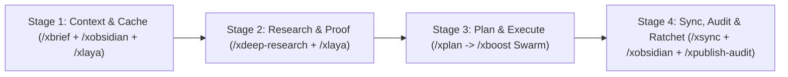

# Antigravity XUltra Protocol (`/xultra`)

When `/xultra` (or alias `/ultra`) is invoked standalone or chained with any BoostX `/x...` skill, enter the **XUltra Elastic Cognitive Swarm & Adversarial Verification Protocol**. XUltra multiplies System 2 compute across isolated subagent context windows while keeping the **Main Thread at Compaction Round 0** (`🟢 HEALTHY`).

Unlike rigid headcount spawners that hardcode fixed agent quotas, `/xultra` derives swarm topology from first principles—sizing execution across **Cognitive-Density Shards (`N`) × Orthogonal Paradigm Vectors (`K`) × Elastic Critic Shards (`C`) × Evolutionary Ratchet Generations (`T`)**, enforcing a **2-Tier `Wave 2A Elastic Critic Shards → Wave 2B Serialized Main Checker` Falsification Gate (`Maker ≠ Checker`)**, and requiring **Pointer-Not-Payload Returns** so raw work never bloats the main conversation.

Portable across **Google Gemini / Antigravity, Claude Code, Grok, Cursor, and Codex** on **Windows, macOS, and Linux**.

---

## 1. The 4-Law First-Principles Swarm Sizing Calculus (`N × K × C × T`)

Never hardcode arbitrary subagent counts or arbitrary word-count caps. Derive the exact swarm topology in Step 0 using four laws:

1. **Law 1 — Code-Over-Swarm Split (Deterministic Compute vs. Semantic Reasoning)**:
   * Never spawn LLM subagents to perform deterministic math, regex scanning, CSV/SQLite joins, HTTP status checks, PDF/table extraction, or AST linting that a parallel Python CLI script (`concurrent.futures`, `asyncio`, `sqlite3`, `laya_triage.py`, `ocr_runner.py`, `audit_engine.py`, `verify_evidence.py`) can execute in milliseconds with `0` token cost.
   * Execute Law 1 deterministic scripts *first* to bound the exact problem surface; reserve System 2 subagents strictly for semantic reasoning, design synthesis, primary-source interpretation, and adversarial falsification.
2. **Law 2 — True Orthogonality Sizing (`K` Vectors for Coupled Problems, `N = 1`)**:
   * When tackling a single coupled architectural, algorithmic, or visual problem (`N = 1`), spawn `K` parallel builders **only** for genuinely orthogonal paradigms (`K ≥ 2` distinct algorithms, module seams, numerical schemes, or visual systems).
   * Never pad `K` with cosmetic prompt paraphrases just to hit a fixed number, and never spawn competing builders when `0` design ambiguity exists.
3. **Law 3 — Cognitive-Density Partitioning (`N` Builder Shards & `C` Critic Shards by Working-Set Weight)**:
   * When a task decomposes into `N` independent targets (modules, files, case studies, skills, slides, or atomic notes) or `C` verification axes (`UL-01..UL-08` in [`deep_audit_protocol.md`](../xboost/references/deep_audit_protocol.md)), never cap total swarm size to a fixed ceiling or fixed item quota. Partition both Wave 1 (`N`) and Wave 2A (`C`) by **per-shard cognitive & output weight**:
     * **Heavy Shards** *(deep code generation, primary-source page scraping, interactive HTML/SVG authoring, or full-system `UL-01..UL-08` runtime falsification)*: Assign **1 dedicated subagent per heavy target or active `UL` cluster (`C ≥ 2`)** so each shard receives 100% attention density with zero "Lost-in-the-Middle" skimming.
     * **Lightweight Shards** *(localized 1-seam edits, short atomic notes, or simple metadata checks)*: Auto-downshift to **`C = 1` Blind Critic** or group lightweight items into coherent domain clusters per subagent.
     * **Pre-Locked Shared Seam Header**: Before fanning out `N` parallel builders, lock an explicit **Shared Seam Header** (exact function signatures, type contracts, CSS design tokens, JSON schema keys, or pre-assigned Obsidian `[[wikilink]]` neighbor signatures) inside every subagent prompt so all `N` outputs merge with zero interface drift.
4. **Law 4 — Rolling Wave Pacing, Evolutionary Ratchet Loops (`T` Generations) & 2-Tier `Wave 2A Shards → Wave 2B Main Checker` Gate**:
   * **Rolling Wave Pacing**: Stream large shard fleets (`N` shards) across rolling waves matched to host concurrency and build/file locks so gRPC channels and disk locks never contend.
   * **Evolutionary Ratchet Loops (`T` Generations)**: For open-ended optimization, numerical solver tuning, or multi-axis dataset curation (`N × K × C × T`), iterate across generations (`Wave t Generators → Deterministic CLI Benchmark + Blind Critic(s) → Cull Losers & Mutate/Hybridize Pareto Winners in Wave t+1`) while enforcing `Pass_Set(t+1) ⊇ Pass_Set(t)` until the target metric and verification gates converge.
   * **Anti-Inline-Shortcut Invariant (`Maker ≠ Checker`) & 2-Tier Wave 2 (`Wave 2A Critic Shards → Wave 2B Main Checker Gate`)**: When `/xultra` is invoked, the main thread is **strictly forbidden** from skipping subagent dispatch and grading its own work inline within the same context window:
     * **Wave 2A (`Elastic Critic Shards`, `C ≥ 1`)**: Spawn `C = 1` Blind Critic for localized tasks, or `C ≥ 2` parallel Critic Shards (partitioned by active `UL-01..UL-08` clusters, Forensic Axes, or pipeline stages) for heavy tasks. Each shard runs **isolated, non-mutating ephemeral probes** (`0` global build/test lock contention) and returns a compact `UL / Invariant | Ephemeral Probe | Observed Delta | Verdict` receipt.
     * **Wave 2B (`Main Checker / Lead Verifier Gate`)**: Runs the **serialized global build/test runner once** (preventing parallel lock collisions), arbitrates cross-shard conflicts (`Truth/Conservation UL-01..UL-07` strictly overrides `Performance UL-08`), verifies cross-stage contract fidelity (`Research Formula == Plan Matrix == Live Code`), and sequences any verified defects into **Wave 2.5 (Surgical Coordinate-Wise Remediation & Cumulative Ratchet Lock)** ([`../xboost/references/deep_audit_protocol.md`](../xboost/references/deep_audit_protocol.md)) before advancing to Stage 4.

---

## 2. Swarm Archetypes & Canonical Stage DAG Normalization

### A. The 4 Elastic Swarm Archetypes (`N × K × T`)

| Workload Profile | Topology (`N × K × T`) | `/xultra` Execution Strategy |
| :--- | :---: | :--- |
| **Single-target complex design, UI/motion prototype, or solver with design ambiguity** | **`1 × K × 1`** *(Archetype 1: Orthogonal `K`-Vector Tournament)* | Spawn `K` (`K ≥ 2`) genuinely orthogonal builders (`_vA`, `_vB`, ... or isolated worktrees) locked to distinct architectural/visual vectors + orthogonal Blind Critics. |
| **Multi-target audit, multi-module build, deck, dataset, or vault** | **`N × 1 × 1`** *(Archetype 2: Elastic Cognitive-Density Fleet)* | Spawn `N` cognitive-density shards (1 subagent per heavy target; domain-clustered subagents for lightweight targets, bound by a Pre-Locked Shared Seam Header) across rolling waves + cross-shard Blind Critics. |
| **Full-stack multi-stage pipeline (`/xobsidian /xdeep-research /xboost /xsync /xultra`)** | **`S` Stages** *(Archetype 3: Multi-Stage Pipeline DAG)* | Normalizes stages into strict causal order (`Context → Research → Plan/Build → Sync/Ratchet`) and runs a right-sized swarm wave at each stage. |
| **Iterative solver tuning, hot-path performance optimization, or prune-and-replace harvest** | **`N × K × T`** *(Archetype 4: Evolutionary Ratchet Loop)* | Runs `T` (`T ≥ 2`) evolutionary generations: `Wave t Candidates → Objective CLI Benchmark & Blind Critic → Cull Losers & Cross-Pollinate Top Pareto Winners in Wave t+1` until convergence. |
| **Localized 1-file edit (`N = 1`, `K = 1`, `0` design ambiguity)** | **`1 × 1 × 1`** *(Auto-Downshift: Builder + Blind Verifier Pair)* | `1` surgical builder + `1` independent Blind Critic (`Maker ≠ Checker`). Never waste multi-vector tournament turns when zero design ambiguity exists. |
| **Zero-token local heading shortlist or contradiction pre-filter** | **System 1 Pre-Gate** | Chain [`/xlaya`](../xlaya/SKILL.md) (`/xlaya /xultra`) so `laya_triage.py` filters chunks in milliseconds before spawning System 2 subagents. |

### B. Order-Independent Canonical Stage DAG Normalization
Users may chain slash commands in any prompt order (e.g., `/xobsidian /xdeep-research /xsync /xboost /xlaya /goal /xultra`). Never execute a downstream stage (such as `/xsync`) before an upstream build stage (`/xboost`). Always sort active skills into the **4 Causal Lifecycle Stages** wrapped by active cross-cutting modifiers:

* **Cross-Cutting Modifiers Active Across All Stages**:
  * **[`/xlaya`](../xlaya/SKILL.md)**: System 1 zero-token local pre-filter (`laya_triage.py`) before each System 2 wave.
  * **`/xultra`**: System 2 `N × K × C × T` subagent fan-out + `Wave 2A Elastic Critic Shards → Wave 2B Main Checker` blind falsification at each stage.
  * **`/goal`**: Unified persistent state tracking (`<artifactDir>/scratch/boostx_state.md`) looping across stages and generations with monotonic ratchet assertions (`Pass_Set(t+1) ⊇ Pass_Set(t)`) until 100% of verification gates pass (`<!-- GOAL_COMPLETE -->`).

### C. Pre-Flight Swarm Contract
Before spawning subagents, output the 4-line **XUltra Swarm Contract**:
> **⚡ XUltra Swarm Contract** — `[Archetype 1 K-Vector | Archetype 2 N-Shard Fleet | Archetype 3 Multi-Stage DAG | Archetype 4 T-Generation Ratchet]` (`N × K × C × T`)
> • **Law 1 Deterministic Pre-Gate & Pipeline**: `<CLI pre-filter/scanner + Stage 1 → Stage 2 → Stage 3 → Stage 4>`
> • **Wave 1 Generators (`N × K` Shards/Vectors)**: `<Exact role, orthogonal vector or cognitive-density shard, Shared Seam Header, and disjoint output path>`
> • **Wave 2 Critics (`C` Shards → Main Checker Gate, `Maker ≠ Checker`)**: `<Wave 2A isolated Critic shard roles + Wave 2B serialized Main Checker arbitration/build gate>`

1. **Forced Orthogonal Priors (Archetype 1 — `K` Vectors)**:
   * Never give competing builders the same generic prompt (which produces `K` copies of the same blind spot). Lock each builder into a **distinct architectural vector, algorithm, or visual paradigm**:
     * *Vector A*: Minimal stdlib / synchronous / clean editorial baseline.
     * *Vector B*: Deep Module seam / high-throughput / kinetic or rich interactive paradigm.
     * *Vector C (and `K_i` as warranted)*: Alternative data structure, vectorized/GPU kernel, or high-contrast visual layout.
2. **Pre-Locked Shared Seam Header (Archetype 2 — `N` Shards)**:
   * Before launching `N` parallel shard builders, lock a **Shared Seam Header** (exact function signatures, type contracts, CSS design tokens, JSON schema keys, or pre-assigned wikilink bridge matrices) inside every subagent prompt so all `N` shards integrate cleanly without post-hoc rewrite churn.

---

## 3. Universal Domain Adaptation & Multi-Host Dispatch

### A. 5-Domain Adaptation Matrix (100% Project-Agnostic)

| Project Domain | Wave 1: Generator / Builder Strategy (`N × K × T`) | Wave 2: Blind Adversarial Critic (`Maker ≠ Checker`) |
| :--- | :--- | :--- |
| **1. Backend, APIs & Distributed Systems** *(Go, Rust, TS, Python, C#, SQL)* | `K` orthogonal algorithms (`Workspace="share"`), `N` disjoint module shards with locked interface types, or `T` optimization generations. | Runs unit/integration tests, concurrency/race probes, `O(N)` latency benchmarks, and AST security checks. |
| **2. Frontend, Web UI, Diagrams & Motion** *(React, Vue, HTML/CSS, SVG, Canvas, WebGL)* | `K` side-by-side visual/motion prototypes (`<stem>_vA.<ext>`, `_vB`, `_vC`) or `N` component/frame shards sharing CSS design tokens. | Captures viewport screenshots/DOM metrics to verify `0` console errors, overflow bounds, typography contrast, and token parity. |
| **3. Data Engineering, Cloud & ML** *(BigQuery, Spark, dbt, PyTorch, Notebooks)* | `K` feature/query/model pipelines or `N` table/DAG stage workers. | Audits train/test leakage, schema grain uniqueness, null rates, and SQL `--dry_run` cost bounds. |
| **4. Physical Sciences, Numerical Solvers & Computational Geometry** *(FEM/CFD, C#/ILGPU, Scientific Computing)* | `K` numerical schemes, `N` solver/module workers bound to an explicit SI Unit Bridge, or `T` convergence ratchet loops. | Verifies the **Physics & Numerical Triad** (`zero-load = 0.0` with no `NaN`/`Inf`, 1D Analytical Toy Benchmark, conservation/CFL/step-scaling stability `UL-01..UL-08`). |
| **5. Research, Security & Knowledge Graphs** *(Docs, Specs, Literature, Obsidian)* | `N` cognitive-density scouts (1 scout per heavy candidate/spec; clustered scouts for lightweight items) or disjoint 5-Tier doc/vault workers. | Executes `verify_evidence.py`, `audit_workspace_docs.py`, `audit_engine.py`, 3-Bucket numeric audit, and Graph Integrity (`BROKEN=0`). |

### B. Multi-Host Dispatch Adapter & Build-Lock Safety

| Host Runtime | Parallel Subagent Dispatch | Read-Only Scout | Read-Write Builder / Critic | Workspace & Build-Lock Isolation |
| :--- | :--- | :--- | :--- | :--- |
| **Gemini / Antigravity** | Parallel `invoke_subagent` calls in same turn | `TypeName="research"` | `TypeName="self"` | `Workspace="share"`/`"branch"` (compiled code) or disjoint `_vA.._vK` files |
| **Claude Code** | Parallel `Task` calls in single assistant turn | `subagent_type="Explore"` | `subagent_type="general-purpose"` | Disjoint file paths or git worktrees in `<scratch>/xultra/` |
| **Grok / Cursor / Codex** | Native parallel background agent tool | Read-only scout | Full execution agent | Disjoint output paths + serialized build verification |
| **Single-Agent Fallback** | **Sequential Multi-Persona Tournament** | Bounded Pass A → B reads | Writes `_vA.._vK` to disk → switches to **Blind Critic Persona** | Disjoint files + mandatory deterministic CLI verification |

> [!IMPORTANT]
> **Build-Lock, Git-Index & Live Desktop MCP Serialization Gate (Anti-"Multiple-Mouses" Invariant)**:
> 1. **Build & Git Locks**: When running with shared disk state (`Workspace="inherit"`), parallel Builder subagents **MUST NEVER** execute package installers (`npm install`, `pip`, `cargo`), global repo compilers (`dotnet build`, `tsc`), or `git` index mutations concurrently. Builders write their disjoint files only; **Wave 2 (the Verification Critic)** executes the unified build/test runner once all file writes finish.
> 2. **Live Desktop GUI MCP Servers (`/rhino`, `/grasshopper`, `/qgis`, `/illustrator`, `/figma`)**: Desktop CAD/GIS/Design runtimes operate on a **single-threaded UI & document loop**. Parallel Wave 1 subagents **MUST NEVER** concurrently mutate shared singleton GUI state (`set_selection`, `run_command`, `set_camera`, `g1_solve_graph`, `QgsLayerTreeRegistryBridge`, or `app.activeDocument`). Instead, enforce **Parallel Brains → Isolated Slots, Disjoint Layers, or Serialized Apply**:
>    * **Rhino (`/rhino`)**: Either route each worker to an isolated instance via `spawn_slot` (`slot=slot_k`), or write headless `__rhino_doc__.Objects.Add*(geom, attr)` scripts targeting disjoint sub-layers (`<Parent>::<Shard_ID>`) on disk and execute/render sequentially in Wave 2.
>    * **Grasshopper (`/grasshopper`)**: Author C#/Python components or declarative graph JSONs across non-overlapping canvas `Y`-bands with `solve=false` (`replace=false` on multi-wire inputs), followed by **one** serialized `g1_solve_graph` barrier in Wave 2.
>    * **QGIS (`/qgis`)**: Generate disjoint `.gpkg`/`.geojson` and `.qml` style files offline in Wave 1 (or route to distinct `instance` IDs); execute `layerTreeRegistryBridge().setEnabled(False)` insertion and `apply_style_qml` sequentially in Wave 2 to prevent C++ `SIGSEGV`.
>    * **Illustrator (`/illustrator`)**: Generate disjoint artboard SVGs or z-ordered manifests per slide/sublayer in Wave 1; execute COM/ExtendScript mutations, ascending Z-order grouping, and pre/post item-count checks sequentially in Wave 2.
>    * **Figma (`/figma`)**: Share a **single** local HTTP server daemon (`port 8765`) serving disjoint `<stem>_vA.._vK.html` variants for side-by-side `html.to.design` push or shard `get_figma_data` pulls by `nodeId`.

---

## 4. Zero-Hallucination (`Maker ≠ Checker`), 3-Bucket Numeric Rule & Pointer-Not-Payload Contract

### A. Zero-Trust Deterministic Critic Contract (Anti-"Rubber-Stamp" & Anti-Anchoring Rule)
No generator subagent (and never the main thread acting inline) may grade its own work, and no Critic subagent may return `PASS` based on reading prose/code alone:
1. **Mandatory Red-Team Prompt & Anti-"Green-Linter" Gate**: Instruct every Critic subagent: *"Assume Wave 1 suffered from anchoring bias, introduced subtle regressions, hallucinated unverified numbers/links, skipped edge cases, or violated frozen boundaries. Attempt to falsify every claim against ground truth."* Static compiler/linter `0 warnings` proves syntax only—never semantic or physical truth.
2. **Mandatory Deterministic & Runtime Perturbation Receipt**: Every Critic must run at least one deterministic CLI or runtime behavioral probe (unit tests, compiler, `verify_evidence.py`, `audit_workspace_docs.py`, `audit_engine.py`, perturbation sensitivity `ΔInput X → ΔOutput Y ≠ 0`, conservation identity `∑ Parts == Whole`, full-coverage `N_proc == N_exp`, or headless screenshot check) and return an `Invariant | Probe Command | Observed Output | Verdict` table.
3. **3-Bucket Numeric Litmus Test (Zero Arbitrary Quotas)**:
   When auditing or authoring specs, skills, or architectures, classify every numeric threshold (`≤ N`, `N..M`, `< N`) into three buckets:
   * **Bucket 1 (Physical / Platform Constants — Enforce Strictly)**: Hardware, model, or runtime limits (`512`-token `ModernBERT` window, `< 30s` synchronous tool timeout, `2-Hop` GraphRAG diameter, `≤ 400`-char target / `≤ 500`-char advisory YAML description budget).
   * **Bucket 2 (Per-Window Cognitive Working-Set Bounds — Enforce Per Window, Scale via Shards)**: Per-thread reading caps (such as `/xbrief`'s `8`-file Pass-B cap per single context window); when corpus size exceeds one window, scale horizontally via `/xultra` shards rather than truncating discovery.
   * **Bucket 3 (Arbitrary Task / Headcount Quotas — Strictly Forbidden)**: Never hardcode fixed subagent counts (`3+2`, `4–12`, `2–4 scouts`) or arbitrary output quotas (`≤ 150 words`, `1–2 notes`, `< 30 lines`). Always derive topology from `N × K × T`.
4. **Partial-Wave Fault Recovery**: All subagents enforce non-interactive CLI flags (`CI=true`, `--yes`, `--no-input`, `PAGER=cat`, `< 30s` timeout). If 1 subagent in a wave fails, preserve all passing outputs and spawn a single targeted replacement for the failed shard only.

### B. Pointer-Not-Payload Return Contract & Winner Promotion Policy
Never truncate required primary-source evidence to fit an arbitrary word cap, and never bloat the main thread with raw file dumps:
1. **Disk-First Pointer Receipt (Write-Capable Subagents)**:
   * Subagents that create or modify code, prototypes, markdown reports, or datasets write all artifacts directly to disk. Returning raw multi-hundred-line file dumps in subagent replies is strictly forbidden.
   * Reply to the main thread with a **Compact Pointer Receipt** containing only:
     * `Saved Path`: Clickable `[filename](file:///...)`
     * `Metrics & Proof`: LOC, runtime `ms`, test/CLI exit code, or verified record count
     * `Key Trade-Offs / Deltas`: Concise bullet summary of architectural decisions or fixes
2. **Telegraphic Evidence Table (Read-Only Scouts)**:
   * Read-only scouts (`TypeName="research"` / `Explore`) cannot write files to disk. They return a **Schema-Complete Telegraphic Markdown Table / JSON** containing 100% of required primary-source fields, deep links, line ranges (`#L<start>-L<end>`), and verbatim proof snippets—with zero conversational filler and zero word-count truncation of verified facts.
3. **Objective vs. Aesthetic Winner Promotion (`K`-Vector Tournament & `T`-Generation Ratchet)**:
   * **Objective Code / Solver / Data Tasks**: Once the Wave 2 Critic proves a winner on correctness, performance, and Ponytail simplicity (or after `T` ratchet generations converge), automatically promote the winning variant to the canonical target path and clean up temporary `_vA.._vK` scratch files.
   * **Aesthetic / Web UI / Diagram / Motion Tasks**: Preserve all passing variants side-by-side (`<stem>_vA.<ext>`, `<stem>_vB.<ext>`, ...) and present the Critic's Visual QA Scorecard so the user can inspect all variants live or hybridize (`vA layout + vB motion`) before cleanup.

---

## 5. Composable BoostX Skill Combination Matrix

| Skill Combination | Wave 1: Elastic Swarm Execution (`N × K × T`) | Wave 2: Blind Adversarial Critic Gate (`Maker ≠ Checker`) |
| :--- | :--- | :--- |
| **[`/xbrief`](../xbrief/SKILL.md) `/xultra`** | Elastic Read-Only Subsystem Scouts (1 scout per subsystem root or spec cluster, each applying the per-window 8-file Pass-B reading bound). | Cross-Doc Contradiction & Boundary Scout checking `[FROZEN]`/`[DEFERRED]` zones and version leaders. |
| **[`/xplan`](../xplan/SKILL.md) `/xultra`** | `K` Orthogonal Architect Scouts (Vector A Stdlib/YAGNI, Vector B Surgical Seam, Vector C Deep Module, plus domain vectors). | Elastic Red-Team Seam & SSOT Critic(s) (`C ≥ 1`) checking unit bridges, Shared Seam Header completeness, `UL-05` bidirectional counter-anchors, `UL-08` live-callable matrix, portability, and blast radius before authoring `implementation_plan.md`. |
| **[`/xboost`](../xboost/SKILL.md) `/xultra`** | `K` Orthogonal Tournament Builders (`N = 1`), `N` Cognitive-Density Module Shards (with Pre-Locked Shared Seam Header), **4-Axis Forensic Audit Shards (`Truth`, `Criteria`, `Wiring`, `Perf` — [`deep_audit_protocol.md`](../xboost/references/deep_audit_protocol.md))**, or `T` Evolutionary Ratchet Generations. | **Wave 2A Elastic Critic Shards (`C ≥ 1` by active `UL-01..UL-08` clusters) → Wave 2B Serialized Main Checker Gate** running live-callable production probes (`UL-08`), bidirectional counter-anchors (`A_pos ∧ A_neg`, `UL-05`), partition/remainder conservation (`UL-04`), and Wave 2.5 Coordinate-Wise Remediation (`Pass_Set(t+1) ⊇ Pass_Set(t)`). |
| **[`/xdeep-research`](../xdeep-research/SKILL.md) `/xultra`** | Cognitive-Density Harvester Shards (1 dedicated scout per heavy candidate/category/source bucket; mandatory deep-link scraping + local manifest/DB probes; single-SSOT delta routing on `Turn t > 1`). | **Wave 2A Axis-Matched Blind Auditors (`C ≥ 1`)** (`Temporal/Attribution/Signature Falsifier` + `Quantitative/Schema/Unit Falsifier` + `verify_evidence.py`) → **Wave 2B Main Checker Gate** verifying Stage 2 → Stage 3 formula/unit contract parity. |
| **[`/xsync`](../xsync/SKILL.md) `/xultra`** | Locks the Canonical Fact & Metric Delta Header first, then shards updates by cognitive density (1 dedicated subagent per heavy HTML deck/dashboard; tier-clustered subagents for Markdown specs). | Blind Ground-Truth & Ghost-Link Auditor running `audit_workspace_docs.py` + SHA-256 mirror verification. |
| **[`/xobsidian`](../xobsidian/SKILL.md) `/xultra`** *(Strict Opt-In)* | Locks a **Pre-Assigned Bridge Matrix** in the Shared Seam Header (guaranteeing unique `[[wikilink]]` neighbor sets), then fans out rolling Vault Builder waves across `VAULT_ROOT`. | Graph Topology Auditor synchronizing `Hub - *.md` tables and running the Graph Integrity Gate (`BROKEN=0`, `ORPHANS=0`, `DUP_NEIGHBOR_GROUPS=0`). |
| **[`/xlaya`](../xlaya/SKILL.md) `/xultra`** | Runs Law 1 `laya_triage.py` (`shortlist`, `contradiction`, or `rubric`) in milliseconds (`0` output tokens) to prune low-signal chunks before spawning System 2 subagents. | Dispatches System 2 Builder/Critic shards strictly on the high-signal `#L<start>-L<end>` ranges flagged by System 1. |
| **[`/xocr`](../xocr/SKILL.md) `/xultra`** | Shards multi-PDF corpora or multi-hundred-page volumes across workers via [`../xocr/scripts/ocr_runner.py`](../xocr/scripts/ocr_runner.py) by **disjoint PDF files** or **disjoint `--pages` ranges** (`--pages 1-50`, `--pages 51-100`) writing to isolated `--output` folders (`Pointer-Not-Payload` returning `ocr_manifest.json` + `table_p*.csv` paths). | Blind Extraction Critic verifies `garble_ratio == 0.0` in `ocr_manifest.json`, checks `tables_extracted > 0` on tabular pages, and cross-verifies CSV column totals against printed "Total" rows. |
| **[`/xcreate-skill`](../xcreate-skill/SKILL.md) `/xultra`** & **[`/xpublish-audit`](../xpublish-audit/SKILL.md) `/xultra`** | Runs Law 1 `audit_engine.py` + 3-Bucket numeric regex scan, then shards skill/package audits across specialized Audit Scouts (`Secret/Path`, `AST/Portability`, `3-Bucket Quota & Claim Receipt`). | Independent Blind Release Gatekeeper verifying `0` blocking issues, `0` Bucket 3 magic quotas, and `0` unverified `LIVE` claims. |
| **`/rhino` / `/grasshopper` / `/qgis` / `/illustrator` / `/figma` + `/xultra`** | **Parallel Brains, Single Mouse**: Wave 1 shards author disjoint `RhinoCommon`/`.gh`/`.gpkg`+`.qml`/`.svg`/`_vA.._vK.html` payloads on disk (or isolated `spawn_slot` / `instance` processes) with `solve=false` and zero shared UI selection calls. | Serialized Wave 2 MCP Integrator & Blind Critic commits layers/graphs sequentially, runs `get_context` / 1-line QA / `RuntimeMessages`, and captures `get_viewport_image` / canvas screenshots. |

---

## 6. Completion Rubric

- [ ] **Canonical Stage DAG Normalized**: Multi-skill chains executed in strict causal order (`Context → Research → Plan/Build → Sync/Ratchet`).
- [ ] **4-Law `N × K × C × T` Topology Matched**: Offloaded deterministic scans to Law 1 scripts first; sized `K` to true orthogonal vectors, `N` to cognitive-density builder shards with a Pre-Locked Shared Seam Header, `C` to Wave 2A Elastic Critic Shards reporting to the Wave 2B Serialized Main Checker Gate, and `T` to evolutionary ratchet loops (`Pass_Set(t+1) ⊇ Pass_Set(t)`) where needed.
- [ ] **Collision & Build-Lock Safe**: Disjoint file paths or isolated worktrees used; compilers/tests serialized in Wave 2.
- [ ] **Anti-Inline-Shortcut `Maker ≠ Checker` Verified**: Independent Blind Critic subagent executed deterministic CLI probes/screenshots and verified ground-truth receipts (`0` self-grading inline shortcuts).
- [ ] **Pointer-Not-Payload Enforced**: Write-capable subagents returned Compact Pointer Receipts (`file://` links + metrics); read-only scouts returned schema-complete Telegraphic Evidence Tables with zero main-context bloat.
